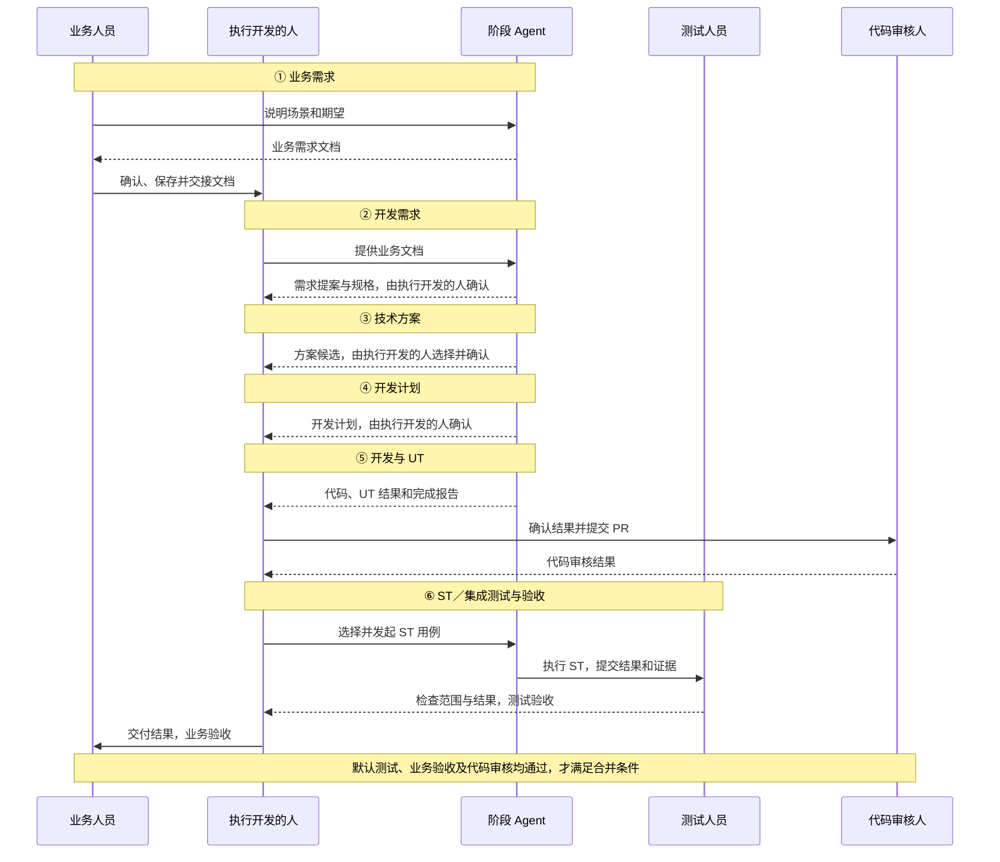

# Lander／Sailor 六阶段 Agent 研发协作方案

> 状态：讨论形成的目标方案，尚未实现或验收。现有 OMP Dev 只有需求、方案、计划、执行四个固定阶段；本文新增业务需求与门禁测试阶段，需要调整 Dev 现有阶段、交接和验收契约。

## 1. 目标与适用范围

业务人员通过与 Agent 对话，把口头需求整理为可交接的业务需求文档。开发接收文档后，依次完成开发需求、技术方案、开发计划和代码开发；最后执行 ST／集成测试，由测试人员和业务人员分别验收。需求大小不改变六阶段流程；小需求可由业务人员自行判断，并借助 Agent 完成开发、提交 PR。

本流程以满足 PR 合并条件为终点，不设计部署、发布和上线运维流程。业务人员不承担知识库日常整理，也不需要了解固定文档模板、编写技术方案或指定 ST 用例。

### 角色

| 角色 | 责任 |
| --- | --- |
| 业务人员 | 与业务 Agent 对话，确认业务需求和业务验收结果；通过人员约定的方式保存、交接业务需求文档。小需求可自行承担执行开发人的职责。 |
| 执行开发的人 | 普通需求由开发人员承担，小需求可由业务人员承担；确认开发需求、方案、计划和开发结果，借助 Agent 选择并发起 ST，按权限提交 PR。 |
| 开发人员／代码审核人 | 对 PR 进行代码审核；业务自助开发不免除合并前的开发人员审核。 |
| 测试人员 | 在最终阶段检查 ST 范围、实际结果和证据，给出测试验收结论；不足时要求补充，不要求事先逐条批准 ST 用例。 |
| 业务、需求、方案、计划、执行、测试 Agent | 各自完成对应阶段的调查、编写、实施或验证工作；Agent 不代替人员作业务确认、测试验收和风险豁免。 |
| Dev 程序 | 管理阶段和已确认的交接材料，检查正式文档存在、格式和适用的必要字段；检查通过不等于业务正确或软件通过验证。 |
| 知识库维护人／资料负责人 | 研发团队负责资料组织、更新和权限；对应负责人确认 Agent 提议的知识更新，业务人员仅确认涉及自身业务的内容。 |

## 2. 六阶段泳道图

图中每一列是一条角色泳道，时间从上到下。阶段 Agent 按当前步骤分别承担业务、需求、方案、计划、执行或测试职责；业务人员自助开发时，同时承担“执行开发的人”的职责。



每次交接时，Dev 程序检查文档格式和必要字段；Agent 可按权限检索知识库。测试不足、审核不通过或业务不认可时，退回对应阶段修改并重新确认。ST 验收前可以提交 PR；代码随后改变时，须重新验证受影响部分。门禁失败、必需验证未执行或关键行为未覆盖时默认不放行；例外由有权负责人按组织规则批准并记录，不由 Agent 自行决定。例外不自动替代测试、业务和代码审核人员各自的确认，也不能将失败或未执行写为通过；哪些事项可例外及其对合并的影响，以组织现有权限和规定为准。

## 3. 阶段、交接与确认

每个阶段先由 Agent 形成或更新材料，程序检查适用格式和必要字段，再由对应人员确认后交接。Agent 对内容缺漏、矛盾和版本适用性提出提示；程序的结构检查不能证明内容真实或完整。

| 步骤 | 输入 | 人的工作 | Agent 的工作 | 文档与交接 |
| --- | --- | --- | --- | --- |
| ① 业务需求 | 实际问题、已有资料及业务对话 | 业务人员确认目标、场景、期望和业务验收预期；人员负责保存和跨团队交接 | 检索、询问缺失事实、整理业务文档并提示待确认项 | 新增业务需求文档；由人员交给接手方 |
| ② 开发需求 | 已确认的业务文档、相关代码及资料 | 执行开发的人确认需求；业务含义不清时请业务人员确认 | 澄清范围、系统行为、边界和可观察验收，编写需求提案与增量规格 | 既有 `proposal.md` 与 `spec.md`；交给方案阶段 |
| ③ 技术方案 | 已确认的开发需求、相关实现及约束 | 执行开发的人选择并确认方案 | 调查可行方案，记录实现思路、取舍、风险和验证方向 | 既有 `-solutions.json`；完整候选及所选方案交给计划阶段 |
| ④ 开发计划 | 已确认需求、完整候选和选定方案 | 执行开发的人确认实施范围和计划 | 分解任务、依赖、修改位置及验证安排 | 既有计划 Markdown；交给执行阶段 |
| ⑤ 开发与 UT | 已确认需求、方案和计划 | 执行开发的人确认结果，可提交 PR；代码审核人审查 PR | 实施代码、运行 UT、完成必要独立审查并记录真实结果 | 更新代码和既有完成报告；关联 PR 与后续测试 |
| ⑥ 门禁测试与验收 | 确定代码版本或 PR、需求、计划及可用测试环境 | 执行开发的人借助 Agent 选择并发起 ST；测试人员检查并验收；业务人员确认业务结果 | 测试 Agent 执行 ST／集成测试，整理覆盖范围、结果和限制 | 在既有完成报告中更新测试和验收证据；不另设新的测试文档格式 |

从后续阶段发现业务规则、需求、方案或计划有误时，退回对应阶段更新并重新确认。代码或相关材料变更后，核对各项确认和证据所对应的版本，标明不再适用的结果并重新执行受影响的验证；未受影响且仍适用的既有结果可保留。现有 Dev 的自动版本检查只覆盖正式材料，不自动检测业务代码或 PR 的变化；六阶段实现需明确如何识别变化并触发复验，未实现前由相关人员核对。实际退回权限和状态衔接需要在六阶段 Dev 实现中定义；现有四阶段 Dev 的 `back` 仅支持相邻阶段回退。

## 4. 每一步的文档格式

### 4.1 第①步：新增业务需求文档格式

**用途**：让业务人员确认“为什么需要、现在遇到什么、希望发生什么”，供开发理解业务，不要求业务人员设计软件或测试用例。

**格式**：Markdown；建议文件名 `business-requirements.md`。具体保存位置由双方依据项目权限与交接方式确定，不假定 Agent 自动完成跨团队保存或交接。

以下为本方案新增的格式定义，不代表现有 Dev 已支持该文档或自动校验。

```markdown
# 业务需求：<需求名称>

## 基本信息
- 涉及产品：Lander／Sailor／两者
- 项目、电路或使用范围：<已知信息；未知时标注待确认>
- 产品版本与环境：<已知信息；未知时标注待确认>

## 业务背景与目标
<当前业务问题，以及希望解决什么问题>

## 实际使用场景与现状
<谁在什么场景下使用、现有输入、当前现象或处理方式>

## 期望结果
<业务人员希望发生什么；必要时说明哪些现有行为应保持不变>

## 业务规则与边界
<已确认的业务规则、适用条件和不适用情况>

## 典型例子
<输入或操作、当前现象、期望现象；敏感路径或数据按授权处理>

## 业务验收预期
<业务人员怎样判断结果符合预期>

## 待确认事项
<列出问题、负责人及影响；确无待确认事项时写“无”>

## 资料来源
<资料名称、版本、位置及与本需求的关系；来自对话的事实注明由业务人员确认>

## 业务确认与交接
- 确认人及确认时间：<实际确认后填写>
- 交接人、接收人及时间：<实际交接后填写>
- 文档版本或可追溯标识：<实际标识>
```

**交接规则**：业务目标、实际场景、期望结果和业务验收预期须经业务人员确认。项目版本、环境等暂未知的内容可明确标为待确认；影响理解或验收的关键问题不能以空字段或猜测代替答案。程序检查格式与必要字段，Agent 提示内容缺口，业务人员确认业务事实。

### 4.2 第②步：开发需求文档

**用途**：把业务目标转换为系统必须具备的、可观察和可验证的行为，明确范围、边界和验收；不决定具体实现。

**保持现有格式**：

- `openspec/changes/<change-id>/proposal.md`：使用现有 `omp-spec` 的 Proposal 格式，包括 `# Proposal`、`## Why`、`## What Changes`、`## Capabilities`（新建及修改能力）和 `## Impact`。
- `openspec/changes/<change-id>/specs/<capability>/spec.md`：使用现有 OpenSpec 增量规格格式，按实际变更使用 `## ADDED Requirements`、`## MODIFIED Requirements` 等；需求使用 `### Requirement:`，正文须包含独立的 `SHALL` 或 `MUST`，可观察场景使用 `#### Scenario:` 及 `WHEN`／`THEN`。新增能力时包含 `## Purpose` 和至少 50 字符的有意义说明；修改已有能力时不复制已有主规格的 Purpose。
- 若项目已有明确的 Markdown 需求权威，继续原位维护；不因业务文档或增量规格建立第二套竞争性主规格。

```markdown
# Spec Delta

## ADDED Requirements

### Requirement: <系统应具备的行为>
系统 MUST <适用范围、条件和可观察行为>

#### Scenario: <场景名称>
- **WHEN** <条件或操作>
- **THEN** <可观察结果>
```

示例仅展示已有能力的增量规格结构；新增能力还须按模板添加 `## Purpose`。实际 Proposal 和规格须遵循现有模板及原生严格校验。

### 4.3 第③步：技术方案文档

**用途**：回答在已确认需求下怎样实现、有哪些选择及取舍，不替代需求，也不展开逐项开发计划。

**保持现有格式**：`docs/superpowers/plans/YYYY-MM-DD-<change-id>-solutions.json`，真实 JSON；`candidates` 非空，每项 `id`、`title`、`content` 均为非空字符串，ID 唯一且不含空白；`recommendedCandidateId` 指向其中一个 ID。`content` 为完整方案 Markdown。至少一个合理候选即可，不强制凑多个。

```json
{
  "candidates": [
    {
      "id": "candidate-a",
      "title": "方案名称",
      "content": "## 实现思路\n说明方案。\n\n## 取舍与风险\n说明适用性及风险。\n\n## 验证方向\n说明验证方向。"
    }
  ],
  "recommendedCandidateId": "candidate-a"
}
```

推荐及理由写入正式材料；具体内容按变更复杂度说明，以上小标题仅为示意，不新增固定栏目门禁。执行开发的人选择方案后，完整候选和选择决定交给计划阶段。

### 4.4 第④步：开发计划文档

**用途**：将确认的需求和选定方案拆成执行者可操作的任务、依赖、修改位置和验证安排；计划确认不代表代码已经实施。

**保持现有格式**：`docs/superpowers/plans/YYYY-MM-DD-<change-id>.md`，沿用现有 Superpowers `writing-plans` 格式，包括计划标题、Goal、Architecture、Tech Stack、Spec、Global Constraints、Review Focus 和带复选框的任务步骤。实际任务记录文件位置、接口和验证步骤；不新增另一套计划 JSON 或自制栏目门禁。示意如下：

```markdown
# <Feature Name> Implementation Plan

> **For agentic workers:** REQUIRED SUB-SKILL: Use superpowers:subagent-driven-development (recommended) or superpowers:executing-plans to implement this plan task-by-task. Steps use checkbox (`- [ ]`) syntax for tracking.

**Goal:** <目标>
**Architecture:** <选定方案摘要>
**Tech Stack:** <技术栈>
**Spec:** <已确认规格路径>

## Global Constraints
<适用约束>

## Review Focus
<需关注的输入或失败模式及相关验证>

### Task 1: <任务名称>
**Files:** <实际需修改和验证的位置>
**Interfaces:** <输入与输出>
- [ ] <实施步骤及可检查结果>
- [ ] <UT 验证步骤>
```

阶段职责和执行授权以 Dev 及项目规则为准；上游计划格式中的技能说明不自动扩大授权，也不意味着必须提交代码。

### 4.5 第⑤步：开发完成报告

**用途**：记录本次实际完成的代码变更、UT、审查和未完成事项，供执行开发的人确认，并交给门禁测试阶段。

**保持现有格式**：`docs/superpowers/plans/YYYY-MM-DD-<change-id>-completion.md`。标题必须为 `# 完成报告`，且 `## 完成情况`、`## 验证结果`、`## 未完成项` 非空；确实没有未完成项时写“无”。记录实际命令、结果、审查与复审状态，以及失败、未运行和限制，不能把未执行的验证写成通过。

```markdown
# 完成报告

## 完成情况
<实际代码变更、相关需求、代码版本或 PR，以及审查状态>

## 验证结果
<实际 UT 命令、结果与证据；失败或未执行时说明原因和影响>

## 未完成项
<未完成事项、未解决的审查意见、未验证内容及影响；确无则写“无”>
```

此阶段完成报告交付后，ST 尚未执行时不能写成 ST 通过；实际状态需如实说明。是否可进入下一阶段由六阶段 Dev 的新交接规则管理。

### 4.6 第⑥步：门禁测试与验收记录

**用途**：在既有完成报告中补充 ST／集成测试和人员验收证据，不引入新的测试文档格式或改变完成报告的现有标题与章节格式。

**记录位置**：继续使用第⑤步同一份 `-completion.md`，在既有 `完成情况`、`验证结果` 和 `未完成项` 章节中按实际情况记录：

- 需求和 PR 标识，以及每轮实际验证的提交 SHA 或等价不可变代码版本；所用电路、工具／EDA 版本、配置和执行环境。
- 执行开发的人借助 Agent 选择并发起的 ST 用例、选择依据、覆盖的功能和边界；测试 Agent 实际执行的命令、结果及可访问证据。
- 测试人员对用例范围、执行结果及证据的检查与验收结论；业务人员对业务预期的确认结论；PR 代码审核状态及各项结论所对应的代码版本。
- 失败、未运行、未覆盖的范围和原因；有权负责人对例外的实际批准及依据。未发生的确认和批准不能预填为通过。

需求未指定 ST 用例时，执行开发的人可借助 Agent 根据变更与现有测试自主选择，不需要测试人员预先批准；测试人员在最终阶段检查验收。测试 Agent 无可用环境、许可证、测试电路或执行授权时，必须记录阻塞，不得虚构运行结果。

## 5. 六阶段文档的区别

| 阶段文档 | 回答的问题 | 面向读者／确认人 | 内容边界 |
| --- | --- | --- | --- |
| 业务需求文档 | 业务为什么需要、真实场景和期望是什么？ | 业务人员、接手的开发人员；业务人员确认 | 业务事实与验收预期；不要求实现设计或 ST 用例 |
| 开发需求提案与增量规格 | 系统必须表现出什么行为，怎样判断符合要求？ | 执行开发的人及后续 Agent；执行开发的人确认 | 范围、规则、边界及可观察验收；不预先确定实现细节 |
| 技术方案 JSON | 用什么方式实现，为什么选择该方式？ | 执行开发的人；其选择方案 | 技术方向、取舍、风险和验证方向；不是任务清单 |
| 开发计划 Markdown | 谁或哪个任务按什么依赖实施、修改和验证？ | 执行开发的人、执行 Agent；执行开发的人确认 | 实施任务和验证安排；不是实际完成记录 |
| 完成报告：开发部分 | 实际实现了什么，UT 和审查结果是什么？ | 执行开发的人、审核人、测试人员 | 已发生的代码变更、UT 和审查；不能预报 ST 通过 |
| 完成报告：门禁与验收部分 | 对哪个版本运行了什么 ST，覆盖与结果如何，谁验收？ | 测试人员、业务人员、PR 审核人 | 对同一完成报告追加实际 ST 和验收证据；不建立新格式 |

小需求可以让每份内容更简洁，但不能以一个文档替代其他阶段的既有正式产物，也不能省略确认和验收。

## 6. 知识库与交接规则

1. 优先复用 OMP 的 Wiki、Repo 索引和检索能力，接入获授权的业务资料、版本手册、质量案例、项目代码和测试资料；不假定已有索引覆盖当前 Lander／Sailor 项目。
2. Agent 区分历史案例、版本手册、当前项目配置及实际代码；标注关键依据的来源和适用版本。资料冲突或版本不明时列为待确认，不把推测写成既定业务规则。
3. 已有资料能回答的事实优先由 Agent 检索；只有需要业务判断或资料不能确定的业务事项才交由业务人员确认。涉及项目、网表和测试数据时遵循现有访问权限。
4. 验收后 Agent 可提取值得复用的业务和研发知识，提出更新建议。业务规则由相应业务负责人确认，研发知识由研发负责人确认；研发团队负责知识库维护。不自动把全部聊天或草稿变成权威知识。
5. 业务文档由人员按约定保存和交接；接手人将已确认文档提供给 Dev 需求阶段。后续阶段沿用既有正式材料和确认机制；测试证据与 PR 及实际被测代码版本关联。

## 7. Lander 小特性示例：MBIST 缺失路径时给出明确错误

### 7.1 示例来源与边界

现有历史资料曾提出：运行 MBIST 相关流程时，如果没有定义 SMS 和 HiBIST outgoing path，增加报错，避免难以定位问题。来源：资料包 `07_Lander与HiBIST平台_后仿与X态.md`，约第 102330–102334 行，原资料为当时的版本需求列表。

**下面是教学示例，不代表当前 Lander 已有或缺少此功能，也不代表已经执行、通过或部署。**历史使用资料称 SYN SUB-MBIST 阶段可只定义 `SMS_OUTGOING_PATH/HIBIST_OUTGOING_PATH`，并注明 HiBIST 1.1.0 以上版本使用后者；不同资料的变量名称和版本范围不同，不能把 SMS 与 HiBIST 名称直接视为两个必须同时提供的独立输入。为说明六步交接，本例假设业务确认某 MBIST 场景需要一份有效的 MBIST outgoing 路径，缺失时在后续处理前明确报错；具体名称、路径来源、版本和依赖须结合目标项目核实。

### 7.2 ① 业务需求文档示例

以下为按第 4.1 节格式填写的示意内容；确认、版本与交接信息均待真实发生后填写。

```markdown
# 业务需求：MBIST 输入路径缺失时明确提示

## 基本信息
- 涉及产品：Lander
- 项目、电路或使用范围：需要 MBIST outgoing 数据的场景
- 产品版本与环境：待实际项目确认

## 业务背景与目标
业务人员运行 MBIST 相关流程时，缺少必要输入路径后难以定位问题。希望尽早知道缺少哪项输入，减少排查时间。

## 实际使用场景与现状
业务人员配置并运行需要 MBIST outgoing 数据的场景。历史需求资料记录了路径未定义时需要改进报错；当前版本的实际现象待核实。

## 期望结果
缺少该场景必需的有效 MBIST outgoing 路径时，在后续处理前明确提示缺少该输入；路径有效的既有场景保持原有行为。

## 业务规则与边界
该规则仅适用于确实依赖该输入的场景；适用的路径名称、来源及场景依赖需结合目标版本和项目配置确认。

## 典型例子
- 该场景必需的 MBIST outgoing 路径没有任何有效定义：提示缺少该输入。
- 通过目标版本支持的来源提供有效路径：不因本需求新增缺失输入错误。

## 业务验收预期
业务人员能从实际结果判断缺少必要的 MBIST outgoing 路径；正常配置的流程行为不因新增检查改变。

## 待确认事项
- 当前 Lander 及 HiBIST 版本、实际入口、路径名称及来源、各场景的输入依赖关系。
- 用于验收的可用 MBIST 测试环境和电路。

## 资料来源
历史 Lander 版本需求列表：MBIST 相关流程未定义 SMS 和 HiBIST outgoing path 时增加报错；适用当前项目的规则以业务和代码调查为准。

## 业务确认与交接
- 确认人及确认时间：待实际确认
- 交接人、接收人及时间：待实际交接
- 文档版本或可追溯标识：待实际确定
```

业务人员确认业务目标和预期；对具体版本、入口或技术依赖不作未经核实的断言。人员保存并交接文档，接手人提供给需求 Agent。

### 7.3 ② 开发需求：可观察行为

需求 Agent 读取业务文档，调查当前代码、配置及已有规格；以下是假设该能力已存在、并确认业务规则后可形成的**增量规格示意**：

```markdown
# Spec Delta

## ADDED Requirements

### Requirement: MBIST 必需 outgoing 输入缺失时明确报错
对于当前运行场景确实依赖的 MBIST outgoing 路径，系统 MUST 在后续处理前识别有效路径缺失，并向调用者报告缺少该输入。

#### Scenario: 缺少必需的 MBIST outgoing 路径
- **WHEN** 当前 MBIST 场景依赖该路径，且目标版本支持的各输入来源均未提供有效路径
- **THEN** 流程报告缺少 MBIST outgoing 路径，不继续依赖该输入的后续处理

#### Scenario: 必需路径已提供
- **WHEN** 当前 MBIST 场景所需的 MBIST outgoing 路径由目标版本支持的来源提供
- **THEN** 不因本需求的缺失输入检查拒绝该场景
```

配套 `proposal.md` 按既有模板描述原因、变更、受影响能力和影响；应根据已有规格选择适当的增量类型，不机械地使用 `ADDED`。若调查后确认是新增能力，还须补充符合模板要求的 Purpose。执行开发的人确认需求；规则冲突或业务含义不清时退回业务人员。

### 7.4 ③ 技术方案：候选示意

```json
{
  "candidates": [
    {
      "id": "validate-required-inputs",
      "title": "在适用场景入口检查必需输入",
      "content": "## 思路\n在实际确认的 MBIST 场景入口，基于该场景对输入的真实依赖，按目标版本支持的来源解析有效 outgoing 路径；缺失时沿用项目现有错误输出方式，指出缺少的输入。\n\n## 适用性与取舍\n在消费输入之前给出可定位错误；不对无需该输入的场景强加限制。具体入口、路径来源和错误接口须以代码调查为准。\n\n## 风险与验证方向\n核对有效路径缺失、通过受支持来源提供路径及不依赖该输入的场景，避免将配置项缺失误判为有效输入缺失。\n\n## 推荐理由\n满足已确认的错误提示目标，同时保留现有正常场景。"
    }
  ],
  "recommendedCandidateId": "validate-required-inputs"
}
```

这是方案示意，不声称已确认当前代码中存在某个入口或错误 API。执行开发的人选择方案后，将完整方案和确认决定交给计划 Agent。

### 7.5 ④ 开发计划：任务示意

计划文件保持第 4.4 节既有格式。该例的核心任务可写为：

1. 调查真实 MBIST 入口、目标版本支持的路径名称与来源、场景输入依赖、现有错误输出接口与测试位置，记录精确文件和接口；与业务确认不明确的场景规则。
2. 按项目现有 UT 方式覆盖有效路径缺失、通过支持的来源提供路径及不依赖该输入的场景，并在确认的入口实施检查。
3. 运行相关 UT，完成独立审查，记录真实命令、结果、未完成项和代码版本。
4. 安排第⑥步 ST：由执行开发的人借助 Agent 根据实际用例与环境选择并发起；测试 Agent 实际执行，测试人员最终检查验收。

以上是计划内容示意，不是已执行任务；真实计划须补齐现有 `writing-plans` 所要求的头部、任务及具体文件位置。

### 7.6 ⑤ 开发与 UT：完成报告的开发部分

执行 Agent 在确认的计划范围内实施，并运行实际 UT。执行开发的人检查代码和报告，按权限提交 PR；开发人员随后进行代码审核。

```markdown
# 完成报告

## 完成情况
示例阶段状态：待实施。实际完成后填写代码变更、对应需求、代码版本或 PR，以及独立审查和复审情况。

## 验证结果
UT：待实际运行，记录命令、结果和证据。
ST／集成测试：尚未执行，进入第六阶段后更新。

## 未完成项
待实施、UT 和 ST 均尚未完成；实际情况发生后更新。
```

上述文字只是示意如何如实记录状态，不是运行报告，也不是测试通过证据。

### 7.7 ⑥ ST／集成测试与验收

执行开发的人借助 Agent 根据实际变更和现有用例选择并发起 ST；测试 Agent 在获授权的环境运行。先核对目标版本、模块和场景支持的路径来源及其生效规则；缺失用例应确保相关有效来源均未提供路径，不能只删除配置字段而忽略环境变量。具体来源及优先级以实际实现为准。可选择能覆盖目标行为的最小 MBIST 测试电路或现有场景，依据真实场景依赖评估：

| 示例场景 | 要检查的行为 | 状态 |
| --- | --- | --- |
| 场景需要 MBIST outgoing，且所有有效来源均未提供路径 | 实际流程提示缺少该输入，并阻止依赖该输入的后续处理 | 待执行 |
| 从目标版本支持的配置或环境来源提供有效路径 | 不因新检查误报缺失；继续核对该场景原有行为 | 待执行 |
| 场景不依赖该输入 | 不因未提供非必需输入而被误拦截 | 待执行 |

测试 Agent 将实际被测的提交 SHA 或等价不可变代码版本、PR、测试电路、工具版本、实际命令、结果和证据写入既有完成报告。测试人员检查用例范围和结果，业务人员确认错误提示是否满足业务预期；PR 代码审核通过后，才满足默认合并条件。测试不足或失败时退回补充；环境或许可证不可用时如实记录未验证，不将未运行的测试或尚未作出的验收结论写成通过。

## 8. 与现有 Dev 的差异及实现边界

- 现有 Dev 为需求、方案、计划、执行四阶段；正式材料路径及格式见第 4 节。业务需求和独立 ST／集成测试验收阶段是本方案新增要求，不是现有功能的配置开关。
- 六阶段实现需要新增业务文档格式检查及其确认、交接，扩展阶段状态、阶段权限、确认和回退，并让第⑥步可以读取相关资料、运行获授权的测试并更新原完成报告。具体命令、交互与持久化设计尚未确定。
- 现有 Dev 的执行阶段要求实施、测试与独立审查；六阶段方案明确把开发 UT 放在第⑤步，把 ST／集成测试放在第⑥步。现有执行阶段的 `/dev next` 是最终验收并触发需求同步、校验和归档；⑤→⑥须设计为新的阶段交接，不能原样沿用这一最终验收语义。第⑥步测试和更新完成报告的权限、最终验收和归档触发方式均须适配，不能声称已经支持。
  方案阶段现有的历史来源核验及 Team 候选约束也须保留或明确调整；方案 JSON 格式合格不代表一定满足推进条件。
- 本方案不自动授权提交、推送、合并或发布。业务自助用户可在已有权限下提交 PR；业务、测试和代码审核结论及例外批准须有实际可追溯记录。

## 9. 依据

- OMP 已批准规格：`openspec/specs/spec-driven-orchestration/spec.md`，特别是四阶段职责、正式产物、方案 JSON、完成报告与阶段确认规则。
- 现有模板：`packages/coding-agent/src/spec-driven/vendor/resources/openspec/schemas/omp-spec/templates/proposal.md`、`templates/spec.md`；现有计划格式参见包内 `superpowers/skills/writing-plans/SKILL.md`。
- 业务历史资料：资料包 `07_Lander与HiBIST平台_后仿与X态.md` 第 102330–102334 行为历史需求，第 17240–17247 行说明部分版本的路径名称，第 1333–1336 行说明某些配置项可由环境变量提供；资料涉及历史版本，具体功能和现网状态须以当前项目核实为准。
