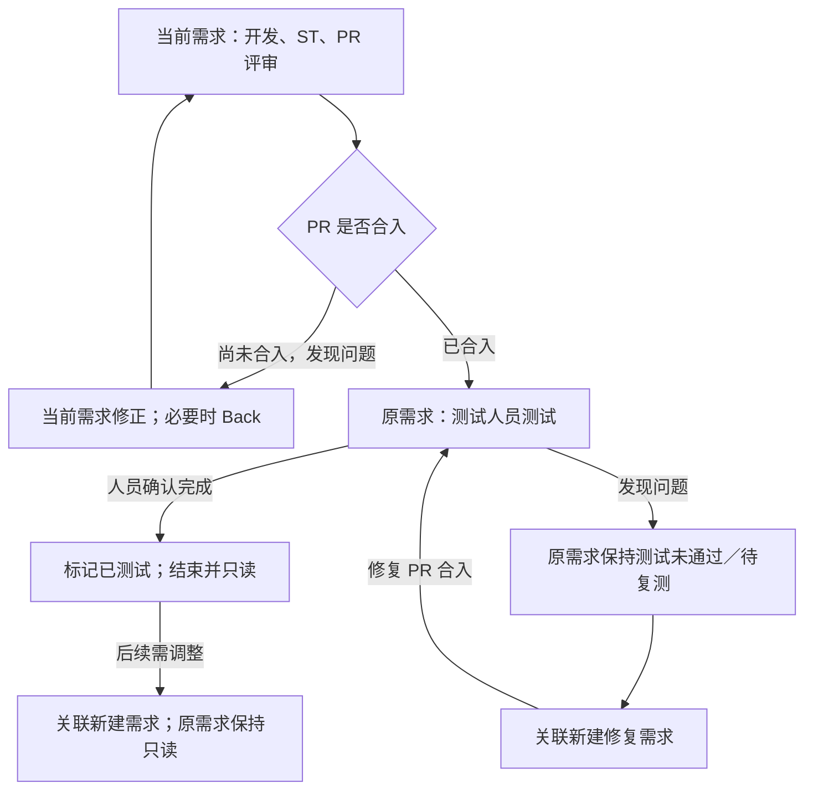

# Lander／Sailor 八阶段浏览器研发协作方案

> 状态：本文说明已实施的 [replace-dev-tui-with-browser-workbench](../openspec/changes/replace-dev-tui-with-browser-workbench/proposal.md) 八阶段流程。Win32 x64／Bun 1.4.4 下，参考布局与默认深色已实际浏览器观察，八阶段、原生输入、普通 OMP 隔离及源码／npm CLI／独立二进制已完成定向验证；具体证据与未验证边界见[开发计划账本](../docs/superpowers/plans/2026-11-07-replace-dev-tui-with-browser-workbench.md#actual-evidence-ledger--2026-11-07-handoff)。模型与 Forge 使用隔离本地夹具，不代表真实外部服务、真实桌面 opener 或其他平台已验收。Dev 专属 TUI 一次性退役，保留并复用现有 Agent 和底层能力；只考虑新建需求，不兼容、迁移或恢复旧 Dev 模式。文件名保留不变，避免破坏既有引用。

## 1. 目标与适用范围

面向 Lander／Sailor 等芯片研发工具，在浏览器中完成业务需求、开发需求、技术方案、开发计划、开发与 UT、ST测试、提交与 PR、测试人员测试八个阶段。业务、开发、测试是人员职责，不是八个独立 Agent；复用现有业务、需求、方案、计划、执行 Agent 及原生会话、模型、工具、材料检查和确认能力。

**Dev 是单独功能模块，不得影响 OMP 正常功能。** 普通 OMP 启动、会话及命令不隐式启动 Dev 服务、任务或持久状态；显式 `/dev`／`omp dev` 只启动工作台，任务和业务状态修改还须对应明确操作。Dev 会话、临时模型／主题设置、工具限制、锁和生命周期不串入普通聊天或无关工作，停止／取消只处理自有资源。公共层仅保留必要且默认关闭的 Dev 接口，Collab 网页适配优先复用普通接口；普通 TUI、命令、模型、Team／Goal和 Collab 保持原默认语义及配置作用域。不新增网页全局 Team／模型角色配置入口，继续既有配置方式，不另建角色权限或重复配置系统；已证实的 Provider／MCP 生命周期和安全 Git 边界保留。这是必须验收的边界，不是已通过验证的结论。

所有新建开发需求都先经过业务文档检查。文档可以通过业务 Agent 对话生成，也可以上传已有 Markdown 或提供 OMP 所在机器的本地文件路径。已有文档可直接点击 **Next**，程序按现有模板检查标题、必要章节及非空内容，不要求先对话，不增加 AI 内容审核。只支持 Markdown，不支持 Word／PDF 转换或 HTTP／HTTPS 文档地址。

业务人员不开发时，只借助 AI 在自己的本地生成、查看和下载业务文档，不提交仓库，不建立团队交付、接收或“仅业务交付完成”状态。文档通过其他方式传给开发人员；开发人员在自己的目录另建需求并导入，仍须经过第一阶段检查，不要求共享或恢复原业务会话。

第一至第五阶段由人员通过 Next／Back 控制，沿用适用的材料格式和确认机制。**最后三个阶段由人点击标记是否完成，AI 只提供辅助**：ST 由开发人员负责，PR 合入后另由测试人员按自己的方法测试，不能把二者合为一次验收。标记“已测试”后需求结束并只读；合入后的修复或调整新建关联需求。

业务人员不承担知识库日常维护，不需要调查代码或指定 ST 用例；开发人员负责开发、ST 和 PR，代码审核人按项目规则评审；测试人员负责合入后的独立测试。知识库资料由研发团队及相应负责人维护。本方案不设计部署、发布或上线运维。

## 2. 浏览器入口与会话协作

- 启动 OMP 后输入 **`/dev`** 进入 Dev 并打开浏览器，或在目标目录直接运行 **`omp dev`**；终端输出完整可复制地址。普通任务未结清或 Loop 尚未退出时拒绝进入，提示先停止、等待或退出 Loop；普通 Collab 正在共享或处于 `join` 会话时，须先自行停止共享或离开该会话。`/dev` 不自动停止普通任务、退出 Loop、停止共享或离开 Collab。进入后当前 TUI 不接受任何普通命令或输入，**只允许再次 `/dev` 退出**，网页与普通 TUI 不同时操作；单纯重开网页不重复创建需求。无法自动打开浏览器时说明原因并保留实际可用地址。
- 非 offline 服务只监听 `127.0.0.1` 的实际分配端口；offline 服务监听 `0.0.0.0`，输出本机 loopback 和真实网卡／主机名的完整 `http://<host>:<port>/<capability>/` 地址。多个地址逐一列出，不保证每个地址都能穿过防火墙；服务失败与仅浏览器打开失败分别报告。不要把带 capability 的入口当作公开认证系统或随意转发。
- 自动打开只使用本机 loopback 地址；打印的内网地址供其他参与者访问。显式无桌面验收可设置 `OMP_DEV_NO_OPEN=1` 跳过 opener，不把跳过报告为已打开浏览器。
- 网页参考已批准的 `runs/dev-workbench-demo/index.html` 与用户参考图的信息层级和四区布局，不要求逐像素复制：左侧需求列表、中央材料上方的阶段状态、中央只读材料、右侧共享 AI 会话，输入框固定在右侧会话底部。**Dev 默认深色**，不改普通 OMP 的主题默认值。已发现且可读的材料在批准前也可查看；点击阶段只查看材料，不构成批准或改变流程。修改通过会话完成，不新增网页文档编辑器。上传读取浏览器使用者选择的文件，输入路径读取 OMP 宿主机器文件；下载用于保存和传递实际 Markdown。
- 只显示当前进行阶段适用的必要流程控制、人工标记和材料操作，确认与结果按明确操作就近呈现，不同时铺开所有阶段动作；查看别的阶段不改变操作授权。不提供原生命令下拉框、JSON 参数表单、JSON 状态／调试面板或内部 hash 控制台。方案正式文件仍用既有 JSON 格式，中央以可读候选和正文呈现，不把数据结构变成页面主界面。
- 右侧底部输入框支持现有内置斜杠命令和技能，复用既有 Composer、发现／调用及原生会话处理，不另建命令、聊天、配置或权限系统；仍受既有权限、阶段范围和人员确认约束。
- 未选择需求时显示引导“新建需求”的空状态，不默认进入本地业务写作，不自动建需求或启动 Agent；只有用户明确选择才进入本地业务写作。未选择目标且未加入真实共享会话时，输入框不可发送；打开页面与加入会话仍是独立操作。
- 进入 Dev 后，网页聊天接入现有 **offline Collab** 的共享及 `join` 机制，多人参与同一个 Agent 会话，主要用于第一阶段共同澄清；这不改变进入前普通 Collab 须先停止共享或离开的要求。不按角色另开聊天，不新增协作服务、跨阶段跟随或自动换 Agent；打开网页不等于加入 Collab。
- 不新增角色权限系统。offline 参与者具有全部工作台操作权限，但不能绕过原生 deny、restrictedFolders、工具白名单、阶段写入范围和人员确认；非 offline 沿用现有邀请、view／write 及命令安全边界，不把 offline 权限扩展过去。用户名用于既有路由和署名，不声称认证身份；模型和工具仍在原会话宿主执行。
- 关闭、刷新网页或浏览器断线不停止已确认的后台任务，OMP 宿主进程仍需存活。重连恢复真实显示，不重放输入、工具或确认；宿主退出、任务失败或状态不可用必须如实呈现。
- 再次 `/dev` 退出时通过既有 native stop／settlement 停止并结清 Dev 自有工作，成功后恢复普通原会话；结清失败不得提前恢复普通输入。退出不取消需求、不回滚 Git、不删除材料。关闭网页不是退出，当前 TUI 仍保持 Dev 锁定；不为普通 `/new`、工作目录变更或 dispose 与 Dev 并存保留会话快照、克隆或额外架构。
- 开发、测试人员也可以手动 `git pull` 后在自己的目录运行 `omp dev`，查看已提交的新需求记录。Git 不同步聊天、Collab 连接或任务运行态，不因此接管另一机器的 Agent。
- offline 网页通过同源 HTTP／WS 访问 OMP 宿主，由原生 Collab transport 完成既有 Relay lookup、加解密和房间接入；远端浏览器不依赖 `crypto.subtle` 或 `crypto.randomUUID`，不另起 Relay、不抢占房主原生 guest 状态。独立 collab-web GuestClient 的 secure-context／远端 WSS 限制仍保留，不能套用到此 native transport，也不能以此放宽非 offline 安全边界。
- 输入和附件仅在宿主明确 accepted 后消费；原生 guest prompt 无准入回执时显示 unknown，保留草稿，不把发送到 transport 等同宿主已接收，也不自动重发。断线恢复只查询事实。
- UI 随源码准备、npm bundle 和独立二进制使用同一内容寻址载荷，不要求另起前端 dev server、远端 CDN 或同级前端 checkout。源码准备使用 `bun run gen:dev-workbench`；缺失载荷应明确报准备失败，不在 HTTP 请求时编译或显示演示页。npm／binary 是否完整内嵌，仍须用本次真实产物单独验收。

## 3. 阶段、交接与确认

| 阶段 | 主要工作及材料 | 人员操作与结果 |
| --- | --- | --- |
| ① 业务需求 | 业务 Agent 对话生成，或导入已有 Markdown；按第 4.1 节模板检查 | Next 确认材料并进入开发需求；无 Back；导入文档不要求对话 |
| ② 开发需求 | 需求 Agent 结合业务文档和现有系统生成 proposal／增量规格 | Back 返回业务需求；Next 确认开发需求 |
| ③ 技术方案 | 方案 Agent 展示完整候选、推荐理由；保留原有 Team 能力 | 通过会话选择候选，Next 确认；只有一个候选时无需额外选择；Back 返回开发需求 |
| ④ 开发计划 | 计划 Agent 沿用既有计划 Markdown | Next 批准计划并进入开发与 UT；Back 返回技术方案 |
| ⑤ 开发与 UT | 执行 Agent 实施、运行 UT、完成必要独立审查并形成完成报告 | Next 确认报告进入 ST，不最终交付、不同步归档；Back 返回开发计划 |
| ⑥ ST测试 | 开发人员选择、执行 ST，AI 辅助并整理实际结果 | 人员点击“标记 ST 完成”进入提交与 PR；Back 返回开发与 UT |
| ⑦ 提交与 PR | 会话辅助提交、创建 PR、处理评审及查看状态；提交 PR 前由人确认需求同步归档 | 人员标记“PR 已提交”后为“已开发”；标记“PR 已合入”后进入测试人员测试；合入前可回退 |
| ⑧ 测试人员测试 | PR 合入后，测试人员按自己的方法测试，AI 辅助；最多更新本需求状态记录 | 人员点击“标记已测试”后结束并只读；不回退已合入代码，不再同步归档或修改其他仓库文件 |

### 3.1 材料确认与人工标记

前五阶段沿用真实材料、格式、必要字段、批准版本及工作结清检查；程序检查不证明内容真实或软件正确。正常澄清、查看材料、普通“同意”和 AI 回复都不自动推进。方案选择不授权实施，计划确认也不隐含 Git 提交、推送、合并或发布。

最后三个阶段不增加“所有必需 ST 必须通过”或 AI 审核的程序放行门禁。人员根据真实结果判断是否完成，失败、未执行及限制照实保留；**“ST 完成”不等于“ST 全部通过”**，PR 查询或 CI 结果也不自动产生人员标记。

每次人工状态标记在同次确认中包含相应 **Git 提交和推送**，展示需求编号、状态变化、文件范围和目标，不要求标记后另行发起提交。只处理本次确认的需求变更；保存、提交或推送失败分别显示实际结果。提交成功但推送失败时保留提交，人员重试只继续未完成推送，不重复提交或推进。最终“已测试”状态也通过本次确认提交和推送，不能因只读而漏存。

确认先由宿主按真实材料和记录字节版本生成 operationId 与一次性确认凭据，绑定需求、阶段、原生会话代际和范围；过期或重复确认不成为下一阶段批准。Git 预览列出实际既有 source／base／remote、目标 ref、观察到的远端 tip 和全部待发布 commit，不按 `origin/main` 等名称猜测。push 会发布祖先链，若带入本次未授权的其他需求提交则受阻，不自动建分支、force push 或直推 base 绕过 PR；源分支推送成功不代表已经合入目标主分支。响应丢失后查询 operation／Git 事实，不重放确认，不重做已成功 commit。

### 3.2 回退、合入与修复

Back 只相邻退回阶段，不执行 Git 回滚；保留文档、代码和历史，撤销相关阶段及下游确认，重新核对后再确认。未受影响且仍适用的材料和验证结果可以复用，不能因文件仍存在就视为重新通过。

PR 合入前，ST 或评审发现本需求范围内问题，在当前需求修正；需求、方案或计划变化时回退对应阶段。第⑦步已经同步归档不等于结束，不能单凭归档禁止合入前修正；材料调整后，在更新 PR 前处理必要的同步归档。未结清的部分收尾副作用必须先安全处理，失败不得伪报成功。



已完成需求后续发现问题时仍保持只读，通过新需求处理，不复活原执行流程。图中的“回原需求复测”针对尚未结束、处于测试未通过／待复测的原需求，修复合入本身不自动标记测试完成。

### 3.3 单点开发、Git 记录与删除

- 同一目录、同一既有分支串行开发，不创建 worktree 或每需求分支，不考虑并行开发。一个需求从开始处理到 PR 合入，或取消并完成所属改动撤销之前，都占用唯一开发名额；“已开发”及等待 PR 评审仍占用。
- 已合入需求的测试／待复测可以与后续开发并行，但只能更新自身状态记录，不修改其他仓库文件；状态提交不得夹带正在开发的其他需求内容。
- 每个开发需求使用稳定编号和独立的 `docs/dev-requirements/<requirementId>.json` 最小业务记录；正式材料仍在各自原路径，不复制正文。记录含阶段、人工标记及实际操作者、批准原文与字节版本、Git 提交、PR 和修复关联；文档可以先提交，代码可以分批提交，各次提交关联编号及实际 SHA。聊天、Team 全文、token、连接、忙碌／队列不入 Git；原生会话只保留引用，本地宿主恢复资料位于 `.omp/dev-workbench/`，不接管旧 `.omp/dev/state.json`。
- 左侧删除入口以 **PR 是否合入**为边界。未合入时，经确认取消相关 PR（如有），停止并结清自有工作，撤销本需求全部文档和代码改动，包括已提交、暂存和未暂存内容；已合入不能删除。
- 删除是撤销本需求改动，不抹除 Git／PR 历史。既有共享文件只撤销本需求修改，不删除原文件或外部导入源，不整体 reset 仓库、不强推抹除历史，不伤及无关或后续需求。归属不明、冲突或撤销未完成时明确处理，不假报删除成功或释放开发名额。

## 4. 每一步的文档格式

### 4.1 第①步：业务需求文档格式

**用途**：帮助懂业务、未必懂代码的人员，将原先通过口头澄清的需求整理为详细、可交接的业务需求文档。业务 Agent 通过业务知识检索和对话，写清业务背景、实际流程、规则与边界、典型例子、期望结果及业务验收预期，而不只是整理目标或聊天摘要；不要求业务人员提供代码位置、作代码层判断、设计软件或测试用例。

**访谈**：对话生成时，业务与需求 Agent 继续使用包内原版 `jch-grill-me`，分别围绕业务事实和开发边界工作，不修改技能原文。停止访谈保留未决事项，不等于确认或推进。**导入已有文档时不要求业务访谈**，可以直接点击 Next 进行程序格式检查；进入第二阶段后，需求 Agent 再调查内容和实现边界。

**格式与来源**：只支持 Markdown；本需求材料路径沿用 `docs/business-requirements/<change-id>.md`。支持上传文件或输入 OMP 所在机器的本地路径，不支持网络文档地址。导入内容纳入当前需求自己的记录，不授权改写或删除外部源文档；业务人员仅本地写作时不提交仓库。

**程序检查**：真实文件须存在、可读、有需求名称，且以下必要章节存在并非空。对话生成和导入文档都使用同一模板；检查失败停留第一阶段并显示具体缺项，不增加 AI 内容审核，不要求原业务人员在线或原会话批准，也不证明业务事实和实际交接已被核实。

```markdown
# 业务需求：<需求名称>

## 基本信息

- 涉及产品：Lander／Sailor／两者
- 项目、电路或使用范围：<已知信息；未知时标注待确认>
- 产品版本与环境：<已知信息；未知时标注待确认>

## 业务背景与目标

<当前业务问题，以及希望解决什么问题>

## 实际使用场景与现状

<谁在什么场景下使用、现有输入、当前现象或处理方式>

## 期望结果

<业务人员希望发生什么；必要时说明哪些现有行为应保持不变>

## 业务规则与边界

<已确认的业务规则、适用条件和不适用情况>

## 典型例子

<输入或操作、当前现象、期望现象；敏感路径或数据按授权处理>

## 业务验收预期

<业务人员怎样判断结果符合预期>

## 待确认事项

<列出问题、负责人及影响；确无待确认事项时写“无”>

## 资料来源

<资料名称、版本、位置及与本需求的关系；来自对话的事实注明由业务人员确认>

## 业务确认与交接

- 确认人及确认时间：<实际确认后填写>
- 交接人、接收人及时间：<实际交接后填写>
- 文档版本或可追溯标识：<实际标识>
```

**交接规则**：点击 Next 只检查当前业务文档、适用的材料版本和工作结清，不要求开发需求、方案、计划或完成报告提前存在；通过后保存本次确认，将完整文档交给需求阶段。对话生成的事实和确认信息按实际发生填写，未知内容明确标为待确认，不预填成功。业务人员只本地生成文档时自行保存、下载和传递，不建立正式“仅业务交付完成”状态；开发人员另建需求导入并检查。

### 4.2 第②步：开发需求文档

**用途**：接收第一阶段已通过格式检查并由当前操作人确认的业务文档，结合当前代码、测试、配置及既有规格，形成系统必须具备的可观察、可验证行为，明确范围、边界和验收，不提前决定实现。需求 Agent 继续使用原版 Grill-me，不对已确认且仍适用的内容从头访谈；发现业务歧义或冲突时再澄清。导入文档必须经过第 4.1 节检查，但不要求来自本机业务 Agent 或具有另一流程的批准。

**保持现有格式**：

- `openspec/changes/<change-id>/proposal.md`：使用现有 `omp-spec` 的 Proposal 格式，包括 `# Proposal`、`## Why`、`## What Changes`、`## Capabilities`（新建及修改能力）和 `## Impact`。
- `openspec/changes/<change-id>/specs/<capability>/spec.md`：使用现有 OpenSpec 增量规格格式，按实际变更使用 `## ADDED Requirements`、`## MODIFIED Requirements` 等；需求使用 `### Requirement:`，正文须包含独立的 `SHALL` 或 `MUST`，可观察场景使用 `#### Scenario:` 及 `WHEN`／`THEN`。新增能力时包含 `## Purpose` 和至少 50 字符的有意义说明；修改已有能力时不复制已有主规格的 Purpose。
- 若项目已有明确的 Markdown 需求权威，继续原位维护；不因业务文档或增量规格建立第二套竞争性主规格。

```markdown
# Spec Delta

## ADDED Requirements

### Requirement: <系统应具备的行为>

系统 MUST <适用范围、条件和可观察行为>

#### Scenario: <场景名称>

- **WHEN** <条件或操作>
- **THEN** <可观察结果>
```

示例仅展示已有能力的增量规格结构；新增能力还须按模板添加 `## Purpose`。实际 Proposal 和规格须遵循现有模板及原生严格校验。

### 4.3 第③步：技术方案文档

**用途**：回答在已确认需求下怎样实现、有哪些选择及取舍，不替代需求，也不展开逐项开发计划。

**保持现有格式**：`docs/superpowers/plans/YYYY-MM-DD-<change-id>-solutions.json`，真实 JSON；`candidates` 非空，每项 `id`、`title`、`content` 均为非空字符串，ID 唯一且不含空白；`recommendedCandidateId` 指向其中一个 ID。`content` 为完整方案 Markdown。至少一个合理候选即可，不强制凑多个。

```json
{
  "candidates": [
    {
      "id": "candidate-a",
      "title": "方案名称",
      "content": "## 实现思路\n说明方案。\n\n## 取舍与风险\n说明适用性及风险。\n\n## 验证方向\n说明验证方向。"
    }
  ],
  "recommendedCandidateId": "candidate-a"
}
```

推荐及理由写入正式材料；具体内容按复杂度说明，以上小标题仅为示意，不新增固定栏目门禁。网页展示完整候选及推荐，通过会话选择后点击 Next 确认；多候选须明确选择，只有一个候选时无需额外选择。完整候选和原始选择决定一起交给计划阶段。

来源不由方案 JSON 的自我声明证明：宿主先从真实原生单 Agent／Team 阶段历史及结果核对来源和候选可采用关系，再保存绑定方案实际字节 hash 的最小事实、候选 ID 及原生引用。历史可用时仍复核；历史缺失时，只能凭已确证且与当前材料版本一致的事实继续，不能复制聊天进 Git 或静默降级。Team 每个正式候选仍须对应本轮可采用候选并包含原始 proposal 原文；失败、取消或不可采用方向不能冒用。方案字节改变须重建来源证明，不能复用旧 hash 的证明。

### 4.4 第④步：开发计划文档

**用途**：将确认的需求和选定方案拆成执行者可操作的任务、依赖、修改位置和验证安排；计划确认不代表代码已经实施。

**保持现有格式**：`docs/superpowers/plans/YYYY-MM-DD-<change-id>.md`，沿用现有 Superpowers `writing-plans` 格式，包括计划标题、Goal、Architecture、Tech Stack、Spec、Global Constraints、Review Focus 和带复选框的任务步骤。实际任务记录文件位置、接口和验证步骤；不新增另一套计划 JSON 或自制栏目门禁。示意如下：

```markdown
# <Feature Name> Implementation Plan

> **For agentic workers:** REQUIRED SUB-SKILL: Use superpowers:subagent-driven-development (recommended) or superpowers:executing-plans to implement this plan task-by-task. Steps use checkbox (`- [ ]`) syntax for tracking.

**Goal:** <目标>
**Architecture:** <选定方案摘要>
**Tech Stack:** <技术栈>
**Spec:** <已确认规格路径>

## Global Constraints

<适用约束>

## Review Focus

<需关注的输入或失败模式及相关验证>

### Task 1: <任务名称>

**Files:** <实际需修改和验证的位置>
**Interfaces:** <输入与输出>

- [ ] <实施步骤及可检查结果>
- [ ] <UT 验证步骤>
```

阶段职责和执行授权以 Dev 及项目规则为准；上游计划格式中的技能说明不自动扩大授权，也不意味着必须提交代码。

### 4.5 第⑤步：开发完成报告

**用途**：记录本次实际完成的代码变更、UT、审查和未完成事项，供开发人员确认，并交给 ST测试阶段；本阶段不提交 PR 或执行最终同步归档。

**保持现有格式**：`docs/superpowers/plans/YYYY-MM-DD-<change-id>-completion.md`。标题必须为 `# 完成报告`，且 `## 完成情况`、`## 验证结果`、`## 未完成项` 非空；确实没有未完成项时写“无”。记录实际命令、结果、审查与复审状态，以及失败、未运行和限制，不能把未执行的验证写成通过。

```markdown
# 完成报告

## 完成情况

<实际代码变更、相关需求、代码版本或 PR，以及审查状态>

## 验证结果

<实际 UT 命令、结果与证据；失败或未执行时说明原因和影响>

## 未完成项

<未完成事项、未解决的审查意见、未验证内容及影响；确无则写“无”>
```

完成报告交付后，ST 尚未执行时不能写成 ST 通过。开发人员点击 Next，按既有报告结构及材料确认规则进入 ST，不结束需求，不同步归档。

### 4.6 第⑥步：ST测试记录

**用途与位置**：开发人员负责 ST，AI 按请求辅助选择、执行和记录；继续在第⑤步同一份 `-completion.md` 的既有章节中记录，不另建测试文档格式：

- 实际被测提交 SHA 或等价代码版本、需求编号、测试电路、工具／EDA 版本、配置和环境。
- 选择的 ST 用例及依据、覆盖范围、实际命令、结果和可访问证据。
- 失败、未运行、未覆盖的范围及原因；环境、许可证或授权不足时记录真实阻塞。
- 开发人员实际作出的完成决定，不预填测试人员结论，也不把第⑧步测试当作本阶段已经发生。

需求未指定 ST 用例时，开发人员可借助 AI 自行选择，不要求测试人员预先批准。是否完成由开发人员点击“标记 ST 完成”决定，并在同次确认中提交、推送相关记录；程序不以全部测试通过作为额外放行门禁，实际失败和限制仍如实保留。

第五步获批的开发报告版本与第六步合法追加后的 ST 报告版本分别记录；ST 追加不重写第五步批准原文，也不使无关上游批准自动失效。若修正的是开发结论或范围，则撤销旧报告本轮资格，按实际影响 Back／重新确认，不能以“ST 追加”为名绕过批准。

### 4.7 第⑦步：提交、PR 与同步归档记录

**用途**：记录本需求实际提交、PR、评审和合入情况；不建立另一个 PR 管理平台。文档可提前提交，代码可分批提交，各次提交信息及实际 SHA 都与需求关联。

提交 PR 前，由人员明确确认调用现有 OpenSpec 能力同步需求、校验并归档；需求材料按真实归档位置读取，方案、计划和报告沿用原位置，相关文档随代码提交。同步归档失败如实保留实际进度，不补造成功或重复已完成副作用。

已归档后仍用实际归档目录维护和读取同一材料，不重建活动 change、不重复 archive。合入前获准修订后，按新材料版本形成新的同步确认，只同步本轮变化；旧 revision 的成功不代表所有后来修订均已同步。同步、回滚或源清理部分失败时保留成功进度及具体路径，先安全结清冲突副作用，不自动重做。

人员通过会话辅助创建 PR、处理评审和查看状态，再点击“PR 已提交”或“PR 已合入”标记，并同时确认相应记录的提交推送。前者显示“已开发”，但仍占用开发名额；后者进入测试人员测试。PR 合入前仍可修正当前需求，归档本身不使它只读。

### 4.8 第⑧步：测试人员测试状态记录

**用途**：PR 合入后，测试人员按自己的方法与 AI 测试，记录本需求的实际测试状态；不再执行需求同步归档，不修改其他仓库文件，最多更新本需求状态记录。

发现问题时记录“测试未通过／待复测”，关联新建修复需求。修复 PR 合入后回原需求复测；人员点击“标记已测试”并确认记录的提交推送后结束，不能由 AI、修复 PR 合入或既有 ST 结果自动完成。

“测试中／测试未通过／待复测”和关联修复也是业务状态修改，走同一预览、确认及范围提交推送。合入后原生工具、shell、扩展、MCP、Team／Goal 和任意深度后代均不得在原需求写其他仓库文件；测试命令若可能写缓存、报告、电路、代码或 Git 且现有受限能力不能证明符合范围，必须明确阻塞，不能仅凭命令叫 test 或事后 diff 放行。已完成原记录不再回写，新修复需求自行记录关联。

## 5. 各阶段材料的区别

| 材料 | 回答的问题 | 内容边界 |
| --- | --- | --- |
| 业务需求 Markdown | 业务场景、规则、期望和验收预期是什么？ | 所有开发需求必经模板检查；本地纯业务写作不等于仓库交付 |
| 开发需求 proposal／增量规格 | 系统必须表现出什么行为，怎样判断符合要求？ | 基于业务文档和当前实现定义需求，不提前设计实现 |
| 技术方案 JSON | 怎样实现、为何选择该方案？ | 保留全部候选、推荐和选择，不是任务清单 |
| 开发计划 Markdown | 按什么依赖实施、修改和验证？ | 沿用现有计划格式，不是实际完成记录 |
| 完成报告：开发与 UT | 实际实现、UT 和独立审查结果是什么？ | 如实记录已发生工作，不能预报 ST 通过 |
| 同一完成报告：ST 部分 | 对哪个版本运行了什么 ST，结果和限制如何？ | 开发人员负责，不替代合入后的测试人员测试 |
| Git／PR 关联记录 | 本需求有哪些提交，PR 是否提交、评审或合入？ | 关联需求编号及实际提交 SHA；归档、提交和合入不是同一状态 |
| 测试人员测试状态 | 合入后的需求是否已测试，是否有待复测及关联修复？ | 只更新本需求记录；完成后只读，新的修改另建需求 |

小需求可以简化实际内容，但不跳过第一阶段模板检查或四个开发阶段的正式产物与确认。八阶段不要求新增八个 Agent，也不为后续人工阶段增加另一套强制报告格式。

## 6. 知识库与交接规则

1. 业务 Agent 主要使用 `knowledge_search`、`openwiki_search` 和 `openwiki_read`，检索获授权的业务资料、版本手册、产品功能、业务规则和质量案例，不以代码细节调查为职责。需求及后续 Agent 按阶段职责用 `read`、`grep`、`glob`、`ast_grep` 和可用 LSP 调查相关代码、测试和配置；不假定已有知识库或 Wiki 覆盖当前 Lander／Sailor 项目。
2. Agent 区分历史案例、版本手册、业务人员陈述及当前系统事实；标注关键依据的来源和适用版本。资料冲突或版本不明时列为待确认，不把推测写成既定业务规则，也不把知识库或 Wiki 记载直接当作已核实的当前实现；需要核对代码、测试和配置的事项交由需求阶段调查。
3. 已有资料能回答的事实优先由 Agent 检索；只有需要业务判断或资料不能确定的业务事项才交由业务人员确认。业务 Agent 使用业务语言提问，不要求业务人员回答代码实现或技术选型问题；涉及项目、网表和测试数据时遵循现有访问权限。
4. 验收后 Agent 可提取值得复用的业务和研发知识，提出更新建议。业务规则由相应业务负责人确认，研发知识由研发负责人确认；研发团队负责知识库维护。不自动把全部聊天或草稿变成权威知识。
5. 需要共同澄清时通过现有 Collab `join` 参与同一 Agent 会话；不要求跨阶段自动跟随。仅本地写文档时由业务人员自行传递，开发人员另建需求导入并经过第一阶段检查，不共享或恢复原会话也能继续。后续正式材料、需求状态和 Git／PR／修复关联按各自需求保存；测试证据关联实际被测版本，原生聊天不纳入 Git 同步。

## 7. Lander 小特性示例：MBIST 缺失路径时给出明确错误

### 7.1 示例来源与边界

现有历史资料曾提出：运行 MBIST 相关流程时，如果没有定义 SMS 和 HiBIST outgoing path，增加报错，避免难以定位问题。来源：资料包 `07_Lander与HiBIST平台_后仿与X态.md`，约第 102330–102334 行，原资料为当时的版本需求列表。

**下面是教学示例，不代表当前 Lander 已有或缺少此功能，也不代表已经执行、通过或部署。**历史使用资料称 SYN SUB-MBIST 阶段可只定义 `SMS_OUTGOING_PATH/HIBIST_OUTGOING_PATH`，并注明 HiBIST 1.1.0 以上版本使用后者；不同资料的变量名称和版本范围不同，不能把 SMS 与 HiBIST 名称直接视为两个必须同时提供的独立输入。为说明八阶段交接，本例假设业务确认某 MBIST 场景需要一份有效的 MBIST outgoing 路径，缺失时在后续处理前明确报错；具体名称、路径来源、版本和依赖须结合目标项目核实。

### 7.2 ① 业务需求文档示例

以下为按第 4.1 节格式填写的示意内容；确认、版本与交接信息均待真实发生后填写。

```markdown
# 业务需求：MBIST 输入路径缺失时明确提示

## 基本信息

- 涉及产品：Lander
- 项目、电路或使用范围：需要 MBIST outgoing 数据的场景
- 产品版本与环境：待实际项目确认

## 业务背景与目标

业务人员运行 MBIST 相关流程时，缺少必要输入路径后难以定位问题。希望尽早知道缺少哪项输入，减少排查时间。

## 实际使用场景与现状

业务人员配置并运行需要 MBIST outgoing 数据的场景。历史需求资料记录了路径未定义时需要改进报错；当前版本的实际现象待核实。

## 期望结果

缺少该场景必需的有效 MBIST outgoing 路径时，在后续处理前明确提示缺少该输入；路径有效的既有场景保持原有行为。

## 业务规则与边界

该规则仅适用于确实依赖该输入的场景；适用的路径名称、来源及场景依赖需结合目标版本和项目配置确认。

## 典型例子

- 该场景必需的 MBIST outgoing 路径没有任何有效定义：提示缺少该输入。
- 通过目标版本支持的来源提供有效路径：不因本需求新增缺失输入错误。

## 业务验收预期

业务人员能从实际结果判断缺少必要的 MBIST outgoing 路径；正常配置的流程行为不因新增检查改变。

## 待确认事项

- 当前 Lander 及 HiBIST 版本、实际入口、路径名称及来源、各场景的输入依赖关系。
- 用于验收的可用 MBIST 测试环境和电路。

## 资料来源

历史 Lander 版本需求列表：MBIST 相关流程未定义 SMS 和 HiBIST outgoing path 时增加报错；适用当前项目的规则以业务和代码调查为准。

## 业务确认与交接

- 确认人及确认时间：待实际确认
- 交接人、接收人及时间：待实际交接
- 文档版本或可追溯标识：待实际确定
```

业务人员确认业务目标和预期，对具体版本、入口或技术依赖不作未经核实的断言。只生成文档时，可本地下载后自行传给开发人员，不提交仓库或建立交付终态。开发人员另建需求，上传该 Markdown 或提供 OMP 本地路径，直接点击 Next；程序检查第 4.1 节模板，通过后才进入需求 Agent，无需先与业务 Agent 对话。

### 7.3 ② 开发需求：可观察行为

需求 Agent 读取已确认的详细业务文档，调查当前代码、配置及已有规格，补充系统层面的行为定义；以下是假设该能力已存在、并确认业务规则后可形成的**增量规格示意**：

```markdown
# Spec Delta

## ADDED Requirements

### Requirement: MBIST 必需 outgoing 输入缺失时明确报错

对于当前运行场景确实依赖的 MBIST outgoing 路径，系统 MUST 在后续处理前识别有效路径缺失，并向调用者报告缺少该输入。

#### Scenario: 缺少必需的 MBIST outgoing 路径

- **WHEN** 当前 MBIST 场景依赖该路径，且目标版本支持的各输入来源均未提供有效路径
- **THEN** 流程报告缺少 MBIST outgoing 路径，不继续依赖该输入的后续处理

#### Scenario: 必需路径已提供

- **WHEN** 当前 MBIST 场景所需的 MBIST outgoing 路径由目标版本支持的来源提供
- **THEN** 不因本需求的缺失输入检查拒绝该场景
```

配套 `proposal.md` 按既有模板描述原因、变更、受影响能力和影响；应根据已有规格选择适当的增量类型，不机械地使用 `ADDED`。若调查后确认是新增能力，还须补充符合模板要求的 Purpose。执行开发的人确认需求；规则冲突或业务含义不清时退回业务人员。

### 7.4 ③ 技术方案：候选示意

```json
{
  "candidates": [
    {
      "id": "validate-required-inputs",
      "title": "在适用场景入口检查必需输入",
      "content": "## 思路\n在实际确认的 MBIST 场景入口，基于该场景对输入的真实依赖，按目标版本支持的来源解析有效 outgoing 路径；缺失时沿用项目现有错误输出方式，指出缺少的输入。\n\n## 适用性与取舍\n在消费输入之前给出可定位错误；不对无需该输入的场景强加限制。具体入口、路径来源和错误接口须以代码调查为准。\n\n## 风险与验证方向\n核对有效路径缺失、通过受支持来源提供路径及不依赖该输入的场景，避免将配置项缺失误判为有效输入缺失。\n\n## 推荐理由\n满足已确认的错误提示目标，同时保留现有正常场景。"
    }
  ],
  "recommendedCandidateId": "validate-required-inputs"
}
```

这是方案示意，不声称已确认当前代码中存在某个入口或错误 API。执行开发的人选择方案后，将完整方案和确认决定交给计划 Agent。

### 7.5 ④ 开发计划：任务示意

计划文件保持第 4.4 节既有格式。该例的核心任务可写为：

1. 调查真实 MBIST 入口、目标版本支持的路径名称与来源、场景输入依赖、现有错误输出接口与测试位置，记录精确文件和接口；与业务确认不明确的场景规则。
2. 按项目现有 UT 方式覆盖有效路径缺失、通过支持的来源提供路径及不依赖该输入的场景，并在确认的入口实施检查。
3. 运行相关 UT，完成独立审查，记录真实命令、结果、未完成项和代码版本。
4. 说明开发人员在第⑥步可采用的 ST 方向，由人员使用现有 Agent 辅助选择和执行，结果如实记录；不把第⑧步测试人员测试提前写成已完成或自动门禁。

以上是计划内容示意，不是已执行任务；真实计划须补齐现有 `writing-plans` 所要求的头部、任务及具体文件位置。

### 7.6 ⑤ 开发与 UT：完成报告的开发部分

执行 Agent 在确认的计划范围内实施、运行实际 UT 并完成必要独立审查。开发人员检查代码和报告，点击 Next 进入 ST；此时不最终验收、不同步归档，也不把尚未发生的 PR 创建或评审写成完成。

```markdown
# 完成报告

## 完成情况

示例阶段状态：待实施。实际完成后填写代码变更、对应需求、代码版本或 PR，以及独立审查和复审情况。

## 验证结果

UT：待实际运行，记录命令、结果和证据。
ST／集成测试：尚未执行，进入第六阶段后更新。

## 未完成项

待实施、UT 和 ST 均尚未完成；实际情况发生后更新。
```

上述文字只是示意如何如实记录状态，不是运行报告，也不是测试通过证据。

### 7.7 ⑥ ST测试：开发人员负责

开发人员借助现有 Agent 根据实际变更和现有用例选择并发起 ST。先核对目标版本、模块和场景支持的路径来源及其生效规则；缺失用例应确保相关有效来源均未提供路径，不能只删除配置字段而忽略环境变量。具体来源及优先级以实际实现为准。可选择能覆盖目标行为的最小 MBIST 测试电路或现有场景，依据真实场景依赖评估：

| 示例场景                                            | 要检查的行为                                       | 状态   |
| --------------------------------------------------- | -------------------------------------------------- | ------ |
| 场景需要 MBIST outgoing，且所有有效来源均未提供路径 | 实际流程提示缺少该输入，并阻止依赖该输入的后续处理 | 待执行 |
| 从目标版本支持的配置或环境来源提供有效路径          | 不因新检查误报缺失；继续核对该场景原有行为         | 待执行 |
| 场景不依赖该输入                                    | 不因未提供非必需输入而被误拦截                     | 待执行 |

AI 辅助将实际被测版本、需求编号、测试电路、工具版本、命令、结果和证据写入既有完成报告。环境或许可证不可用时记录未验证，不将失败或未执行写成通过。开发人员判断是否完成并点击“标记 ST 完成”，同次确认相关记录的提交和推送；程序不依据测试退出码自动标记，也不增加全部 ST 通过才放行的规则。

### 7.8 ⑦ 提交与 PR：人员确认

开发人员通过会话检查本需求文档与代码，确认需求同步、校验及归档后提交 PR。文档和代码可分批提交，例如提交说明包含本需求编号 `[REQ-0042]`，记录实际 SHA，不夹带其他需求改动。人员标记“PR 已提交”后显示“已开发”，待审核和合入；确认“PR 已合入”后进入测试人员测试，标记同时确认状态记录的提交推送。

若评审发现该 MBIST 场景处理有误，在当前需求修正；需求范围变化时 Back 到对应阶段重新确认，再更新材料和 PR，不在 PR 未合入时另开并行开发。

### 7.9 ⑧ 测试人员测试：合入后独立进行

测试人员在 PR 合入后按自己的方法测试，AI 仅辅助。若发现另一受影响场景仍有问题，原需求记录“测试未通过／待复测”，关联新建修复需求；修复 PR 合入后回原需求复测，不在原需求修改代码。

人员确认后点击“标记已测试”，同时确认本需求状态记录的提交和推送，完成后只读。上述提交、标记和结果均为流程示意，真实发生前不得在记录中预填成功。

## 8. 复用范围与验收边界

- 本文说明已批准的八阶段工作台边界；实现尚待统一集成验证，不能据本文、原型、某个局部接口或静态页面宣称完整交付。源码／npm／binary、Windows／Linux、模拟模型／真实模型、隔离浏览器／真实桌面与真实 Forge 凭据必须分别报告，未运行、失败及阻塞如实列出。
- 原先技术控制台式 UI 的完成结论已失效，不能沿用旧截图、light 主题可读或组件通过结果宣称本次深色参考布局已验收；新呈现的实际浏览器和视觉验收仍待完成。既有未受影响的后端、隔离、Git 和 Collab 证据继续复用，只有直接受影响范围需要补证。
- 用户新的广泛授权允许为完成任务执行必要命令，但不是扩大测试范围的理由；由集成主代理复用有效证据，仅补当前变更及实际失败项所需的最小验证，不因授权重跑 fulltest／slowtest 或其他不必要全套检查。本文同步不执行软件检查，也不产生新的通过证据。
- 只删除 Dev 专属 TUI 交互，保留普通 OMP TUI、专有 Agent、原生会话和工具、OpenSpec／Superpowers／JCH、方案 Team 和适用的原生 Goal 能力；不另建执行器、消息队列或协作服务。
- 一次性退役旧 Dev 专属协议、投影、命令和 UI 接线，保留其他 Dev 历史和其他能力需求。
- 新需求统一从第一阶段业务文档检查开始。旧终端 Dev 子命令、旧流程兼容、状态迁移和恢复均不在范围内；不因旧模式退役删除用户已有文档、代码或 Git 历史。
- 业务与需求对话沿用原版 Grill-me；方案采用宿主从真实原生结果确证并绑定字节 hash 的最小来源事实，历史可用仍核验，Team 可采用约束不放松；计划格式、开发与 UT 的独立审查和原生权限继续复用。导入业务文档的纯程序检查不要求先启动业务 Agent。
- 同步归档移至第⑦步提交 PR 前，由人确认；第⑤步 Next 只进入 ST，第⑧步人员标记才结束需求。末三阶段只辅助人员，不新增自动测试或评审完成判定。
- 网页需真正接入原生 Agent、现有 offline Collab、Git 及适用 PR 工具。仅能打开页面、静态原型或局部接口成功不代表完整交付；未实施、未运行及失败须明确说明。
- 不新增角色权限系统、多分支、worktree、并行开发、跨阶段 Collab 迁移、聊天 Git 同步、Word／PDF 转换、网络文档导入、部署或发布能力。

## 9. 依据

- 本次已批准变更：[提案](../openspec/changes/replace-dev-tui-with-browser-workbench/proposal.md)、[网页工作台增量规格](../openspec/changes/replace-dev-tui-with-browser-workbench/specs/dev-browser-workbench/spec.md)、[编排增量规格](../openspec/changes/replace-dev-tui-with-browser-workbench/specs/spec-driven-orchestration/spec.md)、[命令入口增量规格](../openspec/changes/replace-dev-tui-with-browser-workbench/specs/personal-commands/spec.md)。本文是说明文档，不替代 OpenSpec 需求权威；实施授权及文档更新不等于集成验收通过。
- 现有能力及材料格式参考：[spec-driven-orchestration 主规格](../openspec/specs/spec-driven-orchestration/spec.md)和[可选业务 Agent 历史变更](../openspec/changes/archive/2026-11-03-add-optional-dev-business-agent/proposal.md)。与本文新目标不同的旧入口、可选业务及执行阶段终结规则由本次增量明确替换，不作为新流程约束。
- 现有模板：`packages/coding-agent/src/spec-driven/vendor/resources/openspec/schemas/omp-spec/templates/proposal.md`、`templates/spec.md`；计划格式沿用包内 `superpowers/skills/writing-plans/SKILL.md`；业务 Markdown 模板保持本文第 4.1 节不变。
- 现有 offline Collab 接入参考：[内网用户名协作变更](../openspec/changes/add-intranet-username-collab/proposal.md)，复用其共享、join 及原生会话语义，不重复建设 Relay。
- 业务历史资料：资料包 `07_Lander与HiBIST平台_后仿与X态.md` 第 102330–102334 行为历史需求，第 17240–17247 行说明部分版本的路径名称，第 1333–1336 行说明某些配置项可由环境变量提供；资料涉及历史版本，具体功能和现网状态须以当前项目核实为准。
