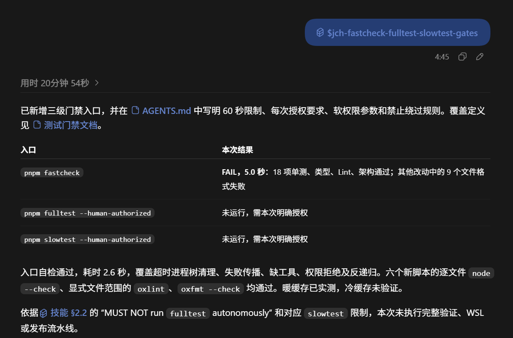
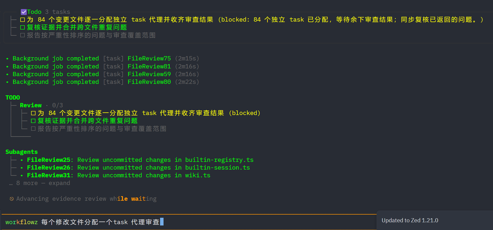
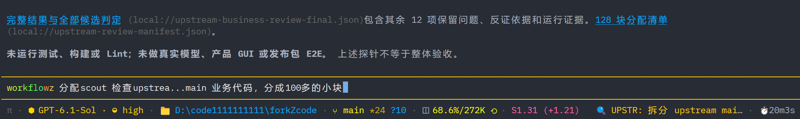
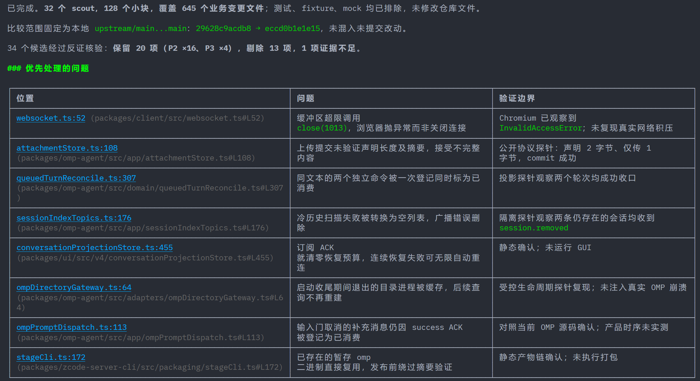
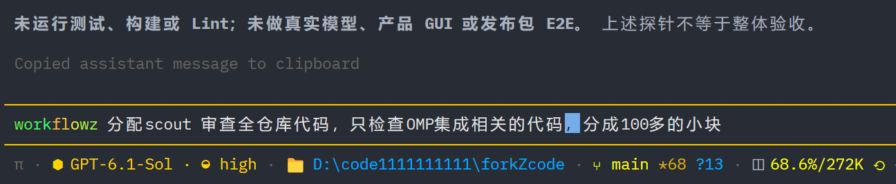
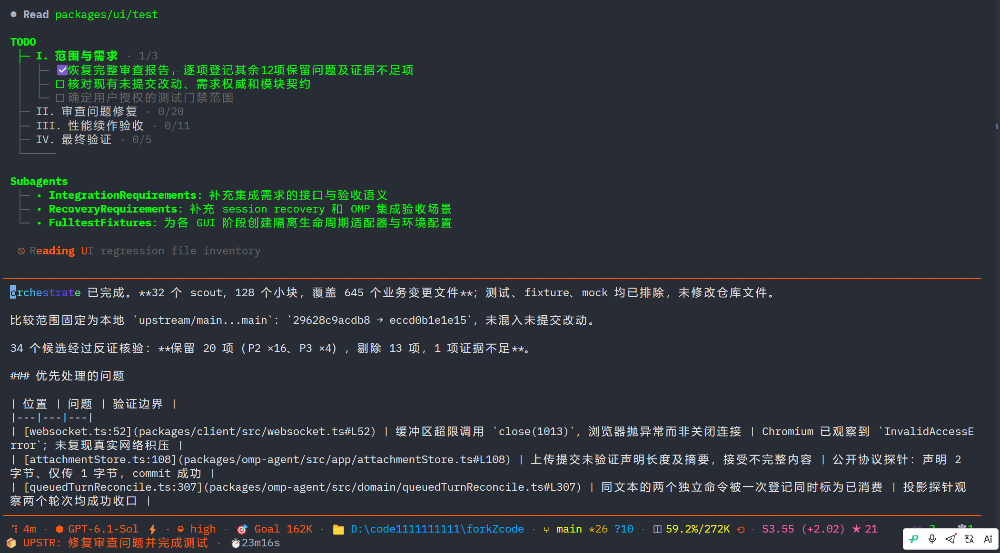

# 公司内网 OMP 新手快速指南（CentOS 7 / tcsh）

`OMP_OFFLINE` 标记公司内部网络环境：系统为 CentOS 7，使用 NFS，有 `/dev/shm`，无法连接互联网。已配置且可达的内网服务仍可使用。

上游 `--offline` 参数只限制辅助服务跨模型 Provider 调用，不启用公司内网模式，也不会阻断网络。内网启动仍需设置 `OMP_OFFLINE`；两者可同时使用。

## 1. 设置环境变量

在启动 OMP 的终端执行：

```tcsh
setenv OMP_OFFLINE 1
setenv OMP_CONFIG_ROOT "$HOME/omp-data"

# 可选：自定义性能数据根目录（绝对路径）：
# setenv OMP_CACHE_DIR "$HOME/omp-cache"

# 使用团队共享资源时，替换为实际网络文件系统路径：
setenv OMP_SKILLS_DIR "/path/to/shared/skills"

# 使用内置 Ascend 模型时，替换为自己的密钥：
setenv ASCEND_API_KEY "<你的密钥>"
```

- `OMP_OFFLINE`：启用公司内网模式；`1`、`true`、`yes`、`on` 均有效，忽略大小写和首尾空白。
- `OMP_CONFIG_ROOT`：持久数据根，可换成有写权限的绝对路径，支持 `~` 展开；未设置、留空或值无效时使用上游默认目录规则。保留 profile 内布局，旧数据不会自动搬迁。
- `OMP_CACHE_DIR`：可选的性能数据根目录，支持绝对路径和 `~` 展开；留空或相对路径不作为显式设置。Linux 在有效值后追加当前用户的数字 UID，例如命名 profile 使用 `<OMP_CACHE_DIR>/<UID>/profiles/<name>/`；不追加哈希或 SDK 身份目录。Windows 直接使用有效值。此设置在 offline 与普通模式均生效；已有专用路径覆盖（如 `PI_NATIVES_DIR`）仍按原优先级生效。
- `OMP_SKILLS_DIR`：可选的共享技能根目录，加载其中 `<技能名>/SKILL.md`；同名时共享版本取得裸名，内容不同的其他版本按既有 namespace 名称保留。执行与管理沿用相同命名与优先级；面板设置以当前宿主会话为准，关闭来源及其诊断只留在管理侧。在 `/extensions` 查看 `Shared` 来源和实际名称，禁用项仍保留，可直接启用／禁用并等待异步刷新后从 `/skill:` 补全调用。启停不修改共享 NFS 技能文件；目录不存在时不影响原有技能加载，不下载或同步文件。
- `ASCEND_API_KEY`：可选，使用内置 Ascend 模型时设置；无需 `models.yml` 或登录，不依赖 `OMP_OFFLINE`，不改变现有默认模型。用 `omp models ascend` 查看模型，用 `omp --model ascend/qwen3.8-flash-next` 启动；参数与 HTTP 明文传输边界见 [Ascend 内置模型](../openspec/specs/model-providers/spec.md)。不要将真实密钥提交到仓库或共享文档。

上述设置可按需放进 `~/.tcshrc`，以后新开的 tcsh 终端自动生效。`OMP_CONFIG_ROOT`、`OMP_CACHE_DIR` 与 `OMP_SKILLS_DIR` 不依赖 `OMP_OFFLINE`，也不需要配置文件；路径示例需替换为实际可访问目录。

| 目录 | 内容 | 保留与丢失 |
| --- | --- | --- |
| 持久目录 | 配置、认证凭据、profile、会话和历史、会话附件与 blob、个人 Skill／工具／命令／提示词／主题 | 不随性能目录切换或清空迁移、删除或重置 |
| 持久目录 | 其他未列为性能数据的用户状态，包括内置 OpenWiki 工作区注册表；项目 `.omp/`、项目 `openwiki/`、Claims、manifest、checkpoint 仍在项目内 | 位置及既有作用域不变 |
| 性能目录 | 原有 `cache/`、`agent/cache/` 和既有缓存类别目录的**全部内容**，包括 webcache、模型权重、推理运行依赖、认证快照、头像、推断结果和文档转换缓存 | 都属于可丢失的性能数据，不因模型或运行依赖较大／难以下载而排除 |
| 性能目录 | 统计数据库及 SQLite 配套文件；运行、错误、启动和安装／更新诊断日志 | 允许丢失，不定期回写或备份；日志级别和保留规则不变 |
| 性能目录 | 默认自动解压的 native、版本缓存及对应 grammar 缓存 | 二进制内嵌的 native 丢失后可重新解压；额外下载的 grammar 等资源不保证离线可恢复 |

Linux 内网模式未设置有效 `OMP_CACHE_DIR` 时，性能数据默认放在 `/dev/shm/omp-<UID>`，其中 `<UID>` 是当前用户的数字 UID，不再重复追加；命名 profile 使用 `/dev/shm/omp-<UID>/profiles/<name>/`。其他环境未设置有效 `OMP_CACHE_DIR` 时不新增默认目录，继续使用原有目录及适用的 XDG 规则。

offline 日志默认保留 WARN／ERROR，并立即刷新到日志文件。Linux 上若主 `logs/` 目录不可写，运行日志会尝试写到 `$XDG_STATE_HOME/omp/logs`（未设置时为 `~/.local/state/omp/logs`）；如果该路径就是主目录，则尝试 `~/.omp/fallback-logs`。两处都写不进去时，OMP 会在 stderr 提示。正常运行时日志仍可能为空，空日志不代表所有功能均已验证。

排查时可在启动前执行 `setenv OMP_LOG_LEVEL debug`，临时记录 INFO／DEBUG、阶段与启动／退出诊断；结束排查后执行 `unsetenv OMP_LOG_LEVEL` 并重启 OMP，恢复低开销默认值。已有守护进程也需重启才能继承新的环境变量；仍可显式选择 `error`、`warn` 或 `info`。

`/dev/shm` 是易失性内存文件系统，重启或清理后缓存、统计、日志及模型／运行依赖文件可能丢失；非内嵌资源的缺失或下载仍遵循原有 offline 规则。先结束使用中的进程再清理性能目录；更换路径不会自动搬迁旧数据。

## 2. 启动

**按公司环境要求，先启动 IDE 和模型代理：**

```tcsh
ma dmas_ide
ide agent
```

代理就绪后，进入自己的项目目录（替换示例路径）：

```tcsh
cd /path/to/project
omp
```

用 `omp -c` 继续当前项目的最近会话；没有可恢复会话时会新建。

用 `omp -P work` 启动独立 profile（等同 `omp --profile work`）；`omp -P work -c` 继续该 profile 下当前项目的最近会话。不同 profile 的聊天记录和设置隔离，无需配置 shell alias。

在上述内网模式下，OMP 复用 Claude Code 中已配置的公司 API 地址和凭据，无需另行登录。

内网未显式配置时，默认主模型、PLAN 和 SLOW 角色均使用 `company/GLM-5.3-public`；也可用 `omp --model company/GLM-5.3-public` 显式选择。SMOL、TASK、VISION 和 ADVISOR 使用 `company/Qwen3.8-27B`，TINY 和 COMMIT 使用 `company/Qwen3.6-35B-A3B`，MEMORY 保持自动解析。`GLM-5.2-public` 仍保留供显式选择，已有角色设置及 CLI 模型参数优先。模型输入、目录参数及公司服务约定见[公司内网模型需求](../openspec/specs/model-providers/spec.md)。

### 旧终端的状态字符与图标

offline 模式默认关闭 `terminal.programStatus`，避免终端将 `7501;state=done:app=omp` 等程序状态序列显示为文本；已有显式设置优先。如果以前手动开启过，可执行 `omp config set terminal.programStatus false` 后重启，使用独立 profile 时须带上相同的 `-P` 参数。

offline 的 Unicode 预设将已确认缺字的图标分别替换为基础字符：清空 `×`、扩展 `⊞`、引导 `→`、诊断修复 `✚`、退出 `■`、Token 计数 `#`、Hook `↪`。命令补全、状态栏和扩展列表统一生效，其他图标（包括 `/fast` 的 `⚡`）保留；显式主题符号覆盖仍优先。Nerd Font、ASCII 预设保持原有行为，聊天图片和模型识图不受影响。无需整体切换 ASCII 或安装字体。普通模式保留原图标及默认开启的程序状态通知，详细边界见[运行默认值](../openspec/specs/fork-runtime-defaults/spec.md)和[offline 图标兼容需求](../openspec/specs/tui-presentation/spec.md)。

### 内网子命令与 Python 分工

以下命令在**系统终端**运行，沿用上面的环境变量和当前 profile：

```tcsh
omp read "./README.md"
omp read "./image.png?q=说明图中的模块关系"
omp render --plain
omp dry-balance --model company/Qwen3.8-27B
omp usage
```

将文件名替换为实际路径。普通本地 `read` 与已有会话的 `render` 不要求公司配置，也不为此做 auth discovery 或在线模型发现。图片问答会按需初始化 company／vision 并调用真实模型；显式配置且解析成功的非 company vision／default 角色仍按用户选择执行，公司配置错误可见但不阻断该显式路径。需要默认或显式选择的 company 模型时，缺失或无效的公司配置必须明确失败，不隐式回退到其他 Provider；`dry-balance` 解析公司模型时复用同一初始化。上述模型目录发现使用 cache-only，不表示禁止公司模型 API 或现有 usage provider 的真实请求；`usage` 仅报告现有接口取得的数据，不提供虚构的 company 额度接口。offline 覆盖仅对当前进程有效，不保存；普通启动行为不变。

内网模式下，登录或保存凭据后只读模型缓存。`omp models refresh` 或模型面板手动刷新只请求显式配置的发现端点（`models.yml` 的 `discovery` 和 `baseUrl`，或本地模型服务的端点环境变量），不探测默认公网目录；实际登录请求不受此规则影响。

内置 OpenSpec 的 `omp openspec version --check` 仅在 `npm_config_registry` 明确指向非默认的 HTTPS 镜像时检查，未配置时不会访问公网 npm。

OMP 的 **Python Eval** 与项目业务 Python 分开：显式 `python.interpreter` 优先；未显式设置时，Linux 内网模式优先尝试 `/software/public/python/3.11.4/bin/python3.11`，缺失或不适合则继续检查原有候选及 PATH 中的版本化 `python3.11`～`python3.15`、`python3`、`python`。内网模式的 `1`／`true`／`yes`／`on` 均生效，忽略大小写和首尾空白；Linux 内网 Eval 要求 Python ≥3.11，遇到默认 Python 3.6 会继续查找，全部候选不满足时明确报错，不降级。显式解释器不满足要求时也会报错，不会自动换解释器。其他平台或非内网模式仍要求 Python 3.9+。OMP 不修改当前终端／主进程 PATH、项目虚拟环境或业务 Python，也不扫描软件目录或安装包；用 bash 执行业务脚本仍应使用项目自己的解释器。

OMP 启动及主会话／子代理会话创建、恢复时不检查或预热 Python，也不显示首次启动的 Python 缺失警告。实际执行 Python Eval 时才按上述规则检查解释器，不可用时返回明确错误；需要提前诊断可手动运行 `omp setup python --check`。

### 内网环境提示词

`OMP_OFFLINE` 生效时，主会话、SDK 和子代理统一获得内网规则：优先本地资料、已有依赖、团队 Skills 与已配置内网服务，不访问公网或反复尝试公共源安装；缺少资源时报告具体缺项。检查工具、Python Eval 和业务 Python 分开，不擅自升级项目目标版本。

Linux offline 额外提醒项目持久材料及必要备份使用获准的 NFS，临时文件与可重建缓存优先使用当前用户的 `/dev/shm`；shm 易失，不存唯一持久副本，不以 `/local`、`/tmp`、`/run/user` 回退。沿用已配置的数据根及共享技能目录，不自动迁移数据。

仅当 Linux 的 `SHELL` 路径末段为 `csh` 或 `tcsh` 时，给用户复制执行的命令使用 `setenv`／`unsetenv` 等 csh 语法。OMP 的 `bash` 工具仍遵循自身执行语言；不能直接提交 csh 语法、假定 `ma` alias 可用，或用 Bash source `.cshrc`。确需模块初始化时才确认入口并显式通过对应 Shell 执行。

普通模式不追加上述规则，Windows offline 不追加 Linux/csh 段落；不改变 Shell 执行器或用户配置。提示词不替代实际网络隔离、存储权限和公司实机验证。

### `/sketch` 手动打开网页

`OMP_OFFLINE` 启用时，原生 `/sketch` 不自动启动浏览器，适用于所有平台和 Shell。请在浏览器中手动打开 OMP 显示的完整地址；OMP 不读取 csh／tcsh 启动文件或调用 `ff` 别名，也不要求配置别名。非 offline 保留系统默认浏览器打开方式。

Linux offline 环境打开原生 `/sketch` 后，仍会自动尝试复制完整的本机回环地址，包括路径与查询参数，可在浏览器地址栏粘贴。其他环境不自动覆盖剪贴板。

复制复用 OMP 的终端 OSC 52 和原生 X11 剪贴板，不需要另装 `xclip`／`xsel`。公司 SSH／Exceed 是否能粘贴到 Windows 取决于终端剪贴板权限和 X11 剪贴板共享设置；界面提示“已尝试复制”不等于实机已确认。不能粘贴时仍可手动复制显示的完整地址；复制不会建立端口转发，`127.0.0.1` 必须指向运行 OMP 的机器。

### 中文输入法突然失效

在发生故障的 OMP 输入框输入 `/jchime` 并发送；也可输入 `/jchime 只有当前窗口不能输入中文` 补充现象。内置指令已包含供较小模型执行的完整恢复块，无需另找脚本或填写总线地址。

命令会让模型核对当前用户和 X11 显示会话，优先请求一次 IBus 自重启，再重新连接并切回 `libpinyin`。若首选方法无效，模型会依据实际结果继续诊断，自主选择同会话内的引擎切换、环境对齐或 daemon 重建；确认卡死时允许精确 PID 的 SIGTERM 后重建，daemon 已退出时也可在核实会话后启动。共用该 daemon 的窗口会短暂中断输入，尚未提交的候选文字可能丢失。它不安装软件、不改持久配置、不全局杀进程或自动强杀；无法确认操作目标、安全手段耗尽或需要客户端操作时才报告具体阻塞，不强行操作其他会话。

模型报告服务正常后，在当前输入框按 `Ctrl+Space`，输入 `中文测试` 确认实际恢复。此命令需要当前模型可用，仅适用于 Linux IBus/X11；Windows 本机或客户端问题不保证能从服务端修复。完整边界见 [JCH 命令契约](../openspec/specs/personal-commands/spec.md)。

## 3. 常用操作

以下操作都在 **OMP 原生 TUI 输入框**中使用：直接输入任务，按 `Enter` 发送；输入 `/` 补全命令，输入 `@` 选择文件。

| 按键 / 命令                    | 用途                                                 |
| ------------------------------ | ---------------------------------------------------- |
| `Ctrl+T` 或 `/switch`          | 查看、临时切换当前会话模型                           |
| `/model`                       | 设置各角色模型                                       |
| `Shift+Tab` 或 `/plan`         | 切换计划模式，先出方案                               |
| `/display`                     | 在干净、紧凑、详细界面之间循环切换                   |
| `/minimal [任务]`              | 提醒模型仅做最小充分变更和验证                       |
| `/workspace [消息]`            | 切换工作区写入提醒；带消息时开启并发送               |
| `/jchime`                      | 让当前模型按详细步骤重启本显示会话 IBus 并切回拼音   |
| `/sketch`                      | 显示完整画布地址，内网需在浏览器手动打开；绘图作为附件手动发送 |
| `Ctrl+O`                       | 紧凑模式优先展开／收起本轮工具原始 Diff，无可展开差异时处理 TodoLoop 卡片；详细模式展开／收起工具详情 |
| `Esc`                          | 在主会话中中断当前任务；暂停 `/loop`，停止 `/loopn`（不会自动恢复） |
| `/tree`                        | 查看、切换会话分支                                   |
| `/copy`                        | 选择并复制对话内容                                   |
| `/copy code`                   | 复制助手回复中最近的代码块                           |
| `/new`                         | 新建会话                                             |
| `/resume`                      | 恢复历史会话                                         |
| `/context` / `/compact`        | 查看上下文占用 / 压缩上下文                          |
| `/team 需求`                   | 多代理独立调查、交叉审查并汇总方案，只读             |
| `/goal-autopilot 目标`         | 持久目标、自动编排与无人值守要求，见第 4.5 节        |
| `/advisor on` / `/advisor off` | 开启 / 关闭第二模型复审，默认逐轮，频率可配置        |
| `/skill:技能名 任务`           | 调用本地技能，从补全中选择技能名                     |
| `/todo` / `/hub`               | 查看待办进度 / 子代理活动                            |
| `/queue 后续任务`              | 当前轮结束后再执行；空闲时直接执行                   |
| `/quit`                        | 退出                                                 |

任务运行中，输入消息后按 `Ctrl+Q` 可排队；按普通 `Enter` 会引导当前任务。快捷键失效时，用 `/hotkeys` 查看绑定。

**工作区写入提醒：** `/workspace` 切换开关；`/workspace <消息>` 开启并发送消息，已开启时也会发送而不会关闭。开关独立于 Plan，可同时开启；恢复会话保留状态，新会话默认关闭。它只是模型提示，不是沙箱、文件系统防护或审批模式，不改变现有审批和 Plan 限制。

提示允许写入实际 Git 项目根目录、系统临时目录和本会话 `local://` 目录；无 Git 项目时不把当前目录或主目录当作替代写入根。允许读取范围外文件，但范围外写入须说明具体路径和操作并等待授权；已有针对该路径和操作的明确授权不重复询问，符号链接按实际目标判断。子代理继承派发时的开关与范围快照，隔离 worktree 加入子代理范围，不随父会话后续切换而改变。

**画图或截图标注：** 在原生 TUI 输入 `/sketch`，无需安装扩展或修改配置。页面按钮、悬浮说明、无障碍标签和内置状态／错误提示均为中文。工具栏和状态区之外铺满绘图工作区，新画布匹配初始窗口大小。浏览器中可手绘、粘贴图片并标注，选择颜色和笔刷大小、撤销、清空及拖动右下角调整画布尺寸；截图粘贴取决于实际桌面剪贴板能力。滚轮围绕光标缩放，也可使用 `−`／`+`、`100%` 和「适应窗口」；按住空格拖动、中键拖动或启用「平移」可平移。缩放和平移只改变视野，不改变图像像素或导出尺寸，附件包含完整画布，而非仅当前可见区域。在浏览器按 `Enter` 或点击「添加为附件」→ PNG 加入 OMP 输入草稿成为真实附件 → 补充描述 → 在 OMP 手动发送，不会自动请求模型。

终端或浏览器按 `Esc` 可取消并保留原草稿；完成、取消或退出会清理本次本地服务，切换会话或输入视图后迟到图片不会串入新位置。画布资源随源码和二进制内嵌，绘图本身不请求公网、CDN 或外部模型。仅支持原生 TUI，不代表 GUI／ACP／RPC 集成。

OMP 和浏览器应在同一主机；通过 SSH 使用远端 OMP 时，用户需自行把显示 URL 的端口转发到远端 `127.0.0.1`，保留完整能力 URL，不会自动转发。页面以 Firefox 128 原生能力为基线，不再兼容 Firefox 52。本机 Windows Firefox 128.14.0 已通过 Selenium＋geckodriver、隔离临时 profile 验证全窗口布局、缩放、平移、绘图坐标、撤销、尺寸调整及 PNG 提交；图片粘贴使用事件夹具验证，不代表实际系统剪贴板、公司 CentOS 或桌面环境已验证。

默认使用紧凑界面。无需编辑配置文件，可直接选择：

| 命令                | 显示效果 |
| ------------------- | -------- |
| `/display clean`    | 隐藏思考正文、工具调用和结果，保留忙碌状态及助手普通回复 |
| `/display compact`  | 聊天历史不堆普通工具卡片；输入框上方显示本轮工具原始 Diff、两行活动及最近工具输出预览 |
| `/display detailed` | 显示完整工具和思考，工具详情可展开或折叠 |

**看现场：** 模型行显示等待响应、思考、回复或准备调用；Agent 行显示当前工具或等待对象，已结束的动作标为「上次」。隐藏思考正文不会隐藏阶段。动作行里的路径是操作目标，不等于已改动。

**看输出：** 输入框上方的输出标题、日志与动作词从同一列开始，窄屏也不为日志另留缩进。预览最多一行来源与状态、五行正文。新调用只有图片、空白或分隔线不会清掉上一份有效输出。标题已有同一 Bash 命令时，活动行显示其意图。失败时优先突出实际诊断，其他上下文保持普通正文。预览不足不补空行；本轮和来源任务都结束三秒后收起，不写进历史，也不重复显示 TODO。

**看改动和历史：** 紧凑模式只显示本轮工具原始返回的 Diff，不合并同一文件的多次编辑，不补算只返回回执的写入。默认显示最新一条；`Ctrl+O` 按完成顺序展开，`Esc` 收起。下一轮开始时清除，不进聊天历史。用 `/display detailed` 查看完整工具记录，`Ctrl+O` 展开或收起工具详情。

会话暂停等待后台任务、子代理或结果时，等待提示显示在 Agent 行。按 Esc 只结束会话等待，不取消后台任务。`clean` 和 `detailed` 仍使用原独立提示。

显示模式会保存到当前 profile，下次启动继续生效。要查看思考正文，先切到 `/display detailed`，再用 `Alt+P` 显示或隐藏思考块。`clean` 和 `compact` 不显示思考正文；`Alt+P` 只切换显示偏好，不开启模型推理，也不改变思考等级。切换显示模式不会重跑工具或模型，也不改变模型输入、会话原文或全文复制。

如果项目配置、启动参数或其他高优先级设置阻止所选模式完整生效，OMP 会提示当前实际显示方式和覆盖项来源，不会强行改变这些覆盖设置。

这三个命令可**直接带任务文本**：

| 命令           | 用途                           | 可复制示例                                                   |
| -------------- | ------------------------------ | ------------------------------------------------------------ |
| `/ultrathink`  | 深入分析再行动                 | `/ultrathink 分析这个错误的根因，给出证据和修复方案`         |
| `/orchestrate` | 拆分任务、委派子代理、整合验证 | `/orchestrate 按 @a.md 实现，拆分独立任务并行完成，统一验证` |
| `/workflowz`   | 按阶段组织批量多代理任务       | `/workflowz 按模块检查当前仓库，汇总有证据的功能问题，只读`  |

这些命令会向模型追加任务要求。`/orchestrate` 依赖 `task` 工具，`/workflowz` 依赖 `task` 和 `eval` 工具；使用时需启用所依赖的工具及相关设置。

## 4. 企业核心功能（本 fork）

### 4.1 定位当前项目代码

按文件名用 `glob` 找文件，按关键词用 `grep` 搜索实现、错误信息和配置键，再用 `read` 读取当前源码、测试和配置。结构化代码匹配可用 `ast_grep`。这些操作无需先建立独立代码索引。CLI 默认关闭 LSP；设置 `lsp.enabled: true` 后可用它定位定义、引用和调用方，临时关闭可传 `--no-lsp`。

例如在普通对话中输入：“定位当前项目中读取配置的实现，读取相关源码和测试，说明输入、输出、错误处理及实际调用方。”检索命中只是定位线索；结论应以当前源码为依据，零命中不证明代码不存在。

### OpenWiki：生成和查询代码仓库 Wiki

OpenWiki 为代码仓库生成可浏览的 Wiki。进入目标仓库，在**系统终端**显式执行：

```tcsh
omp openwiki code --init
omp openwiki code --update
```

生成和更新默认使用简体中文（`zh-CN`），不随终端语言变化。需要英文时，可在生成或更新命令后加 `--language en`。

首次使用 `--init`；源码变化后需要时手动执行 `--update` 增量更新，不会因源码变化自动重跑。已有 Wiki 可直接更新；对已有 Wiki 再次执行 `--init` 是重新生成，并非无损增量更新，会保留用户维护的 `openwiki/INSTRUCTIONS.md`。生成被中断后，可在同一持久检出目录再次执行对应命令，利用已有进度恢复。页面失败或跳过会返回非零；若全部页面成功但生成期间源码发生变化，命令会提示再次更新。

执行前可用 `omp openwiki code --init --dry-run` 或 `omp openwiki code --update --dry-run` 预览。它分别显示页面和规划阶段的模型选择器、源码快照候选路径、可比较的变更路径及已有 Wiki 页面，不调用模型、不生成或修改 Wiki 文件，也不写入 `--telemetry-file`。预览不会验证模型可用性；实际页面由后续模型规划决定，候选路径不是完整读取清单或最终页面清单。OMP 首次启动仍可能释放自身的原生组件缓存。

不传模型参数时，页面使用当前 OMP profile 的 `default` role，规划优先使用已配置的 `plan` role，未配置才回退到 `default`。未额外指定 `--planner-model` 时，显式指定公共模型仍会同时覆盖两个阶段，不改变保存的角色设置：

```tcsh
omp openwiki code --update --modelId company/GLM-5.3-public
```

需要仅为本次运行覆盖规划模型时，增加 `--planner-model`；将下列选择器替换为已配置的 OMP 模型：

```tcsh
omp openwiki code --update --modelId provider/page-model --planner-model provider/plan-model
```

规划模型优先级为 `--planner-model` → `--modelId`／`--model-id` → `plan` role → `default` role。仅在未配置 `plan` 时回退；已配置但不可用会报错，不静默降级。页面仍使用公共模型或 `default` role，不自动选用 `task` role。

`--model-id` 也是可用写法；模型须支持工具调用且服务可达，认证和内网模型配置沿用 OMP，无需另配 OpenWiki 凭据。`OMP_OFFLINE` 不代表本地模型推理：内网生成仍需要可访问的模型服务。无需单独安装 OpenWiki、Node／Bun 或启动 OpenWiki MCP 服务。

页面并发默认是 1，可在终端设置 `setenv OPENWIKI_PAGE_CONCURRENCY 2`，允许整数 1–8；并发过高可能受模型服务限流。一次运行内的页面任务去重不等于跨进程互斥：不要同时在多个 OMP 进程中对同一仓库生成或更新。

可选的 `--telemetry-file reports/run.json` 仅写入本地禁用状态，不发送 OpenWiki 遥测；无法写入时会提示警告，生成仍继续。

**让 AI 查已有 Wiki：** 在相同数据根、profile 和仓库上下文启动 OMP，在输入框例如输入“查询当前仓库 OpenWiki，说明配置加载流程并引用相关章节”。AI 可按需使用 `openwiki_search`、`openwiki_read`、`openwiki_list_workspaces` 和 `openwiki_list_wikis`；它们是只读 AI 工具，不是终端的 `search`／`read` 子命令，不会生成或更新 Wiki。工具检索本身不调用模型，但 AI 对话仍需要可用模型；普通任务不会预加载 Wiki。`tools.commands` 启用且 Bash 工具可用时，通过 Bash 工具按需调用；否则作为顶层工具提供。挂载方式不向受限子代理额外授予权限。

**关联多个已有仓库 Wiki：** 在交互终端执行 `omp openwiki link [directory]`，按界面创建或管理命名工作区并选择仓库。然后可在当前仓库用以下命令选择、查看或清除活动工作区；将示例名称换成已有工作区名称或 ID：

```tcsh
omp openwiki workspace use "my-workspace"
omp openwiki workspace current
omp openwiki workspace clear
```

查询会按工作区解析关联仓库；存在多个候选时应按提示选择，而不是假定会自动选中。关联仓库被移动或不可访问时需修复链接，不会自动生成替代内容。

**浏览与导出：** 在仓库内执行以下命令，实时服务默认只监听本机回环；`--no-open` 不自动打开浏览器，结束命令即可停止服务。静态导出是另一种模式，不能与 `--port` 或 `--no-open` 同用：

```tcsh
omp openwiki visualize openwiki --no-open
omp openwiki visualize openwiki --export /path/to/export
```

`--export` 会直接覆盖目标目录中的同名文件（如 `index.html` 和 `graph.json`），不会询问确认。建议使用新的专用导出目录，不要指向已有站点目录。

实时关系图、阅读器及导出所需资源随 OMP 提供，不依赖公网 CDN。将导出目录交给静态 HTTP 服务承载（可放在子路径），不承诺直接通过 `file://` 打开；浏览和只读检索已有内容不需要模型凭据。

导出的 `graph.json` 不只包含页面关系，还包含页面的 Markdown 正文，能访问该文件的人可直接读取。含公司资料的导出目录只应部署到有访问控制的内网站点，不要公开托管。

仓库页面、Claims 和生成进度保留在项目的 `openwiki/` 中；工作区注册表、缓存等用户级状态跟随有效的 `OMP_CONFIG_ROOT` 和当前 profile，`OMP_OFFLINE` 本身不改变数据根。不同 profile 的工作区相互隔离，旧独立 OpenWiki 工作区不会自动迁移或接管，独立 OpenWiki 仍使用自己的目录规则。

### 4.2 `/team 需求`：多代理调查、交叉审查与方案汇总

适合需求还不清晰、实现方向存在取舍，或需要核对公司规范与现有代码的任务。**只做分析和规划，不自动实施。**

先用 `Ctrl+T` 选好负责对齐与最终汇总的当前会话模型，再在输入框描述目标、资料入口、约束和希望得到的结果。以下示例中的 `a.md` 须已存在且路径明确：

```text
/team @a.md 结合现有代码和项目文档比较可行方案，保持已有接口兼容，给出关键证据、推荐理由、主要风险、执行前检查和验收条件。
```

只输入 `/team` 会提示补充问题，不会猜测任务。

`team.members` 是有序模型名单，与 `/model` 的角色设置不是同一项。重复项保留、不去重，也不会自动追加当前会话模型。名单有 `M` 项时，创建 `N = max(3, M)` 个提案代理，按名单顺序循环分配：`A → AAA`、`AB → ABA`、`ABC → ABC`、`ABCD → ABCD`（每个字母代表一个代理使用的模型）。每个槽位都有独立上下文和唯一标签，同模型的多个代理也分别调查。

未设置 `team.members` 或设置为空数组时，无论 `OMP_OFFLINE=1` 还是普通启动，都使用当前会话模型创建三个独立提案代理，不自动选取公司模型名单。当前会话模型始终负责对齐与最终汇总，即使不在显式名单内，也与指定成员一样必须可用，并支持机械只读工具及结构化输出；否则在讨论开始前明确报错，不会静默略过。

程序会推进讨论流程：各代理先独立调查，再对齐需求与验收标准、交叉审查、修订与必要复核，最后汇总。每个方案最多两轮修订，过程中无需手工分配代理、转发意见或回答中途问题。代理数不等于不同模型数；同时运行数量受 `task.maxConcurrency` 限制，超出的代理排队，不会截断名单。

阶段与参与代理状态看启动后的提示，子代理明细可用 `/hub` 查看。取消时，按启动提示使用后台任务取消入口；主会话中按普通 `Esc` 不代表整个讨论已取消。

子代理通过工具白名单保持只读：可以读文件和搜索代码，不能写项目文件、运行 bash/eval、安装依赖、构建测试、提交或推送。“修订”只改方案内容，正常会话记录仍会保存。

代码调查使用可用的 `read`、`grep`、`glob` 和 `ast_grep`，以当前源码核实定义与实际调用。

报告只追加到发起讨论的会话。如果该会话正在运行模型回合，报告会等本轮结束再追加，不会触发新的模型回合。切换或恢复到另一个会话会取消尚未结束的讨论，不会把迟到的结果写入新会话。报告包括共同需求与验收标准、方案、证据、取舍、风险和待核实前提，不会自动生成项目中的方案文件。

只有方案有明确优势时才推荐，不靠多数票。未解决阻断或必要复核未完成的方案会标为“尚不可采用”。成员失败会如实显示，必要阶段失败会报告流程未完成；不能把失败当成同意或验证通过。

回复“选择方案 A”只确认方案，不授权改代码。实施需另发明确任务，例如后文的 `/goal` 示例。

若补充约束实质改变了方案，或结果提示需求理解存在重要差异，带上澄清后的要求重跑 `/team`。详细约定见[多代理方案讨论需求](../openspec/specs/team-discussion/spec.md)。

### 4.3 项目规则与需求维护

仓库根 `AGENTS.md` 保存开发、同步及验证规则。已批准需求只在 `openspec/specs/` 按能力域维护；未批准提议留在 `openspec/changes/` 的原生 proposal 和增量规格中。需求或用户可见行为变化时更新对应规格；仅实现方式变化且需求不变时，无需制造需求变更。需求文档的结构校验不等于软件实现或功能验收通过。

### 4.4 为项目建立三级测试门禁：`jch-fastcheck-fulltest-slowtest-gates`（可选本地技能）

项目已有检查、测试或 CI，但入口零散、执行权限不清楚时，可以使用该技能。它面向任意代码项目，按实际技术栈复用已有质量检查，建立或完善三个统一入口，**不改写检查标准来让门禁变绿**。

在目标项目目录启动 OMP，显式输入：

```text
/skill:jch-fastcheck-fulltest-slowtest-gates
```

下表概括本地技能的三级分工，不复制技能预算。使用时以已安装技能和目标项目规则为准；本 fork 的预算、覆盖范围和执行权限见[验证门禁主规格](../openspec/specs/fork-verification-gates/spec.md#requirement-fork-验证体系)。

| 入口        | 通用覆盖范围                                                      | 执行权限与边界                                                                       |
| ----------- | ----------------------------------------------------------------- | ------------------------------------------------------------------------------------ |
| `fastcheck` | 静态检查和适用的增量编译 | 不运行项目测试或门禁自测；通过不代表完整验证 |
| `fulltest`  | 当前平台完整日常回归 | 业务测试须另获明确授权 |
| `slowtest`  | 一次 `fulltest` 加适用的扩展验证，可含 WSL 和真实外部依赖 | 须另获明确授权，不触发远端 CI、发布或部署 |

技能先核对现有入口和执行权限，只对未解决的问题做必要的基础设施验证，例如检查选测、超时清理和失败传播。

耗时长但属于当前平台日常回归的测试仍归 `fulltest`，不会仅因慢就移到 `slowtest`。缺少适用的 WSL 或外部依赖时，如实标记相应验证未执行。

调用技能**不等于授权运行 `fulltest` 或 `slowtest`**。需要运行时，另发明确任务，例如“在当前项目运行 fulltest 一次”。不得绕过门禁直接执行内部子步骤，也不能把授权标记参数本身当成人工授权。

若现有项目规则与技能预算或覆盖要求冲突，应报告冲突，并先明确改造范围，不能在介绍或调用中静默改写规则。



截图中的 `fastcheck` 为 **FAIL**，`fulltest` 与 `slowtest` 未运行。入口自检或部分检查通过，不等于三个门禁通过。

截图使用 `pnpm` 和该项目的授权标记参数，不是本 fork 或所有项目都可照抄的终端命令。

### 4.5 `/goal-autopilot`：无人值守目标

适合需要持续调查、规划、实施和验证的长任务，例如夜间处理项目中的功能问题。按需求契约，它复用上游 `/goal` 的正常目标管理与历史消息链，附加完整目标、共享 Orchestrate 编排规则和既有无人值守要求，不再采用每次模型请求临时注入完整自定义提示词的策略；普通 Goal 的提示、状态管理与续跑规则继续沿用上游。

`/goal` 与 `/goal-autopilot` 都直接交给当前会话已有的 Goal 控制器，运行中也不会把原始命令强制排队、等出队才应用目标。控制器生成的目标执行正文仍按原生 prompt／steering 准入处理，沿用调用方的流式输入方式。直接管理目标不代表模型立即执行，也不能绕过忙碌、Stop 保留队列、手动压缩／维护或会话控制权限制。

目标执行中，按 `Ctrl+Q` 或 `Ctrl+Enter` 仍按原方式排队。当前工具批次完整结束且目标仍在执行时，队首用户消息会进入后续模型调用，不必等整个目标结束，也不会打断正在运行的工具。目标未在执行时，沿用原有队列规则。

首次构造的完整提示词进入正常聊天与会话历史，并保存在会话记录和 dump 中。工具轮次、模型续接、重试及允许的自动续跑复用已有历史，不重建或重复插入完整自定义提示词；两次实际压缩之间，已生成提示词的原文与位置保持不变。只有上下文压缩成功提交后，才从保存的完整目标重新构造、再次展开共享 Orchestrate 规则并持久化，不能只依赖可能省略目标与规则的压缩摘要。构造时按已启用的工具能力判断是否可用 `task`（含经 `eval` 间接调用）；不可用时仅省略 Orchestrate，仍保留目标和无人值守要求。

若初始目标正文已进入原生 steering／输入队列但尚未送达历史，Stop 保留队列也会保留对应首次通知的交付归属；经原生入口显式继续／发送后，完整通知随目标正文只交付一次。不会为已替换、删除或失效目标补发旧通知，也不会因此释放其他仍被 Stop 保留的输入。

本模式的附加提示词明确要求：完成目标全过程及所需全部操作已获用户授权，直接自主执行、验证和修复，不提问、不请求确认、不要求选择、不等待输入；与此前用户级要求冲突时，以本次明确授权为准。

稳定历史不等于免费或保证缓存命中；实际压缩仍按上游流程改写上下文，不能保证旧缓存跨压缩保留或费用下降。实际实现与验收状态见[历史验证记录](verification-history.md)。

先退出计划模式，再在 **OMP 输入框**输入：

```text
/goal-autopilot 修复当前项目中有证据的功能问题，保留无关已有改动；按项目规则完成必要验证，汇总结果与受阻项。
```

这些附加提示词要求模型自主调查、拆分与委派、实施和验证，避免反复要求用户选择普通方案；确实无法自主解决或需要额外授权的工作应标为受阻，继续其他可执行工作，最后如实汇总。

| 命令                         | 用途                                                                   |
| ---------------------------- | ---------------------------------------------------------------------- |
| `/goal-autopilot set 新目标` | 创建或替换目标，启用本模式                                             |
| `/goal-autopilot show`       | 查看当前目标、状态与预算                                               |
| `/goal-autopilot pause`      | 暂停目标，停止新增提示词构造与目标工作，不删除或移动已进入历史的提示词 |
| `/goal-autopilot resume`     | 恢复目标原有模式                                                       |
| `/goal-autopilot budget N`   | 设置 token 预算；把 `N` 换成具体数值                                   |
| `/goal-autopilot budget off` | 关闭目标的 token 预算限制，不解除其他权限或停止条件                    |
| `/goal-autopilot drop`       | 删除目标，按原 Goal 流程确认；保留已经修改的代码                       |

**与普通 `/goal` 的区别：**只有用新命令创建或替换目标才启用自动编排标记；对普通目标执行 `/goal-autopilot resume` 不会将它转换为本模式。模式标记随目标保存，重新打开会话后的暂停与继续行为沿用原 Goal 规则。

会话重开与分支切换只读取当前分支路径的最新 Goal 状态，不从兄弟分支借用目标或无人值守标记；当前分支无目标就保持无目标。首次启用过程中若在工具激活后取消目标对话，会恢复此前实际启用的工具集合，保留原目标和模式。

**不是无限续跑或自动授权：**是否自动续跑仍取决于原有 Goal 设置和触发条件；预算、停止、取消、权限审批及用户后续指令继续有效。无人值守要求不保证模型绝不提问，也不保证所有任务必然完成；需要额外授权时不能代替用户批准。

预算耗尽后执行 `resume` 仍保持受限，不会恢复自动工作；须先调整预算，使其不再耗尽，再按原生命周期恢复。`ask` 完全沿用上游 HTML 表单：默认不超时；显式设置超时后，表单当前值有效才作为答案提交。若必填项未填或当前值无效，则报告超时且未收到答案。Goal 模式不会代答，也不会自动批准权限。

检查和测试按本次目标及项目规则执行。用 `/todo`、`/hub` 查看任务与子代理进度，是否完成以实际结果为准。

OMP 终端支持此命令。完整契约见 [Goal 自动编排需求](../openspec/specs/goal-autopilot/spec.md)，实现与验收边界见[历史验证记录](verification-history.md)。

### 4.6 OpenSpec：独立需求闭环

内置 OpenSpec 2.0 的全部 12 项 `openspec-*` Skill 在任意目录按 OMP 原生机制提供名称补全、`/skill:<name>` 显式调用和 `skill://<name>` 按需读取；其中六项 core Skill 默认出现在模型自动发现索引，其余六项仅供显式调用。项目／用户同名 Skill 继续沿用原有覆盖优先级。实际操作仍受用户授权和项目规则约束，发现 Skill 不会自动初始化项目。

所有 CLI 操作统一使用 `omp openspec ...`，无需独立安装 OpenSpec 或 Node；`omp openspec --help` 查看能力。经用户明确要求后运行 `omp openspec init [项目路径]`，仅初始化项目目录和配置，默认 schema 为 `spec-driven`，不安装、更新或清理任何用户 Skill、Agent 配置或旧命令。CLI `update` 与 `opsx` 文件命令入口已移除；`openspec-update-change` Skill 用于修改变更材料，仍然保留。

已有 `mini`／`omp-spec` 等自定义 schema 不会自动迁移，也不再提供包内兼容别名；用户需显式选择迁移并核对产物。仅改 schema 名称不能补齐 `design.md`／`tasks.md`，缺失材料必须如实保持待完成，历史归档不批量改写。本仓库的迁移记录见 [schema 迁移说明](openspec-schema-migration.md)。需求同步或归档不等于软件实现及验收。

系统终端还可运行 `omp superpowers <relative-skill-script> [args...]`，仅执行清单内的原版技能脚本，例如 `omp superpowers skills/writing-skills/render-graphs.js <技能目录>` 或 `omp superpowers skills/subagent-driven-development/scripts/review-package <计划文件> <base> <head> [输出文件]`；`omp superpowers --help` 查看用法。这是用户手动使用的宿主 CLI。JavaScript 通过 OMP 自带 Bun 运行，不依赖全局 Node 或上游源码目录；原版技能中的直接 `node`／Bash 配方不会因此变成系统已安装命令，应使用这个伴随入口。Shell 脚本仍需 Bash 和 POSIX 工具（Windows 使用 Git Bash），审查包还需 Git，绘图仍需 Graphviz 的 `dot`；缺少条件或脚本参数错误时保留真实错误和退出码，不在线安装、不伪造结果。

SDD／计划执行脚本以当前工作目录所属 Git 仓库为准，不按计划文件所在位置猜测仓库，也不要切到技能缓存目录运行。`sdd-workspace`、`task-brief`、`review-package` 支持在脚本路径后加 `-C <工作区>`；例如 `omp superpowers skills/subagent-driven-development/scripts/review-package -C <工作区> <计划文件> <base> <head>`。提取任务仍使用英文 `Task` 标题，编号可为 `A1`、`6b`、`2.1`；需要提交范围的执行／审查脚本要求仓库已有提交，但不会代替用户自动初始化或提交。

包内资源清单固定为 OpenSpec **2.0.0**、Superpowers **7.0.2**（修订 `22f0b463e7a5e579904dd6211a520321035526f7`），并包含真实 JCH `jch-grill-me` 技能及配套元数据。OpenSpec CLI、schema 与全部 Skill 随 OMP 发行升级，离线运行不下载、安装或自更新这些资源，也不要求另行克隆 JCH。现有共享命令消费者使用同一原生控制器。

Superpowers 仅交付完整技能及其引用材料／运行脚本、许可证与 ESM／版本元数据，不携带 Claude、Codex、Pi、OpenCode 等其他宿主的插件、启动 hooks 或品牌图片。全部 15 个技能继续仅供显式调用，用户／项目同名覆盖与资源授权边界不变；后续同步也不整仓复制上游资源。

## 5. 直接复制的例子

**开启复审（默认逐轮）：**

```text
/advisor on
```

`/advisor status` 查看状态，`/advisor off` 关闭。提示缺少模型时，用 `/model` 设置 advisor 角色。

**解释文件：**

```text
@a.md 解释这个文件的用途和主要流程，只读，不修改。
```

**首次执行后最多再重复 3 轮（共最多 4 轮）：**

```text
/loop 3 hello
```

**首次检查、修复后最多再重复 5 轮（共最多 6 轮）：**

```text
/loop 5 检查当前改动，发现明确功能问题就修复，然后重新检查；没有问题就不要做无关修改
```

语法为 `/loop [次数或总时长] [--while '命令' 或 --until '命令'] [任务内容]`。首轮立即执行；次数限制的是首轮之后的重复次数，总时长到期后不再启动下一轮。

条件放在次数或总时长之后、任务正文之前，两个选项只能选一个。OMP 在自动启动下一轮前执行条件命令，按退出码判断，不看输出：`--while` 遇到 `0` 继续、`1` 停止；`--until` 遇到 `0` 停止、`1` 继续。其他退出码或超时会报错并停止循环。

按 `Esc` 会中断正在执行的本轮并暂停循环。暂停后发送新任务会继续循环，输入 `/loop` 才会关闭。

循环已开启时，再次输入 `/loop ...` 会关闭它，不会改成新的轮数。上述例子不会因“没有问题”而自动提前终止循环。

**依次循环多条提示词（仅原生 TUI）：**

```text
/loopn "x1" "x2" "x3"
```

按 `x1 → x2 → x3 → x1 → …` 顺序持续发送，每轮及其后台工作结束后才发送下一条。只接收提示词，不支持其他参数；至少一条且不能空白，含空格时加引号。沿用当前 Loop 上下文策略，状态栏显示 `LoopN · 当前序号/总数`。`Esc` 中断本轮并关闭循环，再次输入 `/loopn` 也会关闭循环；报错停止，不提供暂停恢复。与 `/loop` 互斥，须先关闭已有循环。

**用房间号协作（仅原生 TUI）：**

先启动配套知识库服务；源码联调时，在 OMP 仓库用 `bun run dev` 启动各实例。主持人用 `/collab2 xxx` 分享当前会话，同事用 `/collab2 join xxx` 加入，双方都能向主持人的 Agent 发消息。主持人用 `/collab2 stop` 关房；切换会话或主持断线后需手动重开。

本机默认连接 `127.0.0.1:9333`；跨机时，在启动 OMP 前把各端 `OMP_COLLAB2_IP` 设为同一个知识库内网 IP。登记和查询走明文 HTTP，中继走 WS，只在可信隔离内网使用。原生 `/collab` 和 `/join` 的用法不变。

**按 Markdown 清单串行执行（仅原生 TUI）：**

```text
/todoloop "todo with spaces.md" --check
/todoloop "todo with spaces.md"
```

`--check` 只校验文件并按组列出任务，不启动代理、调用模型或改文件。支持无编号的 `- [ ] 描述`、`- [ ] 1 ...`、`- [ ] 1.1 ...` 等数字任务，以及 Superpowers 原生的 `- [ ] **Step 1: 描述**`，可混用，无需改写计划格式。无编号任务按包含已完成项的全文件 checkbox 顺序生成内部身份并显示顺序号，不向文件补写编号。数字编号全文件唯一；Step 编号只要求组内唯一，不同组可以都从 Step 1 开始，程序按组区分身份。

分组层级取自文件中第一个真实 checkbox（包括已完成项）前面最近的 Markdown 标题：前面是 `##` 就按二级标题分组，是 `###` 就按三级标题分组，其他层级同理；也支持 Setext 的 `===` 一级和 `---` 二级下划线标题，可与 ATX 混用。其余层级只作背景、不额外拆组。代码块和 HTML 注释中的标题与 checkbox 不参与判断，空组不派发。首个 checkbox 没有前置标题时，整份文件作为一组，之后的标题不重新分组；不会改用首个未完成项推断，所以逐项勾选和续做不会改变分组。支持 UTF-8 BOM、LF／CRLF／CR，保留原文及行号。

存在未完成组时，程序先调用一次只读 `scout` 调研整份任务所需公共背景，实际结清后将精简交接作为本次任务固定的原生共享 `context`。换组和接续不重复调研；失败、空结果、取消或结清失败均停止，不启动执行组。该调研不占用每组三次执行次数，也不限制执行 `task` 自主调用 scout。`--check`、非法输入及启动时全部完成不调研；退出后重新运行是独立任务，可重新调研一次。

程序从首个未完成组开始，创建一个原生 `task`，在同一上下文中连续处理该组剩余项，子代理提示不固定组内执行顺序。每项满足自身完成条件及必要验证后立即勾选，TUI 随原生执行进度刷新；代理及其归属工作实际结清后，程序重读并检查整组，全部勾选才进入下一组。未完成则新建代理，只接续该组剩余项；每组总计最多三个代理（首次及两次接续），部分完成不重置次数，第三个仍未完成就停止。

这是固定程序编排，不依赖主 AI 规划或总结；组间及每次接续使用干净代理上下文，组内连续任务复用同一个代理。真实工作区及已有修改始终保留，失败或取消不会回滚产物，不禁止原生 `task` 的正常工具和派生能力。再次运行只从文件首个未完成组的剩余项继续，每组重新计算本次最多三次。

调研读取完整清单及必要明确引用；识别到 OpenSpec Change 时补充提案、已有设计和相关增量规格，仅作为文件上下文，不自动 apply、同步规格或归档。执行代理仍读取完整清单、当前修改目标及受影响的变化事实，已充分覆盖且未变化的公共材料无需逐组完整重读；组身份、剩余项、次数和上次简短结果／错误保留在各自 assignment，不继承其他组聊天。共享 context 不替代真实文件或权限；缓存沿用原生链路，不保证命中或节费。组和任务的身份／正文／顺序、已有勾选及其他组状态不可改动；checkbox 是推进依据，不代表独立质量验收通过。

执行记录追加在本组任务原有正文及记录之后、下一任务或标题之前，建议空行分段；未隔空行的新行追加也可接受，但不能改写原有行、增加 checkbox 或改动其他组。程序在首个代理启动前将输入原文保留在内存，后续重读不覆盖；运行结果的 `originalContent` 可用于诊断和显式恢复，不生成磁盘备份、不自动回滚，进程退出后不保留。

按 `Esc` 停止后，等待本轮及其派生工作实际结清才显示已停止；结清失败会明确报错。进度及 scout／各次执行的原生记录保留在当前 TUI。现行需求见[个人命令规格](../openspec/specs/personal-commands/spec.md)。

**先澄清方案，再生成 Markdown 任务清单：**

```text
/skill:jch-grill-todo 需要讨论并形成执行清单的任务
```

该内置技能保留 `jch-grill-me` 的访谈正文，仅调整结束语以衔接 Todo 生成，并追加 Markdown 生成规则，不改原技能。用户确认达成一致后，另行询问是否在当前工作目录生成 `.todo.md`；已有文件需单独同意覆盖，生成许可前只读。

清单包含目标、边界、决策、相关材料、依赖有序的任务组及最小充分验收，不依赖原访谈记录。采用 `##` 分组和 `- [ ]` 任务，细节为缩进延续正文，不嵌套 checkbox。技能只生成文件、检查 Markdown 结构并报告实际路径和检查结果，不依赖执行器知识、不提供运行器启动指令或自动实施任务；确认与生成由模型遵循技能正文完成，不是程序级拦截。

**设计或精简模块接口：**

```text
/skill:jch-codebase-design 需要讨论的模块或接口
```

该内置技能仅适配名称，正文、描述、Agent 元数据及 `DEEPENING.md`、`DESIGN-IT-TWICE.md` 配套材料与上游一致，用于讨论接口复杂度、模块职责、依赖替换与可测试性；比较替代接口时沿用上游的全新上下文子代理要求。模型可自动发现并按需调用，也可通过上述命令显式调用；不扩大当前任务授权，也不要求固定生成某种文件。

**按方案实现、测试并独立复审（先确认项目里有 `a.md`）：**

```text
/goal @a.md 按方案实现所有代码，补充必要的测试；必须覆盖所有主要接口，必须通过所有 UT，完成代码后必须分配独立子代理对你的代码进行检查。
```

先退出计划模式，再执行上述任务。用 `/goal show` 看状态，`/goal pause` 暂停，`/goal resume` 继续，`/goal drop` 删除目标（保留代码改动）。

普通 `/goal` 沿用上游行为。需要把无人值守编排指令写入会话历史，并在成功压缩后恢复时，显式使用 `/goal-autopilot <目标>`；两者不改变工具审批。

测试结果和子代理过程以实际输出为准。

**工作流使用例子：**

```text
/workflowz 每个修改文件分配一个 task 代理审查
```



也可以把大范围业务代码审查拆成小块，分配 scout 并行调查，再汇总问题与验证边界：

```text
/workflowz 分配 scout 检查本地 upstream/main...main 的业务代码，分成 100 多个小块；只读，不修改文件，汇总有证据的问题并说明验证边界。
```

将比较范围替换为自己项目的本地分支或提交；以下截图来自另一项目，仅作工作流示例。





截图中的探针结果不等于整体验收；未运行的测试、构建、Lint、真实模型及 GUI / 发布包 E2E 须明确标注。

**超大项目：只审查其中一个模块。**

模块代码可能分散在多个目录。先在全仓库定位相关实现与直接调用链，再按实际规模拆成小块并行审查，不扩大到无关模块。以下以 OMP 集成模块为例：

```text
/workflowz 分配 scout 在全仓库中定位并审查 OMP 集成相关代码及其直接调用链，按规模分成 100 多个小块；只读，不修改文件，不审查无关模块，汇总有证据的问题并说明验证边界。
```

将 `OMP 集成` 替换为目标模块名称，并补充已知目录或接口。拆分数量按模块规模调整，不必凑够 100 块。



**编排使用例子：**

已有审查报告时，用 `/orchestrate` 组织后续修复。先核对需求与已有改动，再拆分独立任务、委派子代理，最后统一集成验证。

```text
/orchestrate 按上面的审查报告修复有证据的问题，先核对现有未提交改动、需求和模块接口；拆分独立任务并行处理，不覆盖已有改动，按项目规则完成必要验证并说明未验证项。
```

以下截图来自另一项目，展示阶段待办与并行子代理。截图中任务仍在执行，不代表修复或验收已完成。



**查看子代理和任务进度：**

```text
分配一个独立子代理，让它返回 hello。用 todo 工具跟踪进度。
```

用 `/hub` 看子代理，`/todo` 看进度。

## 6. 用不了时

- **模型不可用**：先确认 IDE 和代理已启动；在系统终端运行 `omp models`，检查是否有 `company` 模型及错误提示。
- **公司配置错误**：检查 `~/.claude/settings.json` 的 `env.ANTHROPIC_BASE_URL`、`env.ANTHROPIC_AUTH_TOKEN`，改完重启 OMP。配置在其他目录时设置 `CLAUDE_CONFIG_DIR`。
- **旧会话找不到**：先确认项目目录和启动 profile 与之前一致，例如重新带上 `-P work`。如果以前用过 `--session-dir` 或 `PI_CODING_AGENT_SESSION_DIR`，确认仍指向原目录；两者同时设置时，命令行参数优先。未覆盖会话目录时，再检查 `OMP_CONFIG_ROOT` 和已生效的 XDG 数据目录；`PI_CODING_AGENT_DIR` 只影响默认 profile。`omp config path` 显示的是 agent 配置目录，不一定是实际会话目录。
- **复制失败**：直接选择终端文本复制。

内网模式临时关闭 Web Search、Browser（含 `/crawl`）、AST Edit 和 Fetch 工具，不改审批，也不拦截 `omp read` 等独立命令访问可达的内网服务。

## 7. 项目地址

- **CLI（终端版）**：[oh-my-pi](https://github.com/jchanghong023/oh-my-pi)，本指南使用的 OMP fork。
