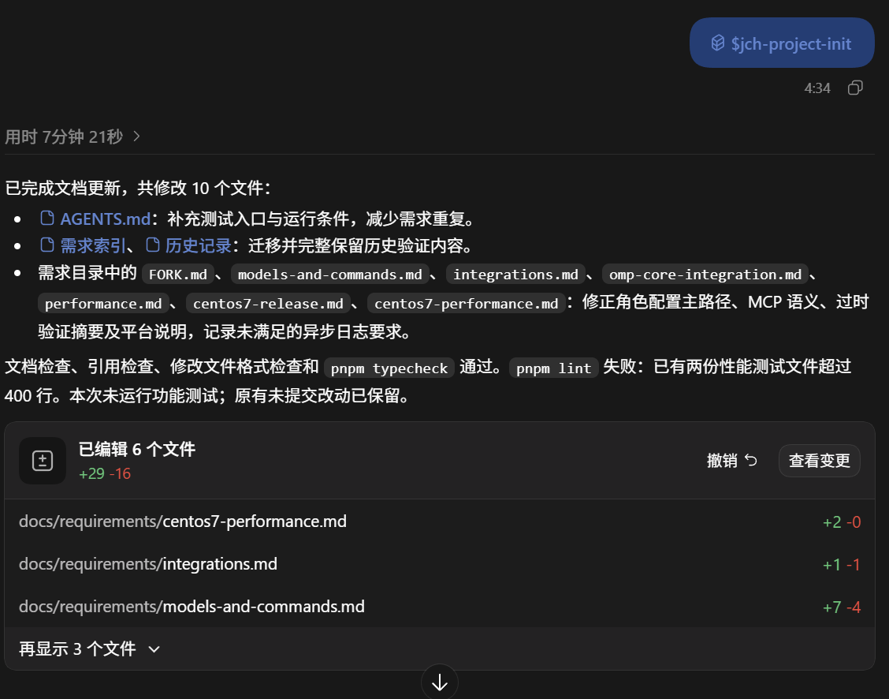
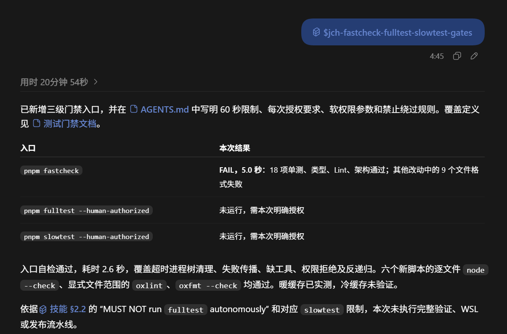
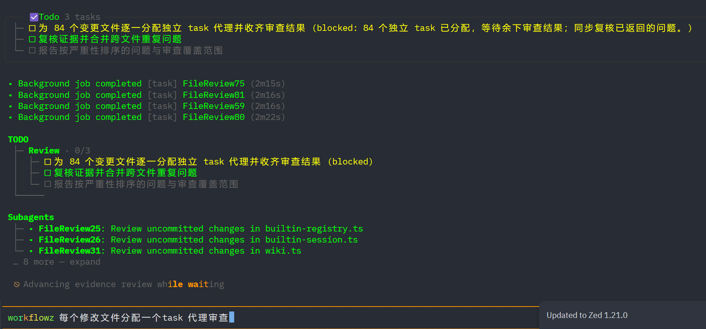
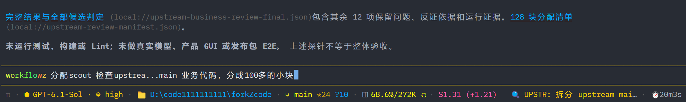
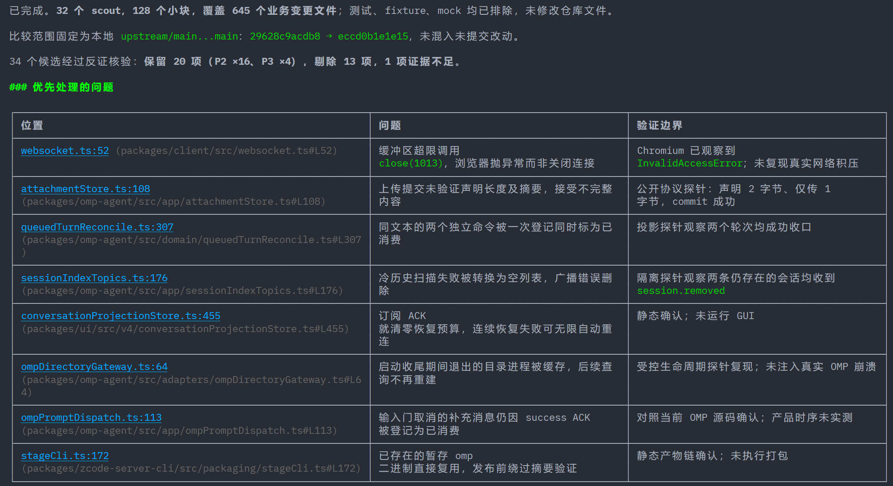
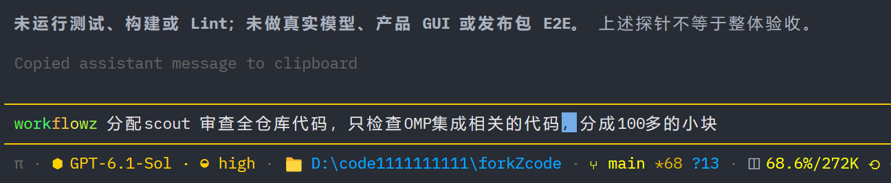
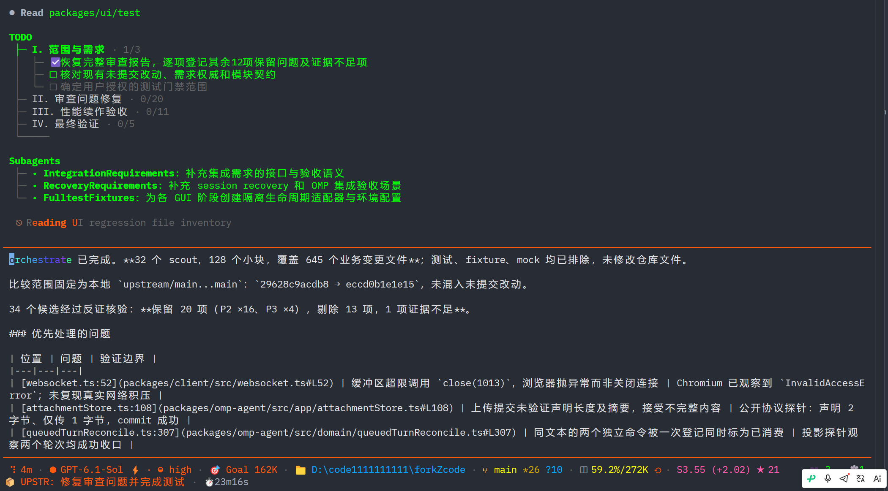

# 公司内网 OMP 新手快速指南（Linux / tcsh）

## 1. 设置环境变量

在启动 OMP 的终端执行：

```tcsh
setenv OMP_OFFLINE 1
setenv OMP_CONFIG_ROOT "$HOME/omp-data"

# 使用团队共享资源时，替换为实际网络文件系统路径：
setenv OMP_SKILLS_DIR "/path/to/shared/skills"
```

- `OMP_OFFLINE`：启用公司内网模式；`1`、`true`、`yes`、`on` 均有效，忽略大小写和首尾空白。
- `OMP_CONFIG_ROOT`：统一的原始数据根，可换成有写权限的绝对路径，支持 `~` 展开；未设置、留空或值无效时使用上游默认目录规则。配置、会话、Wiki／Repo 数据库、日志与缓存均从该根派生，保留 profile 内布局；旧数据不会自动搬迁。Linux 内网模式实际使用下述 shm 运行根，原始根用于后台备份。
- `OMP_SKILLS_DIR`：可选的共享技能根目录，加载其中 `<技能名>/SKILL.md`；同名时共享版本优先，其他用户技能仍保留。目录不存在时不影响原有技能加载，不下载或同步文件。

上述设置可按需放进 `~/.tcshrc`，以后新开的 tcsh 终端自动生效。`OMP_CONFIG_ROOT` 与 `OMP_SKILLS_DIR` 不依赖 `OMP_OFFLINE`，也不需要配置文件；路径示例需替换为实际可访问目录。Wiki 没有独立目录设置：CLI、TUI、RPC 与 AI 的 `wiki` 工具始终使用当前 profile 数据目录下的同一个 `docs.db`，不同 profile 的数据库互相隔离，不提供 NFS 多机共写活动库的保证。

### Linux 内网模式的数据与备份

- **运行在 shm**：仅在 Linux 且启用 `OMP_OFFLINE` 时，将 OMP 自有数据统一读写 `/dev/shm` 下的运行根；路径由原始数据根确定性派生，保留目录名及 profile 布局，并区分用户、主机和不同原始根。`OMP_CONFIG_ROOT` 仍保留原始值，不应手动改成 shm 路径。非 Linux 或非 offline 模式直接使用原始数据根，不启用此映射和备份。
- **启动不恢复**：启动直接使用已有 shm 数据，不访问原始数据根检查备份，不搬运旧配置、会话或索引。shm 为空时就是全新环境，不表示原 NFS 旧文件已删除，也不会清空它们。显式自定义会话目录映射进运行域，不读取原目录；外部 `--resume`／`--session` 文件会报错并提示人工恢复会话及附件，再使用恢复后的运行路径，不自动导入。
- **每 10 分钟后台备份**：前台就绪满一个周期后才首次触发，之后异步备份到原始数据根；设置有效 `OMP_CONFIG_ROOT` 时使用该目录，否则使用上游默认目录。同一数据域的进程协调备份，不在启动或退出时同步复制，也不等待 NFS；短命命令未到周期就退出时，新增数据不保证已备份。备份失败会记录日志并提示，前台仍使用 shm，不回退到 NFS。
- **人工恢复**：在原始根的 `.offline-shm-backups/<domain hash>/current.json` 找到 `current`（最新）或 `previous`（如有）的完整版本；内容位于 `generations/<id>/data/`，旁有 `manifest.json`。先停止对应运行域的所有 OMP 进程及后台任务，再将选中完整版本的 `data/` 内容复制到未使用且为空的 `manifest.runtimeRoot`，保留私有权限、所有者可执行位及符号链接本身，不解引用链接；不要覆盖原始旧 NFS 树、合并到活动目录或复制活动 WAL。没有恢复命令或向导，详细步骤见下方契约。
- **可能丢失的数据**：退出不做最终同步备份；重启、断电、卸载或外部清理可能使 shm 数据丢失。可丢失范围从最近一次成功备份起算，备份持续失败时可能超过 10 分钟；尚无成功备份时不能保证任何新增数据已持久化。tmpfs 也可能使用 Swap，并非保证数据绝不落盘。
- **外部文件与平台前提**：项目源码、项目级 `.omp/`、EDA 文件、Claude Code 配置和共享技能仍在原位置访问，可能继续产生 NFS I/O。`/dev/shm` 不存在、不可写或空间不足时会报告操作失败，不静默换回 NFS 或其他磁盘目录。native 缓存优先普通 shm 映像加载；仅该路径无法执行（如 `noexec`）时，才使用可执行内存后备并要求相应内核／backport、glibc、procfs、运行时及安全策略支持，不为所有 Linux offline 运行统一提高内核／glibc 前提。后备不可用时明确失败，不通过修改挂载、安装依赖或写持久可执行副本绕过，具体前提见下方契约。

路径、逐库而非全局事务的一致性及人工恢复边界以[离线 shm 运行与异步备份契约](requirements/offline-shm.md)为准；实际验证状态见[需求目录](requirements/README.md)，不代表公司 CentOS 7 或实际 shm／NFS 已验收。

## 2. 启动

**按公司环境要求，先启动 IDE 和模型代理：**

```tcsh
ma dmas_ide
ide agent
```

代理就绪后，进入自己的项目目录（替换示例路径）：

```tcsh
cd /path/to/project
omp
```

用 `omp -c` 继续当前项目的最近会话；没有可恢复会话时会新建。

用 `omp -P work` 启动独立 profile（等同 `omp --profile work`）；`omp -P work -c` 继续该 profile 下当前项目的最近会话。不同 profile 的聊天记录、设置及 Wiki／Repo 数据库隔离，无需配置 shell alias。

在上述内网模式下，OMP 复用 Claude Code 中已配置的公司 API 地址和凭据，无需另行登录。

## 3. 常用操作

以下操作都在 **OMP 输入框**中使用：直接输入任务，按 `Enter` 发送；输入 `/` 补全命令，输入 `@` 选择文件。

| 按键 / 命令                    | 用途                                                 |
| ------------------------------ | ---------------------------------------------------- |
| `Ctrl+T` 或 `/switch`          | 查看、临时切换当前会话模型                           |
| `/model`                       | 设置各角色模型                                       |
| `Shift+Tab` 或 `/plan`         | 切换计划模式，先出方案                               |
| `/display`                     | 在干净、紧凑、详细界面之间循环切换                   |
| `Ctrl+O`                       | 详细模式下展开 / 收起工具调用详情                   |
| `Esc`                          | 在主会话中中断当前任务；循环模式下中断本轮并暂停循环 |
| `/tree`                        | 查看、切换会话分支                                   |
| `/copy`                        | 选择并复制对话内容                                   |
| `/copy code`                   | 复制助手回复中最近的代码块                           |
| `/new`                         | 新建会话                                             |
| `/resume`                      | 恢复历史会话                                         |
| `/context` / `/compact`        | 查看上下文占用 / 压缩上下文                          |
| `/wiki`                        | 查询已导入的公司资料                                 |
| `/repo`                        | 建立、更新代码定位索引                               |
| `/team 需求`                   | 多模型独立调查、交叉审查并汇总方案，只读             |
| `/goal-autopilot 目标`          | 持久目标、自动编排与无人值守要求，见第 4.7 节         |
| `/advisor on` / `/advisor off` | 开启 / 关闭第二模型复审，默认逐轮，频率可配置        |
| `/skill:技能名 任务`           | 调用本地技能，从补全中选择技能名                     |
| `/todo` / `/hub`               | 查看待办进度 / 子代理活动                            |
| `/queue 后续任务`              | 当前轮结束后再执行；空闲时直接执行                   |
| `/quit`                        | 退出                                                 |

任务运行中，输入消息后按 `Ctrl+Q` 可排队；按普通 `Enter` 会引导当前任务。快捷键失效时，用 `/hotkeys` 查看绑定。

默认使用紧凑界面：输入框上方只有一个实时思考窗口，最多显示最新五个屏幕行，每次工具调用只显示一行摘要。无需编辑配置文件，可直接选择：

| 命令 | 显示效果 |
| --- | --- |
| `/display clean` | 隐藏思考正文、工具调用及结果，仅保留忙碌状态和助手普通回复 |
| `/display compact` | 显示实时五行思考尾窗，每次工具调用显示一行状态与摘要；失败也保留一行提示 |
| `/display detailed` | 思考仍使用同一个实时五行尾窗，工具详情可展开或折叠 |

选择会保存到当前 profile，下次启动继续生效。`Alt+P` 隐藏／恢复当前实时思考窗口；思考结束、回答或工具开始、取消时窗口消失，不在聊天记录留下旧思考块，原始思考仍随会话保存。紧凑模式下 `Ctrl+O` 不会展开工具正文；要看工具详情，先切到 `detailed`。这些命令只改显示，不关闭思考或工具执行，也不隐藏助手用普通正文发送的进度说明。

如果项目配置、启动参数或其他高优先级设置阻止所选模式完整生效，OMP 会提示当前实际显示方式和覆盖项来源，不会强行改变这些覆盖设置。

这四个命令可**直接带任务文本**：

| 命令           | 用途                                            | 可复制示例                                                   |
| -------------- | ----------------------------------------------- | ------------------------------------------------------------ |
| `/ultrathink`  | 深入分析再行动                                  | `/ultrathink 分析这个错误的根因，给出证据和修复方案`         |
| `/orchestrate` | 拆分任务、委派子代理、整合验证                  | `/orchestrate 按 @a.md 实现，拆分独立任务并行完成，统一验证` |
| `/workflowz`   | 按阶段组织批量多代理任务                        | `/workflowz 按模块检查当前仓库，汇总有证据的功能问题，只读`  |
| `/fullsend`    | 优先速度与验证质量，不以成本或 token 用量为约束 | `/fullsend 按 @a.md 完成实现和必要验证，修复问题后复测`      |

这些命令会向模型追加任务要求。`/orchestrate` 依赖 `task` 工具，`/workflowz` 依赖 `task` 和 `eval` 工具；使用时需启用所依赖的工具及相关设置。

独立任务批处理使用 `/jch-workflowzbatch`，参数、执行限制和 rpc-ui 接入见第 4.6 节。

## 4. 企业核心功能（本 fork）

### 4.1 `/wiki`：把公司资料变成可查询的知识库

用来查内部规范、接口约定、历史方案和业务术语。**先导入资料，再查询**。它不做联网搜索，也不会自动抓取公司知识库。

**首次导入：**

1. 准备已导出的 Markdown 目录。导入会递归读取 `.md` 文件，跳过符号链接。PDF、Word 等需先转成 Markdown；图片、附件和链接目标不会随正文入库。
2. 在 OMP 输入框输入 `/wiki`，按 `n` 新建，填写索引名和目录，确认后等待导入完成。面板会列出索引名、文档数、章节数和源目录。
3. 也可在**系统终端**执行以下命令，替换目录和索引名。终端与 OMP 会话须使用一致的 `OMP_CONFIG_ROOT`、profile 和 `OMP_OFFLINE` 环境；会话使用 `-P work` 时，导入与删除命令也须加上 `-P work`：

```tcsh
omp docs init "/path/to/company-markdown" --name "company-docs"
```

索引名必须唯一，同名不会覆盖。导入和检索都在本机完成，不调用模型，也不需要向量服务。

只有完整导入成功后，索引才可见；失败或取消不会留下可查询的半成品。

**自己查资料：**

1. 在 `/wiki` 面板用 `↑/↓` 选择索引，按 `/` 输入关键词或问题，按 `Enter` 搜索。面板只搜索当前选中的索引；查询与续页会显示加载状态，不阻塞输入或渲染，等待时可按 `c` 或 `Esc` 取消，关闭面板也会取消未完成操作。
2. 用 `↑/↓` 选中结果，按 `Enter` 查看正文，按 `b` 回到当前页结果。提示还有结果时，按 `n` 取下一页；直到显示结果已耗尽。按 `Esc` 返回索引列表或关闭面板。

续页失败或取消会保留当前结果页及所选正文，不必丢弃已有依据。同一数据库快照中的查询与续页复用完整排名，不会每页重新扫描／排序全部资料；数据库变化后仍须遵守下方的游标失效规则。每次成功搜索（含续页和零命中）对外总时长不少于 500ms；实际工作不足此下限时异步等待补足，仍可取消，不表示数据库工作本身用了 500ms，也不是 500ms 响应上限。

导入、删除或加载索引列表时也会显示当前操作状态，按 `c` 或 `Esc` 直接取消未完成操作；忙碌时的 `Esc` 不再先要求确认关闭，取消后可再按 `Esc` 返回或关闭面板。

**让 AI 查资料并解释：** 退出面板，在普通对话中输入：

```text
用 wiki 查询 MBIST 仿真日志的检查项和判据，按索引名、文件路径和行号标注依据；区分资料明确规定与推断，缺少依据时说明。
```

AI 的 `wiki` 工具搜索全部已导入索引，返回完整章节正文和来源。工具本身只读，不代为新建或删除索引；查询、续页和引用都来自当前 Wiki 数据库，源目录移走后仍能使用。

可以输入关键词或整句，中文不用分词。查询没有布尔、引号或通配符语法，`AND`、`OR`、`*` 都按普通字符处理。技术主题、词组和本节标题优先；查询 `mbist_check.rpt`、`std::vector` 等名称时保留原有标点，大小写不影响完整名称匹配。`match=exact-name` 表示完整名称证据，`match=related` 只表示相关；`未找到完整名称命中` 不能解释成已找到该名称。

工具每页通常约 8000 字符，首节过长仍完整返回。页脚若给出下一次调用的 JSON，让 AI 保持同一个 `query` 并传回 `cursor` 继续取页，不要为了拿剩余资料改写问题；需要全部资料时一直取到明确耗尽。例如首次调用 `{"query":"MBIST 仿真日志"}`，后续按返回的 `{"query":"MBIST 仿真日志","cursor":"实际返回的游标"}` 继续。重复正文可指向同页已展示的文字，但每个来源仍可引用，下一页也有自己的完整文字。

已有索引但返回 `0 matches` 是正常查询成功，只说明本次检索的已导入资料中没有匹配。没有索引、参数非法或游标失效仍是错误；若导入／删除改变了数据库，旧游标不能继续，需用原 `query` 不带游标重新开始。

**资料更新：** 索引保存导入时的 Markdown 快照。源目录移走后仍可查，源文件修改却不会自动刷新。重新导出后，先删除旧索引，再重新导入：

```tcsh
omp docs remove "company-docs" --force
omp docs init "/path/to/company-markdown" --name "company-docs"
```

删除只移除当前 profile 数据库中的索引，不删除源资料，也不影响其他 profile。也可在面板按 `d`，再按 `y` 确认删除。

刷新前先确认新导出目录可读。删除后若重新导入失败，旧索引不会自动恢复。没有 `omp docs update`、`list` 或 `status` 命令；查看已有索引用 `/wiki`。

引用的路径、行号对应导入时的版本，不一定是源文件现状。查不到不等于公司没有相关规定，历史资料也不自动代表现行规范。详细约定见[文档索引需求](requirements/fork.md#markdown-文档索引)。

### 4.2 `/repo`：为当前项目建立代码定位索引

用来反复查实现、错误信息、配置键和 Python 定义。代码索引与公司资料的 `wiki` 索引分开维护；建库、查询不调用模型，也不需要安装语言服务器。

**首次建立：** 进入目标项目启动 OMP，输入 `/repo`，核对面板的 `Root:`，按 `b`，再按 `y` 确认建立。

Git 项目索引当前 worktree 的根目录；即使从子目录启动，也会索引整个 worktree。非 Git 项目索引启动时的当前目录。数据库保存在用户数据目录，按 profile 和项目根目录隔离，不向源码目录写库。

面板可查看文件数、Python 符号数、索引代次（`Generation`）、覆盖状态（`Coverage`）、待处理路径（`Pending`）、失败（`Failures`）和最近完整核对时间（`Last full check`）。

| 面板按键  | 操作                                                                         |
| --------- | ---------------------------------------------------------------------------- |
| `u`       | 更新：完整枚举、读取并核对当前范围，同步新增、修改和删除；内容未变不重新解析 |
| `r` → `y` | 重建；数据库损坏或不兼容时可用此入口恢复                                     |
| `d` → `y` | 删除该项目索引，不删除源码                                                   |
| `c`       | 取消正在进行的建立、更新或重建                                               |
| `Esc`     | 关闭；操作中先确认是否取消并关闭                                             |

失败或取消时不会发布半成品，原有可用索引会保留。首次建库须在面板确认，AI 查询不会自动建立。**没有 `omp repo ...` 系统终端命令组**。

**让 AI 定位代码：** 建库完成后，在普通对话中输入：

```text
用 repo 搜索当前项目中读取配置的代码候选，再读取当前源码确认并解释处理流程。
```

```text
用 repo symbol 定位 Python 类 ConfigLoader 及其 load 方法的定义，读取当前文件后解释输入、输出和错误处理。
```

这里的 `repo search`、`repo symbol` 是 AI 工具动作，不是要在终端执行的命令。

- `search` 查源码、测试和配置等文本候选，可按相对路径缩小范围。
- `symbol` 仅定位 Python 模块、类、函数和方法的定义及可用签名。其他语言用文本搜索或已有语言工具。
- 需要覆盖详情时，可让 AI 调用 `repo status`；它不扫描源树。

**何时更新：**

- OMP 内建的文件编辑、新建、删除和重命名操作会记录已知变化。已有索引会在下一次文本或符号查询前局部处理这些变化。
- 切分支、用外部编辑器改动、在外部批量新增/删除，或修改 `.gitignore` 等范围规则后，在 `/repo` 按 `u` 完整核对。不能保证查询会自动发现这些变化。
- 执行 bash/eval 等操作后，可能标记为 `unchecked`（未核对）。Git 候选线索不等于完整核对；看到未核对、待处理或失败提示时，不要把旧结果当成当前的完整覆盖。

索引遵循忽略规则，不纳入符号链接、二进制、无效 UTF-8、超 2 MiB 等文件；具体排除或失败情况看状态。

**命中只是定位线索**。编辑前必须读当前源码；找全部出现位置用 `grep`，按文件名找文件用 `glob`。调查调用方或影响范围，需结合当前源码和可用 LSP。索引不提供调用图、依赖分析或测试覆盖判断，无命中不能证明代码不存在。详细约定见[代码定位索引需求](requirements/repo-index.md)。

### 4.3 `/team 需求`：多模型调查、交叉审查与方案汇总

适合需求还不清晰、实现方向存在取舍，或需要核对公司规范与现有代码的任务。**只做分析和规划，不自动实施。**

先用 `Ctrl+T` 选好负责对齐与最终汇总的当前会话模型，再在输入框描述目标、资料入口、约束和希望得到的结果。以下示例中的 `a.md` 须已存在且路径明确：

```text
/team @a.md 结合现有代码和内部 wiki 比较可行方案，保持已有接口兼容，给出关键证据、推荐理由、主要风险、执行前检查和验收条件。
```

只输入 `/team` 会提示补充问题，不会猜测任务。

在 `OMP_OFFLINE=1` 且未另设 `team.members` 时，默认使用当前可用且启用的公司聊天模型。当前会话模型也会参与独立提案，重复模型只算一次。

显式设置的 `team.members` 优先，与 `/model` 的角色设置不是同一项。指定成员不可用时会报错，不会静默略过。普通非内网启动没有这份公司默认名单。

程序会推进讨论流程：各模型先独立调查，再对齐需求与验收标准、交叉审查、修订与必要复核，最后汇总。每个方案最多两轮修订，过程中无需手工分配代理、转发意见或回答中途问题。

阶段与模型状态看启动后的提示，子代理明细可用 `/hub` 查看。取消时，按启动提示使用后台任务取消入口；主会话中按普通 `Esc` 不代表整个讨论已取消。

子代理通过工具白名单保持只读：可以读文件、搜索代码和查 `wiki`，不能写项目文件、运行 bash/eval、安装依赖、构建测试、更新索引、提交或推送。“修订”只改方案内容，正常会话记录仍会保存。

当前 `/team` 子代理**不开放 `repo` 工具**，调查代码使用只读文件和搜索工具。公司资料应提前通过 `/wiki` 导入。

结果会回到当前会话，包括共同需求与验收标准、方案、证据、取舍、风险和待核实前提，不会自动生成项目中的方案文件。

只有方案有明确优势时才推荐，不靠多数票。未解决阻断或必要复核未完成的方案会标为“尚不可采用”。成员失败会如实显示，必要阶段失败会报告流程未完成；不能把失败当成同意或验证通过。

回复“选择方案 A”只确认方案，不授权改代码。实施需另发明确任务，例如后文的 `/goal` 示例。

若补充约束实质改变了方案，或结果提示需求理解存在重要差异，带上澄清后的要求重跑 `/team`。详细约定见[多模型方案讨论需求](requirements/team.md)。

### 4.4 项目文档初始化与维护：`jch-project-init`（可选本地技能）

接手大项目、补齐 Agent 开发规则，或在模块和需求变化后重新核对文档体系时，可以使用该技能。这里俗称的 **jch-init**，实际技能名是 `jch-project-init`；它不是内置 `/init` 命令。

**前提：** 该技能已安装在本地，并能在 `/skill:` 补全中找到。以下两个技能都不是 OMP 自带功能，内网使用前须准备好本地技能，不在任务中在线安装。

截图中的 `$技能名` 是另一宿主的选择界面，OMP 使用 `/skill:技能名`。

在目标项目目录启动 OMP，输入：

```text
/skill:jch-project-init
```

该技能只允许显式调用，作用于当前项目，**不接受参数**。它自动分析项目并维护两类文档：

- **多层级 `AGENTS.md`**：根文件保存全局规则、真实入口和验证要求。少量有独立业务职责的子目录保存本模块规则、入口和注意事项，不在每个目录建一份。全仓含根文件最多 8 份，子文件不重复根规则。
- **固定需求目录**：优先使用项目已明确的目录，否则默认 `docs/requirements/`。自有项目维护产品需求，持续同步上游的 fork 维护本地差异需求。按功能边界组织，每条需求只有一个权威位置，需求文档数量不限。

已有文档会增量核对和更新，缺失时补齐；分散的需求会按权威关系迁移，并修正引用。技能会保留有效需求、明确规划和已有改动，不会因为实现未完成就删减需求。

后续需求或用户可见行为变化时，应按写入的项目规则同步维护对应需求文档。该技能不是后台监听服务，重新核对仍需显式调用。

**只维护文档体系和必要引用**，不修改业务代码、配置或测试，不同步上游、不提交或推送。文档检查通过不代表功能验收通过。



截图来自另一项目，报告了文档更新和类型检查结果，也明确说明 Lint 失败、未运行功能测试。截图展示的是维护报告，不能据此认为该项目整体已验证。

### 4.5 为项目建立三级测试门禁：`jch-fastcheck-fulltest-slowtest-gates`（可选本地技能）

项目已有检查、测试或 CI，但入口零散、执行权限不清楚时，可以使用该技能。它面向任意代码项目，按实际技术栈复用已有质量检查，建立或完善三个统一入口，**不改写检查标准来让门禁变绿**。

在目标项目目录启动 OMP，显式输入：

```text
/skill:jch-fastcheck-fulltest-slowtest-gates
```

下表是技能的**通用三级方案**，不代表本 fork 现有的门禁配置。本 fork 的预算、覆盖范围及执行权限仍见 [根 AGENTS.md 的验证规则](../AGENTS.md#验证)，不能用此表覆盖项目规则。

| 入口 | 通用覆盖范围 | 执行权限与边界 |
| --- | --- | --- |
| `fastcheck` | 高价值、快速的必要检查子集 | AI 可自主执行；单次非编译硬上限为 90 秒，超时终止本次进程树并报失败，不代表完整验证 |
| `fulltest` | 当前平台按项目权威范围定义的完整本地检查与测试 | 本次须明确人工授权；不切换到第二平台，不触发远端 CI 或发布 |
| `slowtest` | `fulltest` 语义，加项目适用的跨环境、跨平台及已有远端／发布流水线 | 本次须明确人工授权；先确认目标与副作用，缺环境或未得到流水线完成结果不能报整体通过 |

技能会调查现有能力、调整入口编排、记录权限，实测 `fastcheck` 耗时，并自测超时清理和失败传播。

耗时长但属于当前平台完整验证的测试仍归 `fulltest`，不会仅因慢就移到 `slowtest`。项目没有适用的 WSL 或远端流水线时，技能不会凭空增加；必要环境缺失则标为未验证。

调用技能**不等于授权运行 `fulltest` 或 `slowtest`**。需要运行时，另发明确任务，例如“在当前项目运行 fulltest 一次”。不得绕过门禁直接执行内部子步骤，也不能把授权标记参数本身当成人工授权。

若现有项目规则与技能预算或覆盖要求冲突，应报告冲突，并先明确改造范围，不能在介绍或调用中静默改写规则。



截图中的 `fastcheck` 为 **FAIL**，`fulltest` 与 `slowtest` 未运行。入口自检或部分检查通过，不等于三个门禁通过。

截图使用 `pnpm` 和该项目的授权标记参数，不是本 fork 或所有项目都可照抄的终端命令。

### 4.6 `/jch-workflowzbatch`：独立任务批处理

适合全仓审查、按文件补日志、局部格式优化等**可以独立并行完成**的工作，不用于前后任务相互依赖的流程。这是内置命令，无需安装技能；使用时需启用 `task`、`eval` 工具及 `workflowz` 相关关键词设置。

在 **OMP 输入框**输入，任务正文可按需替换：

```text
/jch-workflowzbatch 200 30 审查并修复本仓库 fork 自有改动中有证据的功能 bug；不修改上游原样代码，不为凑数量扩大范围。
```

| 参数 | 含义 |
| --- | --- |
| `200` | 期望最多约 200 个任务块，属于软目标；按实际工作量调整，不要求凑满 |
| `30` | 同时运行子代理总数的上限指令，包含嵌套子代理；已有配置上限更低时遵守更低上限 |
| 后续正文 | 实际任务、处理范围和具体要求；不能为空 |

两个数量必须为正整数。命令展开为普通用户消息，自动带上 `workflowz` 和批处理要求，等同于手动输入完整要求；不修改全局配置，也不新增程序级并发限制。

OMP 按要求先确定范围与统一规则，再拆分独立工作项、排队并行执行，完成后及时补位，不等整批全部结束才启动下一批。修改型任务按不重叠文件集合分配，避免多个子代理同时改同一文件；不为占满并发扩大任务范围。

任务块数与并发槽数独立：可以排入多于 30 个工作项，由最多 30 个同时运行的子代理持续处理，不要求拆满 200 块。子代理自主完成各自范围内的工作并返回精简结果；审查修复时，证据不足只列候选，跨界发现交主代理协调，不越界修改。主代理负责调度、补位、跨界协调和汇总，不逐项重读源码、重审全部改动，也不把集中运行检查作为收尾要求。

**本模式自动附带的限制，主代理和所有子代理都必须遵守：**

- 禁止任何测试，包括单文件测试、冒烟和 E2E。
- 禁止全仓格式化、全仓静态检查及 `fastcheck`、`fulltest`、`slowtest` 等门禁。
- 仅允许对自己负责修改的文件执行文件级非测试检查，或任务要求的局部格式化；工具不能限定这些文件时不执行，不扩大到目录、包或全仓。
- 与仓库及子目录 `AGENTS.md` 的验证要求冲突时，以本次批处理限制为准；其他规则继续有效，不覆盖系统及开发者级约束。主代理汇总时也不能补跑禁止的操作。

这些是发送给模型的执行要求，**不是工具层拦截或绝对保证**。结果应列出完成项、失败或受阻项、修改文件和实际文件级检查，并明确注明测试未运行、跨文件及运行时行为未验证；不能把批处理结束当成功能验收通过。

OMP 终端与 `rpc-ui` 后端支持同一命令。RPC 接入方从命令目录和补全发现它，再通过现有 `prompt.message` 发送整条命令，不需要新增批处理协议；这不代表桌面 GUI 联调或真实模型的大规模批处理已验收。

完整行为与优先级见[需求：JCH 命令](requirements/fork.md#jch-命令)，RPC 接入见[ZCode 接入需求](requirements/rpc-ui-protocol.md#必须接入的命令)。

### 4.7 `/goal-autopilot`：无人值守目标

适合需要持续调查、规划、实施和验证的长任务，例如夜间处理项目中的功能问题。按需求契约，它复用上游 `/goal` 的正常目标管理与历史消息链，附加完整目标、共享 Orchestrate 编排规则和既有无人值守要求，不再采用每次模型请求临时注入完整自定义提示词的策略；普通 Goal 的提示、状态管理与续跑规则继续沿用上游。

首次构造的完整提示词进入正常聊天与会话历史，并保存在会话记录和 dump 中。工具轮次、模型续接、重试及允许的自动续跑复用已有历史，不重建或重复插入完整自定义提示词；两次实际压缩之间，已生成提示词的原文与位置保持不变。只有上下文压缩成功提交后，才从保存的完整目标重新构造、再次展开共享 Orchestrate 规则并持久化，不能只依赖可能省略目标与规则的压缩摘要。构造时按已启用的工具能力判断是否可用 `task`（含经 `eval` 间接调用）；不可用时仅省略 Orchestrate，仍保留目标和无人值守要求。

本模式的附加提示词明确要求：完成目标全过程及所需全部操作已获用户授权，直接自主执行、验证和修复，不提问、不请求确认、不要求选择、不等待输入；与此前用户级要求冲突时，以本次明确授权为准。

稳定历史不等于免费或保证缓存命中；实际压缩仍按上游流程改写上下文，不能保证旧缓存跨压缩保留或费用下降。实际实现与验收状态见[需求目录](requirements/README.md)。

先退出计划模式，再在 **OMP 输入框**输入：

```text
/goal-autopilot 修复当前项目中有证据的功能问题，保留无关已有改动；按项目规则完成必要验证，汇总结果与受阻项。
```

这些附加提示词要求模型自主调查、拆分与委派、实施和验证，避免反复要求用户选择普通方案；确实无法自主解决或需要额外授权的工作应标为受阻，继续其他可执行工作，最后如实汇总。

| 命令 | 用途 |
| --- | --- |
| `/goal-autopilot set 新目标` | 创建或替换目标，启用本模式 |
| `/goal-autopilot show` | 查看当前目标、状态与预算 |
| `/goal-autopilot pause` | 暂停目标，停止新增提示词构造与目标工作，不删除或移动已进入历史的提示词 |
| `/goal-autopilot resume` | 恢复目标原有模式 |
| `/goal-autopilot budget N` | 设置 token 预算；把 `N` 换成具体数值 |
| `/goal-autopilot budget off` | 关闭目标的 token 预算限制，不解除其他权限或停止条件 |
| `/goal-autopilot drop` | 删除目标，按原 Goal 流程确认；保留已经修改的代码 |

**与普通 `/goal` 的区别：**只有用新命令创建或替换目标才启用自动编排标记；对普通目标执行 `/goal-autopilot resume` 不会将它转换为本模式。模式标记随目标保存，重新打开会话后的暂停与继续行为沿用原 Goal 规则。

**不是无限续跑或自动授权：**是否自动续跑仍取决于原有 Goal 设置和触发条件；预算、停止、取消、权限审批及用户后续指令继续有效。无人值守要求不保证模型绝不提问，也不保证所有任务必然完成；需要额外授权时不能代替用户批准。

它不同于第 4.6 节的独立批处理命令，**不会自动附带“禁止测试、禁止全仓检查”的限制**；检查和测试按本次目标及项目规则执行。用 `/todo`、`/hub` 查看任务与子代理进度，是否完成以实际结果为准。

OMP 终端、`rpc` 与 `rpc-ui` 后端均支持此命令。完整契约见 [Goal 自动编排需求](requirements/goal-autopilot.md)，实现与验收边界见[需求目录](requirements/README.md)。

## 5. 直接复制的例子

**开启复审（默认逐轮）：**

```text
/advisor on
```

`/advisor status` 查看状态，`/advisor off` 关闭。提示缺少模型时，用 `/model` 设置 advisor 角色。

**解释文件：**

```text
@a.md 解释这个文件的用途和主要流程，只读，不修改。
```

**首次执行后最多再重复 3 轮（共最多 4 轮）：**

```text
/loop 3 hello
```

**首次检查、修复后最多再重复 5 轮（共最多 6 轮）：**

```text
/loop 5 检查当前改动，发现明确功能问题就修复，然后重新检查；没有问题就不要做无关修改
```

**指定轮次间隔（无需参数名）：**

| 命令 | 行为 |
| --- | --- |
| `/loop 10 30s xxx` | 总计执行 10 轮，每轮结束后等待 30 秒再启动下一轮 |
| `/loop 10m 30s xxx` | 总时长 10 分钟，轮次间隔 30 秒，等待也计入总时长 |
| `/loop 10 xxx` | 保持旧行为：首次执行后最多再重复 10 轮，不指定间隔 |

把 `xxx` 换成任务正文。语法为 `/loop [次数或总时长] [间隔] [任务内容]`；首轮立即执行。间隔使用完整的时长标记（如 `30s`、`5m`、`1h`），仅在次数或总时长之后紧接的位置识别；后续文本作为任务正文。指定间隔时次数包含首轮，不指定时保留原有重复次数语义。等待期间可按 `Esc` 暂停；总时长到期后不再启动下一轮。

按 `Esc` 会中断正在执行的本轮并暂停循环。暂停后发送新任务会继续循环，输入 `/loop` 才会关闭。

循环已开启时，再次输入 `/loop ...` 会关闭它，不会改成新的轮数。上述例子不会因“没有问题”而自动提前终止循环。

**按方案实现、测试并独立复审（先确认项目里有 `a.md`）：**

```text
/goal @a.md 按方案实现所有代码，补充必要的测试；必须覆盖所有主要接口，必须通过所有 UT，完成代码后必须分配独立子代理对你的代码进行检查。
```

先退出计划模式，再执行上述任务。用 `/goal show` 看状态，`/goal pause` 暂停，`/goal resume` 继续，`/goal drop` 删除目标（保留代码改动）。

测试结果和子代理过程以实际输出为准。

**工作流使用例子：**

```text
/workflowz 每个修改文件分配一个 task 代理审查
```



也可以把大范围业务代码审查拆成小块，分配 scout 并行调查，再汇总问题与验证边界：

```text
/workflowz 分配 scout 检查本地 upstream/main...main 的业务代码，分成 100 多个小块；只读，不修改文件，汇总有证据的问题并说明验证边界。
```

将比较范围替换为自己项目的本地分支或提交；以下截图来自另一项目，仅作工作流示例。





截图中的探针结果不等于整体验收；未运行的测试、构建、Lint、真实模型及 GUI / 发布包 E2E 须明确标注。

**超大项目：只审查其中一个模块。**

模块代码可能分散在多个目录。先在全仓库定位相关实现与直接调用链，再按实际规模拆成小块并行审查，不扩大到无关模块。以下以 OMP 集成模块为例：

```text
/workflowz 分配 scout 在全仓库中定位并审查 OMP 集成相关代码及其直接调用链，按规模分成 100 多个小块；只读，不修改文件，不审查无关模块，汇总有证据的问题并说明验证边界。
```

将 `OMP 集成` 替换为目标模块名称，并补充已知目录或接口。拆分数量按模块规模调整，不必凑够 100 块。



**编排使用例子：**

已有审查报告时，用 `/orchestrate` 组织后续修复。先核对需求与已有改动，再拆分独立任务、委派子代理，最后统一集成验证。

```text
/orchestrate 按上面的审查报告修复有证据的问题，先核对现有未提交改动、需求和模块接口；拆分独立任务并行处理，不覆盖已有改动，按项目规则完成必要验证并说明未验证项。
```

以下截图来自另一项目，展示阶段待办与并行子代理。截图中任务仍在执行，不代表修复或验收已完成。



**查看子代理和任务进度：**

```text
分配一个独立子代理，让它返回 hello。用 todo 工具跟踪进度。
```

用 `/hub` 看子代理，`/todo` 看进度。

## 6. 用不了时

- **模型不可用**：先确认 IDE 和代理已启动；在系统终端运行 `omp models`，检查是否有 `company` 模型及错误提示。
- **公司配置错误**：检查 `~/.claude/settings.json` 的 `env.ANTHROPIC_BASE_URL`、`env.ANTHROPIC_AUTH_TOKEN`，改完重启 OMP。配置在其他目录时设置 `CLAUDE_CONFIG_DIR`。
- **旧会话找不到**：确认项目目录、`OMP_CONFIG_ROOT` 和 `PI_CODING_AGENT_DIR` 与之前一致。用 `omp config path` 查看 agent 配置目录，但它不一定是实际会话目录。未设置 `OMP_CONFIG_ROOT` 时，已生效的 XDG 数据目录也可能影响会话存储位置。
- **复制失败**：直接选择终端文本复制。

内网使用本地技能和公司资料，不使用公网搜索、在线安装或更新。

`OMP_OFFLINE=1` 会关闭公网工具及自动更新，但不会拦截显式安装、更新命令。内网不要运行这些联网命令。

## 7. 项目地址

- **CLI（终端版）**：[oh-my-pi](https://github.com/jchanghong023/oh-my-pi)，本指南使用的 OMP fork。
- **桌面 App**：[OmpCode](https://github.com/jchanghong023/OmpCode)，内置 OMP 核心，无需另装 CLI。提供 **CentOS 7 x64 专用兼容 ZIP**，可由普通用户解压后离线运行，无需 root 或升级系统 glibc；仍需图形会话和系统桌面库。

CentOS 7 兼容包使用已停止维护的 Electron 28，并关闭 Chromium 沙箱，仅用于可信工作区。公司 Citrix 图形环境尚未验证；下载和运行方法见 OmpCode 项目 README。内网使用前，应在可联网环境准备好安装包，再传入内网。
