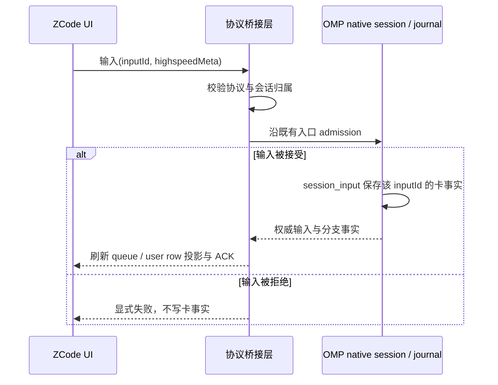
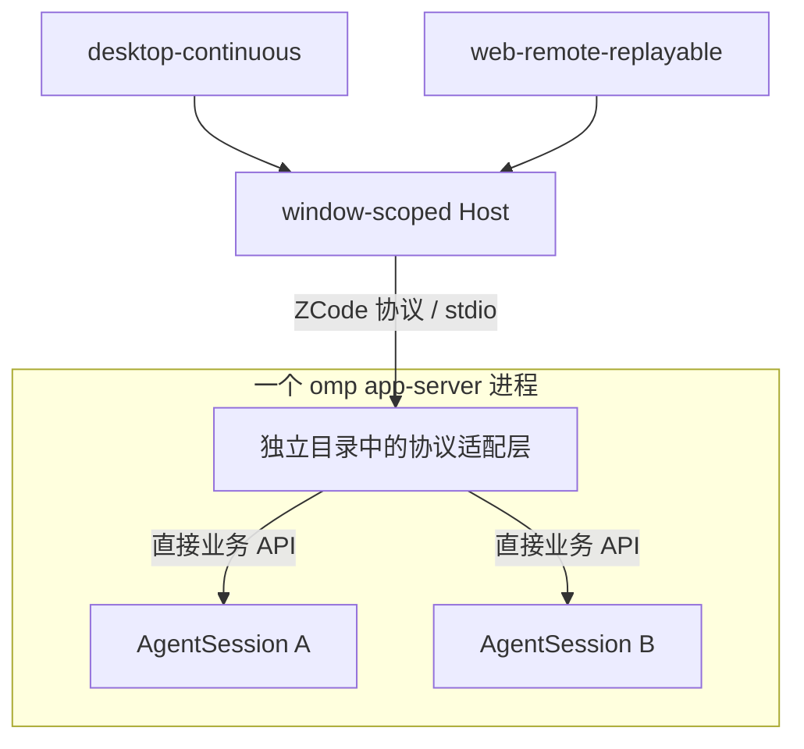
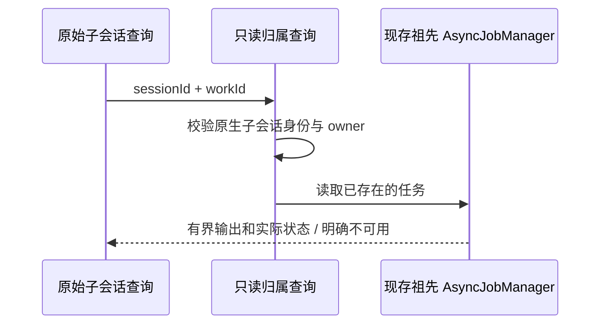
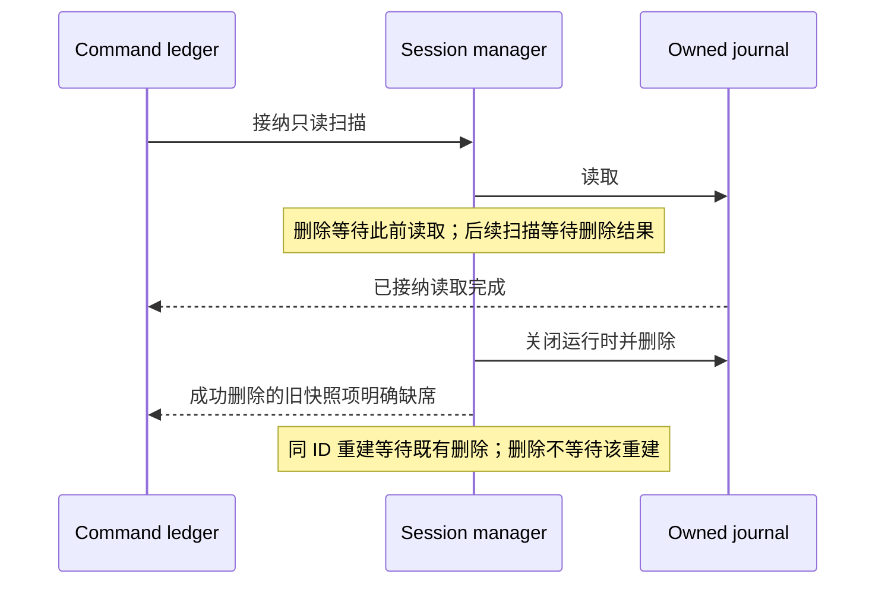
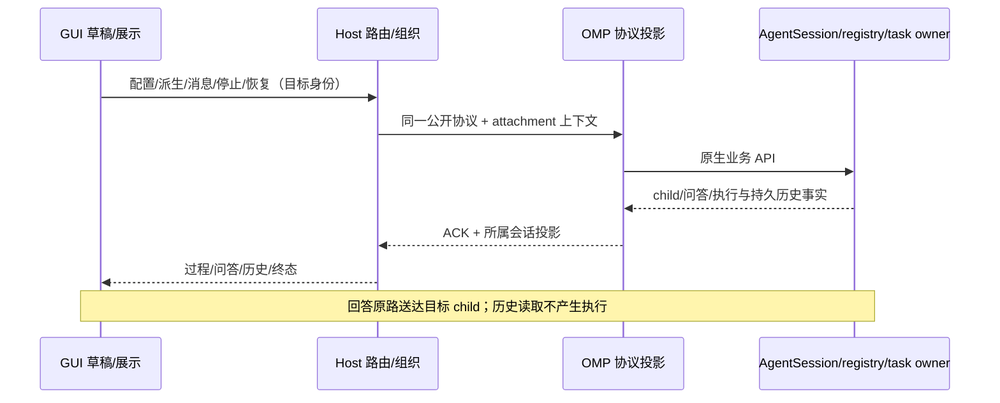
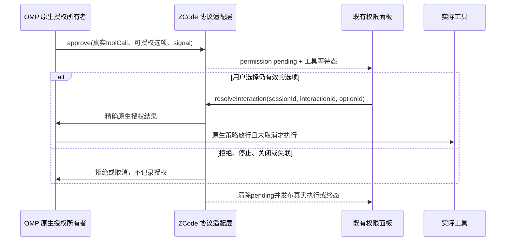

# ZCode 接入需求

使用 ZCode 的界面框架与风格，以 OMP 作为 Agent 核心。模型服务和认证就绪后，用户无需手工编写 OMP 配置文件即可开始使用。共同场景约束见 [Fork 定位](fork.md#项目定位与使用场景)，两仓职责按下节分开维护。

## 文档职责与需求引用

- **ZCode 外部协议与既有产品合同**：由固定兼容提交中的 ZCode 公开 schema 及下列当前规格定义，不由本文件另造 wire 或覆盖既有合同。
- **OMP 侧**：本文件是 OMP 子命令、独立协议目录、同进程业务 API 调用、存储准备生产端、会话／索引投影及功能／权限合同的权威。上游独立 RPC 模式保持上游原样（`modes/rpc` 与上游逐字一致），fork 不修改、不使用：它不是 app-server 内部调用链，也不成为 ZCode 的外部协议；桌面 App 接入 OMP 的唯一入口是 ZCode 协议。
- **ZCode 侧**：运行入口和环境注入、准备进程的消费／监督、桌面与远端发行装配及上游源码保留，以 `F:/code2026/forkZcode/fork.md` 的 FORK-003 为权威。本文件只引用其宿主职责，不重复定义装配实现。
- [OmpCode 需求在线入口（浮动 dev）](https://github.com/jchanghong023/OmpCode/blob/dev/fork.md) 有意用于发布导航，不表示远端已经包含本地确认的合同。未取得双方真实需求发布提交前，以各仓本地需求文件为准；发布时分别记录实际提交并更新引用，不虚构 SHA。需求发布提交与下节固定的协议源码提交分开管理，不因源码可访问而宣称新需求已发布。

## 协议权威来源与固定基线

OMP 新增的是 ZCode 现有协议的兼容实现，不是另外设计一套 App–Agent 协议。本节直接引用 ZCode 仓的文档、schema 和真实调用边界，不在 OMP 需求中复制整套字段定义。

- **兼容仓库**：<https://github.com/jchanghong023/OmpCode>。
- **固定兼容提交**：`c7c190724f3a00a2de998a0a5511201d5a2ba1a0`；[固定提交源码](https://github.com/jchanghong023/OmpCode/tree/c7c190724f3a00a2de998a0a5511201d5a2ba1a0)。这不是浮动的 `dev`／`main`，也不是本 OMP fork 的上游基线。
- **本地参考根目录**：`F:/code2026/forkZcode`。下表直接列出本机可读取路径；它们是开发参考位置，不是发行物或运行时的跨仓源码依赖。换机器时按同一固定提交定位仓库，不能依赖该盘符运行。
- **版本层次**：外层 ZCode Protocol 为 `1`，V4 wire 为 `3`、projection snapshot schema 为 `1`；V4 的 `3` 是 ZCode wire 版本号，与上游独立 RPC 的 v3 无关，不能因数字相同而混用信封或字段。具体常量和解析规则以固定提交的源码为准。

### 语义与字段规格

| 权威内容                                | ZCode 仓内的直接路径                                                      |
| --------------------------------------- | ------------------------------------------------------------------------- |
| 总览、传输拓扑、职责和兼容面            | `F:/code2026/forkZcode/docs/zcode-protocol.md`                            |
| 当前 conversation 产品语义              | `F:/code2026/forkZcode/docs/conversation-product-protocol.md`             |
| V4 字段级主规格                         | `F:/code2026/forkZcode/docs/v4-refactor/10-protocol-spec.md`              |
| command、ACK、inbox 与幂等裁决          | `F:/code2026/forkZcode/docs/v4-refactor/03-commands.md`                   |
| topic、seq、snapshot 和恢复             | `F:/code2026/forkZcode/docs/v4-refactor/04-sync-and-recovery.md`          |
| stdio／wire 分帧、大小限制与背压        | `F:/code2026/forkZcode/docs/v4-refactor/05-transport-and-backpressure.md` |
| fault／reason code                      | `F:/code2026/forkZcode/docs/v4-refactor/12-fault-catalog.md`              |
| sessions-index 语义及与组织元数据的边界 | `F:/code2026/forkZcode/docs/v4-refactor/14-sessions-index.md`             |

### 可执行合同与真实消费边界

| 合同或参考实现                                                                     | ZCode 仓内的直接路径                                                                                                                                                              |
| ---------------------------------------------------------------------------------- | --------------------------------------------------------------------------------------------------------------------------------------------------------------------------------- |
| V4 全部公开 schema、类型、限制和纯函数                                             | `F:/code2026/forkZcode/packages/shared/src/zcode-protocol-v4/`                                                                                                                    |
| 方法、通知、握手、订阅及查询全集：`V4_METHODS`、`V4_NOTIFICATIONS`                 | `F:/code2026/forkZcode/packages/shared/src/zcode-protocol-v4/transport.ts`                                                                                                        |
| 命令 payload、ACK、CAS、查询合同：`commandPayloadSchemas`                          | `F:/code2026/forkZcode/packages/shared/src/zcode-protocol-v4/command.ts`                                                                                                          |
| wire 版本、row target、profile 与限额；snapshot／row／delta 字段另见同目录对应文件 | `F:/code2026/forkZcode/packages/shared/src/zcode-protocol-v4/core.ts`                                                                                                             |
| 外层信封、legacy 方法／通知、capabilities 与启动存储控制帧                         | `F:/code2026/forkZcode/packages/shared/src/zcode-protocol/index.ts`                                                                                                               |
| Host 请求关联、反向请求、错误、超时和启动门                                        | `F:/code2026/forkZcode/packages/services/src/zcode-agent/zcodeProtocolClient.ts`                                                                                                  |
| Host stdio 编解码、LF 分帧、非法输出与 EOF                                         | `F:/code2026/forkZcode/packages/services/src/zcode-agent/zcodeStdioTransport.ts`                                                                                                  |
| 正常启动状态的 attempt／sequence／ready／failed 门禁                               | `F:/code2026/forkZcode/packages/services/src/zcode-agent/zcodeStorageStartupGate.ts`                                                                                              |
| Host 实际调用：配置同步、会话列表／读取／恢复及 V4 转发                            | `F:/code2026/forkZcode/packages/services/src/zcode-agent/zcodeAgentService.ts`                                                                                                    |
| attachment 的 hello／clientHello、可信连接与 relay 路由                            | `F:/code2026/forkZcode/packages/services/src/zcode-agent/zcodeAgentConnectionScope.ts`                                                                                            |
| 环境变量选择、参数追加与进程生命周期                                               | `F:/code2026/forkZcode/packages/services/src/zcode-agent/zcodeAgentProcessManager.ts`                                                                                             |
| 桌面发行环境注入：`buildHostProcessEnv()`                                          | `F:/code2026/forkZcode/packages/desktop/src/main/desktopRuntimeEnv.ts`                                                                                                            |
| 桌面 Host／Agent 存储准备及成功／失败判定                                          | `F:/code2026/forkZcode/packages/desktop/src/host/database-startup/storagePreparationProcesses.ts`                                                                                 |
| 原 app-server 入口装配、存储准备与启动顺序参考                                     | `F:/code2026/forkZcode/apps/zcode-cli/packages/bootstrap/src/zcode-protocol-entrypoint.ts`                                                                                        |
| 原 stdio server 的双向分发与传输参考                                               | `F:/code2026/forkZcode/apps/zcode-cli/packages/bootstrap/src/zcode-protocol/server.ts`、`F:/code2026/forkZcode/apps/zcode-cli/packages/bootstrap/src/zcode-protocol/transport.ts` |
| Agent 存储准备的路径确认、初始化、关闭与结果顺序                                   | `F:/code2026/forkZcode/apps/zcode-cli/packages/bootstrap/src/zcode-protocol/storage-startup.ts`                                                                                   |
| UI 实际调用、帧装配和 workspace 定位                                               | `F:/code2026/forkZcode/packages/ui/src/v4/agentConversationTransport.ts`                                                                                                          |
| UI attachment 业务握手及 capability 消费                                           | `F:/code2026/forkZcode/packages/ui/src/v4/agentV4ConnectionHandshake.ts`                                                                                                          |

### 权威优先级与兼容规则

- 字段、枚举、必填项、方法名、通知名和大小限制按固定提交中的公开 schema／纯函数实现；产品效果、事件顺序、恢复和拒绝条件按上述当前规格解释。生产者与消费者用于核实真实边界，不要求 OMP 复制 ZCode 的内部类、数据库或实现结构。
- `09-protocol-schema.md` 是 `10-protocol-spec.md` 的结构速查，不能覆盖当前 schema 和字段级主规格；历史 phasing、review、deletion 计划及旧协议草案不能作为本次交付依据。
- 接口全集直接由 `V4_METHODS`、`V4_NOTIFICATIONS`、`commandPayloadSchemas`、legacy 方法／通知定义及 Host 的实际消费点确定，不能仅照着聊天示例实现几个命令；仍被启动、普通会话、历史或配置链路使用的接口必须一并接通。无消费者的废弃入口不因 schema 中仍有声明而重新启用；本文明确排除的独立管理面不自动扩成新产品需求。
- schema、当前规格与实际调用发生冲突时，必须在实现中核对固定提交的生产者、消费者和相应用例，并在本次完整交付前解决；不能任意选一份历史文档、静默改变语义或伪造成功。涉及产品取舍的冲突应先明确合同，不以降级代替尚未完成的必需能力。
- 更新兼容基线时同时更新本节完整 SHA、来源及相关验收结果，重新核对受影响接口与行为；不自动追随浮动分支，不仅比较 schema 文本就宣称兼容。若需要提取 schema，保留完整依赖闭包和来源，不能只复制一个入口文件。
- **兼容评估触发**：OmpCode 合并 ZCode 上游、升级目标发行，或修改协议 schema、Host 调用、启动装配、UI 消费链时，必须核对固定基线与目标合同。合同未变可复用有效兼容结果；合同变化才重钉 SHA、适配并验证受影响链路。纯注释、排版或无关代码变化不机械重钉，不仅盯 `zcode-protocol*` 文件而遗漏调用方变化。
- **新增接口的形态对齐规则**：新增协议能力（含 `omp-config-extension` 等附加式扩展）的字段与交互形态 MUST 按功能对齐固定提交中 ZCode 既有同类交互的协议样式，不发明平行形态：数据列表（候选／目录／成员等）用查询返回有序列表、由客户端本地渲染；单项选择由客户端依据选项数据本地渲染选择框、提交时只带具体身份（同 `switchModelConfig`／`switchCollaborationMode` 的选项枚举＋命令提交具体值的形态）；会话内阻塞式问答走 pending interaction 行（`userInput` payload 的 `options`／`questions`，含 `multiSelect` 多选、`sensitive` 输入与 `freeText`），以 `resolveInteraction` 应答；长列表分页沿用 rows range 查询语义。确实没有可对应的既有形态时，先在需求中说明差异依据再定义，不得直接另造。

### OMP 附加能力与方法契约

本节说明当前 OMP 适配层已有的附加 wire，不改变上述固定基线、既有方法／字段／枚举或版本。`runtime/capabilities` 分别以 `ompProfiles`、`ompTan`、`ompTeam`、`ompIndexes`、`ompSkillManagement` 宣布下列能力；Team／role 配置另由 `ompConfiguration` 宣布，不能将运行观测与配置能力互相替代。客户端仅在对应能力为 `true` 时开放入口，缺失时明确不支持，不直接读写执行端配置或另造调用。

字段及严格校验直接引用以下当前源码，方法名由 `server.ts` 分发；本地声明不是对 vendored schema 的修改。以下路径均相对本仓 `packages/coding-agent/src/`：

| 能力 | 现有方法与参数／结果权威 |
| --- | --- |
| `ompProfiles` | `omp/profiles/list`、`omp/profiles/prepareSwitch`、`omp/profiles/cancelSwitch`；`modes/zcode/profiles.ts` 的 `listParams`、`prepareParams`、`cancelParams` 与桥接返回值 |
| `ompTan` | `omp/tan/start`、`omp/tan/list`、`omp/tan/stop`；`modes/zcode/tan.ts` 的 `ompTanStartParamsSchema`、`ompTanListParamsSchema`、`ompTanStopParamsSchema`、`OmpTanJob` |
| `ompTeam` | `omp/team` 的 `list`／`read`／`stop` action；`modes/zcode/team.ts` 的 `handle` 字段校验、`OmpTeamRun`、`OmpTeamNode`、`OmpTeamEdge` |
| `ompIndexes` | `omp/wiki/list`、`init`、`remove`、`search`、`grep`、`cancel` 及 `omp/repo/status`、`init`、`update`、`rebuild`、`remove`、`text`、`symbol`、`cancel`；各 action 均加对应 `omp/wiki/` 或 `omp/repo/` 前缀，参数见 `modes/zcode/indexes.ts` 的 `ompWikiParamsSchema`、`ompRepoParamsSchema` |
| `ompSkillManagement` | `skills/manage` 的 `list`／`refresh`／`setEnabled` action；`modes/zcode/catalogs.ts` 的 `zcodeSkillsManageParamsSchema`、`zcodeSkillsManageResultSchema` |

- 上述 workspace 对象复用 `LegacyProtocol.zcodeWorkflowsListParamsSchema.shape.workspace`，不是新的身份格式。外层沿用既有 stdio 请求 ID、result／error 信封；数字协议错误码原样保留，字符串业务码放在数字 `error.code:-32000` 的 `error.data.code`，已知业务 data／回执不得丢失。无专用数字码的校验或业务异常按当前分发器返回 `-32602`，客户端不凭消息文本推断成功、取消或可自动重试。
- 全部请求受既有启动 ready 门禁与进程生命周期约束；owner EOF 关闭本进程资源，不增加 shutdown／exit 方法。attachment／详情关闭只释放原订阅，不等于关闭原生运行 owner。附加查询不改变 desktop-continuous／web-remote-replayable 的快照与恢复语义，也不把临时响应当作持久执行事实。

#### Profile 身份与重启屏障

- 三个方法均带 `workspace`。`list` 可带 `candidate`，返回 `activeProfile`、`configRoot`、`storageScope`、`profiles:[{name,active}]` 及请求中的规范化 `candidate`；默认 profile 为 `null`。候选选择不是运行身份，不创建、复制或激活 profile。
- `configRoot` 保留原生配置根含义；`storageScope` 标识实际有效持久数据域与运行 profile，以存储准备所声明的真实数据位置为依据。XDG 分流的数据域不能仅按配置根合并；offline 的临时 shm 路径须映射回持久根，不把主机／用户临时缓存身份当成数据域。相同域重启稳定，数据域或运行 profile 不同则隔离；不使用待重启选择或进程随机身份。
- `prepareSwitch` 带 `expectedProfile`，先核对当前运行身份，再同步检查原生任务与生命周期 blocker；有阻塞返回 `{ready:false,blockers}`，无阻塞返回 `{ready:true,token,blockers:[]}` 并设进程准入屏障，不热切换。屏障期间业务请求以 `-32000`／`data.kind:"omp.profileSwitchPrepared"` 拒绝，profile 控制与能力查询仍可用。`cancelSwitch` 带同 workspace 的 `token`，仅匹配屏障时返回 `{cancelled:true}`；不匹配返回 `false`，不解除他人的屏障。实际切换仍由应用完整退出并重启完成。

#### Tan 与 Team 运行观测

- Tan 三个方法带 `workspace`、`sessionId`，先校验父会话属于该 workspace；`start` 另带非空 `work`，返回 `{job}`；`list` 返回 `{jobs}`；`stop` 另带 `jobId`，返回 `{accepted,job}`。job 的原生 `jobId`／`agentId` 与 journal `childSessionId` 不混用 provider session identity。执行、结果与取消均由父会话原生 Tan／AsyncJobManager 所有，桥接层不建第二个调度器。
- `stop` 只取消当前 manager 中属于该父会话 owner 的 live Tan job；仅有派发历史或同 ID 非 Tan 任务不构成取消授权，`accepted` 不是已完成取消。冷历史不恢复执行：原生状态不再保留时为 `unavailable` 并说明缺口，派发 receipt 不证明完成，已知模型错误不得伪报成功。输入 receipt 的冷恢复仅认所属原生 journal 中 `zcode_tan_admission` 的 `{inputId,sourceCommand,jobId}` 精确关联、对应原生 dispatch 及仍为 admitted 的输入事实，并核对 command key／fingerprint／epoch；不按临近顺序猜关联，不迁移缺少关联的旧 receipt，不把未提升的普通排队输入认作已接受。该关联是内部持久事实，不新增 wire 字段。
- `omp/team` 带 `action`、`sessionId`，`read`／`stop` 另带 `jobId`；`list` 返回 `{runs}`，`read` 返回 `{run}`，`stop` 返回 `{accepted,run}`。它只观测／停止指定会话的既有 Team run，不派发讨论、不保存成员配置；发起仍走 `/team`，配置仍走 `session/configure`。
- Team 运行事实来自原生事件、registry、job 与所属 journal；`source` 区分 `native-live`／`native-journal`。节点、工具、消息、时间线只记录真实变化，查询与收口刷新真实状态；冷查询不新建 AgentSession 或抢写租约。无 live owner 的历史 running 状态须为 `unavailable`，不能推断完成／取消。`stop` 仅对所属 live 原生 job 尝试取消，历史不可停止时返回 `accepted:false`。
- 现有 edge 仅支持 `reviews`／`revises`／`rechecks`，`evidence` 标明原生调用标签依据；未公开的对齐输入、反馈及综合消费因果关系通过 `unavailable` 明确提示，不添加枚举、不按时间或模型猜边。该观测面不等于 [Team 动态运行视图完整关系目标](team.md#210-team-动态运行视图与交互关系新增需求未验收) 已实现或验收。

#### Wiki／Repo 的进度、取消与只读边界

- 每个请求带 `workspace`、非空 `operationId`；方法后缀决定 action，wire 参数不另传 `action`。Wiki `init` 带绝对执行端 `directory`、`name` 与 `confirmedDirectory`，`remove` 带 `name`；查询字段及分页／预算限制按上述 schema。Repo 维护带 `confirmedRoot`，查询支持 `query` 及既有 `path`／`category`／`limit`／`cursor`。确认路径按执行端 canonical 目录比较，不能用客户端路径猜根或绕过确认。
- 返回值直接来自 `DocsService`／`RepoService`，类型见 `docs/types.ts`、`repo/types.ts`；Wiki list 为 `{indexes}`，remove 为 `{removed:true}`，Repo remove 另含 `root`。缺库只读查询返回原生缺失状态／结果，不建目录、库或 AgentSession。损坏／较新 Repo schema 的 status 用已有 `exists`、`root`、`needsReconcile`、`uncertainReasons`、`unchecked`、`incomplete` 暴露恢复需要，确认后 `rebuild` 复用原生 recovery，不静默删除重建。
- 通知 `omp/wiki/progress`／`omp/repo/progress` 为 `{operationId,workspace,progress}`；`progress` 原样采用 `DocsProgress`／`RepoProgress`，不得造百分比或将通知视作成功终态。客户端以完整 workspace 与 operationId 关联；最终结果／错误仍在原请求返回，不进入 conversation snapshot 或重放日志。
- `cancel` 使用目标操作同一 `operationId` 与 workspace，返回 `{cancelled:boolean}`；归属同时受类型、canonical cwd、workspace identity／key、remoteSessionId 限定。`true` 只表示找到并发出 abort，不证明回滚；同域 ID 正在使用时拒绝重复准入，不把另一次调用当重试。完成／取消后释放身份；不再发送被取消或已销毁操作的进度。EOF／dispose 取消并等待自有操作收口，不因关闭详情而取消。
- 持久索引代际及维护仍由原生服务拥有；同 Repo 根维护互斥，失败／取消如实结算，不增加平行索引或后台队列。

#### Skill 管理

- `skills/manage` 带执行端 `workspacePath` 和 action；`setEnabled` 另带 `skillId`、`enabled`、可选 `scope`（缺省 `user`）。schema 虽保留 `workspace` scope，当前管理面不支持该写域，必须显式拒绝；不能写旧 `.zcode` 配置或伪报工作区开关成功。
- `list` 读取原生 inventory（含禁用项），`refresh` 重读并刷新驻留会话目录；均不创建聊天会话或执行扩展。返回 `skills`、`capability:{userScopeAvailable:true,toggleScope:"profile"}`、`diagnostics` 及可选只读 `sharedDirectory`。每项的路径身份、正文、来源及 `disabledReason` 以结果 schema 为准；目录项的来源 scope 不等于启停写入范围。
- 管理清单与引用目录共用原生有效根计算。当前 `skills/manage` wire 仅有 workspacePath，没有 session／owner 字段，默认消费目标 workspace 的 Settings 与原生 invocation／CLI roots，不等于管理任意会话的私有 overlay 目录，也不能挑选一个驻留会话借用其根。仅已有明确内部 session 上下文时，才采用该会话的 settings overlay、explicit roots／explicit-only；不为此新增 wire 字段。
- 启停仅写当前运行 profile 的用户层原生开关，按技能名持久化，成功后刷新同进程驻留会话并失效目录缓存；不改 provider／include／ignored／master 等高层限制，不复制／修改团队共享技能。高层仍禁用时显式失败，不以请求值冒充有效启用。保存失败也不得关闭进程共享存储；读取 warning 保留在 `diagnostics`，不能伪造可用条目。

## 接入架构与启动合同

**状态：`omp app-server` 入口、同进程协议及 Host／UI 接入已实现；OMP 原生现有定向验证已通过，整体验收尚未完成。当前新版 GUI 的 Team 结构化详情、profile 待重启角色写入边界、mention 及命令错误专项仍在修复／待定向复验，不能宣称新 GUI 全部通过。跨仓真实验收状态统一见 [OMP 联调阻塞记录](../../../forkZcode/docs/testing/omp-integration-blockers.md)，不在本需求复制第二套历史或清单；真实模型及平台／远端范围按该记录分别界定。**

### 入口与仓库边界

- OMP 是用户预先独立安装的外部依赖，不打入 OmpCode 安装包、ZIP 或其他发行归档，不由 OmpCode 自动下载、安装、升级或替换。ZCode 桌面按 OmpCode FORK-003 选择已有外部 OMP：显式非空 `ZCODE_AGENT_SERVER_COMMAND` 优先；未设置时直接调用当前终端继承 PATH 中的 `omp`，不扫描安装目录、自行遍历 PATH 或维护发现缓存，开发态与打包态一致。显式配置失败不回退；未找到、不可用或协议不兼容时明确阻断并提示安装／更新兼容 OMP，不回退随包副本、源码运行器或原 Agent；完整选择及发行排除合同由 OmpCode FORK-003 维护。现有 Host 默认调用 `omp app-server --stdio`，桌面追加 `--surface desktop`；OMP 对外说 ZCode 协议，对内与 AgentSession 同进程直接调用业务 API，不启动会话宿主子进程。
- 不带该子命令直接运行 `omp` 时仍进入原生 TUI；上游自带的 RPC／ACP 入口与默认行为不因 ZCode 接入改变，fork 不扩展、不依赖独立 RPC。
- 协议实现目标目录为 `packages/coding-agent/src/modes/zcode/`，是待实现的独立模式目录；CLI 注册和构建复用上游入口。协议解析、路由、事件映射和投影集中在该目录，不在 Agent 核心、工具或 UI 中散布 ZCode 专属分支，也不另造 Agent loop。
- OmpCode 保留上游 Agent 源码，通过启动和初始化接入外部 OMP；两仓各自持续合并上游。OMP 不跨仓深路径引用 ZCode 源码，OmpCode 不嵌入 OMP 的私有运行时实现或发行资产。
- OMP 项目独立交付可安装、可校验的发行物；OmpCode 仅记录兼容的 OMP 版本／提交范围、ZCode 协议基线和实际能力，不将 OMP 发行物装配进自己的桌面或远端发行包。需要提取协议 schema 时包含完整依赖闭包及来源；schema diff／结构校验不等于行为兼容，更不能把 MCP 的 `protocolVersion` 配置当作 App–Agent 协商。

### 独立目录与同进程调用边界

- 依赖方向为“ZCode 协议适配层 → OMP 会话与共享业务服务”，业务核心不反向依赖 ZCode 协议。目录独立是代码职责边界，不是进程边界，也不意味着再建一个 npm 包或额外发行物。
- 适配层可直接调用现有 `createAgentSession`、`AgentSession`、会话存储及配置／命令等内部业务 API，无需为形式包装内部 RPC、回环连接或通用引擎接口。当前业务能力有缺口时，在原状态所有者处最小补齐，不复制业务实现。
- 直接调用不等于任意写私有字段：不能绕过业务入口改队列、运行态或 journal，不能修改原始消息对象来迁就 ZCode schema。协议层只做协议校验、上下文路由、命令／结果映射和投影，业务状态仍由原 OMP 服务拥有。

- Stop held 与自动消费偏好的唯一所有者为原生 AgentSession／Agent：`getQueueAutoDrain()` 同时反映 `queuedMessagesHeld` 和 `followUpAutoDrain`。Stop 先 hold 原队列，再终结当前执行；队列文本与身份未变化时，原生 `queue_update` 可以合并而不发事件。投影必须在既有运行事实刷新及终态 settle 发布真实 `queue.autoDrain`，不能只等待条目事件；同批发布 idle 且非空 held 队列的 `inputRouting=choice`，运行中仍为 `enqueue`。Host／UI 仅消费事实，不另存暂停权威或将 choice 改为 startNow。
- UI 对非空且 `autoDrain=false` 的队列显示暂停提示及继续操作；继续命令交给同一原生 owner 解除 hold／武装消费，投影随后发布 `autoDrain=true`，idle 路由回 `startNow`，running 保持 `enqueue` 且不抢占当前执行。keep 保留 held 队列，clear 清空旧队列；两者不隐式恢复自动消费。验收复用原 B02／B04／B06／B14／B15 E2E，投影回归须覆盖同 items 的 hold／resume、实际 consumer reducer、普通队列条目的身份及 Highspeed 卡保留。
- held 处置仍由原生队列 owner 在新输入的同步 admission 边界执行：先校验 `expectedHeldQueueItemIds` 的完整有序 CAS（keep 可省略，传入则必须校验；clear 必填），再保留／清除旧队列，最后写新输入 admission 并交给 Agent 生成 user row。该边界已经持有本次 prompt 的准备态，不等同已有响应正在流式执行；不得因此拒绝自己的 admission。CAS 或处置失败须在 accepted receipt／ACK 之前拒绝，旧队列和新输入正文／执行材料不得被吞掉，Host 据失败回执恢复输入。冻结模型执行继续由 session manager 单一 lease owner 管理，真实 completion 释放租约，busy-only 材料校验不放宽，不以定时重试、丢弃材料或提前删租约恢复。

### Highspeed 输入事实与恢复

- 卡快照的唯一事实所有者为本会话 OMP native journal；`sendText`（含排队）、`editUserQuery`、`sendQueuedNow` 收到的 `highspeedMeta` 仅在对应输入实际 admission 后写入既有 `session_input` custom entry，以 `inputId`／`sourceCommand` 归属。拒绝、丢弃及其他会话不得写入卡事实；凭据与 header 不进入该事实。
- 队列提升、编辑、fork 继承与冷恢复只读取所在 native branch 的事实，不能按模型名推断卡或给普通历史输入补卡；扁平 queueItem.highspeed 与 user row.highspeed 必须一致。
- Stop 保留原生队列后，idle 会话的显式 `sendQueuedNow`（含无 execution）必须通过原生 `takeQueuedInput` 仅提取所选输入，并沿既有 prompt admission 真正提交；不能只改为 steering 后返回成功，也不能打开全局 autoDrain／解除 Stop held 来批量释放其他输入。busy 且无 execution 仍沿原生 steer 规则，携带 execution 仍受现有 idle-only guard 与模型材料校验约束。
- 显式提升继续使用原 `queueItemId` 作为 `inputId`，优先保留原排队输入的 `sourceCommand`；新提升命令的 commandId 只标识控制 ACK，不抢占原输入归属。缺省 `highspeedMeta` 从该 inputId 所在 native branch 的原卡事实继承；只有真实 admission 后才能 ACK 成功或发布 accepted／promoted。admission 前失败须由原生队列 owner 恢复所选输入及原位置，不伪造提升事实。
- running 中显式 `sendQueuedNow` 提升 Goal 时，必须在同一命令 owner 内先将所选原输入交给既有 Goal slash 控制器，再沿原生 steering 消费其结果；不得等待当前 HTTP stream 结束才设置目标，也不得把 `/goal` 原文当模型正文。普通排队 Goal 仍等原生 dequeue admission 才应用；提升按原 inputId 去重，保留 sourceCommand，未选队列与 Stop held、revision CAS、busy execution 拒绝边界均不改变。不支持实时 steer 的 provider 在当前响应结束前仍真实保留 pending 输入，不提前移除队列或伪造 promoted，也不为达成 UI 超时断言而中断当前执行。真实 app-server 回归须在 HTTP stream 未结束时观察目标 active／verifying 与真实 pending 队列，释放响应后在原生 boundary 核对所选输入精确消费、journal 原归属、模型正文无 `/goal` 原文及未选输入保留。
- `setHighspeedMetrics` 使用既有 row target 解析到本会话已持久化用户输入，仅对已存在卡快照追加 native annotation；只写调用方提供且经 schema 校验的真实指标，不补造耗时、成功或 TPS。
- 验收必须覆盖迟到卡用于下一轮的 HS-E2E-02 标签、普通轮不误标、同一已接受 inputId 的 snapshot／刷新／冷恢复一致以及跨会话隔离。无 execution 的 busy queue 必须保留卡；现有 idle-only execution guard 不因卡投影而绕过，busy 且携带 execution 时明确拒绝且不写卡，不得静默丢弃或改写原执行材料。原 OMP TUI 行为不改变；未执行验收不能称为通过。
- Stop 后显式提升的验收须从真实公开 app-server 入口，在不改原输入与断言的条件下观察 promoted userInput；核对原 queueItemId／command 归属、卡快照与刷新恢复一致，未选输入仍 held；覆盖 admission 前失败恢复、无 execution 的 idle 提升、GUI 携带 `modelExecution` 的提升及 busy steer／execution 拒绝边界。队列断言必须消费本次订阅／恢复的完整组装快照，不能误取历史 initial snapshot；revision CAS 拒绝与原生 admission 失败须依据真实 ACK 区分，不以放宽 CAS 或伪造 accepted 掩盖。



### 桌面呈现合同

- `--surface desktop` 选择适配器的桌面呈现上下文，并作用于其管理的全部会话：正文、工具过程、命令输出与通知映射为 ZCode 结构化帧；提问、确认和计划审批沿已有交互往返，不能调用终端选择器或等待用户直接操作进程 stdin。
- app-server 不进入 TUI、不输出 ANSI 控制序列、不启用终端 PTY 交互；通过同进程会话的 UI 上下文与事件回调对接 ZCode 交互，不借子进程或序列化 UI 帧转发。surface 不隐含自动批准、headless 默认拒绝、模型切换或队列／Goal 策略变化，权限仍按本文既有合同处理；不能把参数解析后丢弃。
- 无论参数来自默认值还是 `ZCODE_AGENT_SERVER_ARGS_JSON`，都必须保留该入口所需的 stdio／surface 合同；`ZCODE_AGENT_SERVER_CWD` 必须解析为执行端有效 cwd。接受参数与真实呈现效果需通过工具、命令、问答往返验证，不以“启动未报错”代替。

### 进程与状态所有权



- 每个 window-scoped Host 的每个 workspaceKey 最多一个 app-server 进程，其内同进程托管多个主会话 AgentSession；协议层与会话运行时直接调用，不启动每会话执行宿主，也不以子进程隔离代替本节多会话上下文隔离。两个窗口可各有 app-server，但持久会话写租约仍跨进程约束，不能同时写同一 journal。
- OMP 会话运行时是正文 journal、上下文、输入／执行队列、模型执行、工具、Goal、loop 和子代理工作的唯一权威。适配层只拥有协议会话映射、命令裁决及结果账本、投影与订阅恢复；账本不能成为第二条待执行队列。
- 上下文用量投影直接读取目标 `AgentSession.getContextUsage()` 的当前事实，并随会话运行事实刷新持续发布；不能只在首次恢复或切换模型时取一次值，也不能以累计 usage 或适配器自行估算替代。终态及等待后台工作的 settle 发布 idle／held 路由时，同批包含该原生 owner 的当前上下文水位；不得先发布携带旧水位的 idle，再让同次收口的延迟用量刷新无谓推进 Resume 所依据的 revision。实际后续事实变化仍正常发布并参与 CAS，不忽略、重写或重试过期命令。压缩后水位仍由同一会话状态所有者计算。
- Provider 显式报告上下文耗尽（如 Anthropic `model_context_window_exceeded`）时，OMP 必须保留该终止语义，优先于低用量／输出 `length` 启发式进入既有上下文恢复链；无可用扩窗目标时先实际压缩历史再重试原输入，不伪造 usage，不注入输出上限纠偏或额外 Continue。普通 `max_tokens` 仍按输出截断处理，保留已有部分正文与无正文时的输出恢复策略；协议层和 ZCode 不另建恢复循环。
- Window Host 只保留可信连接路由、attachment、进程监督及项目／任务组织元数据；UI 只保留草稿和展示状态。Main、Host 和 relay 不接管 conversation 的业务状态，手机不另起 Agent。
- 身份 key 使用 `workspaceIdentity?.trim() || workspacePath`；`workspacePath` 用于文件和命令执行，远端保留 `remoteSessionId`。`desktop-continuous` 与 `web-remote-replayable` 共享 OMP 事实，但拥有各自投递和恢复边界。
- 命令经过校验／幂等裁决并由 OMP 实际接纳后，才能按合同返回 accepted；随后由 OMP 事件生成权威投影。停止、切换、进程重启和会话换代必须隔离迟到结果。
- 外层 stdio 请求 ID 只是请求关联身份，不能当作业务 commandId 或持久幂等保证；相同文本的多条输入不能凭文本猜测归属。稳定输入／命令身份须贯穿 OMP 权威输入链，不能用协议层影子队列掩盖缺口。

### 同进程多会话与生命周期隔离

- 一个 app-server 启动时确定 profile 与执行环境；每个已托管 sessionId 只对应一个活跃会话实例。请求、事件订阅、提问、模型选择、cwd、代理身份、registry、异步任务和子代理消息均显式绑定目标会话，不能靠进程级“当前会话”变量或 `process.chdir()` 路由。
- 当前 `packages/coding-agent/src/sdk.ts` 的 `bindProcessState` 默认绑定进程设置、顶层代理身份默认 `Main`、registry 默认使用全局实例；同进程多主会话必须在原业务所有者处完成上下文隔离，不能简单重复默认创建，也不能只设 `bindProcessState:false` 就宣称隔离完成。不创建平行配置库或第二套代理注册／调度机制。
- 允许共享有明确进程级所有者的服务和不可变目录事实；会话可变状态不得互相覆盖。用户主动保存共享 role／Team 默认值按既有配置合同生效，但不得隐式切换其他已绑定会话的当前模型、权限、cwd 或 UI 草稿。
- 长命令、提问等待、存储锁等待和单会话错误不能占住全局命令通道；其他会话仍可发送、停止和回答。同进程不能提供操作系统级崩溃隔离，进程级不可恢复故障须如实结算所有受影响会话，不能假装只有单会话退出或自动重放未知输入。
- stop 只调用目标会话的停止 API，不关闭会话实例或释放其写租约；显式关闭会话时才取消并释放该会话的执行、监听、提问和写租约，不调用全局 `process.exit` 或处置其他会话。
- UI 切换查看目标只改变订阅与请求路由，不替换或取消原会话及其 loop／Goal。attachment 断开仅释放该订阅，不自动关闭共享会话；app-server 的 stdin EOF／owner 消失才收尾全部本进程托管的会话及自有资源。
- 工具和子代理仍可按上游机制使用必要子进程；禁止的是为主会话另起执行宿主，不是禁止 OMP 的 Bash、工具或子代理能力。存储准备入口保留独立短生命周期进程，不托管会话。

### 会话存储、组织索引与活动投影

- OMP 会话记录及存储 API 是会话身份、标题、父链、正文和历史的事实源；`session/list`、`session/read`、`session/messages` 从该来源生成兼容视图，不能扫描 Host tasks-index 冒充 OMP 历史。
- Host `tasks-index.sqlite` 是持久项目／任务行集合、归属、pin／archive／group／unread 等组织态的事实源。app-server 不写第二份组织库，不把 OMP 会话目录视为全部 UI 列表 membership，也不反向用 tasks-index 重建正文或新建空会话。
- app-server 从 OMP 会话事实派生 `sessions-index/<workspaceId>` 活性与详情摘要；它是可重建的 projection，不是第三份持久会话列表。客户端按既有合同，以 tasks-index 行集合为左表 join 可用摘要；摘要缺失不删除组织行，也不能把旧 running 摘要当作当前执行。
- 当前原生执行 turn 在首个内容到达前及仅执行工具的阶段，`turnHeader` 必须保持 `running`，与同一会话的 control 执行事实一致；只有原生执行进入真实终态后才发布完成。完成时沿用原生时间事实发布 `endedAt`／`activeMs`，不伪造结束时间或有效工作时长，等待用户回答的时间不计入有效工作时长。
- 冲突按字段归属处理，不整库互相覆盖：正文／历史取 OMP，组织态取 Host，实时活性取当前运行代际的 OMP 投影。只读列表／索引遵守 `existing-only`，不隐式启动会话、抢写租约或续跑 Goal；缺失／不可读历史如实报状态，不伪造空历史或自动删除 Host 行。

### 后台 Bash 的冷子会话只读查询

- 后台执行事实与输出仍由创建任务的原生 `AsyncJobManager` 持有；子代理共享其祖先的 manager。查询只访问现存执行所有者，不恢复会话、不抢 journal 写租约、不产生模型请求，也不为冷会话重建历史后台任务目录。
- 请求的原始 `sessionId` 必须贯穿归属校验。子代理 runtime 已释放、或独立重开后使用新 manager 时，仍可按原生 registry 与持久子会话身份定位现存祖先持有的 Bash；不能仅按可重用的 `workId` 查遍其他 root，不能读取兄弟或其他工作区的任务。
- 仅任务确实不在当前所有者时继续查找；`output` 与 `read_failed` 直接返回，不用其他任务的同名输出掩盖失败。没有现存匹配任务时返回 `unavailable`，不把启动 receipt 当作当前 running 事实，不重启旧进程。
- 复用既有 8192 字节 UTF-8 安全尾窗与读取前状态截面；输出不进入 snapshot、事件日志或会话持久化。`desktop-continuous` 与 `web-remote-replayable` 共用该只读查询，均不新增队列或恢复事件。
- 验收覆盖 live child、冷 child、已有但不持有旧任务的 child runtime、嵌套子代理、不同 root 的同名 workId、兄弟任务拒绝，以及任务结束／owner 关闭后的实际输出或明确不可用；查询前后不得新增执行或模型请求。



### 原生资源的普通目录消费

- `plugins/list`、`plugins/overview`、`plugins/referenceCatalog`（含 category 入口）与 `skills/referenceCatalog` 从 OMP 当前 profile、请求 cwd 的原生发现／安装清单投影；保留原生插件 ID、有效启用态、来源、组件及不可用诊断，不把 ZCode 内置资源假定为已安装。npm `omp`／`pi` manifest、市场安装 manifest 与 portable Agent Plugins manifest 由原生所有者解析，适配层只映射公开字段。
- 工作区目录读取使用只读 Settings，不创建 Agent、不打开会话历史写租约、不导入插件执行模块，也不触发模型、认证或市场刷新。`configScope` 限定实际安装来源；已有 session 的引用目录只读取 resident runtime 的资源快照，未知／冷 session 明确失败，不能激活或回落工作区目录。
- Plugin 引用目录与模型 reminder 仅包含规范身份和实际可用组件名，不携带安装路径、环境、用户配置或 MCP 凭据。Skill 的资源路径仅用于公开 schema 约定的资源预览，不把任意诊断原文、配置内容或凭据加入目录。
- Hook 目录是只读配置／可用性事实，不是执行或授权入口；信任决定仍须由原生策略所有者处理，不能由 UI 投影授信、自动执行或重放已跳过事件。原生没有等价声明／策略时必须明确说明不可用原因，不制造已信任状态或平行 trust store。新插件管理 UI 不在本次接入范围。

### 外部协议与启动初始化

- 外部实现既有 `runtime/capabilities`、启动存储控制帧、命令、ACK、投影、topic 与恢复合同，同时覆盖 Host 实际消费的 legacy 子集：配置同步、会话创建／恢复、列表／父链／目录校验、历史及索引只读回源；不是只实现发送和停止。hello／clientHello 由现有 Host 的 attachment facade 负责，app-server 不新增同名 stdio 初始化方法。
- 外层是 ZCode 自有严格 NDJSON 信封：请求／通知使用 `method`，响应使用 `result` 或带数字 code 的 `error`；不能添加 `jsonrpc: "2.0"`，不能套用 OMP 的 `type: "response"`。V4 hello／clientHello 属于 attachment 与 Host 的业务握手，不等于 stdio 初始化；不得从 MCP 移植不存在的 `initialize`／`initialized`／`shutdown`／`exit` wire 方法，也不得把内部 OMP ready 帧透传到外部。
- stdout 只输出约定协议帧，诊断走日志／stderr。V4 的 seq、logEpoch、revision 和订阅恢复不能由 OMP journal entry cursor 或进程内输入序号冒充；初始及恢复 snapshot 必须来自一致性截面，重启不能拼接旧运行态。
- 命令 ACK、单轮 yield 与整个会话 settled 分开处理；后台工作仍可能唤醒会话时不能按 `agent_end` 提前宣称完成或回收运行时。
- 取消外层请求等待不等于停止业务；需要停止时须直接调用目标会话的实际取消 API。单会话停止不能退出 app-server；stdin EOF、stdio 连接关闭或 owner 消失时须处置本进程托管的会话及自有工具／子代理资源，不得影响其他 workspace 或非本次拥有的进程。
- Host 仍消费的 `workspace/generateText`／`workspace/cancelGenerateText` 纳入普通工作区能力，用于 Git 提交信息等独立文本生成；请求、结果及取消身份沿固定基线 legacy schema，不改既有 wire。使用目标工作区与当前 profile 的原生模型／认证解析及 completion，生成不写聊天历史、不创建持久会话、不执行工具；取消只终止匹配的生成，owner EOF 释放本进程全部自有生成资源，不影响其他会话。
- 文本生成的 envelope id 仅关联响应；可选 `operationId` 标识本进程待取消的生成，活跃同名请求明确拒绝、完成后允许复用，未知取消返回 `cancelled:false`。`messages` 与 `prompt` 同时提供时按基线优先使用 messages；原样返回选择身份与真实文本、toolCalls、finishReason 和 usage，不执行模型返回的工具调用。生成期间仍受 profile 切换准入屏障保护。
- `ZCODE_AGENT_SERVER_COMMAND` 只选择程序，不绕过准备；OMP 生产端按下节合同完成真实初始化，ZCode 的任务索引准备、外部进程 spawn、帧消费及监督按 OmpCode FORK-003 装配。不能把 Bun 二进制作为 Node Worker 脚本，也不能用空成功、静默跳过或放宽时限伪造 ready。
- 配置源、role 默认值与当前会话选择按本文现有范围分别管理；适配 ZCode 配置输入时明确作用域和覆盖顺序，不维护第二套隐式双向同步的配置真值，也不依赖真实用户已有配置才能完成隔离启动验证。
- app-server 的进程级网络配置在创建任何会话／Provider 前一次消费 Host 的 `ZCODE_HTTP_PROXY`、`ZCODE_NO_PROXY`、`ZCODE_AGENT_CA_CERT`（键名复用协议 vendor 的 `runtimeEnv` 定义），转接原生代理和额外 CA 机制，不建立每会话代理状态。非空 Host 代理适用于 HTTP／HTTPS，保留原生 per-request／per-provider 代理优先级与本地地址／NO_PROXY 绕过；连接失败直接报告，不重试直连或 Windows 系统代理。显式存在但为空的代理键表示直连默认值，不落回继承的标准代理或系统代理；Host 空设置目前不注入该键，完全没有 Host 显式网络配置时保持 OMP 原生行为。
- Host CA 只接受可读取的现有证书文件，并由原生额外 CA 合并机制加入信任根；app-server 使用该配置时必须严格验证 TLS，不通过关闭证书验证接通代理。启动前已安装的全局系统代理 wrapper 不得覆盖随后消费的 Host 显式代理；该适配仅属于 app-server，不改变普通 TUI 或原生 Provider 的传输优先级。验收从真实 app-server／Provider 请求进入本地捕获代理并返回正文，另验证不可连接时失败、不绕过，以及无 Host 配置时原生行为不变；环境键复制或回显不算网络边界验收。
- 只有未知操作、本文明确排除的独立能力或上游明确限定为 TUI 的命令可以按合同返回不支持；本文约定的必需能力必须在同次交付中真实实现，不能通过隐藏 UI、关闭 capability 或返回 unsupported 缩减范围。实际能力展示必须与实现一致，不回 accepted 后空执行，不通过权限默认放行掩盖差异。
- 本地和 SSH／WSL／Docker 执行端分别部署并选择同一兼容版本；本地环境变量不等于远端配置。OMP 启动、版本或初始化失败必须明确失败，不静默回退 ZCode 原 Agent 或本地运行时。

### 存储准备生产端合同

本节只定义 OMP 入口及生产端行为；wire 形状以固定 ZCode 提交的 `zcodeStoragePreparationFrameSchema`、`zcodeStoragePathReadySchema`、`zcodeStorageStartupStateSchema` 为准，Host 如何装配和监督由 OmpCode FORK-003 定义。

- **执行形态**：独立子进程运行 `omp app-server --stdio --prepare-storage --cwd <绝对路径>`，复用正常 app-server 已解析的同一产物、cwd、profile、配置覆盖和环境；不能用 Node Worker 加载 EXE。此入口只准备真实 OMP 存储，不创建聊天会话、不启动模型／工具／Goal，不迁移原 ZCode session 库，也不抢占其他运行会话的租约。
- **真实资源边界**：先解析有效 OMP 数据根与本次需要准备的存储，私有准备通道报告实际存储路径（主存储文件或其有效数据根）；不能伪造一个无用途的 ZCode SQLite 文件。路径不进入业务 snapshot／遥测，公开状态中的 databaseId 为不透明资源身份，不含路径或凭据。
- 同次准备在路径声明前发送附加通知 `omp/startup/profile`，参数为严格的 `{configRoot,activeProfile,storageScope}`，与正常进程 `omp/profiles/list` 的实际原生事实同源。Host 据此准备同域任务组织索引后确认路径，不从会话路径或待重启选择猜测执行域；既有 `startup/storagePath`、确认及状态 schema 不变。

| 顺序       | 生产端与对端行为                                                                                                                                                                     |
| ---------- | ------------------------------------------------------------------------------------------------------------------------------------------------------------------------------------ |
| 路径声明   | OMP 输出 `{method:"startup/storagePath",params:{path}}`，同次准备只声明一个已解析的资源路径；在 Host 确认观测边界前不修改该存储                                                      |
| 路径确认   | 等待 Host 的 `{method:"startup/storagePathReady",reuse?:boolean}`；`reuse` 在顶层，不放进 params                                                                                     |
| 准备与状态 | 未 reuse 时核验并初始化／迁移实际 OMP 存储，按 schema 发送 `startup/storageState`；同一 attemptId／databaseId 下 sequence 递增，failed 必须带真实 errorCode，不能伪造 migration 事实 |
| 复用边界   | `reuse:true` 只接受 Host 对同一轮已成功准备的同一真实资源的确认，不写永久跳过标志，不把不同 profile／存储身份混为同一资源                                                            |
| 准备完成   | 必要操作确认成功并关闭准备资源后，才输出 `{method:"startup/storagePrepared",params:{}}`，随后正常结束；Host 可在接到该帧后关闭 stdin，成功仍要求退出码 0 且无失败                    |
| 失败与取消 | 非法／缺失确认、提前 EOF、时限、存储错误或取消均不发 prepared／ready；能发帧时输出合法 failed 状态，非零退出并清理自有资源，保留原始错误，不杀其他进程                               |

- 没有待迁移项也须完成真实路径、可用性与必要资源检查后才能报告 prepared；无需打开的资源不为制造进度而打开，不以立即成功的 no-op 绕过准备。准备不执行后台预热、模型发现或额外迁移。
- 正常 app-server 是另一个运行代次，按相同有效环境真实打开需要的运行存储，通过 `startup/storageState` 报告自身 checking／ready 或 failed；不能重放准备进程的 ready。必要初始化 ready 前不接受执行命令，模型／认证仍有独立就绪边界。
- 状态、首帧和确认等待沿用基线既有时限与错误合同，不新增宽限掩盖阻塞。EOF／取消须关闭连接、释放准备锁并结束本次自有进程；准备成功不授权其他 Host 接管仍存活的会话。

### 独立 RPC 退役

本仓库不修改、不使用上游独立 RPC 模式：`packages/coding-agent/src/modes/rpc/` 与 `docs/rpc.md` 保持与上游逐字一致，`--mode rpc-ui` 保留为上游原样的单会话 RPC，fork 不扩展、不依赖。桌面 App 接入 OMP 的唯一入口是 ZCode 协议（`omp app-server --stdio`）。

原 RPC v3 的命令目录与补全、plan／loop／goal 宿主及 role 持久保存等业务宿主代码已迁移至 `packages/coding-agent/src/modes/zcode/hosts/`，由 app-server 同进程调用；保存会话目录管理（rpc-fork-sessions）随独立 RPC 场景删除，桌面会话列表由 Host tasks-index 与 OMP sessions-index 派生覆盖。app-server 复用这些 hosts/ 宿主与共享业务服务（会话 API、命令注册表、UI 上下文及配置保存服务），不给自己发送 RPC 帧；“当前会话”必须由请求携带的 session／workspace 上下文明确确定，不存在独立 RPC 的单会话宿主默认。独立 RPC 场景的历史客户端与验证证据不能作为同进程多会话隔离或 ZCode 接入已验收的证据。

### 单次完整交付与验收

本需求不分阶段，不设只实现基础聊天或部分命令的独立交付。独立协议目录、同进程业务调用与多会话隔离、准备／正常启动、全部有效产品能力及两仓必要装配须一次完成、统一验收；内部工程依赖顺序不构成部分交付出口。下列为并列条件，任何一项未完成均不宣布整体交付：

1. 从真实 ZCode UI 验证开发态显式环境覆盖、桌面发行默认注入、参数／cwd 覆盖，以及 `omp app-server --stdio`、`--surface desktop` 的实际呈现效果、独立准备进程与正常启动门；普通 `omp` 的 TUI 行为保持。
2. 在同一 app-server 进程内并发运行至少两个主会话，验证发送／工具／问答、临时切模型、cwd 与配置隔离、代理／子代理消息归属、稳定输入关联及重复提交；阻塞、停止或关闭其中一个会话时，另一个仍可完成消息与工具，不通过拆成子进程规避验收。另验证两个窗口／Host 的隔离、同 journal 写租约冲突、进程级故障与 owner 消失后的真实结算。
3. 完成 OMP 历史与 Host 组织行的字段归属、sessions-index 派生和 existing-only 不激活执行、冷恢复、全部约定命令／技能、临时切模型、role 持久保存与 Team 配置、执行中输入及队列事实；本文下方每项成功、失败、取消与保存合同均属于同次交付。
4. 分别验证 desktop-continuous 和 web-remote-replayable 的断线、gap／snapshot、重启换代与迟到结果，不能恢复出第二份队列或隐式重放未知命令。
5. 从桌面安装产物与远端实际部署启动固定版本 OMP，验证初始化失败、取消、EOF、进程退出与版本不兼容的显式失败；不静默回落旧 Agent 或错误执行端。
6. OMP 真实 CLI、ZCode GUI 联调、远端／平台及真实模型分别记录证据，但不是可拆分的交付阶段。默认联调使用隔离本地模拟模型且经过真实进程和协议；认证和真实模型质量不能由模拟结果代替，真实模型调用仍须另获授权。
7. 任一必需能力尚未实现、同进程隔离或合同冲突未解决、约定验收未完成时，整体标记为未完成／未验收；保留已取得的局部证据，不以 UT、静态检查或某个平台通过宣布完整替换已完成。

## 多会话与消息

支持多个会话同时运行。一个会话等待用户回答时，不阻塞其他会话；消息、停止和问答按所属会话处理。

并发主会话由同一 app-server 内的独立 AgentSession 托管，不用反复切换一个“当前会话”冒充并发，也不新建每会话执行宿主。

同一 app-server 对相同 session identity 的并发打开／运行恢复必须共享一次完整 opening，包括异步原生 child 身份解析、持久读取与租约取得；后到请求等待并复用同一个运行 owner，不得重复创建 AgentSession 或将租约冲突当成成功。失败或取消按同一次 opening 结算并清除其在途状态，后续显式打开仍可重试；普通冷历史读取保持只读，不因该并发协调激活模型。

保留普通消息、流式回答、工具过程、停止、执行中插话和排队补充，以及创建、历史恢复、关闭、改名和删除会话。改名不得破坏无标题槽的旧格式；被任何运行时托管的会话（含同进程其他会话和其他 Host）均不得通过离线文件改写绕过所有权。活跃会话改名走目标会话 API，删除须先关闭目标运行时并释放租约，但不能因此退出整个 app-server 或关闭其他会话；失败以可辨识错误拒绝，不新增审批流程。

命令回执扫描由会话管理器协调读取与删除的生命周期：删除等待此前已接纳的 journal 读取完成；扫描快照中已被本管理器成功删除的会话返回明确缺席，不得使其他会话的创建或查询失败。读取损坏／不可读的 journal 或删除失败仍须报错，不以重试或空历史掩盖。相同显式 ID 的创建与删除只允许单向等待，不能因互相等待而阻塞请求或关闭。



恢复或切换到持久会话前先查本 app-server 的已托管实例，不能对同一 sessionId 重复创建运行时。首次写入前取得并持续持有同一所有权租约；其他进程已持有时明确拒绝接管，切换失败保留原会话及其所有权，关闭目标会话后释放。纯历史读取、导出和渲染不取得运行所有权。app-server 存储操作始终绑定显式目标上下文。

上述功能的具体行为，包括忙时限制、失败处理、停止后的内容保留和恢复语义，统一跟随上游 OMP，不维护 fork 独立规则。

真实 `agent://` 消息的成功投递回执保留总线生成的消息 ID 与发送时间，每个广播收件人使用其实际消息身份；写工具原有结构化结果直接持久化这些字段，使接入方在冷恢复时可将发送与接收记录幂等关联。不新增通信日志或猜测处理回执，失败仍保留真实失败语义。

### 子代理核心能力

子代理是 ZCode→OMP 替换的核心能力；撤销此前对子代理过程、历史查看及控制的排除。以下是交付要求，不表示当前实现或验收已经完成：

- 既有 GUI 的子代理创建配置须落实为 OMP 原生派生参数，包括代理定义、指令、工具范围、模型与思考级别；配置读回与实际 child Provider 请求一致。父、子、兄弟及其他主会话的模型／思考和可变配置隔离，不因查看、刷新或配置子代理改变父会话。
- 真实 child 由 OMP 原生 AgentSession／registry／task owner 创建与持有，稳定关联 parent、child、任务与执行身份。复用原生工具及消息总线，不添加旧 `Agent`／`SendMessage`／`AskUserQuestion` 工具别名，不启动原 `zcode-cli` 或平行 runtime。子代理提问转到所属父会话的既有问答入口，回答只交给该 child；其他会话不被阻塞。
- GUI 可查看真实运行过程、工具与消息、持久历史及成功／失败／取消状态；child 详情保持 readOnly，不新增 child composer。对目标 child 的消息、停止及恢复／继续从既有父会话入口／真实原生工具发起，而非为“控制”另建直接编辑 child 的界面。恢复沿用原生已保存上下文与任务状态，不重启未知工具、不重复派生或重放输入；冷历史读取不启动模型。父会话关闭／停止、child 结束及 owner 消失按实际原生生命周期结算，自有资源释放，迟到事件不得复活终态或串入其他父会话。
- live child 的迟到订阅必须显示原生 owner 当前尚未提交的 assistant partial，并继续消费同一消息的后续事件；仅使用真实 `AgentSession` 的当前流式快照，不重发模型、不重复合并已完成持久消息。冷历史读取不创建或恢复流式执行。
- 原生 `write` 向 `agent://` 目标发送的是通信而非文件写入：保留真实工具名、输入和消息 receipt，复用既有通用详情查看消息正文、回执及错误，不生成文件预览或文件打开动作，不注册旧消息工具别名；普通文件写入展示保持不变。
- 执行与通信事实始终属于 OMP 原生 owner；协议层仅投影，Host 仅路由与组织，UI 仅草稿和展示。desktop-continuous 与 web-remote-replayable 各自遵守订阅恢复语义，不共享游标、ACK 或待执行队列。



核心验收对应 ZCode case catalog 的 `OMP-SA01`–`OMP-SA06`：配置／模型隔离、真实派生与父问答、过程与冷历史、消息关联、停止恢复和失败／owner 收尾。必须经过真实 GUI→Host→OMP app-server→原生 child 与隔离本地 Provider；旧 fixture 的暂缓或历史通过不能替代这些新 E2E。

### 既有界面的工作流与记忆消费

- 替换后仍保留 ZCode 已保存工作流界面的文件目录、元数据编辑、移动、删除、实参校验、直接启动、运行历史、产物与从实际 run 保存能力。复用固定兼容提交的独立编译器、引擎与沙箱 runner，保留来源和依赖闭包，不实例化原 Agent runtime；actor 执行由同进程 OMP AgentSession 承担。
- 已保存定义仍由 project/global 定义文件持有；run、actor、node、event 由独立的持久工作流 journal 持有，不把 Host tasks-index 当运行历史，不以内存仓储兜底。会话 journal 只记录真实启动及执行引用；活动 run 句柄仅属于创建它的 app-server，取消／EOF 必须关闭自有执行与沙箱。
- 工作流是同等核心能力，不以 `/workflowz`、`/jch-workflowzbatch`、脚本串行调用、静态流程图或伪造 run 状态替代既有 GUI 工作流。定义创建／编辑／保存／重开、目录与元数据管理、参数错误拒绝及从真实 run 保存均须走既有公开入口；定义与运行身份可追溯。
- 必须从 GUI 启动真实 run，实际 actor 使用 OMP 原生 AgentSession／registry／task owner，支持 GUI actor 过程、工具、问答／消息交互、节点状态与产物查看；结果来自实际执行与真实产物，不以预置输出或 accepted 回执作为完成。
- workflow actor 属于其父 run 的嵌套执行会话，不得混入公开根 `session/list` 或主任务 `sessions-index`。活动创建与冷启动均按持久 workflow journal 的 actor 身份隔离；创建尚未写回 journal 的阶段沿用 SDK 已分配的 scoped interaction UI 所证明的嵌套身份，不建立第二份 actor registry。过滤公开列表不能切断 actor 内部查找、同一 journal 的恢复以及 run 中的只读下钻；actor 原生问答始终由父会话持有 pending interaction 并原路回应。
- run／actor 的持久过程、输入输出、事件次序、终态及失败原因可在历史重开后读取。取消、恢复／继续与 app-server 重启后的处置依赖持久 journal 和实际 owner 事实，不复活已取消 run、不重复已提交 actor／副作用；失去 owner 的运行必须明确结算，不能显示仍在运行。失败与取消须释放本 run 自有 actor／沙箱，不影响其他 run 或会话；恢复不可用的原生状态须明确失败，不假称恢复成功。
- 核心验收对应 ZCode case catalog `OMP-WF01`–`OMP-WF05`：完整定义管理／参数校验、真实 actor 运行与交互、输出／产物、历史与恢复、失败／取消／owner 收尾。工作流运行 journal 与原生 actor owner 在 OMP 执行端持有；Host 的定时调度仍仅按下文既有调度合同持有，不接管工作流执行真值。全部为要求／待验收，不由旧 hub 或脚本用例的通过推定完成。
- Host 的会话创建期 Memory 偏好须落实到该会话的原生 OMP backend，活动会话不随设置开关热切换。消息 ACK 与执行 telemetry 使用实际采用值；记忆文件与读写跟随 OMP backend，不复制旧 ZCode Memory 数据库或假造 Extraction 结果。跨运行时 E2E fixture 应断言各自真实公开能力，不把旧数据库布局当 OMP 状态来源。
- 会话内定时任务复用既有 Host `automation/create` 等反向协议与 Host 持久调度所有者；适配器仅注册真实工具、校验并转交显式会话上下文及实际结果。调度触发轮禁止再创建／修改调度，取消后不提交迟到结果；不在 OMP 再建第二份调度队列。

## 权限与提问

工具授权策略与上游 OMP 一致，原生运行时是允许、拒绝、一次／会话及持久授权的唯一所有者。原生 `approve` 需要用户决定时，app-server 必须通过 ZCode 已有 `permission` pending interaction 和权限面板完成真实审批，不降级为普通 `userInput`，不自动批准或默认报不支持。

- 原生请求携带真实 toolCallId、toolName、已解析输入及可提供的授权选项；协议层只发布本次原生允许的选项。仅允许一次、会话授权、目录／目标及持久授权按原生 prompt 精确映射；不新增全访问选项，不接受客户端自带规则扩大范围。未知选项、取消、拒绝及失效应答均不得执行工具或记录授权。
- `resolveInteraction` 按 session／interaction 身份先到者生效，重复或迟到应答幂等 noop。工具行呈现 pendingApproval，conversation pendingInteractions、兼容 pendingPermissions 和 sessions-index permissionCount 来自同一等待事实；用户确认前不得出现真实工具副作用。
- Stop、会话关闭、owner EOF 和真实连接关闭必须取消相关审批等待，撤除投影，迟到批准不能恢复工具。仅切换查看目标或 unsubscribe 不等于关闭运行时；continuous／replayable 的订阅恢复仍使用各自 snapshot／seq 水位，不能复制审批执行或跨会话应答。
- 关闭顺序先取消待审批与反向请求、卸载投影订阅，再关闭 workflow journal 等被观察资源；不能在数据库关闭后由取消回调再次查询，也不能吞掉清理错误冒充正常退出。
- 原生子代理与工作流 actor 的审批保留 origin、父工具和 child 身份，由父级已有权限面板路由到实际原生等待者；并发主会话不被审批阻塞。
- 验收从真实 GUI → Host → 当前 OMP → 真实工具验证允许一次、拒绝、取消、隔离与刷新恢复；原生协议回归另覆盖重复／迟到应答、非法授权、会话关闭／EOF、连接关闭和两种 delivery profile。模型仅使用隔离本地模拟服务，不操作共享桌面输入。普通模型提问和计划确认仍保持原有交互。



### Skill 与 Provider 管理桥接

- ZCode 的 Skill 与 Provider 管理在 OMP 现有能力范围内尽力完整适配，不再作为独立管理面整体排除。仅修改 ZCode 协议适配层与消费侧，复用原生 Settings、Skill 发现／刷新及 Provider registry／认证／请求 API，不改变 OMP 核心执行语义，不建立平行配置或业务状态。
- Skill 页面以原生发现清单与有效启用状态为事实源；启停通过原生已有配置入口保存，刷新复用原生发现与会话资源刷新。清单能力以可选 `toggleScope:"profile"` 明确原生只能保存当前 profile 用户层；UI 必须提示影响该 profile 下工作区，并发送 `scope:"user"`，不得根据资源的 workspace 发现范围伪装工作区持久化。字段缺省保持旧 Agent 的 scope 语义，显式原生 workspace 写请求明确拒绝。仅原生已有安全业务入口支持的删除／复制才提供真实操作；缺少等价 API 时在现有页面明确返回不支持，不擅自操作原 ZCode 技能目录或删除共享／插件资源。
- `OMP_SKILLS_DIR` 以原生 catalog 的真实来源元数据展示 `Shared`、执行端和只读路径，不根据路径猜测来源、不另行扫描。共享技能仍沿用原生命名与优先级；启停只写当前 profile 设置，不修改共享源文件。尚无原生安全 API 的新建、导入、删除、复制或同步 UI 必须保留可见，禁用并说明原因，不执行旧 ZCode 目录操作。目录环境变量只展示执行端实际值，不修改系统环境或静默重启 Agent。
- Provider 继续复用已有账户配置同步、registry 刷新与会话模型切换，补齐现有 `provider/testModelConnectivity` 调用，使用目标 workspace 下实际解析的模型及认证进行最小真实请求；失败保留结构化原因，不能只检查配置存在或伪造成功。连接测试不改变默认模型、已有会话或持久凭据。
- 管理操作保持 workspaceIdentity／远端路由、profile 与请求代际归属；只读清单不启动会话，不把 Host 的旧 `.zcode/cli` 配置当成 OMP 配置。验证仅使用隔离本地模型和临时 Skill，分别证明真实持久启停／刷新与 Provider 成功／认证失败／不可达；不自动调用真实模型。MCP 等其他管理面不随本需求扩大。

### Team、Wiki 与 Repo 核心界面

- Team 是当前会话的 `/team …` 内置聊天命令；专用设置入口只配置成员、模型与顺序，不承载任务输入或运行。聊天记录显示复用工作流组件的动态流程卡片，点击卡片在右侧展示逐 Agent／每次调用的真实过程、阶段及审查／修订关系；完成后卡片与最终方案保留，继续使用当前输入框。底层仍由原生 Team 编排，不转成普通工作流；完整合同见 [Team 2.9–2.10](team.md#210-team-动态运行视图与交互关系新增需求未验收)。
- Team 成员／模型／顺序属于原生运行 profile 的全局用户配置，所有会话共用，不按会话分别保存。新增可选 `omp/team/configure` 扩展以 `{workspace, request}` 路由当前执行端的原生 TeamConfigService；`request.operation` 仅为 `get_team_config`、`get_team_models` 或 `set_team_config`，其参数及结果复用已有配置合同。读取、预览与保存不依赖 sessionId，不创建／激活会话或请求模型，不能借配置入口启动讨论；profile 仍由可信执行端确定，工作区不成为平行存储所有者，CAS 与离线双写合同不变。
- Wiki 专页承接 TUI 的新增／导入、删除和搜索，权威合同见 [Wiki 专页](fork.md#zcode-wiki-专页新增需求未实现未验收)；Repo 专页承接全部 TUI 维护操作及原生查询，权威合同见 [Repo 专页](repo-index.md#zcode-repo-专页新增需求未实现未验收)。两者左侧入口位于自动化下方，相邻展示。
- OMP 已尽力适配但仍无法实现的功能，ZCode 原有页面、入口和操作控件均保留可见，不得因 OMP 能力缺失而删除或隐藏；使用禁用态和明确原因表达真实边界，不伪造可用状态或切回旧 Agent。Wiki／Repo／Team 缺少可选扩展时也保留入口及页面，清楚显示不可用原因。
- Wiki／Repo 严格只增加可选能力、独立方法／通知和 schema，不修改既有 ZCode 协议的字段、方法、通知、信封、版本或语义，不改 vendor 基线。Host 只桥接、UI 只展示，管理与查询仍由各自原生索引服务拥有。新增进度、取消和错误也属于扩展，不借修改旧聊天／会话合同承载；旧客户端与缺少扩展的旧 Agent 保持既有行为。

## 命令与技能

保留完整真实命令目录、命令名补全及已有参数用法提示。名称、别名、说明和用法来自目标工作区当前 OMP 注册信息，不维护人工白名单；本次不要求动态参数候选或命令专属表单。

终端专属命令可以明确报告不支持。调用及错误处理优先跟随上游，不为界面另造业务语义。

### 必须接入的命令

app-server 的同进程入口须通过通用提交支持全部非 TUI 专属原生内置命令及其合法参数，不以此文档的示例命令限制实际目录。使用既有 `createSession.firstInput.text`、`sendText.text` 与交互应答，不新增逐命令接口、参数字段或协议版本；ZCode 不复制参数解析、校验或业务逻辑。新增普通内置命令应由实际目录发现并复用同一提交路径，无需增加 ZCode 命令分支。下列已有命令的业务合同继续有效，但不得据旧本地解析拦截实际注册的命令。

- app-server 直接调用目标会话的 prompt／命令业务入口，复用同一注册表的命令、别名与补全，不另维护人工目录。已识别但仅限 TUI 的命令必须明确拒绝，不能原样交给模型。
- 原生 custom command 以 `void`／空串完成、不产生模型正文时，在真实处理完成的原生 admission 边界记录受理并返回 accepted；原处理器已消费并展示的错误仍保留其真实输出，不将 accepted 解释为业务成功。返回非空 prompt 的命令继续在原 prompt／queue 边界准入，未知、取消或未完成的处理不能提前接受；同 commandId 沿用既有 ledger 去重。
- OMP 运行时实际目录中的命令及别名优先于 ZCode 同名本地逻辑；文本中的引号、换行和内部空白完整交给 OMP 原生处理器。非法参数返回原生用法或错误，不降为普通模型问题、不以受理代替完成；仅 TUI 专属子操作明确不可用，不阻断同命令其他独立操作。普通对话、既有按钮及上游 Agent 路径不改变。
- 验收从现有输入框执行 `/goal show`、`/goal pause` 及带完整参数的 `/compact`，核对原生结果、真实错误、交互、取消与历史，保留会话身份、队列准入、停止和去重边界。
- app-server 从同进程结果、事件及 UI 回调生成 ZCode 输出和交互，调用同一业务服务，不为界面另造命令执行、权限或配置保存实现，也不通过内部序列化绕行。
- `/wiki` 提供已有索引的查看、检索、新建与删除；仍只有 init/remove 两种维护动作，业务契约见 [文档索引](fork.md#markdown-文档索引)。`/repo` 提供状态、首次确认建立、更新、重建恢复、删除及进度和取消，业务契约见 [代码定位索引](repo-index.md#用户入口repo-内置命令)。ZCode 对话作为用户入口，与终端面板使用同一服务。
- `/plan [任务]` 进入或切换计划模式，复用计划只读保护、计划 role 临时模型、计划文件及 `xd://propose` 提交链路；已有草稿退出前确认。提交计划后展示计划正文并请求用户确认，取消或拒绝保留计划模式，批准后恢复工具与模型并复用上游计划保存、引用和执行链路。本次审批支持保留当前上下文继续执行；清空上下文、压缩后执行和终端计划编辑器不属于本次接入范围。
- `/loop` 复用共享参数解析、次数/时长限制、`--while` / `--until` 条件和 prompt/compact/reset 设置；位置间隔参数与计数语义见 [循环间隔契约](fork.md#loop-轮次间隔)。首轮正常发送，后续轮次在会话空闲且间隔结束后执行；停止暂停重复提交，下一条用户提示可恢复，再次 `/loop` 关闭。切换或关闭会话取消旧会话的待提交、间隔定时器与条件进程；启用 loop 时不同时自动提交 goal 续跑。
- `/goal` 复用上游目标生命周期与既有 goal 控制器（app-server 侧宿主位于 `modes/zcode/hosts/`），保留目标创建/替换、查看、暂停、恢复、删除和预算调整；不得维护第二份目标状态。自动续跑沿用既有设置，无工具输出的一次性纠偏与停止提示统一见 [Goal 续跑边界](goal-autopilot.md#6-无人值守与权限边界)。
- app-server 的独立 `pauseGoal`／`resumeGoal` 控制必须即时交给同一原生 Goal 控制器，不得因会话正在执行或压缩而排到运行中目标之后；暂停与恢复由原有 owner 发布事实，恢复继续同一目标，不转为模型正文或重复创建目标。普通目标正文、`/goal set` 与 `/goal-autopilot` 的创建／替换仍走原生输入队列 admission，保留 `inputId`／`sourceCommand`、Stop held 与手动压缩期间的队列行为；控制不绕过会话 generation、取消或 owner 边界。
- `/goal-autopilot` 的完整模式契约与验收条件统一见 [Goal 自动编排需求](goal-autopilot.md)；接入沿用上述命令提交、目录、补全、输出与宿主对话机制，不维护第二份业务语义。
- `/jch-workflowzbatch <任务块软目标> <并发上限> <任务正文>` 复用共享命令处理器，以普通用户消息展开并沿用 workflowz；完整批处理约束见 [JCH 命令](fork.md#jch-命令)。目录发现、补全与提交沿用 app-server 同一命令链路；正文内部空白及字面量须保留，非法参数只返回用法且不启动模型回合。不增加专属调度、配置写入或程序级并发/禁测拦截。
- `/team`、`/advisor` 的开关/状态/记录、魔法关键词命令、技能与 `/compact` 复用已有执行路径。`/advisor configure` 的终端编辑器仍明确报告仅 TUI 可用，role 保存继续使用现有配置接口。
- 长操作与审批等待不得占住停止通道；取消、会话切换及 EOF 后不得向其他会话写入结果或启动后续轮次。命令的调用受理、模型运行与最终完成沿用现有命令事件语义。

### Tan 原生后台委派

- 接入 `/tan <任务>` 和可发现的“后台委派”入口，复用原生 Tan 控制器、Agent Registry、AsyncJobManager 及结果投递；不修改 OMP 核心或 TUI，不把已有 `/side`／fork 改名冒充 Tan，不新增后台调度、执行状态机或结果存储。
- Tan 在所属父会话的 `record.run` 注册表作用域中派发，父回合继续运行且不被 steer。继承原生稳定上下文、模型／思考、工具、扩展、MCP、认证／缓存及 `local://` 归属；清理父待办、修复未完成工具尾部，并沿原生压缩恢复规则避免重复请求。
- 原生 job、独立 Agent 与 parent owner 精确绑定；工具与最终结果只投递所属 Main，不能泄漏到并发 root、其他 Tan 或 profile。等待自身与派生异步任务收口，失败不伪报成功；正常完成 park 并保留真实历史。
- 独立停止 Tan 使用原生取消入口，父会话 Stop 保持原生语义；关闭 owner／EOF 回收其自有任务。关闭详情视图只退订，不取消后台任务。权限与提问沿原生 headless 安全策略，不借 UI 扩权；原生无安全支持时保留 UI 并说明限制。
- 通过可选附加能力与现有会话／子代理投影公开派发、过程、结果、错误、停止和历史，保留 desktop-continuous 与 web-remote-replayable 的恢复边界。验收覆盖父运行中派发、继承隔离、真实工具／结果回投、多 Tan／root／profile、取消／EOF、视图关闭、正常历史和失败；仅用隔离本地模型及现有真实 CLI／GUI 自动化入口。
- Tan 必须增加并实际运行一个最小端到端测试：从真实界面派发到原生 Tan、实际执行并将结果展示给所属父会话，使用隔离本地模型；不能以仅 schema／单测或未执行的测试定义代替。其余边界仅按本次实现的具体风险选择最小必要回归，不扩大无关套件。

## 模型配置

保留仅作用于当前会话的临时切模型操作，不写持久配置，不改变其他会话及新会话默认值。

保留完整 role 配置界面和持久保存能力，包括未配置项、自定义 role、保存结果、并发修改及配置来源的处理。优先复用上游配置机制；已有上游行为按上游执行。

保存单个用户 role 由 Settings 的现有文件锁、比较并交换及原子写入统一负责；只改变目标 role，保留其他角色、配置字段及 YAML 注释。并发冲突不得改写文件，非法配置继续隔离备份并显式失败。验收覆盖已有角色更新、新角色添加、取消角色和并发外部编辑后的注释与字段保留，并通过真实 GUI 保存及重启读回。

模型筛选和可用性统一跟随上游，不新增 fork 专有禁用策略。

### 多 profile、多 role 与临时模型界面

- 三者是 OMP 核心优势，均须在界面提供可发现入口；不能把 OMP 压缩为 ZCode CLI 的单套模型设置。页面显示实际执行端、当前原生 profile、配置来源及作用范围；无法支持的操作仍保留可见并明确原因。
- profile 选择复用 OMP 原生名称校验、目录及启动机制。不同 profile 的模型角色、用户设置、技能启停、凭据和会话历史保持原生隔离；不在已经运行的同一 OMP 进程中改写全局 profile，不把旧会话交给另一 profile 执行。切换目标不得静默停止或迁移运行中任务，也不得借 GUI 复制配置或认证。端到端验收使用两个隔离 profile 证明配置与会话互不串写。
- `omp/profiles/list` 的附加返回包含原生实际 `configRoot` 与稳定 `storageScope`；后者标识实际有效持久数据域与运行 profile，而非仅配置文件根，在相同域重启后保持；offline 临时 shm 域映射回持久数据域，不采用进程随机身份或待重启选择。`configRoot` 含义不变。OmpCode 的任务组织索引、草稿与 Recent 隔离消费此可信事实，应用侧具体所有者及切回恢复合同由 ZCode 仓 FORK-004 维护。
- 会话删除的已完成墓碑只供历史／账本扫描确认缺席，不构成 profile 切换 blocker；只有实际进行中的创建、恢复、关闭和删除才阻塞切换。并发恢复同一会话可以共用一次打开，但不能静默忽略调用方不兼容的目录、MCP 或工具策略。
- 设置页枚举默认／命名 profile，选择由应用持久化并于完整退出重启后生效；不热切换正在运行的同一原生进程。待重启期间设置页、会话工具栏及 Host 持久写入边界均禁止向旧 profile 保存角色，并明确说明原因；当前会话临时模型仍保持既有运行语义。
- role 界面展示原生完整角色目录、未配置项及自定义角色，分别编辑保存，保留无损原值、来源、revision、冲突和保存回执；只写目标 role，不顺带更改 Team、当前主模型或其他 profile。
- 临时模型选择只改变显式目标会话的运行态，显示当前生效值；不修改用户 role、Team、workspace 默认模型或新会话默认值。取消不产生写入，目标会话或连接代际变化后不应用迟到结果。验收从实际界面选择模型并核对当前会话请求模型及持久文件未变。

### Team 模型配置接口（规划，未实现）

**状态：Team 配置已由 OMP 附加式协议扩展接入 ZCode 协议：`session/configure` 的 `get_team_config`／`get_team_models`／`set_team_config` operation（schema 见 `packages/coding-agent/src/modes/zcode/schema/omp-config-extension.ts`），能力经 `runtime/capabilities` 的 `ompConfiguration: true` 宣布，由 `modes/zcode/commands.ts` 分发至共享服务 `src/team/config.ts`；不修改任何既有协议方法与 vendored schema。原 RPC v3 wire 适配（`modes/rpc/rpc-team-config.ts`）已随独立 RPC 场景退役删除；ZCode GUI 配置面板与 Host 路由已接入，当前新版 GUI 尚待定向复验。** 原标题仅保留既有链接锚点，不代表配置面板仍未实现；既有 `/team` 讨论及原生定向通过不替代 GUI 验收。业务、TUI 与保存服务以 [Team 第 2.9 节](team.md#29-team-模型配置界面规划未实现)及[第 5.6 节](team.md#56-模型配置实现方案规划未实现)为权威；offline 配置必须服从[用户配置的 shm／NFS 双写权威要求](offline-shm.md#23-用户配置的-shmnfs-双写权威要求程序实现待验收)。本节以下字段契约为该扩展 operation 的 data 结构规格（`ompTeamConfigSchema` 等，含 role／模型 operation），不另立存储规则；跨仓真实验收状态统一见 [OMP 联调阻塞记录](../../../forkZcode/docs/testing/omp-integration-blockers.md)。

#### 能力发现与通用约定

- 传输与能力发现使用既有附加式扩展：`session/configure` 携带 operation 与参数（schema 在 `packages/coding-agent/src/modes/zcode/schema/omp-config-extension.ts`，不改任何既有方法与 vendored schema），能力经 `runtime/capabilities` 的 `ompConfiguration` 宣布；沿用既有请求关联与分帧，不增加协议大版本、HTTP 服务或独立连接。旧版本未声明该能力时 GUI 禁用配置入口并说明不支持，不能改读配置文件兜底。
- 三个接口绑定目标会话、profile 和项目，从显式 session／workspace 目标获取同进程会话上下文，不能读取全局“当前会话”。均不接受任意路径、跨 profile 写入、凭据或 YAML 文本；GUI 切换目标会话后重新读取，不要求切换或重启进程。
- 写入的模型引用使用 `provider`／`modelId` 组成的具体身份，不接受自然语言、通配符、`auto` 或思考级别扩展。查询采用下述无损槽位表示，原始 selector 即使失效也不能丢弃；只读预览可以携带该原文用于诊断，不能借预览将其写入。顺序及重复项完整保留，响应不含密钥、完整配置文件或无关设置。
- 正常响应与失败回执沿用 ZCode 协议 `session/configure` 的 result／error 信封（data 结构以扩展 schema 为准）及机器可读错误码。外层 `error.code` 仍是数字；共享配置服务的字符串错误码保留在 `error.data.code`，已有问题索引、实际保存回执及可取得的最新配置一并保留。GUI 不从错误消息文本解析状态。

#### `get_team_config`

请求含 `id`、`type:"get_team_config"` 及可选 `preview`（见后文），不执行模型推理、不发起讨论、不修改配置。明确打开配置时可以按需读取原始 NFS 持久主配置以展示双方原值；不扫描其他目录，不进入启动回源。未提供 `preview` 时只返回已保存配置的查询快照；返回 `data`：

| 字段                | 契约                                                                                                                                                                                                                                                                                                                                                                                                                     |
| ------------------- | ------------------------------------------------------------------------------------------------------------------------------------------------------------------------------------------------------------------------------------------------------------------------------------------------------------------------------------------------------------------------------------------------------------------------ |
| `profile`           | 当前命名 profile；默认 profile 为 `null`                                                                                                                                                                                                                                                                                                                                                                                 |
| `revision`          | 当前用户层目标配置的不透明版本；Linux offline 联合覆盖活动和持久两端目标字段的原始值、缺失状态及实际文件身份，不是进程内计数。任一必要目标存在结构非法／重复键或不可安全读取时为 `null`；仅 selector 失效／模型不可用不影响版本生成                                                                                                                                                                                      |
| `userMembers`       | 活动端用户层的完整有序 `TeamMemberSlot[]`；字段缺失为 `null`，显式空名单为 `[]`，结构非法或不可读时省略。是否可读由 `storage.active.readState` 判定，不能把读失败或失效成员当成字段缺失                                                                                                                                                                                                                                  |
| `persistentMembers` | 原始 NFS 端同一 profile 的完整有序 `TeamMemberSlot[]`；字段缺失为 `null`，显式空名单为 `[]`。结构非法、不可读或单端模式不适用时省略，由 `storage.persistent.readState` 区分；不得只返回 `different` 而隐藏持久端原值                                                                                                                                                                                                     |
| `effectiveMembers`  | 当前有效基础名单的完整有序 `TeamMemberSlot[]`，失效项原位保留；有效空名单／未配置时按既有规则回退为当前会话模型的一行。结构非法或无模型可供默认回退时为 `null` 并附问题                                                                                                                                                                                                                                                  |
| `source`            | 当前有效配置来源：`default`、`global`、`project`、`overlay` 或 `runtime`；无法确定时为 `null`。不因为某行模型不可用而抹去已知来源                                                                                                                                                                                                                                                                                        |
| `sessionModel`      | 当前主模型的引用、展示名称及 `available` 状态；无会话模型时为 `null`。其问题独立于成员名单，不通过保存成员顺带切换主模型                                                                                                                                                                                                                                                                                                 |
| `participants`      | 当前有效名单按既有规则展开的 `{index,label,model}` 槽位数组；成员无法解析或实际 Team 资格校验失败时为空并附问题，不能以少量合法项拼成成功预览                                                                                                                                                                                                                                                                            |
| `issues`            | 每项含 `code`、`message`、`target`。`target:"member"` 时必须含 `list`、零基 `index` 和原始 `selector`，`list` 精确指向 `userMembers`、`persistentMembers` 或 `effectiveMembers`；有效名单问题另含其 `source`。其他 target 为 `session_model`、`config` 或 `storage`；用户配置文件／存储问题必须有 `side:"active"` 或 `"persistent"`，高层配置问题则用 `source` 标识、不伪填用户文件 side。可含安全的逻辑文件标识及行／列 |
| `writableScopes`    | 本能力仅支持 `["user"]`，不借此修改项目、overlay 或运行时层；服务无法保存时可返回空数组，并附原因                                                                                                                                                                                                                                                                                                                        |
| `storage`           | `{mode,syncState,active,persistent}`；`mode` 为 `single` 或 `offline_shm`。每端 `{readState}` 明确 `present`、`missing`、`invalid`、`unreadable`，持久端另可为 `not_applicable`；`present` 指目标字段是合法的字符串列表，包括 `[]`，`missing` 包括字段或文件缺失。`syncState` 为 `in_sync`、`different`、`unknown` 或 `not_applicable`，比较两端本次字段的原始有序值及缺失状态，不比较整文件；单端持久端不适用           |
| `preview`           | 仅在请求含合法 `preview` 时返回的只读草稿投影；结构与语义见下文，不替换以上已保存快照                                                                                                                                                                                                                                                                                                                                    |

**无损成员槽位 `TeamMemberSlot`：** `{index,rawSelector,model,name?,status,reasonCode?,reason?}`。`index` 为原列表零基位置，`rawSelector` 原样保留配置中的字符串（不擅自 trim、改写大小写、去重或丢行）；`model` 为能确认身份时的具体引用，否则为 `null`；`status` 为 `available`、`unavailable` 或 `unresolved`，后两种必须给原因。例如用户列表 `[p/A,"失效旧别名",p/B]` 必须返回三行，中间行的 `model:null` 不得造成 A、B 丢失或索引前移；高层也有失效项时用不同 `list/source` 精确归属。重复映射键、非数组或非字符串成员属于结构非法，不伪装成模型失效；仅无法解析或当前不可用的字符串成员仍可显示并修复。

GUI 编辑 `userMembers`，分别展示 `persistentMembers` 和 `effectiveMembers/source`，不能把高层名单自动保存回用户层或在两端有差异时盲目覆盖。`revision:null` 时禁止保存，先修复结构／读权限并重读；结构可读但模型失效时必须能取得 revision，用候选替换或删除原槽位后提交修复。`writableScopes` 不得仅因旧模型失效就清空。

##### 只读草稿预览

保留三个接口，不增加第四个预览接口。`get_team_config` 可带 `{preview:{clientRevision,members}}`：`clientRevision` 为 GUI 草稿版本的非空不透明字符串，服务原样回传；`members` 与保存的数组／`[]`／`null` 语义相同。为诊断未修复的旧槽位，数组项额外允许 `{rawSelector:string}`，只读解析为真实候选或带问题的槽位，不进行自然语言猜选。写接口不接受此原文变体。

```json
{
	"id": "team-preview-1",
	"type": "get_team_config",
	"preview": {
		"clientRevision": "draft-7",
		"members": [
			{ "provider": "company", "modelId": "GLM-5.2-public" },
			{ "rawSelector": "失效旧别名" },
			{ "provider": "company", "modelId": "Qwen3.8-27B" }
		]
	}
}
```

返回 `data.preview:{clientRevision,userMembers,effectiveMembers,source,participants,issues}`，列表及槽位采用上面的无损结构，内部成员问题的 `list` 指向 `preview.userMembers` 或 `preview.effectiveMembers`。共享服务先在内存中投影拟保存的用户层值，再按真实项目／overlay／运行时优先级计算预计有效值及运行槽位；高层覆盖不因用户草稿改变而消失，主模型不变。不合法的保留槽位返回问题、不得生成部分成功的运行槽位。

预览仅校验与计算，不能保存、隔离／修复文件、启动保存锁、触发备份或修改 Settings 的持久／运行时层；默认回退和清除也只作投影。已保存快照字段不被草稿替换，GUI 同时展示实际和预计结果。GUI 按会话及 `clientRevision` 丢弃过期响应；没有问题的预览也不是锁定目录或承诺随后保存必成功，保存仍须重新校验版本及资格。TUI 复用同一只读方法，不各自重写槽位算法。

#### `get_team_models`

请求：`{id,type:"get_team_models",query?:string}`。省略或空查询返回当前上下文全部已知聊天候选，支持 GUI 本地过滤；不受当前成员、少数预置模型或其他界面的最近使用列表限制，不截断为前若干项。模型数据、可选资格和原因由共享服务提供；非聊天模型不进入此目录。

返回 `data.models` 数组，每项为 `{model,name,selectable,reasonCode?,reason?}`。`model` 是具体模型引用，`name` 是展示名称；`selectable:false` 必须有原因。原因至少区分未认证、被禁用／当前范围不允许、Team 不支持的后端 Agent 或必要能力缺失；可选性不等于真实提供者认证／任务质量已验证。旧成员不论是否仍在候选目录，都在 `get_team_config` 对应完整列表中保留原始槽位和问题。

`query` 对名称、ID、provider 及已核实的中文别称／简称进行确定性候选搜索，不通过模型推理理解名称，不自动选择或改写成员。无法唯一确定的别称返回全部真实匹配，零匹配返回空数组，不拼造 selector 或静默选“最新”。唯一结果供普通 Agent 代配使用，GUI 仍由用户确认。offline 保留原离线目录策略，不为查询或刷新回退到公网，也不修改认证／启用策略。

#### `set_team_config`

请求使用完整列表替换，不增加逐项写接口：

```json
{
	"id": "team-save-1",
	"type": "set_team_config",
	"scope": "user",
	"expectedRevision": "opaque-revision-from-get_team_config",
	"members": [
		{ "provider": "company", "modelId": "GLM-5.2-public" },
		{ "provider": "company", "modelId": "Qwen3.8-27B" },
		{ "provider": "company", "modelId": "GLM-5.2-public" }
	]
}
```

示例 ID 必须以目标环境实际目录为准。`members` 为具体模型引用数组、`[]` 或 `null`：非空数组保存有序名单；`[]` 保存显式默认回退；`null` 移除用户层字段。不可省略 `members`，不把省略、非法类型、空字符串或未知 ID 当成重置。`scope` 只接受 `"user"`；`expectedRevision` 为必需的非空字符串。

- 保存前重新核对当前候选资格，非法项返回零基位置及原因，不静默删除；允许重复身份。主模型问题独立返回，不阻止用户修复成员名单，也不宣称保存成员就已具备运行资格。
- 校验 revision、重复键和实际目标后，按[双写权威要求](offline-shm.md#23-用户配置的-shmnfs-双写权威要求程序实现待验收)的统一锁顺序持有 NFS 跨主机锁与活动端本机锁，在锁内重读、比较双方版本，首次提交前发现冲突不改任一配置。同旧版本的合作写入不能因锁只在本机生效而双双通过；保存阶段第二端 I/O 或目标身份变化仍须返回实际部分／未知结果。
- `success:true` 仅表示本请求在锁保护下将所有必要目标确认保存或判定同值无变更，并完成锁内读回；不代表没有高层覆盖。返回 `data` 含 `config`（随后取得的最新查询快照，含两端原值／读取状态）、`saveState`、`writes`、`effectiveMatchesRequested` 及可选 `effectiveNote`。`writes` 是本请求已确认的提交事实，不冒充永久不变的现值；若随后查询已被新保存改变，`config` 展示现值并明确说明，不把它伪造成此前请求未提交。
- `saveState` 为 `complete`、`partial`、`failed` 或 `unknown`；`writes` 含 `active` 与 `persistent`，每端为 `{status,message?}`，`status` 为 `saved`、`unchanged`、`failed`、`not_attempted`、`unknown` 或 `not_applicable`。普通单端模式的 `persistent` 为 `not_applicable`，不是重复写同一路径。
- 所有必要目标都已确认完成且读回成功才为 `complete`；部分目标已完成而其他未完成为 `partial`；确定没有提交且失败为 `failed`；任何关键提交／读回事实无法确定为 `unknown`。后三种均 `success:false` 并携带已知回执；部分或未知不是可自动重试的普通失败。
- `effectiveMatchesRequested` 是布尔值；存在高层覆盖或不能确定有效值时为 `false` 并给 `effectiveNote`，不能用保存成功遮蔽未生效。清除／空名单时按删除用户字段／默认回退语义判断，不与非空运行槽位机械比较。
- 复用 `invalid_params`、`scope_not_allowed`、`revision_conflict`、`persistence_failed`、`execution_failed`；本能力增加 `invalid_config` 区分重复键、非法 YAML 等必须先修复的配置问题。前置校验失败为 `failed`、两端 `not_attempted`；错误 data 可附 `issues` 和可安全取得的 `config`。返回错误码不能抹去实际提交状态。
- 本能力只改 `team.members`，不写 `models.yml`、role、凭据或 provider 开关，不创建／迁移数据库，不触发真实模型探测。失败或连接断开后 GUI 先重新查询，不自动重放保存或用旧 revision 覆盖。

#### GUI 展示、通知与会话隔离

GUI 提供专用 Team 模型配置面板，交互能力和预览按 Team 第 2.9 节，不要求用户了解配置文件或 shm。打开时读取完整用户／NFS 持久／有效三份列表及各自问题，分别展示具体原值、读取状态、主模型和覆盖来源；失效原槽位不得丢弃或把两端不同简化为一个告警。草稿编辑、排序、复制、删除后通过可选 `preview` 查询共享投影，不逐次写盘；保存时将所有修复后的具体模型引用一次提交，使用返回快照更新页面，不能在请求发出时乐观标为已持久化。

- 交互形态按上方「新增接口的形态对齐规则」对齐 ZCode 既有样式：成员名单与模型候选是查询返回的有序列表（`get_team_config`／`get_team_models`），面板内选择框由 GUI 依据候选数据本地渲染，保存只提交具体 `provider`／`modelId`（同 `switchModelConfig` 形态），不在扩展里另造选择框 wire；会话内"agent 代配需用户确认唯一模型"等阻塞选择走 pending interaction（`options` ＋ `resolveInteraction`），确需多选才用 `multiSelect` 问题形态。

- 完整保存且生效、保存但被项目／overlay 覆盖、两端部分保存、结果未知及并发冲突分别展示；版本冲突保留草稿，允许重新读取并比较，不能直接自动重试。取消不调用保存；恢复默认只改草稿。
- 保存后复用现有 `settings_changed {scope:"user"}` 事件，不增加另一套订阅总线。面板收到事件或重新获得焦点时按需重读；有脏草稿时提示外部变化而不覆盖草稿。其他进程不能依赖此进程的广播，最终正确性依赖后端重新读取与版本检查。
- 面板请求与草稿绑定发起会话／profile，切换、关闭或失联后不得把旧响应写到新面板；取消界面不证明已发保存请求未提交，必须依据回执或重新查询。配置保存不占用模型生成通道，不阻塞停止讨论和普通消息。
- 经对话方式提交 `/team configure` 时，宿主须通过已有对话机制接入同一配置服务或明确指引 GUI 使用本能力，不把配置命令交给模型，不输出虚假保存成功。原 `/team <任务>` 派发及状态协议不变。

#### Team 模型配置验收

**状态：以下各条的入口均已切至 `omp app-server` 的 `session/configure` operation（能力协商经 `runtime/capabilities` 的 `ompConfiguration`）；服务端及 ZCode GUI 面板已接入，GUI 联调项现可执行。OMP 原生现有定向验证已通过，历史 GUI 局部证据不代表当前新版 GUI 已全部验收；当前定向复验、未验收平台与真实模型边界统一见 [OMP 联调阻塞记录](../../../forkZcode/docs/testing/omp-integration-blockers.md)。**

- 在隔离环境从真实入口验证能力门控、旧协议／缺能力拒绝、三个接口的响应及错误字段、空名单／清除、跨 provider 搜索、中文别称多解、不支持／失效成员与主模型问题；入口为 `session/configure` 的对应 operation。请求不触发真实模型或不允许的网络访问。
- 通过真实配置文件验证保存、顺序／重复保留、同 profile 重启读回、命名 profile 隔离、高层覆盖提示、重复键拒绝、同字段冲突及无关字段合并；三个来源列表各含不同位置失效 selector 时逐行无损返回，问题的 `list/source` 无歧义，模型失效但结构合法时仍可取得 revision 并替换／删除修复。
- 默认／命名 profile 的 shm 与原始 NFS 名单分别为不同非空列表、`[]` 和字段缺失时，查询及保存回执中的 `config` 都能展示双方具体值与读取状态；结构非法、读失败和单端不适用不混同。锁内确认双方写入成功才返回完整成功，NFS 权限／写入失败、提交事实未知及后续保存改变现值均有准确回执，不靠备份或异步补写求成功；验收按双写权威要求执行。
- 在实际 NFS 部署的两台主机、同一用户／目标上，从同一持久旧版本并发提交，只能一方提交该版本，另一方在首次写前冲突且原值不被覆盖；证明锁由共享服务器协调，锁不可用时不降级。只跑本机进程／Windows seam 不代表此项通过。
- `get_team_config` 的草稿预览覆盖添加、排序、重复、失效原槽位、`[]`、`null`、高层覆盖及无主模型，返回实际快照与投影不混同；对真实临时配置断言预览前后文件字节不变，未启动保存／备份；不同 `clientRevision` 的迟到响应不覆盖当前草稿。
- GUI 单独验证目录展示、成员编辑、草稿取消、有效来源、失效状态、保存／部分完成／冲突、通知时草稿保护及切换会话后迟到响应隔离。OMP 侧接口通过不等于 ZCode GUI 已实现／联调通过，需分别记录证据；外部 GUI 验收仍待执行。

## 范围与验收

除上述明确要求的 Team 模型配置、工具权限审批、Skill／Provider 原生能力桥接、子代理核心能力、工作流及其显示／控制外，不新增此前已取消的管理面、附件协议或 SDK 同步义务。具体不要求：队列查看、删除、重排和清空的独立管理面；通用设置、MCP、用量、搜索和 jobs 管理；结构化附件协议；SDK 同步与未列出命令的逐命令覆盖；独立的 `/btw` GUI 接入。上游自带功能随上游保留，不因此新增 GUI 接入承诺。此处的 jobs 管理排除不包含上述必须交付的子代理任务控制或工作流 run／actor 历史与控制。Skill／Provider 的原生能力边界按上节专门合同，不以旧排除项拒绝桥接。

**明确排除项：**

- v4 permission 工具审批已纳入上述「权限」合同，不再属于排除项；旧用例依赖原 Agent 工具名／私有规则或存储时仍需原生验收，不以旧夹具失败取消审批闭环。
- **插件引用与插件目录不支持**：`plugin_reference` reminder、canonical `plugin://` 引用解析、插件目录 Picker 投影（icon/displayName(I18n)/category）均不作为交付或验收项。含插件引用的输入不得因插件未安装/未知而被拒绝整条输入（fail-open 跳过引用并继续对话），其余正文正常执行。

“一次实现所有”指本文全部有效需求与正常接入必需的协议／启动合同同时完成，不重新引入上段明确排除的产品范围；排除独立管理面也不能被用来跳过普通聊天、历史、配置或启动必需的底层调用。

通过真实 OMP 进程与 ZCode 接入统一验证：多会话并发和隔离、消息与工具过程、停止与恢复、提问回答、全部约定命令发现／补全／派发、临时切模型、role 持久保存及 Team 配置，以及上述子代理和工作流核心能力；配置、索引、计划、loop、goal、技能和失败／取消条件均按本文合同完成，不拆成仅 OMP 接口可用或仅基础 UI 可用的交付。本次后续仅运行为该适配新增的 OMP-native E2E；不重跑旧套件、不用旧工具名／私有存储 fixture 充当通过证据，也不将暂缓旧 fixture 推导为默认排除核心行为。未运行或未实现的项保留未验证／未完成状态。

app-server 须经同进程多会话、直接业务调用、启动准备、ZCode GUI 及桌面／远端发行链路共同验收。两仓按职责配合，证据按来源分别记录；不以局部模拟或静态检查替代新架构验收，真实模型全流程仍单独标明授权与结果。

不再要求验收“一项目一进程”或本文未列明的 fork 专有行为。文档确认不代表接入已实现或验证通过。
