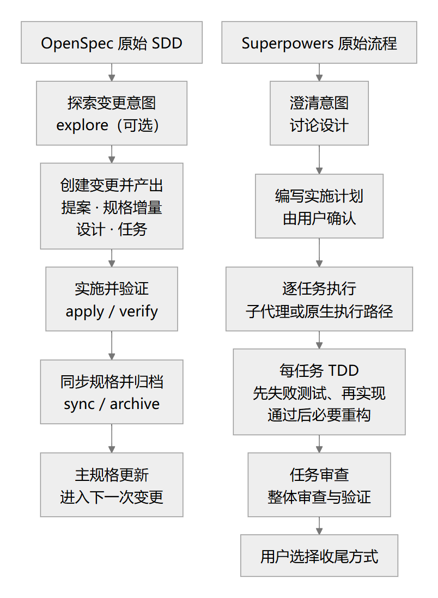
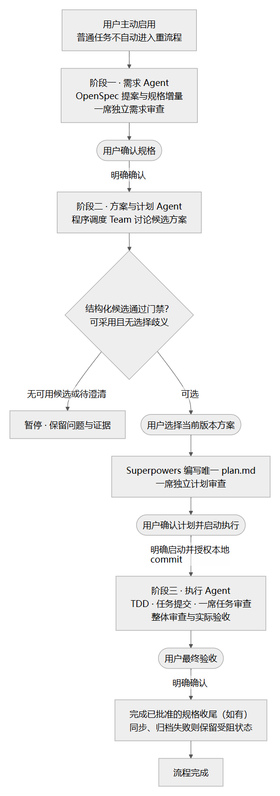
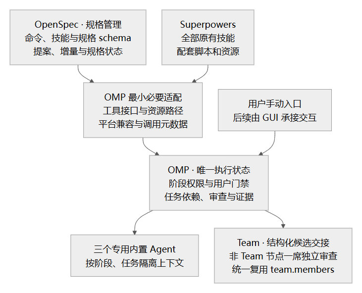

# 从 Skill 到受控工程流程：OMP 的规格驱动三阶段 Agent 编排

企业内网使用编码 Agent，经常遇到两个问题：一是模型能力、上下文长度受限；二是任务一大，需求澄清、方案选择、实现和验收容易混在一次长对话里。Agent 可能还没把需求问清楚就开始改代码，也可能写完计划便直接实施，或者在验证不足时宣布完成。

成熟的开源项目已经提供了很多工程方法。真正需要补上的，不一定是更多提示词，而是把这些方法放进一个有明确职责、权限和决策门禁的流程。

我把这套方法称为：**规格驱动的三阶段 Agent 编排**。

它不是让每个任务都背负重流程，而是为大型、重要、需要认真权衡方案的任务提供一个主动启用的工程入口。**目标是用更多 token、费用和等待时间换取更高的交付质量，不是减少 token 或降低费用。** 按需加载用于控制单个上下文的负担，不代表整条流程消耗更少。

当前源码已提供 `/spec` 三阶段编排、三个专用内置 Agent、Team 结构化候选交接，以及包内 OpenSpec／Superpowers 资源和显式调用入口。Windows 源码与编译产物的四项公开入口场景、Electron／ZCode 的两项场景、OMP 当前平台 fork-affected fulltest 与 ZCode `verify:pre-push` 均已通过，具体范围、缓存及报告边界见[需求目录](README.md)。Computer Use 已通过真实窗口输入完成规格确认、方案选择、计划启动与最终验收，观察到任务验证、独立审查、本地提交、规格同步和归档；未使用 WDIO／CDP 或界面状态注入代替此次桌面操作。对话验证均使用隔离的 localhost 模拟模型；文件、验证命令、Team、审批、任务提交与规格归档由真实 OMP 执行。真实模型的交付质量、token、费用和等待仍未验收，未知项保持未知。以下权限、用户门禁和验收条件继续作为实现必须满足的要求，不因已有代码而降低。

## 一、先复用成熟能力，不再重写一套方法论

这套方案结合三个部分：

- **OpenSpec**：用于需求探索、规格编写和增量变更管理；相关命令、全部技能及运行所需资源随 OMP 包内置，而不是只摘取几段提示词。
- **Superpowers**：内置其全部原有技能及配套资源，复用计划编写、TDD、调试、子代理协作、代码审查和收尾等工程能力。
- **OMP**：提供统一入口、三个专用内置 Agent、现有 Team 协作能力，以及程序化的阶段和任务调度。

### 原始 OpenSpec：用主规格和增量变更管理需求

SDD 是 Specification-Driven Development，即规格驱动开发。它先回答“要做什么、为什么做、怎样算满足需求”，再把规格转成技术计划、任务和实现。规格不是写完就丢弃的开工材料，而是后续决策和验收持续引用的依据。

OpenSpec 把长期有效的主规格和本次变更分开管理。主规格按能力描述系统行为；一个 change 则保存本次提案和规格增量。增量用 `ADDED`、`MODIFIED`、`REMOVED`、`RENAMED` 表达新增、修改、移除和重命名，并以 Requirement、Scenario 描述可观察行为及具体场景。这样维护存量系统时，不必每次重写整个产品规格。

上游默认主路径是：先用 `/opsx:explore` 探索意图，或直接用 `/opsx:propose` 生成 proposal、specs、design、tasks；再用 `/opsx:apply` 实施，结合 `/opsx:verify` 检查，最后同步规格增量并归档。`/opsx:new`、`/opsx:continue` 提供逐产物推进方式，`/opsx:ff` 则一次生成全部规划产物。原生校验能检查规格结构和部分一致性，但不能代替软件测试或业务验收。

聊天中的 `/opsx:*` 是技能入口；终端中的 `openspec new change`、`openspec status`、`openspec instructions` 等是 CLI 能力。不同宿主可能采用不同调用写法，不能把上游名称直接当作已经发布的 OMP 命令。

### 原始 Superpowers：把设计变成计划，再用 TDD 推进实现

Superpowers 原有入口通常先通过 `brainstorming` 澄清意图和设计，再用 `writing-plans` 编写可执行计划。用户确认后，可以采用 `subagent-driven-development` 逐任务派发新的实现者和审查者；也提供由当前 Agent 连续执行的 `executing-plans` 路径。最后结合验证、代码审查及分支收尾处理交付。

TDD 是 Test-Driven Development，即测试驱动开发。它不是实现后补几个测试，而是先写针对目标行为的测试，实际运行并确认因尚未实现该行为而失败；随后写最小实现使其通过，再在保持测试通过的条件下做必要重构，也就是 RED、GREEN、REFACTOR。



### OMP 的组合：OpenSpec 管规格，OMP 管执行状态

这里不是把两个完整开发流程依次跑一遍。OpenSpec 负责需求探索、提案、规格增量、规格校验及获批的同步归档；Superpowers 提供计划编写、TDD、调试和审查的方法；OMP 复用 Team 比较方案，并独占阶段、批准、任务依赖、执行证据和审查状态的管理。**OpenSpec 的产物就绪、计划中的 checkbox、本地 commit，都不能代替 OMP 的执行门禁。**

**不能把默认 `/opsx:propose` 或 `/opsx:ff` 原样放进第一阶段。** 它们会连同设计和任务一起生成，而第一阶段只能产出需求材料。程序必须按产物选择 proposal、specs；不能因为 design、tasks 已经处于 ready 状态就继续生成，也不能为了让上游报告“全部规划完成”而越过阶段边界。

原版 `brainstorming` 仍然保留，用户可以单独手动调用；主链路不默认在 OpenSpec 澄清之后重新跑一遍完整需求探索。OpenSpec 的完整规划和实施能力也保留为显式单项入口，不再默认承担本流程的计划器和执行器。

这里的“内置”，不是读完两个仓库，再按自己的理解重写一份替代品。OpenSpec 的相关命令、两仓库的全部原有技能，以及配套 schema、模板、脚本和运行所需资源都应随 OMP 包交付，不能只复制说明文字，也不能依赖开发机上另一个源码仓库的绝对路径。上游正文和实现尽量保留，来源版本与许可一并保留；只有工具接口、资源路径、平台兼容或既定流程确实需要时，才做最小适配。

优先把差异放在 OMP 外层：由程序控制何时调用、允许做什么、收到什么结果后才能进入下一步。必要修改需要有明确原因，不能以“精简”为由随意改写成熟技能。

包内来源清单固定为 OpenSpec **1.14.3** 和 Superpowers **7.0.1**，后者源码修订为 `2ce8aa15d05bd57213e6f746f953aafb7ded7a8b`。完整清单与资源来源保存在 `packages/coding-agent/src/spec-driven/vendor/inventory.json`；版本固定不等于已经通过所有平台及发行入口验收。

本次固定清单的 OpenSpec 技能覆盖 explore、new、continue、propose、ff、apply、update、verify、sync、archive、bulk-archive、onboard 和 feedback；CLI 另提供初始化、规格查询、变更新建、产物状态、指令生成、schema 和校验等能力。集成必须按固定上游版本的完整清单核对，不能只内置三阶段直接使用的少数入口。这些能力不必全部硬塞进主流程：单项手动调用与程序按需调度都应保留。

也需要准确看待上游：**OpenSpec 已有 CLI、schema、产物依赖和结构化指令机制，不是纯提示词集合。** 但上游明确把依赖视为帮助而非刚性审批门禁，允许迭代修改产物；OMP 需要在其外层落实已确认的阶段权限、用户批准和变更回退，而不是把上游的 ready 或文件存在当作批准。


## 二、全量内置，不等于全量注入上下文

企业内网模型的上下文往往比较紧张。如果把两套仓库的技能描述、正文和调用说明全部放进普通会话，就会让简单任务也承担不必要的阅读负担。

`verification-before-completion` 与 `systematic-debugging` 保留固定上游版本的原始 `SKILL.md`，不添加隐藏或禁止模型调用字段；它们的名称和描述默认可发现，正文在实际使用时加载。其余内置上游技能增加以下元数据：

```yaml
disable-model-invocation: true
```

设计目标是：

- 普通模型会话默认仅可发现上述两个技能的名称和描述，不自动注入任何技能正文；其余内置技能的目录、描述和正文仍隐藏。
- 用户可以手动调用某一项能力，不必每次都走完整流程。
- 内部程序可以在固定节点调用对应技能，模型不能自行跳过程序门禁。
- 被调用后，仅向相关执行 Agent 加载所需正文和资源，而不是把整个能力库灌入所有上下文。

这里有一个实现边界：OMP 当前会把这个字段用于隐藏技能列表，**它本身不是文件系统隔离或完整的调用权限检查**。只加字段，不能直接声称已经实现“只能手动或程序调用”；调用入口和内部资源暴露也需要配套适配。

“模型默认感知不到”指的是不主动暴露未调用的能力，不是说执行某项技能时，模型仍然看不到它必须遵循的内容。

用户终端入口为 `omp openspec <原生参数...>`；两仓库全部原有技能均可显式用 `/skill:<name> <任务...>` 调用。除上述两个默认可发现技能外，其余通过隐藏 Provider 按需提供；不自动注入整套技能目录、描述或正文，不自动启用 Superpowers bootstrap。`/spec` 的阶段调用范围、角色权限和批准门禁保持不变，单项调用不能绕过。包内 Superpowers 脚本另有 `omp superpowers <relative-skill-script> [args...]` 入口，`omp superpowers --help` 显示用法；仅接受清单内的技能脚本。JavaScript 使用 OMP 自带 Bun，Shell 脚本仍需 Bash／POSIX 工具（Windows 使用 Git Bash），相关脚本还可能需要 Git 或 Graphviz；缺少条件时报告真实错误，不在线安装或伪造成功。这些终端入口不是前两阶段可任意调用的模型工具。

## 三、严格区分三个阶段

三个阶段分别由三个专用内置 Agent 承担。程序决定阶段转换，Agent 负责当前阶段的具体工作。



### 阶段一：只澄清需求、编写规格

需求 Agent 可以读取代码、检索资料、向用户澄清，并编写提案、spec／spec delta 及必要的需求检查材料。提案只解释动机和范围，不写实现设计；本阶段不能生成 design、tasks、修改业务代码，也不能运行任意命令、代码测试或临时实验。

规格应明确目标、范围、约束和可验证的验收标准，并以 OpenSpec 的 Requirement、Scenario 表达行为；已有行为变化用规格增量描述。草稿形成后安排独立审查，检查遗漏、冲突和无法验收的表述。审查意见涉及用户真实意图时，仍需要回到用户，而不是靠多个模型投票决定需求。

需求 Agent 的写入范围受程序限制。OpenSpec 必需的项目检查、变更目录和定位元数据准备，可以由外层程序在明确范围内完成；已内置的技能不需要每个项目重新安装。主流程固定使用包内的**规格专用 schema**，只声明 `proposal`、`specs` 及两者的依赖，不声明 design、tasks 或执行进度跟踪，不要求用户手写 schema。程序通过 `openspec status --change <name> --json` 读取规格产物状态，通过 `openspec instructions proposal --change <name> --json` 和 `openspec instructions specs --change <name> --json` 分别取得原生指令。必要的规格结构校验也由限定接口代办，不向 Agent 开放通用 Bash。这不授权切分支、安装依赖、构建或运行代码测试。

项目已有明确的需求权威目录时，接入不能制造第二套可编辑主规格。本仓库继续以 `docs-zh-CN/requirements/` 为权威，不额外维护一份平行的 `openspec/specs/`，也不自动迁移既有文档。没有既有目录约定的新项目，才使用上游默认主规格布局。

**目录兼容不等于格式兼容。** OpenSpec 原生合并依赖能力路径、`### Requirement:` 和 Scenario，不能把现有编号章节直接交给它整块替换。两种布局的读写边界固定如下：

| 主规格布局 | 读取与变更定位 | 验收后的回写 |
| --- | --- | --- |
| 原生 OpenSpec 布局 | 直接使用能力路径、Requirement 与 Scenario 标识 | 使用原生规格同步和校验 |
| 已有 Markdown 需求目录 | 沿用原文件、标题层级及已有需求编号；缺少编号时在本次变更映射中分配引用 ID，不批量改写原文。每项 delta 关联目标文件、完整标题路径、原文定位和基准内容摘要 | 由规格 Agent 按 OpenSpec 增量语义提出针对原文的精确补丁；一名独立审查者检查需求、场景和未涉及内容的保留，程序校验目标、原文匹配及批准版本后应用。不能直接调用原生 `specs-apply` 覆盖非原生文档 |

映射同时覆盖读取、查询、delta、校验和收尾；程序准备的结构化视图只用于调用 OpenSpec，不是第二份可编辑主规格。原文仍是判断依据，不能用模型临时重译的规格替代。新增须明确插入位置，修改或删除须唯一命中原文，重命名须关联原位置与新位置；未涉及的章节和场景保持不变。定位不唯一、来源已变化、场景映射不完整或无法确认无损时，暂停并澄清或重新审查，不能猜测合并。结构检查不能证明语义等价，语义保留仍需独立审查；这不是承诺一个能理解任意 Markdown 的通用合并器。

### 阶段二：先比较方案，选定后再写计划

方案与计划 Agent 以已确认的规格为输入。程序复用 OMP 自有的 Team 能力，让参与者独立调查、对齐差异、交叉审查、修订复核，最后汇总有实际选择价值的方案。Team 也是本方案可修改的一部分，不把当前接口当作不可改变的外部限制；讨论算法继续沿用既有 `/team` 契约，本次补齐它与流程的结构化交接。

这里不是要求每次硬凑 A、B、C 三个答案。只有一个合理方向，就明确说明；存在真实取舍，才分别展示候选；没有可采用方案，也不能为了推进流程拼出一个未经审查的新方案。

#### Team 到选择门禁：交付候选，不只交付报告

当前 Team 返回的 `completed` 主要表示讨论正常结束，不能证明存在可采用方案。需要扩展其结果：保留 Markdown 报告，同时从已有提案、修订和阻断记录中交付以下结构化事实，而不是另派模型从报告里提取：

- 本次讨论 ID、输入规格版本，以及每个最终候选的稳定 ID、当前修订版本和报告对应关系。
- 每个候选的审查及必需复核是否成功、是否可采用、未解决阻断 ID 与依据；被排除的方向保留原因，不混入可选集合。
- 影响选择的需求理解差异、必须由用户回答的歧义，以及执行前待验证条件；未证实的运行时前提不能冒称已经验证。

报告和选择界面消费同一份候选结果。程序只接受当前讨论、当前规格版本下可采用候选的明确选择；有影响选择的未决歧义时，先让用户回答，再按 Team 契约重跑受影响讨论。讨论失败、取消、零个可采用候选、必需复核失败、结果缺失或选择了旧版本，都不能进入写计划。选择有条件方案时，条件必须进入计划，实际检查未通过前不解锁依赖该条件的执行任务。OMP 不重写 Team 的审查算法，也不把 `completed` 或综合模型的推荐文字当作放行依据。

#### 唯一计划与唯一执行状态

用户选择方案后，调用 Superpowers 的 `writing-plans`，明确任务边界、接口、依赖、验证方法和执行位置。**唯一计划固定为 `<change-dir>/plan.md`**；默认布局即 `openspec/changes/<change-id>/plan.md`。这是 `writing-plans` 允许的调用方路径覆盖，不再生成默认的 `docs/superpowers/plans/` 副本，也不生成一份竞争性的 design 或 tasks。计划经过一名独立审查者审查，不能把“方案审查过了”等同于“任务拆分也正确”。

计划中的任务具有稳定 ID，如 `T001`，步骤可引用 `T001.1`；修订保留未改变任务的 ID，不把编号重新分配给其他任务。OMP 把任务状态与当前规格、所选候选和计划版本绑定，并关联本任务的提交范围、验证记录及独立审查结果。实现完成、验证通过、审查通过分别记录；**只有当前版本的必需验证与独立审查均通过，任务才算完成并解锁依赖。** 计划的步骤勾选只是阅读进度，不能提升程序状态。

OpenSpec 的 `status` 只报告规格产物状态；OMP 展示阶段和任务状态。调用 `openspec-verify-change` 时，由 OMP 提供唯一计划、当前任务状态与提交及验证证据，适配其默认寻找 design／tasks 的指引；归档只消费已验收的规格增量并随变更保留这份计划，不用 OpenSpec checkbox 统计判定执行完成，也不因缺少 tasks 而补造文件。两种状态各有职责，不做双向进度同步。

这个阶段仍然只能写本阶段文档，不能提前实施。**选择方案只授权编写计划，不等于授权修改代码或提交。**

### 阶段三：按获批计划执行和验收

执行 Agent 只处理已经批准的任务。程序维护依赖关系，调度实现、验证和独立审查；不能仅凭实现 Agent 自报“完成”就解锁后续任务。

行为代码按 TDD 组织工作：先有针对目标行为的失败证据，再实现并验证通过。纯文档、部分生成产物等不适用传统 TDD 的任务，必须在计划中提前列明理由和替代验证方法，执行中不能自行新增豁免。

一个任务的测试通过，不代表整个需求已经满足。全部任务结束后，还需要整体审查，以及符合已批准验收标准和目标项目规则的实际验证。缺工具、未运行必需验证或仍有阻断问题，都不能包装成通过。

#### 本地 commit 与审查材料

本流程允许本地 commit。用户确认计划并明确启动执行时，一并授权在获批工作区提交本次任务的相关改动；前两阶段及所有审查者仍无提交权限。它不包含合并、推送、发布、PR、强制改写历史或提交用户无关改动的授权，目标项目规则仍然适用。

执行前记录 Git 基准，必要时先把已批准且属于本流程的规格和计划单独提交。每个产生改动的任务及后续修复形成真实 commit，程序记录审查用的 `base`、`head` 和任务归属，再复用 Superpowers 原版 `review-package` 生成审查材料；新增文件随提交进入材料。审查未通过的提交仍然存在，但不能因此标记任务完成。

提交范围必须只包含对应任务；采用隔离工作区，或串行安排会相互污染提交区间的任务，不能把其他任务或用户已有改动混入 `base..head`。禁止用 `git add .`、空提交或假 SHA 凑材料；没有改动且不需要提交的任务，直接审查该任务的文档或验证证据，不调用要求非空提交区间的脚本。Git 条件不满足或提交失败时明确暂停，不自动初始化仓库或绕过审查。

### 三阶段实际调用哪些上游命令和技能

下表列的是本流程的主要调用映射，不是上游全部能力清单，也不是要求一次性把所有正文加载进上下文。OMP 统一入口为 `/spec`；终端原生 CLI 入口为 `omp openspec ...`，手动技能入口为 `/skill:<name> ...`。

| 阶段 | 主要上游命令／技能 | 本阶段使用方式 | OMP 补充的程序节点 |
| --- | --- | --- | --- |
| 需求：写 spec | OpenSpec：`openspec-explore`、`openspec-new-change`；按产物取用 `openspec-continue-change` 的能力，以及 CLI `new change`、`status`、`instructions`、`validate` | 探索需求，按原生 proposal／specs 指令写提案和规格增量；只生成当前允许的需求产物，结构校验不代表软件测试通过 | 限定文档写入和 CLI 接口，独立需求审查，用户确认规格；不自动生成 design、tasks |
| 方案与计划：写 plan | Superpowers：`writing-plans` | 接收已确认 spec 和用户选定的方案，写明任务、接口、依赖及验证方法；保留原有自检 | 程序先调度现有 Team 比较方案，再在计划生成后发起独立审查，等待用户批准并启动 |
| 执行与验收 | Superpowers：`subagent-driven-development`、`test-driven-development`、`requesting-code-review`、`verification-before-completion` | 逐任务实现、运行有效红绿测试、请求独立审查、用实际结果验证交付；由程序控制派发及结果收集 | 任务依赖与并行限制、两轮修订上限、阻断追踪、整体审查和用户最终验收 |

还有一些按条件调用的能力，而不是每个任务都必须加载：

- `systematic-debugging`：出现失败或异常时，用于定位根因，不靠反复猜改。
- `receiving-code-review`：处理审查反馈，需要核实意见，既不能盲从，也不能忽略真实问题。
- `dispatching-parallel-agents`：确有相互独立的工作时使用，不替代程序对依赖和冲突的判断。
- `using-git-worktrees`：计划已明确采用隔离工作区时使用；不得在需求阶段擅自创建分支。
- `finishing-a-development-branch`：实施验收后的收尾选择；合并、推送、PR 等仍由用户决定和授权。
- `openspec-update-change`：需求或变更需要修订时使用；涉及已确认的需求或核心方案变化，必须先经过回退和重新确认，不能按上游自由推进方式直接继续实现。
- `openspec-verify-change`：对照规格检查实现与产物，补充整体审查；不能替代真实测试，也不能把文件存在视为需求已实现。
- `openspec-sync-specs`、`openspec-archive-change`：用于已验收变更的规格同步和归档；仅在明确授权范围内执行，不提前把尚未验收的变化写成主规格。

`executing-plans` 的原版路径不提供逐任务独立审查，因此保留为可单独手动调用的能力，而不是本流程默认执行方式；不能在流程内部借此取消已确认的审查门禁。OpenSpec 的 propose、ff、apply 等能力同样完整保留，但不在主链路中自动再跑一套规划和实现。规格专用 schema、唯一计划路径和 OMP 执行状态共同确定主链路边界；手动调用仍服从当前阶段和目标项目权限，不能借上游默认流程绕过。

需要特别区分：`writing-plans` 原有的计划自检是作者自检，不是这里新增的独立计划审查。上游提供方法，OMP 额外组织独立视角和强制门禁，不能把两者混称为已经等价具备。

### 用户命令与版本绑定

在现有 OMP 输入框或 GUI 的共享命令消费者中使用以下命令，不新增工作流设计器。流程状态、批准与权限由同一原生控制器管理，界面不另立规则：

| 命令 | 输入及作用 |
| --- | --- |
| `/spec start <change-id> <需求正文...>` | 主动启动；普通任务不自动启用 |
| `/spec status` | 显示阶段、材料、问题、阻塞原因、当前 ID／版本及下一步完整命令 |
| `/spec answer <回答...>` | 回答当前澄清问题 |
| `/spec confirm-spec <spec-version>` | 确认当前规格后才讨论方案 |
| `/spec choose <run-id> <candidate-id> <candidate-version>` | 只选择当前讨论下可采用的候选，进入计划编写 |
| `/spec confirm-plan <plan-version>` | 批准当前计划并启动执行，同时授权获批工作区内本任务改动的本地 commit |
| `/spec accept <acceptance-version>` | 必需验证与整体审查通过后进行最终用户验收，随后仅执行已授权收尾 |
| `/spec amend <修改后的需求...>` | 回到受影响的需求节点，撤销相关下游批准，保留代码和材料 |
| `/spec change-solution <原因...>` | 需求未变但核心方案需要改变时重新讨论，撤销相关下游批准 |
| `/spec pause`、`/spec resume`、`/spec cancel` | 当前运行期间暂停、继续或取消；不授权重置工作区，不提供跨进程重启恢复 |

用户应阅读材料并复制程序打印的实际完整批准命令；上述尖括号仅为参数说明。版本参数必须由程序校验，不沿用旧批准，也不以默认选项代替用户决定。`confirm-plan` 不授权 push、merge、发布、PR、改写历史或提交用户无关改动；`accept` 不能豁免缺失证据或未通过的必需验证。显式模型／Provider 无效、必需证据缺失或运行条件受阻时暂停并报告，不静默回退或假报通过。

流程控制状态保存在当前原生会话的内存中，同一会话的宿主共享控制器。`pause`／`resume` 只作用于这个仍存活的运行；切换或释放原生会话、变更其工作目录或退出 OMP 进程后，不承诺续接原运行。磁盘上的规格、计划、提交和聊天记录即使保留，也不是可恢复的控制器检查点；重新打开历史不能恢复原批准和调度进度。

## 四、多模型用在需要独立视角的节点

多模型的价值在于给关键判断提供不同视角，而不是让每次工具调用都变成讨论会。同一个模型可能把自己早期的假设一路带到计划和实现；另一个独立调查者有机会发现不同解释、遗漏或反例，但这种机会不等于正确性保证。

| 引入位置 | 为什么值得引入独立模型视角 | 必须守住的边界 |
| --- | --- | --- |
| 需求提交确认前 | 从不同角度检查遗漏场景、相互矛盾的约束，以及无法实际验收的标准 | 模型不能代替用户决定业务意图，也不能自行扩需求 |
| 候选方案讨论 | 不同模型独立探索实现方向，暴露架构、兼容性、修改范围和验证成本上的真实取舍 | 先独立调查再交叉审查，避免其他参与者只是附和第一份答案 |
| 计划提交确认前 | 检查 spec 是否落实到任务，接口是否一致，依赖、并行边界和验证方式是否可执行 | 不是把计划写得越长越好，也不是重复生成另一份计划 |
| 任务完成及整体交付时 | 发现实现者的局部盲点，以及跨任务拼接后才出现的不一致 | 审查必须结合真实代码和证据，不能代替测试与实际入口验证 |

模型名单统一复用 OMP 的 `team.members`，不再为新流程建立另一套配置。主持、需求起草和计划编写默认使用发起流程时的当前模型。Team 内部的提案槽位、交叉审查和修订复核仍按既有 Team 规则运行，**不缩减成一名成员的方案讨论**。

Team 讨论以外，需求审查、计划审查、每个任务审查和整体审查，**每个审查节点每次只派一名独立审查者**。任务审查由这一个人同时检查规格符合性和代码质量；调用多个审查技能只提供方法，不能重复创建审查者。

审查模型按节点创建顺序遍历本次启动时解析的有序名单，优先选取与被审查材料作者不同的模型；没有不同模型时，使用同模型的新独立上下文并明确标注。未配置名单时沿用 Team 的当前模型回退，显式配置不可用则报错，不静默换人。节点的初审与后续复核固定同一审查席位和模型，复核保留问题 ID、修订与验证证据；席位失败或模型不可用时暂停，不自动追加第二名审查者或重跑完整 Team。

内网模型选择有限时，允许同一模型启动多个独立 Agent，但必须明确标注为“同模型独立分析”，不能冒称多模型。独立上下文可以减少直接相互影响，却不能提供不同模型本身的视角。

审查不采用多数票代替证据。多个模型也可能共享错误前提，因此要回查事实、保留不同意见，只对有依据的问题要求修订。一个有证据的反例，比多数模型的“看起来没问题”更重要。

**这是用 token 和费用换质量的选择，不是降本方案。** 更多调用、必要材料的重复阅读和独立审查都是预期投入；按需加载与一席审查限制无关上下文和重复派发，不承诺减少总 token、费用或耗时。质量提升也不能仅凭“模型更多”宣称已经实现，仍须用实际交付结果检验。

## 五、小上下文：靠职责和材料边界，而不是不断压缩

三个内置 Agent 是三种角色定义，不是三个必须从头聊到尾的长会话。

各阶段使用独立上下文；执行阶段进一步按任务创建上下文。每个任务获得全局硬约束、本任务相关需求原文、必要接口和代码证据，而不是默认继承所有聊天、废弃方案和其他 Agent 的转录。

交接材料需要保留决定及其依据。摘要可以帮助导航，但不能替代已确认需求、关键决策和验收条件的原文。文档可以通过需求 ID 和章节按需读取；必要材料仍无法容纳时，应暂停并重新划定任务范围，而不是静默截断。

任务拆分同样要克制：

- 强耦合改动不能只为缩短上下文而强拆。
- 边界和交接明确、存在依赖的任务，可以顺序执行。
- 只有确认修改范围、接口和共享状态不会相互影响的任务，才能并行；不能只凭“修改不同文件”判断。

## 六、为什么需要程序编排，而不是只让模型阅读技能

这套设计要解决的是“流程遵循不能完全依赖模型自觉”，而不是宣称程序编排能把弱模型变成强模型。

如果只把两仓库的技能装进 OMP，再告诉模型“请严格按流程执行”，决定下一步的仍然是模型。模型需要同时记住职责、权限、批准状态、审查结果和依赖；上下文较小时，这些信息更容易被遗漏。增加更多提醒，不能替代明确的状态转换条件。

程序编排要解决的是以下具体问题：

- **阶段权限不能靠自觉。** 需求 Agent 不只是收到“不要写代码”的文字提醒，而是不能获得越界执行能力，写入入口也只能接受本阶段明确允许的文档。
- **批准和交接不能靠猜测。** 用户选择方案后，程序只能进入写计划节点；即使技能正文提到后续执行，也不能提前放开改代码权限。
- **审查和测试不能靠自报。** 必须取得实际审查结果、工具执行记录及所需证据，程序才允许更新任务状态；不能把“我已经检查过”当作执行记录。
- **循环和上下文要有边界。** 修订次数、任务依赖、暂停状态和本次应加载的资源由程序掌握，不依赖模型从长聊天里重建流程。



因此，这不是另写一套提示词方法论，也不是同时启动两套完整工作流引擎。需要把上游技能中的自动触发和交接，接入 OMP 的显式节点；脚本副作用、工具调用、阶段切换与用户确认服从外层约束。正文和脚本能保留就保留，只有确实无法兼容时才做最小修改。

| 应由程序控制的事项 | 仍需要模型与验证解决的事项 |
| --- | --- |
| 当前阶段、允许的工具和文档写入范围 | 是否准确理解业务意图 |
| 必经节点、用户授权和任务依赖 | 方案是否合理、接口是否设计正确 |
| 是否发起审查、修订轮数和阻断状态 | 审查意见是否真实、重要且有依据 |
| 实际验证调用及结果记录是否齐备 | 测试是否覆盖了真正需要证明的行为 |
| 能否进入下一步或等待用户验收 | 实现是否满足需求及其关键边界 |

程序可以拒绝缺少必需结果的状态转换，却不能仅凭一个结构化的 `passed` 字段证明方案正确；一次非零退出也不能自动证明获得了有意义的 TDD 红灯。

因此，流程门禁、独立审查和实际验证是互补的。对于模型能力不足、证据不全或格式无效的情况，正确行为是显式停住，而不是伪造成功结果继续推进。

## 七、变化要回到上游，失败要有停止条件

流程不能只会向前走，还必须处理已经批准的约定发生变化。

- 需求目标或验收标准发生实质变化，退回需求阶段。
- 需求未变，但已选核心方案需要改变，退回方案与计划阶段。
- 只撤销受影响的下游确认，保留已有材料和代码；回退不等于自动删除或重置工作区。
- 不改变已批准约定的实现细节，由执行 Agent 自行处理。

自动修订也不是无限循环。需求、计划、任务和整体审查最多允许两轮修订与必要复核；Team 保持已有的两轮上限。到上限仍有阻断就暂停，不能把“没有轮次了”解释成“问题已经解决”，也不能照搬上游搁置阻断后继续的收尾规则。

最终自动验收通过后，流程进入“待用户验收”。用户确认才算业务验收完成；这不豁免尚未完成的必需验证。执行阶段的本地提交已随启动授权，不需要到最终验收才提交；用户最终确认仍不自动授权合并、推送、发布或创建 PR。

OpenSpec 的规格同步和归档需要在获批计划中明确，或另行获得用户授权，只在最终验收确认后执行。既有 Markdown 目录按已审查的原文补丁回写，原生布局按原生同步处理；写入前均重新核对来源和批准版本。若它们属于本次计划的必需收尾，发生同步冲突、归档失败或权限阻塞时，不得把整个流程标成完成；未授权时保留变更并明确列出待收尾项，不自动合并、移动或删除文件，也不宣称主规格已经更新。

## 八、当前设计刻意保留的边界

| 取舍 | 当前边界与代价 |
| --- | --- |
| 重要任务才启用 | 普通任务保持轻量；用户需要主动选择进入重流程 |
| 保留上游原件 | 降低自行重写方法的风险，但仍要维护必要适配并核对上游变化 |
| 用 token 和费用换质量 | 接受独立调查、审查与修订的额外消耗，不以减少 token、费用或等待作为成功标准 |
| 执行位置随计划确定 | 沿用项目偏好；无偏好时选择原地执行或 worktree，获批后才准备环境 |
| 只支持运行期间暂停与继续 | 不做跨进程重启恢复；文档可以保留，但进程退出后不能承诺续接原流程进度 |
| 原生流程与 GUI 边界 | GUI 通过现有共享命令消费者展示阶段、方案及用户决定；不新增工作流设计器，不在界面另造流程规则，也不让 GUI 成为唯一入口 |

源码已接入包内资源解析、规格专用 schema、原文回写及 Team 结构化候选交接，不能再把它们整体描述为待实现，也不能把现有 Markdown 报告当作候选门禁的替代。OpenSpec 采用 JavaScript／TypeScript 生态不等于与所有平台兼容；当前 Windows 源码、编译入口、Electron／ZCode 及 Computer Use 证据不覆盖 Linux、公司内网或真实模型。各入口与仓库门禁分别报告，不将一个入口的通过扩大为其他入口或跨平台验收。

这套方法适合跨模块改造、重要功能开发、需要比较多种实现方向的工程任务。增量价值要与既有能力区分：OpenSpec 已有规格管理，Superpowers 已有 TDD 和独立审查，Team 已有多方调查与交叉审查；OMP 新增的是跨阶段的权限、有效批准、证据关联和强制停止。后续应在相同任务、代码起点、模型配置和验收标准下，与直接使用这些能力的方式比较，检查是否减少越权、遗漏、无证据放行和额外人工纠偏，同时如实记录请求、token、费用和等待。刻意设置的用户决策门不计为被迫纠偏；更多投入是代价，不自动等于更高质量，也不是需要包装成下降的指标。

## 附录：实现的验收条件

实现按以下可观察行为验收；本表是验收要求，不是通过记录。Team 自身的讨论规则仍以既有契约为准；本次结构化交接改造与组合流程门禁在本文一并验收，不能因 Team 已存在而跳过。

验收应复用项目既有 UT、集成与真实入口验证，覆盖成功路径和关键失败边界；不要求每行机械新增一份测试，也不得只检查源码文字、提示词副本或模型自报结果。验证范围及运行授权必须遵守目标项目规则，不能因为上游通用措辞就擅自运行全量测试、安装依赖或调用真实模型。

| 编号 | 对应正文 | 可观察的验收条件 |
| --- | --- | --- |
| AC-01 | 第一节：完整内置 | 脱离两个上游源码工作区后，从打包 OMP 的真实入口逐项调用固定清单中的 OpenSpec 命令和两仓库技能，能够定位并使用包内 schema、模板、脚本及必要资源，得到对应的真实工作结果；缺少必需运行条件时明确报错，不返回假成功。不能只有源码运行可用、发行包缺失资源。 |
| AC-02 | 第二节：显式触发与默认可发现例外 | 普通任务实际发往模型的上下文仅包含 `verification-before-completion`、`systematic-debugging` 的名称和描述，不预装正文；这两个技能使用固定上游原件，可以按需读取，其余未调用内置技能的目录、描述和正文不暴露。用户手动调用与程序节点调用均可加载对应内容，不附带整套能力库；包括上述两个例外在内，任何技能都不能绕过当前阶段权限和批准门禁。仅设置隐藏字段而调用链仍可擅自推进流程，不能算通过。隐藏不等于对任意文件访问建立保密沙箱。 |
| AC-03 | 第三节：三个角色与权限 | 三个专用内置 Agent 分别承接对应阶段，并使用独立上下文。尝试从前两阶段改代码、执行命令或写入未授权文档，必须在产生副作用前被拒绝；不能通过子代理、其他工具或单项技能绕过。程序限定的目录和元数据初始化正常完成，不能借此执行安装、切分支、构建或测试。 |
| AC-04 | 第三节：用户门禁 | 规格未明确确认时不启动方案讨论；只选择方案时不开始改代码；计划未经明确批准并授权启动时不进入执行。自动验收通过后进入待用户验收，只有用户最终确认才完成。确认必须对应当前有效产物，不能沿用已经失效的批准。 |
| AC-05 | 第三节：方案和计划 | 实际复用并扩展现有 Team：交付与报告一致的候选 ID、版本、可采用性、审查及复核状态、阻断、歧义和采用条件；零可用候选即使返回 `completed` 也不能进入计划。旧版本、被排除候选或影响选择的未决歧义不能放行；有条件方案的检查进入计划并约束依赖任务。 |
| AC-06 | 第四、七节：独立审查与停止 | 需求、计划、每个任务和整体结果各在每个审查节点只派一名独立审查者；任务审查同时检查规格符合性和代码质量，不因多技能重复派发。初审与复核固定席位和模型；两轮后仍有阻断、席位失败或必需复核未成功就暂停，未通过任务不解锁依赖。Team 内部规则不受“一席审查”缩减。 |
| AC-07 | 第四节：模型配置和降级 | 讨论与审查复用 `team.members`；非 Team 节点按节点顺序和有序名单选一名审查者，优先不同于作者的模型，无不同模型时明确标注同模型独立上下文。未配置时回退当前模型；显式项不可用报错，不静默删除或追加配置外模型。 |
| AC-08 | 第五节：上下文交接 | 阶段和执行任务不默认继承完整历史及全部技能。交接可回查全局硬约束、相关原文、接口和必要证据；摘要遗漏或材料过长时，不得用静默截断替代覆盖。必需材料无法容纳时明确暂停并重新划界，不能仍宣称已满足全部要求。 |
| AC-09 | 第五节：拆分和并行 | 有明确依赖的任务按依赖顺序执行；强耦合工作不强拆。只有修改范围、接口和共享状态确认不会相互影响的任务才可并行；依赖未完成或无法确认安全时不得并行，不能仅以文件名不同作判断。 |
| AC-10 | 第三、六节：TDD 和证据 | 行为代码任务具有针对目标行为的红灯、实现和绿灯证据，不能把任意非零退出当作有效红灯，也不能用模型口述代替真实执行结果。TDD 例外及替代验证随计划预先批准；执行中遇到新的豁免需求时暂停相关任务，不能自行跳过。 |
| AC-11 | 第三、六、七节：整体交付 | 任务局部通过后仍执行获批的整体审查和实际验收，观察真实公开入口的结果。必需验证未运行、失败或环境受阻时准确报告状态，不进入可供最终确认的成功路径。可使用本地模拟模型验证编排，但不能据此宣称真实模型任务质量已验收。 |
| AC-12 | 第七节：上游变化 | 实质修改已确认需求或核心方案后，程序退回最早受影响阶段，并撤销相关下游确认；不继续使用旧批准实施新要求，也不删除已有代码或自动重置工作区。未改变已批准约定的实现细节无需人为制造回退。 |
| AC-13 | 第八节：运行生命周期 | 当前运行期间可以暂停与继续；暂停后不再派发后续节点，继续时不重复已完成且仍有效的工作。OMP 进程退出后不宣称能够恢复原流程进度，保留文档不等于具备跨重启恢复能力。 |
| AC-14 | 第三、八节：提交和操作授权 | 获批启动后允许本地提交本任务改动，前两阶段及审查者不能提交。真实任务 commit 的 `base..head` 可经原版 `review-package` 审查，包含新增文件而不混入用户或其他任务改动；修复提交关联原问题。无改动任务不制造空提交；提交失败暂停。允许 commit 不等于允许合并、推送、发布、PR 或改写历史。 |
| AC-15 | 第八节：当前交付范围 | 当前实现范围是 OMP 包内能力与原生流程，不把提前实现 GUI、跨重启恢复或复制两套独立工作流引擎作为必要前置。后续 GUI 应消费同一套程序控制的流程，而不是在界面提示词里另造一套规则；GUI 接入需要按届时明确的需求单独验收。 |
| AC-16 | 第一、三节：明确取用分工 | 主链路使用包内规格专用 schema 生成 proposal、specs，不声明或补造 design、tasks。唯一计划是 `<change-dir>/plan.md`，由 Superpowers 编写并经过独立审查；任务 ID 稳定，OMP 单独管理与产物版本绑定的执行、验证和审查状态。勾完步骤、OpenSpec 规格就绪或已有提交均不能代替任务门禁；verify 使用该计划与实际证据，archive 不靠任务 checkbox 推断完成。 |
| AC-17 | 第三、七节：主规格与收尾 | 原生布局与既有 Markdown 目录分别走明确的回写路径。已有目录仍是唯一可编辑主规格；验证新增、修改、删除、重命名及场景保留，非原生文档不交给原生整块合并。定位歧义、来源变化或映射不完整即暂停，不能靠副本或改路径文案冒充适配。获批同步、归档仅在最终验收后执行，失败不损坏原文、不误报完成。 |
| AC-18 | 第四、八节：质量目标与投入 | 在约定的配对任务和验收标准下报告交付缺陷、遗漏、越权或无证据放行、额外人工纠偏，以及实际请求、token、费用和等待；区分上游已有能力与新门禁作用。未知费用如实标未知，不用调用次数冒充账单，不以消耗下降作为验收目标，也不只凭模拟编排通过宣称质量提高。 |

## 参考项目

- [OpenSpec](https://github.com/Fission-AI/OpenSpec)：主规格、增量变更、schema、逐产物指令和相关命令、技能。
- [Superpowers](https://github.com/obra/superpowers)：可组合的软件开发技能与工程实践。

