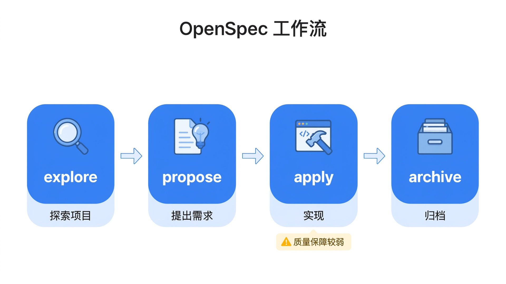
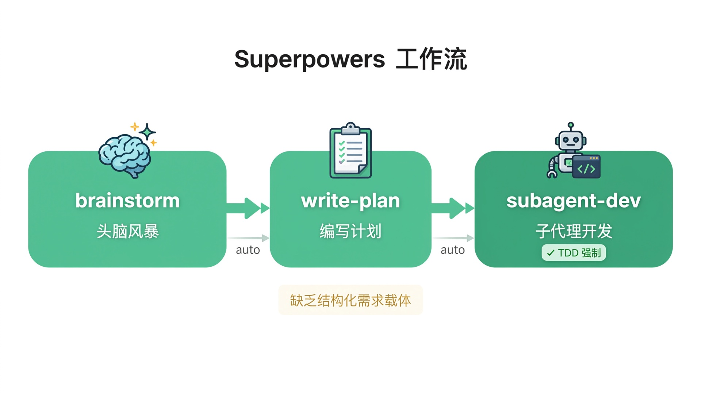
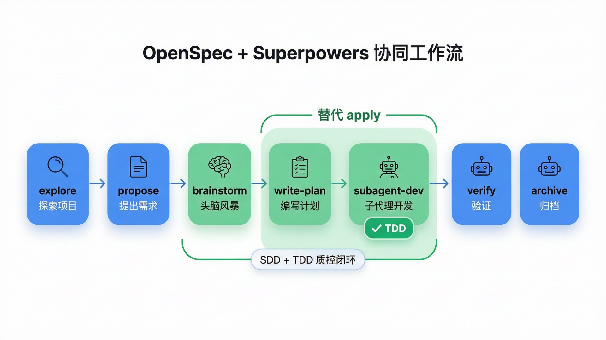
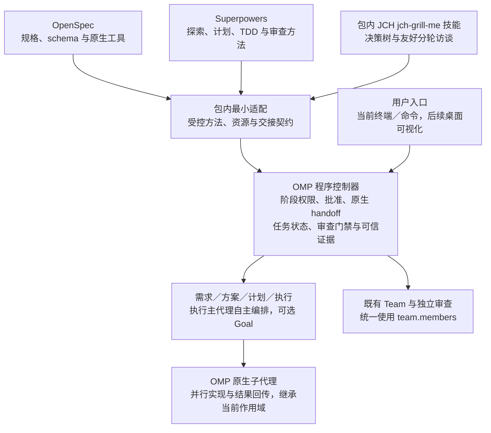

# 协同开发模式的架构背景

本页保存规格驱动编排的流程图、方法比较与技术背景。当前有效行为和验收条件由 OpenSpec 规格定义。

## 流程总览

下面依次对比单独使用 OpenSpec、单独使用 Superpowers、两者协同，以及加入 OMP 受控编排后的流程。前三张图原样转载自 lixueduan 的[《OpenSpec + Superpowers: SDD+TDD 双驱动 AI 编程工作流》](https://www.lixueduan.com/posts/ai/21-openspec+superpowers/#why-openspec)，图片保存在本地，不依赖外网加载；图中命令、自动流转及优缺点表述属于原文介绍，不作为本文固定上游版本或 OMP 的能力与验收结论。

### 图 1：单独使用 OpenSpec

### 图 2：单独使用 Superpowers

### 图 3：OpenSpec + Superpowers

### 图 4：OpenSpec + Superpowers + OMP

图 4 为本文新绘，沿用原图的横向圆角卡片、图标及蓝绿配色。它展示的是本文既定流程：OpenSpec 管理需求规格，Superpowers 提供计划与工程方法，OMP 组织 Team、主代理及原生子代理，并由程序控制阶段权限、有效批准、唯一任务状态与可信证据；不是在图 3 后简单追加一个 Agent。

图 4 中的 handoff 是原生交接能力的真实调用，不是给“传几个字段”换一个名字。它负责延续业务理解；阶段权限、批准状态和是否允许启动下一节点仍由 OMP 控制。后续桌面界面展示和操作同一套流程，不另建界面专属状态机。

## 六、为什么需要程序编排，而不是只让模型阅读技能

这套设计要解决的是“流程遵循不能完全依赖模型自觉”，而不是宣称程序编排能把弱模型变成强模型。

如果只把两仓库的技能装进 OMP，再告诉模型“请严格按流程执行”，决定下一步的仍然是模型。模型需要同时记住职责、权限、批准状态、审查结果和依赖；上下文较小时，这些信息更容易被遗漏。增加更多提醒，不能替代明确的状态转换条件。

程序编排要解决的是以下具体问题：

- **阶段权限不能靠自觉。** 需求 Agent 不只是收到“不要写代码”的文字提醒，而是不能获得越界执行能力，写入入口也只能接受本阶段明确允许的文档。
- **批准和交接不能靠猜测。** 用户选择方案后，程序只能进入写计划节点；即使技能正文提到后续执行，也不能提前放开改代码权限。
- **审查和测试不能靠自报。** 必须取得实际审查结果、工具执行记录及所需证据，程序才允许更新任务状态；不能把“我已经检查过”当作执行记录。
- **循环和上下文要有边界。** 修订上限、依赖准入、暂停状态和授权资源由程序掌握；模型自主决定具体分工和安全并行策略，不能把原生调度、权限和证据责任重新交给模型口述。

因此，这不是另写一套提示词方法论，也不是同时启动两套完整工作流引擎。需要把上游技能中的自动触发和交接，接入 OMP 的显式节点；脚本副作用、工具调用、阶段切换与用户确认服从外层约束。正文和脚本能保留就保留，只有确实无法兼容时才做最小修改。

| 应由程序控制的事项 | 仍需要模型与验证解决的事项 |
| --- | --- |
| 当前阶段、允许的工具和文档写入范围 | 是否准确理解业务意图 |
| 必经节点、有效授权、依赖准入与原生派发限制 | 方案是否合理、任务如何细化分工和并行、接口是否设计正确 |
| 必需审查结果、修订上限与阻断状态 | 审查意见是否真实、重要且有依据 |
| 实际验证调用及结果记录是否齐备 | 测试是否覆盖了真正需要证明的行为 |
| 能否进入下一步或等待用户验收 | 实现是否满足需求及其关键边界 |

程序可以拒绝缺少必需结果的状态转换，却不能仅凭一个结构化的 `passed` 字段证明方案正确；一次非零退出也不能自动证明获得了有意义的 TDD 红灯。

因此，流程门禁、独立审查和实际验证是互补的。对于模型能力不足、证据不全或格式无效的情况，正确行为是显式停住，而不是伪造成功结果继续推进。

## 参考项目

- [OpenSpec](https://github.com/Fission-AI/OpenSpec)：主规格、增量变更、schema、逐产物指令和相关命令、技能。
- [Superpowers](https://github.com/obra/superpowers)：可组合的软件开发技能与工程实践。

## 上游方法与方案选择背景

**原始 OpenSpec：用主规格和增量变更管理需求**

SDD 是 Specification-Driven Development，即规格驱动开发。它先回答“要做什么、为什么做、怎样算满足需求”，再把规格转成技术计划、任务和实现。规格不是写完就丢弃的开工材料，而是后续决策和验收持续引用的依据。

OpenSpec 把长期有效的主规格和本次变更分开管理。主规格按能力描述系统行为；一个 change 则保存本次提案和规格增量。增量用 `ADDED`、`MODIFIED`、`REMOVED`、`RENAMED` 表达新增、修改、移除和重命名，并以 Requirement、Scenario 描述可观察行为及具体场景。这样维护存量系统时，不必每次重写整个产品规格。

上游默认主路径是：先用 `/opsx:explore` 探索意图，或直接用 `/opsx:propose` 生成 proposal、specs、design、tasks；再用 `/opsx:apply` 实施，结合 `/opsx:verify` 检查，最后同步规格增量并归档。`/opsx:new`、`/opsx:continue` 提供逐产物推进方式，`/opsx:ff` 则一次生成全部规划产物。这是原版方法介绍，不是 OMP 的交付清单；OMP 的保留范围见下文。原生校验能检查规格结构和部分一致性，但不能代替软件测试或业务验收。

聊天中的 `/opsx:*` 是技能入口；终端中的 `openspec new change`、`openspec status`、`openspec instructions` 等是 CLI 能力。不同宿主可能采用不同调用写法，不能把上游名称直接当作已经发布的 OMP 命令。

**原始 Superpowers：把设计变成计划，再用 TDD 推进实现**

Superpowers 原有入口通常先通过 `brainstorming` 澄清意图和设计，再用 `writing-plans` 编写可执行计划。用户确认后，可以采用 `subagent-driven-development` 逐任务派发新的实现者和审查者；也提供由当前 Agent 连续执行的 `executing-plans` 路径。最后结合验证、代码审查及分支收尾处理交付。

TDD 是 Test-Driven Development，即测试驱动开发。它不是实现后补几个测试，而是先写针对目标行为的测试，实际运行并确认因尚未实现该行为而失败；随后写最小实现使其通过，再在保持测试通过的条件下做必要重构，也就是 RED、GREEN、REFACTOR。

**已选方案与修改边界**

| 方案 | 取舍与决定 |
| --- | --- |
| A：强化 OMP 原生编排 | **采用。** OpenSpec 保持规格专用 schema，Superpowers 提供唯一计划和工程方法，OMP 独占阶段、批准、任务状态及证据判定；改动集中，不新增竞争性的 design／tasks 或进度同步。 |
| B：把计划加入 OpenSpec 产物图，同时保留 OMP 门禁 | 原生 CLI 可以发现计划，但增加 schema、包内资源和逐阶段产物适配；OMP 已直接传递唯一计划，不为重复获得上下文可达性增加这层维护。 |
