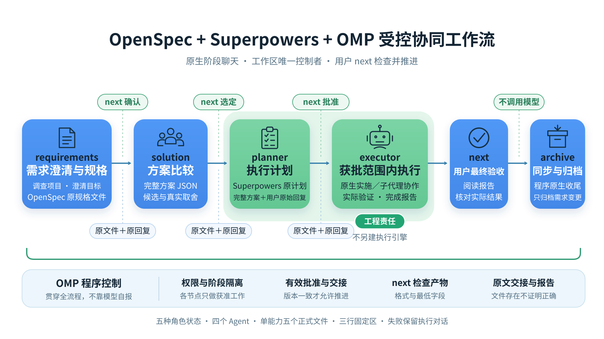

# 从需求到交付：OpenSpec × Superpowers × OMP 的四阶段协作

需求还没确认就开始实现、方案只剩一句总结、计划写完便自动开工——这些问题不能只靠给模型增加一段“请严格遵守流程”解决。OMP 的 `/dev` 将工作固定为四个 Agent：**需求 → 方案 → 计划 → 执行**。程序读取文件、保留用户决定、交接原文；Agent 负责调查、设计与真正的工程实施。



图中验收与归档是生命周期边界，不是第五、第六个 Agent。本文解释设计，正式行为以[需求规格](../openspec/specs/spec-driven-orchestration/spec.md)为准，不建立第二套需求权威，也不表示这些行为已在所有平台通过验证。

## 一、为什么只让程序管它能确定的事

程序很适合判断文件是否存在、JSON 能否解析、字段是否齐全、批准后的文件是否改变，以及用户有没有明确作出决定。但它不能仅凭报告里写着“测试通过”，就知道软件正确；也不能靠一套自然语言关键词判定哪个方案更好。

因此，这里的责任划分是：

| 程序的文件合同 | Agent 的工程责任 |
| --- | --- |
| 确定产物路径并读取真实文件 | 调查项目事实、澄清需求与取舍 |
| 检查格式和最低字段 | 写出可执行计划并覆盖需求 |
| 核对字节版本与用户明确决定 | 实施、测试、调试及必要审查 |
| 完整文件和原始确认回复交接 | 如实说明实际验证和剩余问题 |
| 控制阶段、消息、暂停和取消 | 遵守项目规则及用户授权 |

这意味着 `/dev` 不再维护另一套逐任务执行状态、固定 reviewer 席位、修复次数、RED／GREEN 证据账本或本地 commit 门槛。TDD、代码审查、子代理仍可作为工程方法使用，但不是四阶段控制器附加的强制流水线。方案可选 Team、执行可选原生 Goal，只改变阶段内部的工作方式，不增加阶段或审批。

减少程序条件不等于降低工程责任。计划需要说明如何验证，执行需要真正验证，报告不能把未运行的检查写成已通过；这些工作由承担完整目标的 Agent 按项目规则完成，最终由用户判断是否接受。

## 二、几套能力各自做什么

**OpenSpec 保存“要做什么”。** 提案说明动机与范围，规格描述可观察行为和验收场景；长期主规格与本次变更分开管理。在 OMP 中，它也能独立完成需求探索、修订、同步、核对与归档，不承担代码实施。需求文档已同步或变更已归档，不等于软件交付。

**Superpowers 提供工程方法。** 计划编写、TDD、系统调试、子代理协作、审查与完成验证都保留。普通会话可以手动调用，不需要启动 `/dev`。四阶段中按职责使用必要方法，不重复运行几套完整流程，也不让技能文本替用户批准下一阶段。

**Grill-me 是可用的需求澄清方法。** 包内保留原 `jch-grill-me` 与 Brainstorming 资源和手动调用，可以按授权使用；`/dev` 不强制自动加载这两套完整工作流。需求 Agent 调查并澄清目标，使用原 OpenSpec instructions 编写 proposal／specs；计划 Agent 使用原 `writing-plans`。澄清回答不替代正式文件确认。

**OMP 连接文件与决定。** 这些技能及必要资源随包交付，内网不要求临时克隆来源仓库。普通会话按既有规则发现技能，阶段会话按职责获得准确资源。固定版本和系统规则提供的是可追溯输入，不是模型一定遵循或质量已经提高的保证。

## 三、四个 Agent，四次明确决定

### 1. 需求：先把目标写进真实文件

需求 Agent 阅读项目、通过只读 `wiki` 查询已入库的企业资料、澄清目标、范围、不做什么、约束与验收行为，不提前编写方案、计划或业务代码。Wiki 使用当前 profile 的既有索引，不自动建库，不扩大需求文件写入白名单。

原生 OpenSpec 项目的本次材料为：

```text
openspec/changes/<change-id>/proposal.md
openspec/changes/<change-id>/specs/<capability>/spec.md
```

已有明确 Markdown 需求权威的项目仍生成上述原格式 proposal／delta specs，描述本次变更并引用已有权威；原权威是额外输入，继续原位维护，不替代这两个正式产物，也不复制成第二套主规格。程序读取实际材料并做原生校验，通过后等待用户**确认需求**，不会自动调用方案 Agent。验收后使用真实原生归档，`--skip-specs` 避免改写既有主规格。

### 2. 方案：比较真实方向，不硬凑三案

方案 Agent 直接收到已确认需求原文件和用户原始确认回复，可直接调用只读 `wiki` 核实企业规范及技术约束，无需开启 Team 才能检索。它调查可行方向，将候选写到：

```text
docs/superpowers/plans/YYYY-MM-DD-<change>-solutions.json
```

文件格式固定且简单，`content` 是完整方案 Markdown，应说明范围、实现方法、取舍风险和验证思路：

```json
{
  "candidates": [
    {
      "id": "existing-request-deadline",
      "title": "沿用现有请求链的截止时间",
      "content": "## 范围\n沿用登录请求链。\n\n## 实现方法\n复用现有截止时间传播。\n\n## 取舍风险\n需核对取消语义和现有错误反馈。\n\n## 验证思路\n覆盖超时、成功及权限检查保留场景。"
    }
  ]
}
```

至少一个候选，每项 `id`、`title`、`content` 非空，ID 唯一且不含空白，可直接用于 `choose <candidate-id>`。只有一个合理方向时就说明原因，不为了填满 A／B／C 编造方案。程序检查 JSON 合同，不靠模型投票或关键词给方案自动盖章。

用户**选择并确认候选**后，只授权编写计划，还没有授权实施。

### 3. 计划：收到完整方案和用户原始回复

这是最重要的交接边界：用户确认方案后，程序将**完整方案文件、已确认需求、所选候选 ID、用户完整原始确认回复**直接交给计划 Agent。不是只发一句“用户选了 A”，不是只留下选中候选，不生成交接文档，也不额外调用模型总结。

计划 Agent 将需求和方案转成执行范围、任务、接口、依赖、修改位置与验证安排。唯一计划放在：

```text
docs/superpowers/plans/YYYY-MM-DD-<change>.md
```

OpenSpec 原 proposal／specs 模板、Superpowers 原 `writing-plans` 格式和工程方法保持不变。程序只确认计划确实是可读、非空的 Markdown 文件，不附加自制计划 JSON；计划是否周全、命令是否适用、任务能否落地，仍是 Agent 应承担的工程责任。用户阅读完整计划并**批准计划**后，才进入执行。批准不隐含提交、推送、发布、创建 PR 或任意扩大范围的权限。

### 4. 执行：真正实施，然后写完成报告

执行 Agent 直接收到完整原文件、用户原始确认回复与获批材料，可以亲自实施，也可以使用普通原生工具按实际独立性组织子代理。如何拆分、并行、测试和审查，服从获批计划、用户授权和目标项目规则，不由外层程序模拟一个工程执行引擎。

结束工作时，执行 Agent 必须写出真实报告：

```text
docs/superpowers/plans/YYYY-MM-DD-<change>-completion.md
```

报告采用固定标题和三个非空栏目：

```markdown
# 完成报告

## 完成情况
说明实际完成的内容。

## 验证结果
说明真实验证命令、状态、结果和限制，区分已运行、未运行与失败。

## 未完成项
说明未完成事项；确实没有时明确写“无”。
```

程序只检查文件和栏目，**不会把报告存在当作测试通过或软件正确**。报告符合合同后停在待用户验收，用户可检查实际结果、继续提问或要求修复。

## 四、每次转换都交文件，不让模型再总结一次

三次阶段转换都直接传完整原文件和用户原始确认回复，方案到计划还传候选 ID；不额外生成交接文档、确认文件或任务状态文件，不调用原生 `/handoff` 或其他模型总结。用户原话逐字保留、不裁剪，后继不依赖前一个 Agent 的记忆。

单能力只有五个正式文件：OpenSpec 原 proposal／spec，以及同放 `docs/superpowers/plans/` 的一个完整方案 JSON、一个原格式计划、一个完成报告。内存中只保留当前阶段和决定所需内容，不新增流程 `state.json`；现有 app-server 的历史投影仍可正常保存。

转换前重新读取上游文件：字节内容已不同于批准版本时要求重新确认，不悄悄拿新材料继承旧批准。程序检查的是文件和用户决定，不额外建立一层交接产物。

每个阶段结束时都检查真实文件。缺文件、JSON 错误、候选字段不足或报告栏目为空，流程保留当前阶段并指出具体缺口；用户继续与当前 Agent 对话完成文件。不要求聊天输出 JSON，不靠 `yield`，也不设置自动修复轮数来掩盖阻塞。

## 五、用户如何操作

在输入框发送 `/dev` 切换普通聊天与协同开发模式，`/dev help` 打开当前阶段决策面板；两者都不会启动 Agent。无运行时，面板先收集需求，再给出可编辑的自动 change ID。也可以直接启动：

```text
/dev start login-timeout 明确登录超时行为，保留现有权限检查，并通过实际入口验收
```

主要决定与修改命令如下；`confirm-spec` 与 `confirm-plan` 均可附可选确认说明，原始回复完整交接，不要求版本参数或手抄版本摘要：

```text
/dev confirm-spec [--team] [确认说明...]
/dev choose existing-request-deadline 保留现有请求链，不增加独立重试
/dev confirm-plan [--goal] [确认说明...]
/dev revise-plan 补充现有会话超时场景的验证安排
/dev accept
/dev repair 超时后界面未恢复可用状态，请在获批范围修复
/dev amend <修改后的需求...>
/dev change-solution <原因...>
```

现有“确认需求”面板提供 **本次方案启用 Team**，现有“批准计划”面板提供 **本次执行启用原生 Goal**。两个开关独立、默认关闭，仅对本次运行有效；空格切换，`Ctrl+Enter` 与原决定一起提交，关闭窗口不生效。命令可用 `--team`／`--goal`，不带参数保持普通方式；参数必须放在确认说明之前，说明以参数开头时用 `--` 分隔。

Team 复用 `/team configure` 中的成员及既有只读讨论，方案 Agent 将完整可采用候选写入同一方案 JSON；讨论失败不静默回退单代理。Goal 仅在执行 Agent 自己的会话内运行，目标直接来自完整获批计划，不必另输 `goal xxx`，也不改变外层聊天模式。阶段启动后不热切换；待验收仍只读，明确修复后才恢复获批范围，最终仍须用户验收。

普通文字直接交给当前阶段 Agent，可以回答、讨论和修改尚未批准的材料；“可以”“继续”“同意”不会被程序猜成下一阶段授权。程序仍核对所属会话、运行、当前阶段和文件版本，不因为命令少了版本参数就沿用旧批准。

### 面板和自动提醒

面板将当前决策、查看材料、流程管理分组，批准前安全地默认查看材料，不默认提交。澄清问题、推荐理由和回答区同屏，完整需求、方案、计划和报告可读；聊天只显示必要摘要，不重复倾倒全部正文、长 ID 和内部状态。

已启动流程等待澄清或决定、暂停或受阻时，自动打开同一个面板，包括普通聊天中的后台流程。已有对话框时等待其关闭，不覆盖草稿和附件。同一轮关闭不重复弹出，不自动切模式、确认或提交输入。

### 消息、暂停与取消

忙碌时消息绑定当前运行、阶段和实际 Agent 排队，“已排队”不等于已经处理，也不会自动交给后继。`/dev cancel-message <message-id>` 只取消指定消息；处理中消息要等调用及自有后代真正停止并隔离迟到结果，才算取消完成。已经发生的写入不会自动回滚。

`/dev pause` 暂停存活运行，暂停输入保留为草稿；`/dev resume` 不自动发送草稿。关闭面板或切回普通聊天不会取消后台流程。`/dev cancel` 停止当前工作并保留文件，新流程须等旧消息与运行时真正释放；失败显示原生原因并可重试，不让新 owner 抢先接管。

这些能力只适用于当前进程仍存活的会话。历史材料不恢复旧批准或跨进程工作流，也不新增流程状态文件。协同开发输入模式与外层 Plan、Goal、Vibe 互斥；执行 Agent 内部的可选 Goal 不改变外层会话，独立模式本身不因此改变。

## 六、验收之后才收尾

待验收时，执行 Agent 只能解释和只读调查，不能因为一句反馈继续改代码。明确 `repair` 后才返回执行，使旧验收资格失效；修复后更新报告，再交用户决定。

需求变化回到需求阶段；核心方案变化回到方案；计划需要调整就 `revise-plan`，保留未变的已确认上游，但重新批准计划。回退撤销下游批准，不自动删除已有代码或重置工作区。

只有用户明确接受当前交付后，程序才调用包内 OpenSpec 原生同步与归档。原生项目同步增量到主规格；已有 Markdown 权威已经原位维护，归档用 `--skip-specs` 避免产生影子权威。归档只处理需求变更；方案、计划与报告继续留在 Superpowers 计划目录。同步或归档失败就显示真实失败，不直接移动目录冒充成功，也不把运行提前标为完成。

桌面后端通过 ZCode 投影同一控制器、同一文件和动作事实，不另建执行器或把 `/dev` 冒充动态工作流。历史只读，读取历史不启动模型或恢复旧运行；桌面 UI 的实施与验收不由后端结果代替。

## 七、不需要每次都使用 `/dev`

小修复可以继续用普通对话和原生工具。独立需求维护使用 `/skill:opsx-explore`、`opsx-propose`、`opsx-update`、`opsx-sync`、`opsx-archive`、`opsx-verify`；终端入口为 `omp openspec ...`。当前工作目录直接包含 `openspec/` 时，这六项技能也会按既有规则进入默认索引，正文按需读取，其他目录保留手动调用。

普通会话保留全部包内 Superpowers 手动入口，例如独立更新需求后用 `writing-plans` 编写计划、用 `executing-plans` 实施。默认发现仍只有调试、完成验证、技能编写三项 Superpowers 技能，不因为安装了 OMP 就自动运行整套方法。

这套设计希望减少阶段越权和交接信息损失，不承诺减少 token、费用或等待，也不承诺提高任意真实模型的能力。文件合同、模拟模型测试、真实模型质量和实际软件交付是不同层面的证据，不能互相替代。收益仍需用真实任务中的遗漏、返工、人工纠偏、交付缺陷与实际成本衡量。

## 延伸阅读

- [OpenSpec](https://github.com/Fission-AI/OpenSpec)
- [Superpowers](https://github.com/obra/superpowers)
- [OpenSpec + Superpowers: SDD+TDD 双驱动 AI 编程工作流](https://www.lixueduan.com/posts/ai/21-openspec+superpowers/)
- [OMP 快速指南](quick-start-intranet.md)
- [协同开发模式需求规格](../openspec/specs/spec-driven-orchestration/spec.md)
