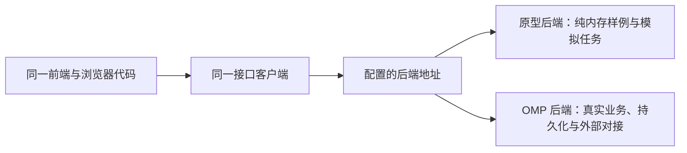

# AIReq 需求澄清、管理与开发进度跟踪

AIReq 是 AI 驱动的需求澄清、需求管理和开发进度跟踪平台。人提供业务信息、检查材料并作决定；AI 整理需求、评审、分析方案与代码证据。**AIReq 不参与实际编码，不安排编码执行 Agent，不执行开发计划、测试、代码交付或 IR 验收归档流程。** 实际开发与代码 PR 在平台之外完成。

本文说明当前目标规则及独立原型边界，不是正式业务后端的实现或验证报告。原型已实施独立纯内存后端，预览与正式源码入口及网络客户端已统一；真实 OMP 业务后端尚未实现，后续只实现同一冻结合同的后端并配置地址，不修改前端或接口格式。可复现的启动、接口配置与已执行历史证据见 [前端 README](../packages/aireq-frontend/README.md)。

## 1. 从自然语言到 IR／SR

用户通过对话描述目标、范围和异常场景，业务需求 Agent 澄清信息，生成 IR（业务需求）及其 SR（系统需求），包括可检查的验收条件。正常入口是与 AI 对话，不要求人手工编辑或复制修补规格文件。

- 新建提案先打开未发送草稿，按 Web、账号、项目及 Release 隔离；重复点击复用草稿。首次消息接纳后才加入列表，失败保留输入，不重复创建提案。
- 首发失败仍为未接纳草稿，材料区显示尚未生成，不提前展示占位材料；允许移除的草稿沿用确认／取消入口，正式需求及历史不随之开放删除。
- 提案以 IR 为讨论、修改及推进单位；左侧只显示 IR，使用提案文档图标，保留提交人、当前阶段、搜索、筛选与排序。提案没有负责人，筛选仅包含阶段、提交人及单项“入库检查：需要处理”；不细分检查问题。正常等待合入不是异常，合入且材料完整后自动离开提案列表。SR 在右侧材料选择器中阅读，没有独立讨论或推进流程。
- 提案主线为“业务需求 → 需求评审 → 技术方案 → 需求入库”。查看历史、切换材料或选择项目不启动 Agent、不推进阶段。
- 新建输入及空材料区引导描述业务目标、使用场景与完成标准，再由 AI 追问；四阶段名称在三栏中完整可见，查看历史不改变当前阶段。
- 业务需求 Agent 只维护 IR／SR 需求材料，方案 Agent 维护技术方案；均不修改实现代码、开发计划、测试报告或交付产物。

## 2. 四 Agent 评审，人工决定

需求文件完整后，由人发起当前版本评审：

1. 评审 A／B／C 使用三个不同模型，并行独立只读检查同版 IR 及全部 SR，不先参考彼此结论。
2. 第四个综合评审 Agent 等待三份报告完成，归并重复意见，保留来源、依据、原文和分歧。
3. 人默认阅读综合意见，按需切换原始报告和会话，决定“通过，进入技术方案”或“返回业务补充”。模型的票数、评分、问题标签或分歧不能代替人的判断。

“只读”指评审工具不修改文件，不是关闭聊天；人可以追问依据。当前需求材料及四份同版报告完整可读，是人工判断的材料条件，不是模型自动批准。需求修改后，旧报告和人工决定保留历史但失效，须重新评审。原始报告改变时综合意见也须更新。

“返回业务补充”实际退回业务阶段，列表和重新进入保持一致，取消不改变阶段。评审或方案退回后，须先在业务讨论中处理意见并更新 IR／SR，才能重新发起评审；不能用重跑评审跳过待处理意见，不增加逐项裁决表单。

界面复用 ZCode 原生工作流时间线、Agent 头像和会话；“评审流程”展示三路并行汇入综合评审，再进入人工判断，不将人工判断画成第五个 Agent。头像顺序为综合意见、A、B、C，支持键盘切换及名称／模型提示。

连续方向键及 Home／End 切换后，焦点留在对应评审头像；用户主动进入输入框时不强制抢回。异常推送情境预览只限制当前弹窗提交，关闭后可以重新打开并恢复正常交接。

## 3. 方案、依赖与人员排期

方案、SR 依赖和工期预估均由方案 Agent 通过对话生成及更新，界面不设生成或重新生成按钮。人负责补充信息、核对材料及逐文件确认；进入页面或切换会话不会生成方案。

方案 Agent 与人讨论整体设计、各 SR 的实现思路、边界和取舍，在同一 OpenSpec Change 下同轮生成／更新共享 `design.md` 及同目录的 `sr-dependencies.json`。`design.md` 保留实现思路和技术取舍并引用 JSON，不重复依赖清单；SR `spec.md` 不再维护依赖。不编制编码任务执行计划。

`sr-dependencies.json` 是依赖及原因的唯一权威，结构为 `{ "srs": [ { "srId": "...", "estimate": { "workingDays": 3, "assumptions": "估算依据与不确定项" }, "prerequisites": [ { "srId": "...", "reason": "..." } ] } ] }`。每个稳定 SR ID 唯一覆盖 IR 全部 SR，无依赖用空数组，前置项记录稳定 SR ID 与原因；不允许自依赖、未知 ID 或循环。界面读取 JSON 展示依赖及原因，可并行关系由依赖图推导，不在 JSON 重复存储。

两个方案产物共用现有需求版本／方案轮次绑定，同轮生成、更新、失效并纳入查看和人工逐文件确认。需求或任一产物变化使旧方案确认失效。JSON 缺失、无效或过期时明确显示原因，不回退旧文档或旧依赖，不沿用旧确认，不允许提交或自动转正。

方案阶段保持三栏：中间讨论，右侧阅读方案、SR 依赖及工期预估。顶部直接切换“技术方案／SR 依赖／工期预估”。提案只有提交人，不安排负责人、开发人员和计划起止时间。

- 每个 SR 的工期预估与依赖放在同一个 `sr-dependencies.json` 中：`estimate.workingDays` 为正数工作日（可用小数），`estimate.assumptions` 说明估算依据、范围和不确定项。预估由方案 Agent 生成，人通过对话补充和修改；界面只读展示，不要求人编辑文件。
- 预估不是实际用时或承诺日期。等待依赖、并行执行会影响总周期，因此不把 SR 预估直接相加为 IR 总工期。
- 预估与依赖同轮更新、失效、逐文件确认并提交 PR；缺失或非法预估不能沿用旧确认。数据库不维护可编辑的预估副本，`design.md` 只引用 JSON。
- 自动转正后保留预估及依赖；管理员再给正式 IR 分配负责人，由管理员或负责人安排 SR 人员和起止时间。这些正式安排属于数据库元数据，不自动从预估换算，也不反写 JSON。
- 正式需求保留工号校验、人工调整记录、时间冲突提醒和 IR 起止汇总，不自动重排，不从计划计算代码进度。

方案无法解决的业务问题，由人填写退回意见，返回业务 Agent 补充，再评审并重新分析方案。取消退回不改变阶段；保留历轮意见和会话，旧方案及确认不能用于新版本。长意见可滚动及全屏阅读，不自动拆题、分派或逐项裁决。

方案参与人工号只是来源记录，不形成独占锁；团队 Web 的其他业务参与人可继续讨论、生成或退回方案，并按当前文档确认入库。其他 Web 仍只读，不借此获得真实项目编码或 Git 工具权限。

## 4. 确认、推送与后台自动转正

业务澄清和方案设计期间不创建 Git 分支。方案完成后，人逐文件确认当前 IR、全部 SR、`design.md` 和有效 `sr-dependencies.json`，平台才按需拉取配置仓库，从最新默认分支创建提案分支（如 `ir/<IR-ID>`），将上述完整材料一同 Git 提交并推送，通过公司内网 Git API 自动创建 MR，记录编号、地址和来源／目标分支。无需配置本地或个人开发目录。

最新流程：**确认材料 → 创建分支并提交推送 → 自动创建 MR → 人工评审、合并 → 后台定时核验并转正。** MR 包含上述 JSON，地址由平台记录，无需手填。后台定时查询 MR 并核验默认分支实际合入与材料完整性，不提供自动合并或“人工确认合入”操作。

后台自动转正只有两个条件：

1. 提案分支已合入配置的默认分支；
2. 默认分支上的 IR、全部 SR、`design.md` 及有效 `sr-dependencies.json` 完整。

满足后自动成为正式需求，保持项目／IR／SR 身份、提交人、仓库工期预估和依赖；正式需求再按既有规则分配负责人、开发人员与计划起止，不从预估自动排期。随后从包含提案的最新默认分支创建并推送各 SR 分支，记录映射和基点。重复检查不重复入库或创建分支。新 SR 进度为 0%，转正只表示需求获准开发，不表示实现完成。

未合入、文档不完整（包括 JSON 缺失、无效或过期）或获取失败时保留提案，展示原因、最近与下次检查时间并继续检查；JSON 有效性属于第二个条件，不新增入库审批。无法确定合入事实时不转正；核验需兼容 merge、squash 和 rebase。真实后台须独立于浏览器运行。

管理员可在提案列表按检查失败、文档不完整、等待合入等状态巡查和组合筛选，不必逐份打开；数量来自已有检查记录，筛选不执行 Git 或触发转正。

## 5. 正式需求：代码证据、进度与遗留问题

正式需求使用当前项目／Release 的 IR／SR 大表格，IR 可展开 SR，支持名称／编号搜索、状态筛选和“我负责的”（IR 负责人或所属 SR 开发人员），可一键清除筛选。表格包含九列：需求、状态与进度、负责人／开发人员、开发分支、依赖关系、计划开始、计划结束、问题、最近分析。固定表头及名称列，单层横向滚动，不使用聊天 Markdown 表格工具栏。

正式表格另支持指定 IR 负责人工号精确筛选和未分配 IR 筛选；指定负责人与 SR 开发人员区分，“我负责的”语义不变，工号检索在弹层中完成。

筛选可自动展开匹配的 SR，但用户仍可手动收起／展开；不会强制维持展开或改写无筛选时的偏好。

正式需求默认收起左侧提案导航，顶部可展开导航及切换项目／版本。选中行后表格仍保留，右侧同页显示可拖拽的“进度报告／需求材料”面板，默认占内容区 30%，最小 320px、最大 45%，可拖拽调整。切换行或收起面板保留浏览状态，不跳入开发详情页，不显示编码聊天或开发阶段操作。

开发者展开 IR，即可在各 SR 行“开发分支”列查看并点击复制完整分支名，无需进入设置。复用需求分析已有的分支复制、提示组件；长名可省略，悬停或聚焦查看完整名称，成功／失败明确反馈。所有访问者均可复制，不触发行选择或 Git 操作；IR 行提示查看各 SR。正式 SR 的平台开发分支是必填数据，缺失时显示异常，不用分析分支、执行历史或猜测名称兜底；异常时禁止复制及人工确认完成。开发分支列固定 112px，只显示复制入口，完整名称在提示中查看。

需求分析 Agent 根据需求、验收条件和代码证据，报告实现情况、遗漏、遗留问题、不确定项、代码活动、合入依据、分析时间和代码版本；不编码或修复问题。

- **SR 的 0%～99% 进度只由 AI 分析，AI 最高 99%。**
- **只有 AI 分析到 99%、平台开发分支非空且已合入默认分支，才允许人工确认到 100%。** 合入是必要条件，不会自动提升进度。
- 管理员或该 IR 负责人仅可填写依据将 99% 确认到 100%，不能输入其他百分比。人员和排期调整不改变代码进度。
- IR 进度为所属全部 SR 百分比的算术平均；没有 SR 时为 0%，只有全部 SR 完成才完成。显示精度不能把未完成值四舍五入成 100%。

人工进度在百分比旁标明“人工确认”，首屏显示工号、时间及依据，旧 AI 问题与代码证据标为此前报告。新转正 SR 首次分析前保持 0%／尚未分析，不预填历史分析时间、代码版本或实现结论；提案合入基点不等于 SR 代码分析版本。

AIReq 不控制开发启动、并发名额、worktree、编码会话或交付 PR，也不要求 IR 完成后再执行验收／归档 PR。代码开发、测试、评审及规格归档由外部开发流程负责，不能作为旧执行流程重新出现在 AIReq 中。

### 需求分析与调度

主页侧栏“正式需求”上方提供独立“需求分析”，两部分共用一套权限：全员可查看、筛选和阅读报告，仅共享 Web 启动者能修改或触发分析。

原“需求进度分析”更名为“需求分析”，从设置移到主页“正式需求”上方。页面以 SR 任务和执行历史为主，项目分析范围与调度设置默认收起。复用原生 Tabs、Select、表格、语义状态徽标和进度条；保留所有筛选、分页、报告与调度操作，权限不变。模型与个性化的 Agent 配置仍在设置中，自动化页快捷入口同步跳转主页。

1. **项目分析范围**：可按项目名称搜索的紧凑表格，按项目直接启停，显示待分析 SR 数、最近分析及状态。新项目默认关闭，不要求逐 SR 创建任务。
2. **统一调度与执行历史**：全局自动分析开关、统一间隔（默认 60 分钟、正整数分钟）及运行摘要，下方为“SR 任务／执行历史”两个标签，只展示当前标签的分页列表。沿用定时任务风格，不复制通用任务新建／模板／工作流或开发模式。

一个调度器管理全部项目，每个正式 SR 自动有一条唯一任务记录；稳定 ID 不因重命名、配置修改或重复检查而变化。不创建每 SR 定时器或独立 cron。全局开关只暂停自动接纳，仍可对开启项目立即分析；项目关闭同时排除自动与手动接纳。已接纳项继续，同 SR 不重复并发、失败彼此隔离。已完成 SR 停止自动分析，重开后复用原记录；需求与代码证据均未变化则跳过模型分析。

项目 → IR 联动筛选和 SR 名称／编号搜索直接过滤任务及历史，历史另可筛状态和时间。两个列表分别分页，默认 25 条、可选 50 条，有匹配总数、首尾及前后翻页，固定表头和限定滚动区域。筛选变化重置相应页码，翻页／切标签保留筛选与各自页码，数据减少时夹至合法页。历史摘要按 SR 记录批次、触发方式、开始／结束、耗时、结果和进度变化；任务失败行直接查看原因或仅重试当前 SR，报告按需读取，在当前视口弹窗展示版本、合入依据或错误，关闭返回原控件；切筛选／分页／标签关闭旧详情。分析成功不等于需求完成。

任务与历史均展示每个 SR 的分支名，历史保留当次执行分支。点击分支文字复制完整名称，长名可截断但可查看完整值；所有人可复制，成功／失败明确反馈，不属于管理写操作、不执行 Git。

“分析当前筛选范围的 N 个 SR”按全部匹配项计数与执行，不是当前页，不受历史状态或时间过滤影响；不改变自动范围，不纳入停用项目、已完成或正在分析的 SR。查询只返回当前页摘要，状态刷新不携带所有报告；原型已在后端分页查询、按需读取报告，正式 OMP 的统一接口仍待接入。独立原型 `?demo=analysis-scale` 初始提供恰好 300 个任务与 1000 条历史，共用相同查询／调度逻辑，不能当作真实代码分析或生产容量证明；新增执行后历史可增长，重启原型后端恢复初始规模。

模型、思考强度和追加提示词沿用既有需求分析 Agent 配置，不重复设置。原型在后端内存模拟任务及历史，通过显式“模拟一次调度检查（原型）”推进虚拟时间，不调用真实模型、Git 或数据库，不覆盖正式需求报告，也不等同于生产定时分析。状态归具名 demo 的后端作用域，服务重启恢复初始样例，页面刷新或关闭不重置业务、不停止服务端已接纳任务。首个项目可预置开启供演示，新增项目仍关闭。

失败样例区分仓库读取、模型调用与文档读取，说明阶段、原因、下一步和重试条件，不冒充真实后端诊断。重试仅启动者可操作，项目关闭、已完成或正在运行时禁用；单 SR 重试不派发其他 SR，不重复并发。


## 6. 文档与数据归属

OMP 按固定项目目录管理会话及历史。AIReq 每个 IR 记录项目路径和对应会话 ID：业务需求讨论、独立评审 A／B／C、综合评审、技术方案讨论，并保留各轮次。切换 IR 或 Agent 只切换会话 ID，不切换 dir、创建 workspace 或重建连接。不同 IR、Agent 和轮次的会话互不混用，打开页面不新建会话。需求入库仅记录确认、分支、MR 和核验状态，不另建 Agent 会话。业务数据库保存引用及业务状态，聊天消息和会话文件仍由 OMP 原生管理。


一个 IR 对应一个 OpenSpec Change，一个 SR 对应一个能力规格，IR 共用一份技术方案：

```text
openspec/changes/{change-id}/
├── proposal.md                 # IR：目标、范围与验收条件
├── specs/{capability}/spec.md   # SR：稳定 ID、需求及验收条件，不维护依赖
├── design.md                   # 整体设计、各 SR 思路与技术取舍，引用依赖 JSON
└── sr-dependencies.json        # 全部 SR 的依赖、工期预估与假设
```

提案的业务需求、四路评审及方案会话使用所属 OMP 项目的同一固定 `dir`，材料位于其 `openspec/changes/<change-id>/` 下，经确认后提交仓库。不同 IR 使用不同 change-id 和会话 ID，不切换项目目录。原提交人和业务身份不随查看者、标题或排序改变。正式材料来自仓库，提案材料来自项目 dir 下对应 Change 的当前文件。提案合入不提前把未实现的增量同步为 `openspec/specs/` 中的已实现规格，也不自动归档 Change。

只读材料按业务类型选择，再显示完整换行路径及内容；IR 可阅读原始需求、全部 SR、`design.md` 及 `sr-dependencies.json`，SR 仅显示自己的规格。右侧选中依赖 JSON 时，复用现有图画布与缩放控件显示只读依赖图，不展示 JSON 正文：节点为稳定 SR ID 与标题，箭头从前置 SR 指向依赖方，支持平移及点击连线查看原因，独立 SR 也显示；无效或过期材料报错，不绘制旧图。不混入旧开发阶段报告，不提供复制、下载或带入讨论按钮。流程操作位于提案材料底栏；材料缺失、未生成和读取失败明确区分，失败保留目标和草稿，重试不自动重放动作或回退样例。

## 7. 配置、多人访问与模型职责

项目只配置名称、Git 仓库地址和默认分支，Release 沿用项目配置；平台管理内部工作副本。保存设置不拉取仓库、不创建分支或推送。原型格式校验不证明仓库可访问或分支存在。

Git URL 必须含主机；`https://`、`https:///` 不可保存，合法 URL 与 SCP 地址仍只作格式校验。分析间隔及下一周期超出安全整数／可表示日期范围时在修改配置前拒绝，不污染原调度。

以下为目标共享部署约定，不代表本轮已实现服务或安全认证：

| 项目 | 约定 |
| --- | --- |
| 业务数据 | 唯一共享 `omp aireq_web` 后端直接打开和读写 `/tmpdata/DFT_LAB/omp/omp_aireq_sqlite.db`；无需独立数据库服务或数据库端口，浏览器经现有 Web 接口访问 |
| Web | 只启动一个共享 `omp aireq_web`，所有人访问同一地址；`--port <端口>` 指定端口，省略时选可用端口并输出地址，不按访问者启动个人 Web |
| Token | 所有访问者使用启动者的 OMP Token／profile；切换浏览器工号不切换宿主或凭据 |
| 工号 | 小写 `a`–`z` 字母加 8 位数字，保留前导零；仅格式检查，不是完整认证 |
| 共享查看 | 项目、Release、提案、正式需求及全部设置对所有人可见 |
| 提案讨论 | 所有访问者在同一共享 Web 提需求和讨论，无需个人 Git 目录；讨论归该宿主，宿主不可用不自动接管 |
| 设置权限 | 外观和 Skill 设计所有人可用；其余设置仅启动该 Web 的人可修改，其他人只读，可切换、搜索、筛选和复制；草稿、保存、快捷键及全部写入口使用同一权限，不隐藏页面 |
| 设置分组 | 先“个人工具”（外观），后“平台配置”（项目与 Release、模型、个性化、技能等有效设置）；两组全员可见，分组不改变权限 |

模型职责为业务需求、需求评审 A／B／C、综合评审、方案、需求分析、Issue 分析及 Skill 设计。不提供计划、执行或 IR 验收 Agent 配置。评审前三者使用不同模型，综合评审独立选型；模型、思考强度及追加提示词按会话／评审轮次保存快照，修改只影响新会话或新轮次，不覆盖历史。不新增提示词预览。

个性化追加提示词与模型配置均在离开前提供保存／丢弃／取消；保存读取最新草稿，长文本连续输入不循环更新。每个 Agent 按 UTF-8 最多 100 KiB，超限保留内容但禁止普通保存、快捷键及保存并离开，缩短后恢复。技能管理提示共享 Web 启动者维护，不要求访问者另启个人 Web。

Skill 设计从设置移至主页侧栏“自动化”下方，以独立工作页打开；设置中的技能管理、Skill 设计 Agent 模型与个性化配置保留。技能页及独立 Skill 设计保留为辅助能力，不代表 AIReq 接管编码。所有访问者可填写 Skill 设计表单，把实际值及临时路径填入原聊天草稿，明确发送后预览并确认保存；不因此获得模型、提示词或技能管理的修改权。目标明确展示为共享 OMP 当前 profile 的 `skills/<name>/` 或有效项目 `.omp/skills/<name>/`，不冒充访问者的个人后端；没有项目绑定不阻止 profile 目标，不覆盖同名技能或写目标外目录。这不引入 AIReq 个人开发目录要求；原型仅演示固定文件及内存保存状态。

Skill 左右两栏同步显示当前版本的生成／保存状态；重新生成后清除旧版保存标记和过期通知。通用定时任务列表与详情区分“已启用 · 等待执行”“执行中”“已暂停”，启用不代表正在执行，暂停任务不计入执行中筛选。

## 8. 原型与真实运行边界

### 架构目标与实施进度

AIReq 原型与正式版的源码入口已使用同一份前端代码、同一接口客户端及完全相同的浏览器代码，只通过配置的后端地址选择连接目标；不按 prototype／runtime 模式编写不同业务界面，也不注入两套前端业务数据源。原型通过网络客户端连接独立后端，开发、演示可持续使用；真实 OMP 业务后端尚未实现，源码统一不等于正式服务已接通。



完整目标要求两个后端可互相独立启动，遵守同一请求、响应、错误与实时事件契约；两类后端错误均经同一客户端路径显示，不自动回退样例。原型侧已由后端持有全部原型业务数据、状态、模拟回复、任务及事件，纯内存运行，不依赖数据库、Git 或模型；服务重启恢复初始样例，页面刷新或关闭不能作为业务重置或服务任务停止条件。OMP 侧仍需接入统一契约，负责真实业务、持久化及模型、Git 等外部对接，复用原生宿主能力，不新增第二执行器。

**真实接入验收标准：只实现真实 OMP 后端并配置地址，不修改前端、不替换客户端、不迁移 runtime、不转换接口格式，即可使用相同浏览器代码完成业务。** 后端缺接口、版本不兼容及其他错误必须直接显示，不允许转旧协议或回退样例。

当前源码已实施共享前端入口、同一客户端、原型后端及地址选择，不改变既有 UI、业务门禁及普通 OMP／WebGUI 的非干扰边界。安装后分别运行 `bun ./standalone.ts backend`（默认 `http://127.0.0.1:4174/`）与 `bun ./standalone.ts start`（前端 `http://127.0.0.1:4173/`）；无需 OMP、Git、数据库或模型。后端通过 `OMP_AIREQ_BACKEND_HOST`／`OMP_AIREQ_BACKEND_PORT` 配置监听，端口 `0` 可由系统分配，启动输出实际 URL。浏览器地址优先级为 URL 编码的 `?backend=<地址>`、`VITE_AIREQ_BACKEND_URL`、当前页面的同源挂载地址；默认由前端预览服务器把 HTTP／WS 原样代理到独立后端，不把访问者自己的 localhost 当作服务器。普通内网 IP 的 HTTP 访问及 `/xxx/xxx/` 挂载前缀按前端 README 配置，不要求 HTTPS；原生 runtime 继续保留宿主已有随机能力目录。完整安装步骤及示例见[前端 README](../packages/aireq-frontend/README.md#当前实现独立启动)。

### 当前实现与既有演示边界

`preview/main.tsx` 和 `runtime/main.tsx` 仅导入同一 `app/bootstrap.tsx`，统一由 `client/remote-data-source.ts` 执行网络 bootstrap；样例业务数据源和模拟服务位于 `backend/`。`backend/contract.ts` 固定 `AIREQ_CONTRACT_VERSION = 1`，`AIReqRemoteOperations` 显式定义每个 operation 的参数／返回类型，`AIReqRemoteCall` 为判别联合，真实后端直接实现这份 type map。服务提供 `GET /api/aireq/bootstrap`、`POST /api/aireq/call`（`{path,args,selection?}`），响应为 `{ok:true,value}` 或 `{ok:false,error:{code,message}}`；畸形 JSON 返回 400，无权修改返回 403，未知路径拒绝，错误不转旧协议、不回落样例。`/api/aireq/events` WebSocket 发送 `workflow`／`models`／`skills`／`scheduler`／`freeChats`／`error` 类型事件；`/api/aireq/services` 复用既有 zcode 二进制 RPC，通过 `workspace`／`selection`／`session` 查询参数绑定选择。请求和连接均通过 `clientId`／`employeeId`／`demo` 查询参数独立绑定访问者和样例，不使用跨浏览器共享的“当前工号”。

bootstrap 包含 `contractVersion: 1`、`provenance: {kind: "sample" | "live", notice?}`、业务能力及辅助演示操作 `scenarioOperations`。`sample`／`live` 只表示数据来源，来源徽标或提示不能切换业务界面；合同没有业务 `mode` 或 `prototypeBusiness`。需求管理支持由 `capabilities.requirementManagement` 表达，`scenarioOperations` 只标识辅助演示可用性；主业务 `readPrHandoff(group)` 独立于演示接口。请求、结果、错误码／envelope、实时事件与二进制 services RPC 格式均保持不变。

正常入口与每个具名 demo 各有一份 worker 纯内存后端作用域，不按浏览器新建；同一后端同一 demo 的访问者共享修改，不同 demo 互不污染。worker 重入后端入口，经进程内 IPC 调用，不转发 HTTP。四 Agent 报告、`design.md`、`sr-dependencies.json`、排期建议、Git 推送、SR 分支、代码证据和进度报告仍是服务端演示数据，不真实写文件；刷新／关页不重置，原型后端重启才恢复样例。提案后台演示由后端每 5 秒读取内存预置结果，关页不停止；这不是实际 Git 合入检测或真实代码分析。

真实共享数据库、AI 调用、Git／PR 集成或后台代码分析仍需真实 OMP 后端按同一冻结合同实现，不需要未来修改前端或增加宿主适配客户端。本轮未修改正式 OMP 服务、未重新生成发行内嵌资源，也未新增 build、浏览器或重启验证；既有证据不能证明本轮切换或正式后端可运行。原型按各请求工号检查写权限及记录操作者，但工号仅格式检查、可自行填写，不构成认证；本机原型不能视为生产安全部署。

当前原型隐藏自由会话、新建会话和正在开发入口，不删除底层会话、草稿或原生能力，也不修改原 WebGUI；此处描述现状，不要求目标架构按运行模式区分界面。**AIReq 只考虑电脑端浏览器：设计、原型及验收不覆盖手机、平板或触屏专用布局。** 电脑端窄窗口及拖窄分栏仍须可用，底部操作在栏内换行，不能裁切；外观控件关联可见标签并支持键盘操作。桌面 Firefox 128 兼容边界不变；本机 Chromium 的既有截图与交互记录见前端 README，Firefox 128、真实读屏软件及真实宿主仍需独立验证，不能互相代称通过，也不能作为新架构落地证据。

当前可编辑聊天输入框保留两项原型辅助输入；以下描述原型后端能力，不是预览／正式入口专属界面的要求，本次不额外开发，真实接入只由后端实现同一合同：

- **画图**：全屏覆盖现有 Sketch 页面，发送时只把完整画布 PNG 回填原输入框附件，不自动发送消息或推进阶段。取消不改变草稿；失败保留绘图。当前原型不连接真实 Sketch 服务。
- **语音转文字**：麦克风入口演示录音及可编辑示例文字，确认后追加草稿，不自动发送；不申请麦克风权限、不采集音频、不调用识别服务。

相关规格：[需求提案与入库](../openspec/specs/aireq-requirement-intake/spec.md)、[工作台](../openspec/specs/aireq-browser-workbench/spec.md)、[编排边界](../openspec/specs/spec-driven-orchestration/spec.md)、[命令与配置](../openspec/specs/personal-commands/spec.md)、[总提案](../openspec/changes/refactor-dev-webgui-requirement-intake/proposal.md)。实际后端接入和运行检查须单独提供证据，不能以原型样例状态替代。

## 视觉基线与功能布局边界

WebGUI 与 AIReq 的视觉基础统一对齐官方 ZCode 3.18，来源、原文和本地适配规则见[设计规范入口](../docs/design/omp-zcode-visual-adaptation.md)及 [OpenSpec 视觉基线](../openspec/specs/zcode-visual-baseline/spec.md)。本次只调整设计规范、主题、面板圆角、字阶、表格容器、控件用法、工作流头像和消息／材料样式；功能布局、表格列宽、四 Agent 人工评审及现有操作保持。AIReq 原型和正式版仍共用同一 bootstrap、客户端和冻结契约，mock 只在独立后端；视觉同步不重新引入浏览器样例或另一套原型 UI，也不恢复原生编码执行流程。WebGUI 只在同一已授权视觉范围内适配，不改变业务或后端。

工期预估缺失或字段不完整时，只要当前材料的 SR 依赖结构、版本及拓扑有效，仍展示只读依赖图，对应节点显示“待预估”。依赖本身缺失、无效、循环或材料过期仍报错，不绘制旧图。图可阅读不等于方案完整：确认、提交与自动转正仍须补齐每个 SR 的正数工作日和非空估算假设；人通过方案对话让 AI 更新同一 JSON，不手工改文件。

提案“工期预估”解析当前 `sr-dependencies.json`，复用原生 Markdown 表格生成及阅读组件，按 SR ID、需求、工期（工作日）、估算假设逐行展示。某 SR 的预估缺失或非法只在对应单元格显示“待预估”，假设缺失显示“待补充”；其余有效数据照常显示，不以完整方案的提交校验挡住只读表格。保留原生横向滚动及全屏表格预览，不新增复制／下载入口，不提供手工编辑。JSON 不可读、依赖结构无效或材料过期仍显示实际错误；提交完整性要求不变。

Skill 设计默认说明／对话预览为 40%／60%（2:3），复用原生 ResizablePanelGroup、Panel 和 Handle 支持鼠标及键盘调整；说明最小 280px、最大 60%，对话／预览最小 360px，长内容仍各自滚动、底部操作保留。拖拽布局按页面独立保存，不与提案聊天或正式需求共用；重新打开沿用已保存比例。正式需求右栏新默认使用独立 v3 布局记录，旧固定宽度记录保留但不套用；切换 IR／SR 不重置拖拽宽度，不再由展开动画强制恢复默认宽度。


模型设置页仅显示精简的继承、修改权限及新建会话生效说明，不显示旧流程职责长说明、原型／mock 来源提示、“有未保存的更改”行或恢复演示配置入口。Issue 分析 Agent 独立配置模型、思考强度及追加提示词，支持跟随默认；新分析记录保存配置快照，历史不随配置修改。原型仍在服务端内存模拟，不调用真实模型。未保存的模型或个性化配置离开时，使用 ZCode 原生 448px 最大宽度紧凑弹窗，保留取消、丢弃及保存后离开的保护。


公司 offline 内网 Git 平台能力已由用户于 2026-11-12 实测确认：可查询／创建 PR／MR，且“克隆 → 改代码 → push → 建 MR → 放弃 → 删分支”已完整跑通。无公网不等于内网 API 不可用。当前 AIReq 采用自动建 MR、人工评审合并、后台定时核验转正的流程；本轮不增加自动编码、合并、放弃或删分支操作，只改文档和原型，不运行测试、不实现真实接口。


正式需求表格占满左右侧栏之间的剩余宽度，左右仅留 12／16px，不再使用最大 1280px 居中列；移除“名称列固定／还有几列”及前后列按钮整行，使用原生滚动条。切行仅更新高亮和右栏，不卸载工作台、不重连同项目只读工作区；失败可局部重试，连续点击只显示最后选择的结果。
