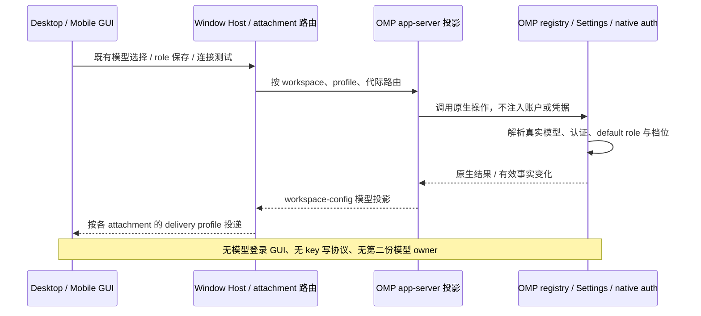

# ZCode 接入参考与文档职责

本页保存跨仓参考和文档职责说明；批准行为及验收条件以对应 OpenSpec 规格为准。

## 文档职责与需求引用

- **ZCode 外部协议与既有产品合同**：由固定兼容提交中的 ZCode 公开 schema 及当前 [ZCode app-server 规格](../openspec/specs/zcode-app-server/spec.md)定义，不由本页另造 wire 或覆盖既有合同。
- **OMP 侧**：子命令、独立协议目录、同进程业务 API、存储准备、会话与索引投影及功能／权限合同以 [ZCode app-server 规格](../openspec/specs/zcode-app-server/spec.md)为准。上游独立 RPC 模式保持原样；桌面 App 接入 OMP 的唯一入口是 ZCode 协议。
- **ZCode 侧**：运行入口和环境注入、准备进程的消费／监督、桌面与远端发行装配及上游源码保留，以 `F:/code2026/forkZcode/fork.md` 的 FORK-003 为权威。本文件只引用其宿主职责，不重复定义装配实现。
- [OmpCode 需求在线入口（浮动 dev）](https://github.com/jchanghong023/OmpCode/blob/dev/fork.md) 用于发布导航，不表示远端已包含本地确认的合同。发布时分别记录实际提交并更新引用；需求发布提交与规格中固定的协议源码提交分开管理。

## 实现与验证参考

以下为实现定位和验证操作参考，不构成需求基线，也不表示本次已执行。

### Tan 公开入口验证参考

- Tan 必须增加并实际运行一个最小端到端测试：从真实界面派发到原生 Tan、实际执行并将结果展示给所属父会话，使用隔离本地模型；不能以仅 schema／单测或未执行的测试定义代替。其余边界仅按本次实现的具体风险选择最小必要回归，不扩大无关套件。

### ZCode 命令宿主实现位置

fork 的命令目录与补全、plan／loop／goal 宿主及 role 持久保存集中在 `packages/coding-agent/src/modes/zcode/hosts/`，由 app-server 同进程调用；桌面会话列表由 Host tasks-index 与 OMP sessions-index 派生覆盖。app-server 复用这些宿主与共享业务服务，不给自己发送内部 RPC 帧；目标会话由请求携带的 session／workspace 上下文明确确定。

### Team 配置验证参考

* **TUI 公开入口：** 按仓库要求以真实 `bun run dev`＋`tui-test`、隔离配置完成 `/team configure` 的打开、跨 provider 搜索、中文辅助查找、添加／替换／排序／复制／删除、默认回退预览、保存与取消；覆盖窄屏、长 ID、失效成员及默认回退。会话 `scopedModels` 限为 A 时，Team 界面仍能选择另一个符合实际 Team 资格的 B；无需模型推理的操作不启动服务，讨论生效验证只用获准的本地模拟模型。
* **保存语义：** 验证顺序及重复槽位、`[]` 与移除用户值、当前 profile 隔离、项目／overlay 覆盖提示、主模型不变、在跑 Team 不变与后续 Team 读取新值。取消时文件不变；回执必须与实际保存值和有效值一致，不只断言接口未抛异常。
* **可靠性：** 真实临时文件验证重复根／嵌套键拒绝且原文不变、合法数组重复保留、注释及其他字段保留、同字段并发冲突不覆盖、无关字段修改可合并、同值幂等、写入／读回失败与结果未知。不得用源码文本匹配或复制 mock 返回证明。
* **offline 边界：** 按[双写权威要求](../openspec/specs/offline-shm/spec.md)验证默认／命名 profile 的两处最小写入；两端不同、有序重复、空名单和字段缺失均展示具体原值，失败／不可读取与不适用不混同。验证 NFS 端失败后的部分／未知结果及显式重读再保存；真实两台主机同一 NFS 目标的同旧版本竞争只能一方提交，不能两方成功或丢更新。备份、原始环境及启动不回源保持不变，Windows seam 不替代 Linux／NFS 验收。
* **无损读回与只读预览：** 用户、持久、有效名单各含不同位置的失效 selector 时，接口返回每个完整原槽位及准确名单／来源，GUI 能单独替换或删除而不丢合法项；仅模型失效不能使 revision 失效。草稿添加、排序、复制、删除、`[]` 和清除触发共享只读预览，用户草稿与考虑覆盖后的预计有效结果正确且当前已保存快照／文件不变；过期草稿版本响应被丢弃。结构非法或重复键仍须拒绝保存。
* **GUI：** GUI 验收项按 [Team 模型配置验收](../openspec/specs/zcode-model-configuration/spec.md) 以全局 `omp/team/configure` 入口执行并单独记录 GUI 读取／编辑／展示联调；OMP 侧通过不代替 ZCode GUI 验收。

### 模型配置投影链路

### 模型目录投影验证参考

- 验收须对比同一 profile 的真实 TUI 与 GUI 目录、provider 名、档位、默认档位及 default role 解析初值；覆盖非空原生源绝对优先、无源真实空态／等待态且不回落 Host 注入目录、role 保存后的热更新、空目录／缺凭据／不可达、连接测试不改凭据，以及桌面／手机同 owner 与迟到结果隔离。仅需求确认不构成实现或验证通过。

### Team 接口验证参考

- 在隔离环境从真实入口验证能力门控、旧协议／缺能力拒绝、三个接口的响应及错误字段、空名单／清除、跨 provider 搜索、中文别称多解、不支持／失效成员及默认回退；入口为 `omp/team/configure` 的对应 operation。请求不触发真实模型或不允许的网络访问。
- 通过真实配置文件验证保存、顺序／重复保留、同 profile 重启读回、命名 profile 隔离、高层覆盖提示、重复键拒绝、同字段冲突及无关字段合并；三个来源列表各含不同位置失效 selector 时逐行无损返回，问题的 `list/source` 无歧义，模型失效但结构合法时仍可取得 revision 并替换／删除修复。
- 默认／命名 profile 的 shm 与原始 NFS 名单分别为不同非空列表、`[]` 和字段缺失时，查询及保存回执中的 `config` 都能展示双方具体值与读取状态；结构非法、读失败和单端不适用不混同。锁内确认双方写入成功才返回完整成功，NFS 权限／写入失败、提交事实未知及后续保存改变现值均有准确回执，不靠备份或异步补写求成功；验收按双写权威要求执行。
- 在实际 NFS 部署的两台主机、同一用户／目标上，从同一持久旧版本并发提交，只能一方提交该版本，另一方在首次写前冲突且原值不被覆盖；证明锁由共享服务器协调，锁不可用时不降级。只跑本机进程／Windows seam 不代表此项通过。
- `get_team_config` 的草稿预览覆盖添加、排序、重复、失效原槽位、`[]`、`null`、高层覆盖及默认回退，返回实际快照与投影不混同；对真实临时配置断言预览前后文件字节不变，未启动保存／备份；不同 `clientRevision` 的迟到响应不覆盖当前草稿。
- GUI 单独验证目录展示、成员编辑、草稿取消、有效来源、失效状态、保存／部分完成／冲突、通知时草稿保护及切换 workspace／profile 后迟到响应隔离。OMP 侧接口通过不等于 ZCode GUI 已完成联调，需分别记录证据。

### 命令桥接验证参考

- 验收从现有输入框执行 `/goal show`、`/goal pause` 及带完整参数的 `/compact`，核对原生结果、真实错误、交互、取消与历史，保留会话身份、队列准入、停止和去重边界。

### 权限桥接验证参考

- 验收从真实 GUI → Host → 当前 OMP → 真实工具验证允许一次、拒绝、取消、隔离与刷新恢复；原生协议回归另覆盖重复／迟到应答、非法授权、会话关闭／EOF、连接关闭和两种 delivery profile。模型仅使用隔离本地模拟服务，不操作共享桌面输入。

### 命令回执验证参考

- 验收覆盖纯 clock 零 journal 读取、重启后旧命令去重、admission-only 恢复、取消／失败与 produced 优先级、索引缺口／失效回源及读取失败；通过真实 app-server 验证，不以局部 mock 代替协议边界。桌面时间窗口独立验证，不用窗口缩小回执验收范围。

### 子代理输出查询验证参考

- 验收覆盖 live child、冷 child、已有但不持有旧任务的 child runtime、嵌套子代理、不同 root 的同名 workId、兄弟任务拒绝，以及任务结束／owner 关闭后的实际输出或明确不可用；查询前后不得新增执行或模型请求。

### 协同开发后端验证参考

- 后端验收须从真实 app-server 入口覆盖启动、查询与增量订阅一致、全部原生用户动作及过期／错误身份拒绝、阶段对话和消息队列归属、摘要与完整材料一致、产物真实读取与缺失、旧严格客户端兼容、进程丢失后的纯只读历史，以及普通会话和既有动态工作流不变。消息取消分别覆盖排队和处理中场景、取消 ACK 先于实际停止时仍禁止转换、错误消息归属及迟到结果隔离；修复覆盖待验收只读交流、过期版本零修复派发、有效接纳后旧验收失效、修复及验证后新版本重新待验收。分别覆盖 desktop-continuous 与 web-remote-replayable；未实现的 GUI 页面和真实界面联调明确列为未运行，不以协议测试声称 UI 验收通过。

### Goal 输入提升验证参考

真实 app-server 回归须在 HTTP stream 未结束时观察目标 active／verifying 与真实 pending 队列，释放响应后在原生 boundary 核对所选输入精确消费、journal 原归属、模型正文无 `/goal` 原文及未选输入保留。

### 代理传输验证参考

验收从真实 app-server／Provider 请求进入本地捕获代理并返回正文，另验证不可连接时失败、不绕过，以及无 Host 配置时原生行为不变；环境键复制或回显不算网络边界验收。

### 管理桥接验证参考

验证仅使用隔离本地模型和临时 Skill，分别证明真实持久启停／刷新与 Provider 成功／认证失败／不可达；不自动调用真实模型。MCP 等其他管理面不随本需求扩大。

### 完整接入验证参考

1. 从真实 ZCode UI 验证开发态显式环境覆盖、桌面发行默认注入、参数／cwd 覆盖，以及 `omp app-server --stdio`、`--surface desktop` 的实际呈现效果、独立准备进程与正常启动门。
2. 在同一 app-server 进程内并发运行至少两个主会话，验证发送／工具／问答、临时切模型、cwd 与配置隔离、代理／子代理消息归属、稳定输入关联及重复提交；阻塞、停止或关闭其中一个会话时，另一个仍可完成消息与工具，不通过拆成子进程规避验收。另验证两个窗口／Host 的隔离、同 journal 写租约冲突、进程级故障与 owner 消失后的真实结算。
3. 完成 OMP 历史与 Host 组织行的字段归属、sessions-index 派生和 existing-only 不激活执行、冷恢复、全部约定命令／技能、临时切模型、role 持久保存与 Team 配置、执行中输入及队列事实；本文下方每项成功、失败、取消与保存合同均属于同次交付。
4. 分别验证 desktop-continuous 和 web-remote-replayable 的断线、gap／snapshot、重启换代与迟到结果，不能恢复出第二份队列或隐式重放未知命令。
5. 从桌面安装产物与远端实际部署启动固定版本 OMP，验证初始化失败、取消、EOF、进程退出与版本不兼容的显式失败；不静默回落旧 Agent 或错误执行端。
6. OMP 真实 CLI、ZCode GUI 联调、远端／平台及真实模型分别记录证据，但不是可拆分的交付阶段。默认联调使用隔离本地模拟模型且经过真实进程和协议；认证和真实模型质量不能由模拟结果代替，真实模型调用仍须另获授权。
7. 任一必需能力尚未实现、同进程隔离或合同冲突未解决、约定验收未完成时，整体标记为未完成／未验收；保留已取得的局部证据，不以 UT、静态检查或某个平台通过宣布完整替换已完成。

### 接入功能验证参考

通过真实 OMP 进程与 ZCode 接入统一验证：多会话并发和隔离、消息与工具过程、停止与恢复、提问回答、全部约定命令发现／补全／派发、临时切模型、role 持久保存及 Team 配置，以及上述子代理和工作流核心能力；配置、索引、计划、loop、goal、技能和失败／取消条件均按本文合同完成，不拆成仅 OMP 接口可用或仅基础 UI 可用的交付。

### 运行与发行验证参考

app-server 须经同进程多会话、直接业务调用、启动准备、ZCode GUI 及桌面／远端发行链路共同验收。两仓按职责配合，证据按来源分别记录；不以局部模拟或静态检查替代新架构验收，真实模型全流程仍单独标明授权与结果。
