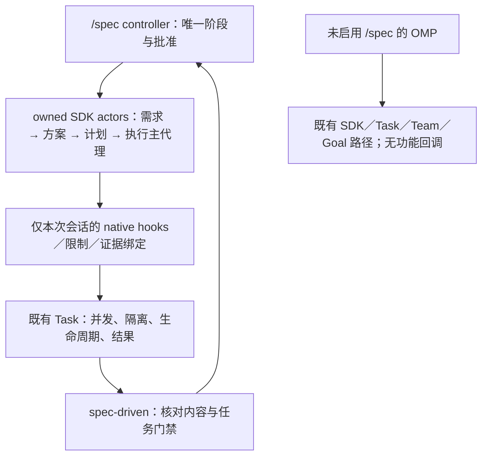

# Spec-Driven Multi-Agent Orchestration Implementation Plan

> **For agentic workers:** REQUIRED SUB-SKILL: Use superpowers:subagent-driven-development (recommended) or superpowers:executing-plans to implement this plan task-by-task. Steps use checkbox (`- [ ]`) syntax for tracking.

**Goal:** 在不改变 OMP 核心及其他场景既有语义的前提下，实现用户主动启用的 `/spec` 四职责流程、真实交接、自主执行、内容有效证据与验收后收尾。

**Architecture:** 保留 OpenSpec 需求引擎、Superpowers 工程方法和原生 Team／Task／Goal；`spec-driven/` 独占本功能的业务状态与门禁。四类职责使用由功能直接持有的 SDK 会话，执行主代理自行决定分工与安全并行，原生运行器落实执行；必要的共享扩展采用默认不存在的调用级回调，不向核心导入 `/spec` 状态或规则。

**Tech Stack:** TypeScript、Bun、现有 SDK／AgentSession、原生 Task／隔离 workspace／VCS、固定版本 OpenSpec／Superpowers、现有资源归档生成器、Bun 测试与 localhost Provider 公开入口夹具；不新增运行框架或依赖。

**Spec:** [唯一需求与设计](../../../openspec/specs/spec-driven-orchestration/spec.md)，AC-01—AC-28；[仓库验证与授权](../../../openspec/specs/fork-verification-gates/spec.md)；Goal 的独立行为继续遵守 [goal-autopilot.md](../../../openspec/specs/goal-autopilot/spec.md)。本计划是当前仓库的实施材料，不是运行中 `/spec` 为目标项目生成的 `plan.md`。

## Global Constraints

- `/spec` 只是 OMP 的一个可选功能，不得改变核心能力或其他使用场景的既有行为。
- 唯一入口、四类职责节点、三次主阶段原生 handoff；没有 `/spec --light`，没有第二份 design／tasks 或执行状态。
- OpenSpec **1.14.3**；Superpowers **7.0.1**，修订 `2ce8aa15d05bd57213e6f746f953aafb7ded7a8b`；不升级工具链或上游资源版本。
- JCH Grill-me 固定来源 `d1332445063976050be7aecfcac893a9b9c2fbfd` 的 `skills/jch-grill-me/SKILL.md`、`skills/jch-grill-me/agents/openai.yaml`。规划阶段已核对这两个已跟踪文件相对该提交无差异；打包记录实际纳入字节的摘要。
- 保留七项 OpenSpec 需求技能，删除六项包装及旧入口；保留原生需求引擎和传递依赖，不删除外部源码工作区、用户项目、历史产物或有效缓存。
- 普通发现继续是既定十项；本功能不追加修改普通系统提示词、默认技能匹配、普通 Task／Team／Goal、Provider 或宿主策略。八项恢复发现的 description 保留显式启用前提；两个既有发现技能保持上游原件。
- 模型复用 `team.members`；非 Team 审查每节点一席、初审加最多两轮修订复核，席位及计数不因 Goal、重派发或暂停而重置。
- 任务内部细化、普通实现决策、授权内等价验证和既定内部集成不新增用户批准；需求、核心方案、父任务实质契约变化才回到对应门禁。
- 普通执行默认开启自主推进；Goal 是可选持续方式，不扩大权限。最终用户验收保留，验收后同步归档不计入验收前实施任务。
- 当前执行授权以用户本次 Goal auto-orchestrate 请求为准：实施、针对性测试、构建及必要本地提交已获授权；使用隔离 localhost 模型，不将一般授权解释为需要调用真实模型、发布或推送共享分支。
- 实施先查导出符号的 LSP 引用；复用仍有效的检查结果。验证由主编排者执行，子代理跳过测试、门禁和格式化；完整门禁遵守仓库的范围、时限与授权合同。
- 所有运行夹具使用隔离临时项目、配置、HOME 与 localhost 模型；绝不读取真实凭据后自动回退真实服务。缺工具报告未验证，不自动安装。
- 本轮不新增 GUI、公开协议、跨进程恢复、通用工作流设计器、平行调度器、结果缓存系统或最终分支合并。实施后按真实结果更新需求索引与包 changelog，不改写历史通过记录。

## Review Focus

1. 同进程同时运行普通 OMP 和 `/spec`，取消后者不得收回前者工具、改写全局设置或取消普通任务；T005／T008／T010 覆盖。
2. 待审批期间保留的生产者会话，必须仍能基于原对话执行真实 handoff；T004 覆盖等待、取消、保存失败及成功交接复用。
3. 相关未跟踪文件或验证命令自身改写输入，不能让旧绿灯和旧 accept 继续有效；T006 覆盖，无关材料及同内容新提交不机械全量重跑。
4. 子代理实际 cwd、工具闭包与所属任务必须一致；并行来源通过不能冒充集成目标通过；T005／T007 覆盖。
5. 发布 A 后外部改写 A、随后发布 B 失败，回滚不得覆盖外部改动；T009 覆盖，同时保留原始证据及部分收尾事实。

## File Structure

完整路径相对仓库根；同一行的省略项沿用该行首个文件的目录前缀，`src/`、`scripts/`、`test/` 开头的省略项相对 `packages/coding-agent/`。未标“新增”的文件是已定位的现有文件。共享文件只做所列最小扩展，不为 `/spec` 重构其原有流程。

| 文件／范围 | 单一职责／变更边界 |
| --- | --- |
| `packages/coding-agent/scripts/spec-driven-resources.ts` | 固定资源、OpenSpec 七项生成与再生成限定、有效方法分支、JCH 纳入及归档；保留既有 `--prepare`／`--embed` |
| `packages/coding-agent/src/spec-driven/resources.ts`、`vendor/inventory.json`、`vendor/archive.generated.ts` | 三来源、普通／受控资源精确定位及来源摘要；后两项仅生成 |
| `packages/coding-agent/src/spec-driven/vendor/jch-grill-me/SKILL.md`、`vendor/jch-grill-me/agents/openai.yaml`（新增） | 两个固定 JCH 原始资产；不访问已安装个人技能作为运行依赖 |
| `packages/coding-agent/src/prompts/spec-driven-methods.md`（新增） | 受控分支的静态适配正文及适配目标；不在 TS 拼接模型规则 |
| `packages/coding-agent/src/discovery/spec-driven.ts`、`src/internal-urls/skill-protocol.ts`、`src/spec-driven/skill-policy.ts` | 在既有来源选择与访问链纳入 JCH／受控路径；普通优先级不变 |
| `packages/coding-agent/src/prompts/skills/superpowers-descriptions.md` | 仅补齐八项描述的已确认触发前提，不重做已完成的发现功能 |
| `packages/coding-agent/src/spec-driven/types.ts`、`schemas.ts`、`artifacts.ts` | 正式产物、版本、任务覆盖、证据契约与安全发布；不扩展 OpenSpec 规划图 |
| `packages/coding-agent/src/spec-driven/actors.ts`（新增） | 四类职责会话的 SDK 构造、固定系统规则、真实交接及生命周期所有权 |
| `packages/coding-agent/src/spec-driven/execution.ts`（新增） | 执行主代理的任务准入、后代作用域、任务检查点及原生派发适配；不调度另一个任务队列 |
| `packages/coding-agent/src/spec-driven/evidence.ts`（新增） | 可信记录、相关内容身份、有效性核对及持久化验证材料；不是结果缓存 |
| `packages/coding-agent/src/spec-driven/runtime.ts`、`orchestrator.ts`、`controller.ts`、`execution-tools.ts`、`git.ts` | 连接既有状态机、原生能力及上述三个内聚模块，删除被替代的逐任务 worker 驱动 |
| `packages/coding-agent/src/prompts/agents/spec-driven.md`、`src/prompts/spec-driven-task.md` | 专用职责／任务契约；正式文档、答案和 handoff 仍作为业务输入 |
| `packages/coding-agent/src/task/types.ts`、`structured-subagent.ts`、`executor.ts`、`persisted-revive.ts`、`src/tools/index.ts`、`src/sdk.ts` | 仅补齐下述调用方原生后代回调与显式受限 Goal 准入；不导入 `spec-driven/` 业务类型、不改未提供回调的路径 |
| `packages/coding-agent/src/slash-commands/builtin-spec-driven.ts` | 既有命令解析与执行方式选择；不新增 UI 协议或另一套命令表 |
| `packages/coding-agent/test/spec-driven/` 现有测试及夹具 | 按任务迁移消费者行为；新建必要的 `actors.test.ts`、`evidence.test.ts`、`execution.test.ts`，不按文件机械建测试 |
| `packages/coding-agent/test/task/structured-subagent.test.ts`、`test/modes/zcode-hosts-goal.test.ts`、`test/sdk-session-isolation.test.ts` | 复用相关普通路径回归；仅共享触点所需，不扩展全仓测试 |
| `packages/coding-agent/CHANGELOG.md`、`docs-zh-CN/verification-history.md`、根 `AGENTS.md` 的相关入口段 | 实施并完成冒烟后维护实际入口和状态；不新建第二份产品需求 |

此前的 `2026-10-24-superpowers-skill-discovery.md` 已有实施及验证记录，作为现状复用，不把它当成本轮新增功能已通过。其旧示例 description 不能覆盖当前权威需求的显式触发前提；不重复执行已完成的发现改造。

## Shared Interfaces and Ownership

以下为本计划选定的新接口；未注明新增的原生接口保持原语义。具体实现留给任务，不引入任意状态机／策略框架。

| 接口 | 所有者与合同 |
| --- | --- |
| `SpecStageRole = "requirements" \| "solution" \| "planner" \| "executor"` | `types.ts`；审查仍是只读内部节点，不是第五个用户主阶段 |
| `loadSpecDrivenSkill(source, name, options?: { role?: SpecStageRole \| "reviewer" }): Promise<Skill>` | `resources.ts`；省略 role 走既定普通分支；role 由程序传入，不从文本推断 |
| `SpecRequirementsDraft.document: SpecDocument`、`SpecSolutionDraft`／`SpecSolution` | 需求书路径固定 `requirements.md`；方案草稿字段为 `specificationVersion, runId, candidateId, candidateVersion, proposal, conditions`，持久状态另绑定 `version, artifactVersion`；保存选定原文，不重写设计 |
| `SpecArtifactStore.writeSolution(solution): Promise<ArtifactSnapshot>`、`readSolution(): Promise<ArtifactSnapshot>`、`writePlan(draft: SpecPlanDraft): Promise<ArtifactSnapshot>` | `artifacts.ts`；固定正式路径，计划由完整结构化草稿生成覆盖表和批准元数据，不保留旧字符串／可选任务双签名 |
| `SpecPlanDraft.workspace` | `{ executionPath: string, isolation: "none" \| "native", integration: "native" }`；执行位置为项目内相对路径，实际隔离后端和落地机械操作仍由 native 能力决定，不假定 linked worktree／SHA 相同 |
| `SpecValidation` | `id, command, behavior, inputPaths`；最终验证另保留 `realEntry`。`inputPaths` 为必需非空的工作区相对输入文件／目录选择，不是 shell 表达式；包括所需测试、配置和依赖输入 |
| `SpecCondition.inputPaths: string[]` | 必需非空的工作区相对文件／目录选择，显式声明执行前采用条件所需的现有输入；条件证据独立绑定这些输入，不并入依赖任务未来才会创建的 owned files |
| `SpecActor` | `actors.ts`：`id, role, session`，`request(input: SpecActorInput, context: SpecRunContext, schema?: unknown): Promise<unknown>`，`handoff(input: SpecHandoffInput, context: SpecRunContext): Promise<SpecHandoff>`，`dispose(): Promise<void>`；SpecActorInput 包含当前正式文档、前驱交接及业务 payload，SpecHandoffInput 包含转换点、批准文档及用户决定，二者在 `types.ts` 定义 |
| `SpecHandoff` | 程序事实：来源 actor／会话、run／generation、转换点、原生正文的相对路径及摘要、依赖文档版本；正文来自 `AgentSession.handoff()` |
| `NativeSubagentHooks` | `task/types.ts` 的最小通用可选回调：`beforeSpawn(request: StructuredSubagentRequest): Promise<NativeSpawnOverrides \| void>` 在副作用前准入；`configureSession(request: StructuredSubagentRequest, options: Readonly<CreateAgentSessionOptions>): Promise<NativeSubagentOverrides>` 在真实 cwd 确定后配置；可选 `onSpawnFailed(request, error)` 在启动失败时释放本次准入预留，不伪造来源或成功结果。可选 `beforeCapture(request, result)` 在自有工作静止后、实际来源捕获前等待保存，`afterResult(request, result)` 等待保存真实捕获结果；捕获回调接收原生 `SingleResult`，不得改写结果或扩大权限。每次调用独立绑定，不用共享可变“当前 child”传递上下文 |
| `subagentHooks?: NativeSubagentHooks` | 从 SDK ToolSession 经 structured-subagent、executor 及同进程 revival 显式传递；undefined 走原路径，不创建功能服务。回调实现与审批引用留在 `spec-driven/`，不写进用户文本或持久化为可恢复授权 |
| `SpecExecutionBinding` | `execution.ts` 内部对象：run／generation／planVersion、稳定父任务、actor、实际 workspace、角色、取消信号与当前权限。由 native hooks 为实际会话创建，模型只能引用任务 ID，不能提交绑定对象 |
| `spec_task({ action: "start" \| "integrate" \| "checkpoint" \| "status", taskId?: string, sourceIds?: string[] })` | 执行阶段专用工具；start 请求进入就绪父任务；integrate 仅接收已记录且属于该父任务的原生来源 ID，落地到获批工作区；checkpoint 核对实现、验证、Git 与一席审查。没有 approve、force-complete、任意路径／分支或自由写状态参数 |
| `spec_verify({ validationId, stage, command?, reason? })` | 扩展既有工具；stage 保留 red／green；等价调用记录实际命令、理由与原验收义务，仍须满足项目授权并经独立审查判断，不由模型自称等价降低门禁 |
| `SpecEvidenceService.capture(inputs, context)`、`revalidate(context)`、`flush(status, context)` | `evidence.ts`；capture 生成内容身份，revalidate 返回受影响的稳定任务 ID 及原因，flush 先保存原始记录再发布 `verification.md`；不接受模型插入原始成功记录 |
| `SpecDrivenPorts.models.execute` | 从“一次一个 task 的 worker 调用”改为一次驱动整个执行主代理，输入获批文档、任务状态及 execution mode；原生工具回调逐步更新唯一任务状态。模型最后返回文本不直接推进 completed |
| `confirmPlan(version, options?: { mode?: "normal" \| "goal" })` | 默认 normal；文本入口保留 `/spec confirm-plan <version>`，增加同一批准命令的 `--goal` 选择，不增加一次批准门禁 |

`NativeSpawnOverrides` 声明本次隔离结果是否自动落地的 `applyChanges?: boolean`，以及已有原生保活选项的调用级覆盖 `keepAlive?: boolean`；`/spec` 返回两项 false，以既有一次性执行在来源清理前保存原始材料并取得真实捕获结果，不增加 `runSubprocess()` 生命周期模式。未提供时保留普通 Task 的既有行为；不能修改全局 `task.isolation` 或保活设置。`NativeSubagentOverrides` 仅选取既有 SDK 的 `toolRestrictions`、`toolNames`、`customTools`、`systemPrompt`、`skills`、`rules`、`restrictToolNames`、`allowRestrictedCustomTools`、`enableMCP`、`enableLsp`、`lspReadOnly`、`enableIrc`，另允许返回当前后代的 `subagentHooks` 及既有 `ExecutorOptions.onSessionCreated` 回调。不能覆盖原生身份、深度、模型、job owner 或隔离所有权；核心不解释回调里的业务数据。

受限 Goal 的新增调用级字段固定为 `allowRestrictedGoal?: boolean`，默认 false，仅显式选择 Goal 的执行 actor 设置；它不替代现有 Goal 启用条件、工具名单和 ToolRestrictions。不增加用户全局配置，不改变独立 `/goal-autopilot`。

四职责使用独立 SessionManager。SDK 创建参数显式提供唯一 `agentId`、同值 `parentTaskPrefix`、正确 `parentAgentId`、`expectedAgentRef: null`、`bindProcessState: false`、借用的 AsyncJobManager／事件总线及既有模型／认证依赖。不以 `taskDepth` 单独冒充父级关联；不使用外层 Main 的 SessionManager，不取得全局 Main 身份。

生产者会话不交给自动 idle parking；由功能持有至批准、真实 handoff 持久化及后继准入完成。审查者可继续使用原生一次性运行器。执行主代理不安装 terminal yield；阶段化结果使用现有 schema 校验／实际原生结果事件，不从最终散文猜成功。无需给 `runSubprocess()` 增加调用方生命周期模式。

## Task 1: OpenSpec 仅保留需求维护，所有生成入口一致（T001）

**Files:** 修改资源生成器、`resources.ts`；生成 `vendor/archive.generated.ts`、`inventory.json`；复用 `resources.test.ts`、`process.e2e.test.ts`。

**Interfaces:** 保留 `runOpenSpec(args, cwd, signal?)`；在固定包内的 shared skill／command template selection、默认 schema 选择及真实冲突模板适配，不在 CLI 外围另造需求引擎。依赖：无；产出：可独立使用的七项需求工作流。

- [ ] **Step 1: 更新需求维护行为用例。** 在现有原生 CLI 夹具覆盖新建／逐产物继续／propose／update；执行 init、update 及 legacy migration 后读取其实际生成内容，技能／命令集合只能是 explore、new、continue、update、propose、sync、archive。六项已删除包装显式调用失败，无 design／tasks／业务代码副作用。
- [ ] **Step 2: 覆盖旧 schema 与严格边界。** 旧 spec-driven change 仅在需求部分可隔离时修订 proposal／specs，原 design／tasks 字节保持不动；无法隔离时非零且给出不兼容原因。原生 `instructions apply` 不再返回可实施的 fallback；结构查询／validate／schema／archive 仍正常工作。
- [ ] **Step 3: 获取红灯。** Run: `bun scripts/test-report-bun.ts packages/coding-agent/test/spec-driven/resources.test.ts`。Expected: 失败在保留集合、再生成或需求副作用断言；环境失败不算有效红灯。
- [ ] **Step 4: 修改固定资源生成路径。** 将过滤落在所有 init／update 共用的模板工厂及其 unfiltered／custom 分支；移除六项 workflow 的导出、命令包装和可执行资源，不只改 manifest。propose／new／continue／update 的实际正文只处理需求产物；替换实施交接，不保留冲突 fallback。原生共享解析、validate、merge、archive 及其依赖不删除；native feedback CLI 与 feedback skill 分开处理，本任务只删除需求明确列出的 skill，不额外裁剪无关 CLI。
- [ ] **Step 5: 保留轻量原文路径。** 普通手动需求编辑沿用现有权威目录与原文补丁适配；小修不强制 change。新 change 使用包内需求专用 schema，不能悄悄改旧 change metadata。包内默认 schema／模板与所有再生成路径一致，不只把 `/spec` 的 schema 改正确。
- [ ] **Step 6: 重建并验证真实资源。** 使用既有固定归档离线恢复 staging 中的原始来源和依赖，再运行 `bun packages/coding-agent/scripts/spec-driven-resources.ts --embed`。staging 被其他任务占用则不覆盖；不联网安装依赖。重跑受影响的精确测试，实际运行 detached `omp openspec` 创建、校验并归档一次临时需求变更。完成后只维护本任务的 changelog 项，未另获授权不提交。

## Task 2: 三来源真实内置及一致的受控方法分支（T002）

**Files:** 资源生成器、三来源 `resources.ts`／discovery／skill protocol／skill policy；新增两个固定 JCH 源资产和 `spec-driven-methods.md`；修改 description 源；测试 `resources.test.ts`、`skill-policy.test.ts`。依赖：T001。

**Interfaces:** 实现带可选 role 的 `loadSpecDrivenSkill`；manifest 普通 skills 与 role-specific methods 分开登记，methods 关联 source、原件路径／摘要、有效路径／摘要和适配标识。普通发现只消费普通 skills；不新增激活状态机。

- [ ] **Step 1: 更新资源消费边界。** 测试通过真实 discovery／resolve 证明十项普通可见，Grill-me 和其余隐藏项没有普通索引；`/skill:jch-grill-me` 从包内资源显式读取。四角色加载到相应有效分支，错误角色被现有 phase policy 拒绝。删除旧的“固定十三项 OpenSpec／两来源／十八项隐藏”实现数量断言，不重新钉住旧布局。
- [ ] **Step 2: 取红灯。** Run: `bun scripts/test-report-bun.ts packages/coding-agent/test/spec-driven/resources.test.ts packages/coding-agent/test/spec-driven/skill-policy.test.ts`。Expected: 当前缺少 JCH 来源或受控加载的消费断言失败。
- [ ] **Step 3: 固定来源、生成普通与受控资源。** 将两个 JCH 原始文件及修订纳入生成输入，不执行 JCH installer，也不修改 JCH／Superpowers／OpenSpec 外部仓库。普通原件保持来源可追溯；受控有效资源保留相对目录，让实际 references／scripts 解析到同分支，不只改角色尾注。
- [ ] **Step 4: 消除真实方法冲突。** Brainstorming 仅需求探索，Grill-me 正文与 YAML 均按已就绪 frontier 分轮，确认需求书后交宿主；writing-plans 生成调用方唯一计划并交回，保留作者自检；SDD 的恢复、修复、ledger、parked、final-review 及清理引用服从稳定父任务、一席审查、两轮复核及先保存证据；TDD／verification 保留真实证明义务，但不要求越权全套测试或无条件重新运行有效证据。普通独立正文不受这些受控改写影响。
- [ ] **Step 5: 补齐普通 description 的显式前提。** 仅八项恢复发现的 description 以前置条件开头，两个既有可发现技能保持原字节；using-superpowers 及 references 保留隐藏。复用已实现的发现链，不恢复 bootstrap、不重复正文 autoload，不增加全局技能授权机制。
- [ ] **Step 6: 重建归档并运行消费冒烟。** 用 T001 同一离线生成路径；复验本任务两个文件，临时从显式技能入口读取 Grill-me 及一个有 references 的受控方法。检查实际解析路径／来源和下游行为，不新增提示词措辞快照或“有文件即通过”测试；真实模型访谈质量留待单独授权。

## Task 3: 正式产物、完整覆盖与四阶段版本契约（T003）

**Files:** `types.ts`、`schemas.ts`、`artifacts.ts`、`orchestrator.ts` 的产物／计划部分；现有 `artifacts.test.ts`、`orchestrator.test.ts`。依赖：T001；产出供 T004／T006／T008 使用。

**Interfaces:** 实现 Shared Interfaces 的需求书、`SpecSolution`、`SpecValidation`、workspace 和版本字段；扩展既有 artifact ports，不为第二份主规格或 plan 新建文件。

- [ ] **Step 1: 增补用户可见契约断言。** 两项本次需求 R1／R2 加明确受影响存量 R3，允许一个任务覆盖 R1／R3、另一个覆盖 R2；遗漏 R3、空／重复／未知引用、重复任务 ID 均阻塞计划审查。需求书或方案书改变使旧批准失效；覆盖表／计划正文被手改也必须拒绝旧 confirm-plan。
- [ ] **Step 2: 获取红灯。** Run: `bun scripts/test-report-bun.ts packages/coding-agent/test/spec-driven/artifacts.test.ts packages/coding-agent/test/spec-driven/orchestrator.test.ts`。Expected: 当前缺少正式文件、完整覆盖或新版本绑定的语义断言失败。
- [ ] **Step 3: 实现正式产物。** 需求版本覆盖 `requirements.md`、proposal／specs 及当前原文映射；solution 保存用户选中候选原文与采用条件，绑定 spec／run／candidate 版本，不再由模型重写选定方案。计划仅 `<change-dir>/plan.md`，覆盖表由结构化 tasks 生成，并一并计算批准版本。
- [ ] **Step 4: 校验父任务契约。** 覆盖集合只含本次需求与明确影响范围，不要求给历史全部规格造任务；全局硬约束传给所有任务。新增 workspace／inputPaths 语义校验，保持稳定任务 ID；内部细化不重写父任务义务。提前批准的 TDD 例外必须有理由和替代验证。
- [ ] **Step 5: 保留两种权威布局。** 复用已有 source map／精确补丁；新增、修改、删除、重命名与场景引用仍走既有路径。schema 继续只声明 proposal／specs，OpenSpec ready／checkbox 不提升 OMP 状态。
- [ ] **Step 6: 运行受影响测试和产物冒烟。** 同一临时变更完成需求书、候选保存及计划批准；实际读取三个正式文件和生成覆盖表，拒绝篡改版本。复验 Step 2 中受影响文件；不重跑无关发现测试。

## Task 4: 生命周期受控的四职责会话、系统规则及真实 handoff（T004）

**Files:** 新增 `actors.ts`、`actors.test.ts`；修改 runtime、专用角色／任务 prompt、controller 释放及阶段连接；复用 `runtime.test.ts`、`command.test.ts`、Provider 夹具。依赖：T002／T003。

**Interfaces:** 实现 `SpecActor`、`SpecHandoff`；保留 `createAgentSession()`／`AgentSession.handoff()` 原语。方案 actor 接收需求交接并承接既有 Team，不新增 Team 算法。

- [ ] **Step 1: 测试真实生产者交接。** 多轮需求澄清后确认文档，local Provider 在原生 handoff 请求中看到真实决定及批准文档原文；后继实际输入同时包含返回交接和正式文档。确认前后必须是同一活会话；三种转换各一次，不为每任务加 handoff。
- [ ] **Step 2: 覆盖失败与复用。** 空返回、原生调用失败／取消、保存失败、生成期间输入版本变化都不创建后继；暂停后有效成功交接可复用。晚到结果不能更新新 generation；释放时只处理自有 actor／后代，证据留存后才释放。
- [ ] **Step 3: 红灯。** Run: `bun scripts/test-report-bun.ts packages/coding-agent/test/spec-driven/actors.test.ts packages/coding-agent/test/spec-driven/runtime.test.ts`。Expected: 失败于当前没有 retained actor／真实 handoff／实际系统请求合同，不以私有函数未定义作唯一证明。
- [ ] **Step 4: 实现直接 SDK 所有权。** 采用 Shared Interfaces 的 native identity 参数和独立 SessionManager；复用 `/tan` 的直接构造模式，不拷贝 executor builder。功能自行持有生产者，无 idle parking；真实释放前停止自有工作，使用 expected ref 防止清理替换代次。审查运行仍可一次性，且只读。
- [ ] **Step 5: 系统装配与重建。** 通过 SDK 已有 `systemPrompt(defaultPrompt)` callback 加载本角色有效正文，保留当前 native 默认系统块；压缩／继续／`refreshBaseSystemPrompt()` 仍由同一固定资源重建。需求书、候选、答案、代码与 handoff 放业务输入，不混入系统授权；不再对已固定注入正文使用首轮 autoload。必要材料容纳失败明确受阻，不静默切掉规则或关掉所有原生压缩。
- [ ] **Step 6: 原生交接事务。** 向生产者明确提交当前批准文档与决定，等待维护空闲后真实 `session.handoff()`，保存原始正文与程序关联，再复核版本并准入后继；失败不创建替代摘要。成功文件固定 `handoffs/{requirements-to-solution,solution-to-plan,plan-to-execution}.md`，不把文件存在当作已交接。
- [ ] **Step 7: 执行请求级冒烟。** 复验本任务精确文件，扩展现有 localhost 公开入口观察多轮及压缩后的四角色系统输入、独立审查只读和真实原生 handoff 请求；Provider 限制与实际模型遵循分别报告。不修改普通系统提示词或全局构造器策略。

## Task 5: 仅调用方启用的原生后代作用域与可信工具绑定（T005）

**Files:** 新增 `execution.ts`／`execution.test.ts` 的准入部分；最小修改 task types／structured-subagent／executor／persisted-revive、SDK／ToolSession；复用 `test/task/structured-subagent.test.ts`。依赖：T003／T004。

**Interfaces:** 实现 `NativeSubagentHooks`、可选 `subagentHooks` 和仅功能内部的 `SpecExecutionBinding`；复用 `ToolRestrictions`、`bindSpecSkillPolicy`、原生事件与既有 custom-tool 安装，不在 core 增加 spec 状态字段。

- [ ] **Step 1: 测试未启用及并行隔离。** 不提供 hooks 的原生任务仍可执行其原有工具、并行和生命周期，无 spec 文件／观察器／额外请求。另一个会话启用本功能并取消时，普通任务继续完成，设置与默认工具保持不变。
- [ ] **Step 2: 测试实际后代拒绝。** 执行主代理通过 native task 分派 T001／T002；未知／非就绪父任务在隔离准备和模型请求前拒绝。选择不同 bundled agent、嵌套调用或同进程 revival 不能越过当前计划、owned paths、技能和 reviewer 只读限制。子工作区的验证结果归属真实 child cwd／会话，而非父闭包。
- [ ] **Step 3: 获取红灯。** Run: `bun scripts/test-report-bun.ts packages/coding-agent/test/spec-driven/execution.test.ts packages/coding-agent/test/task/structured-subagent.test.ts`。Expected: 当前缺少跨后代的实际 scope／工具绑定，或错误影响普通路径的契约断言失败。
- [ ] **Step 4: 只补齐原生构造缝。** beforeSpawn 在任何工作区／子会话副作用前运行，并可通过本次 applyChanges 关闭自动回写；configureSession 在真实 cwd 确定后、首次模型请求前运行，重新构造子作用域工具与 observer。输出只覆盖 Shared Interfaces 声明的会话能力字段；保留原生身份、permit、深度、模型选择、job owner 和隔离所有权。不假定 restrictToolNames 会继承完整父名单，不把 `params.tools` 当 native allowlist，不转发父 eval kernel 闭包作为子证据。
- [ ] **Step 5: 权限以当前绑定为准。** native task 的 `name` 在功能会话中关联稳定父任务 ID；进一步细化仍归属于该父任务，参数不能扩权。root 的 inline task 同时只持一个写入绑定；实际后代通过已验证的调用身份关联。重建同进程 child 时重新检查活 owner／版本，已结束绑定拒绝；不得从聊天或磁盘恢复批准。普通 revive 无 hooks 时原行为不变。
- [ ] **Step 6: 保持 core 无新增业务依赖。** hooks 的实现和闭包只在 `spec-driven/`；迁移现有 `ExecutorOptions.specSkillPolicy` 桥接到调用方绑定，不能保留两套权限传递。既有普通技能访问机制不因目录整理而重写；native 构造不导入 runtime／orchestrator／actors／execution／evidence 等功能业务模块。undefined 分支不加载资源、创建 evidence service、增加任务队列、注册全局 policy 或修改共享 Settings。一次实施后运行 Step 3 的受影响用例及实际双会话冒烟，记录两个会话均真实调用过工具。

## Task 6: 内容绑定证据、选择性失效及持久化验证报告（T006）

**Files:** 新增 `evidence.ts`／`evidence.test.ts`；修改 types、schemas、execution-tools、runtime、orchestrator 的证据边界；复用 artifacts 测试。依赖：T003／T005。

**Interfaces:** 实现 `SpecEvidenceService`；扩展 `SpecToolRecord` 记录 actor／父任务／实际 workspace、规格／计划、内容身份及运行条件。结果状态允许 cancelled／unknown，退出码未知时不得填 0；原始输出路径位于 `<change-dir>/checks/`。

- [ ] **Step 1: 测试内容而非版本自报。** 测试完成后分别变更相关生产文件、测试、配置、未跟踪输入及删除输入，旧任务完成资格和旧 acceptanceVersion 必须失效；失效沿实际依赖传播。修改无关说明、同内容新 commit 不引发全量重跑，但提交来源事实更新。需求／方案／计划本身未变则批准保留。
- [ ] **Step 2: 测试验证改写输入与保存失败。** 命令执行中改写被测输入时，不能直接按结束后的新内容签发通过；要求足以证明当前内容的新证据。原始输出保存失败则不发布成功摘要、不清理唯一证据；取消无可靠退出码按 cancelled／unknown 保存。
- [ ] **Step 3: 红灯。** Run: `bun scripts/test-report-bun.ts packages/coding-agent/test/spec-driven/evidence.test.ts packages/coding-agent/test/spec-driven/orchestrator.test.ts`。Expected: 失败于旧证据仍放行、无关变化全量失效或记录持久化错误；不是制造任意非零命令。
- [ ] **Step 4: 捕获真实相关输入。** 以 `inputPaths`、当前任务的实现／测试／配置及其已知依赖组成输入集合，记录目录成员及 missing，包含相关 untracked；运行工具身份／版本与必要环境只记录影响语义的可核验事实，敏感值不展示。无法确认输入／条件时结果为不可放行，不拿 HEAD 或计划哈希替代内容。仅在必要边界采集，不建立跨运行缓存或全仓无关指纹。
- [ ] **Step 5: 接入完成边界。** 验证／审查前后、任务交接、发布 completed、进入待验收、accept 和 close 前核对。相关变化撤销受影响及依赖结论，原始记录保留；自主补齐后生成新 acceptanceVersion，旧命令明确拒绝。revision 计数不通过失效／重派发重置。
- [ ] **Step 6: 程序生成交付材料。** flush 先保存原始命令／输出／内容身份／审查／问题，再发布 verification.md；使用变更目录相对引用。任务转交、失败、暂停／取消、待验收和收尾前均刷新已观测事实；报告和 checks 不是新调度状态，也不因保存报告本身造成无关输入失效。
- [ ] **Step 7: TDD 与等价验证。** RED／首次实现／GREEN 绑定各自内容与顺序，允许真实红绿代码不同；独立审查必须判断红灯语义。等价命令保留原义务、实际调用和理由，经当前项目授权与审查，不能新增 TDD 豁免或减少覆盖。复验本任务文件，真实执行一个会改写 fixture 的命令，观察旧 accept 被拒绝及原始输出可读。

## Task 7: 原生隔离并行、内部任务集成与真实提交范围（T007）

**Files:** `spec-driven/git.ts`、execution／runtime 的工作区绑定；修改 `git.test.ts`、`execution.test.ts`；复用原生 `task/worktree.ts` 与 `test/task/worktree.test.ts`，无需求不修改其算法。依赖：T005／T006。

**Interfaces:** `SpecGitService` 从单一 cwd／单活 task 改为按获批 workspace 与 task 绑定的服务；记录 sourceWorkspace／来源提交或实际 delta，以及 targetWorkspace／真实落地范围。复用 `mergeTaskBranches(repo, branches, onProgress?)` 和既有 repo lock。

- [ ] **Step 1: 测试真实并行与污染边界。** 两个独立任务在原生 isolated workspace 同时实现并形成提交；来源文件、index 和审查区间隔离。并行后顺序落地到获批执行工作区，来源与落地 SHA 可不同；各任务新增文件出现在对应 review-package，用户已有改动不被提交。
- [ ] **Step 2: 测试关键失败。** 有未就绪依赖／重叠写入／不兼容共享接口时拒绝危险并行；内部集成冲突保留文件与实际部分落地事实，不声称全部完成。没有来源提交不伪造 SHA；无改动不造空提交；没有 Git／无法安全保留用户改动明确受阻，不初始化仓库。
- [ ] **Step 3: 红灯。** Run: `bun scripts/test-report-bun.ts packages/coding-agent/test/spec-driven/git.test.ts packages/coding-agent/test/spec-driven/execution.test.ts`。Expected: 当前单 task 限制、来源归属或集成后证据语义断言失败。
- [ ] **Step 4: 复用原生 workspace。** 不把隔离方式硬编码为 linked worktree；原生 m workspace 的独立 Git 元数据／baseline／delta 按既有事实消费。共享 checkout 的写入、index、提交和落地操作串行；安全独立的隔离实现允许并行，不仅凭文件不同判定独立。
- [ ] **Step 5: 受控集成与审查。** 原生隔离任务通过调用级 applyChanges=false 禁止自动回写父 checkout；执行主代理调用 `spec_task({action:"integrate", taskId, sourceIds})`，host 核验已登记的任务／来源／workspace 后复用 native publication／repo lock，不接收任意 repo 或 branch 参数，不经过外部 push／merge／PR。只提交本任务明确路径，记录修复 finding IDs，复用包内原版 review-package；先将证据保存到 change checks，再允许清理源 workspace。
- [ ] **Step 6: 目标内容重新定资格。** 来源 GREEN／review 保留但不自动证明目标组合；T006 对实际目标重新核对受影响输入和整体义务。复验本任务文件，运行原生并行→内部集成→目标入口冒烟；仅原生 worktree 行为实际受改动影响时复用其已有定向用例，不顺带扩展测试范围。

## Task 8: 执行主代理自主推进、可选 Goal 与当前内容完成门禁（T008）

**Files:** execution 的工具与驱动、orchestrator、runtime、controller、builtin-spec-driven、专用执行 prompt；共享 SDK／tools index 仅补显式受限 Goal 准入；测试 `execution.test.ts`、`orchestrator.test.ts`、`command.test.ts`，复用 `goal-tool-runtime-enable.test.ts`、`modes/zcode-hosts-goal.test.ts`。依赖：T004—T007。

**Interfaces:** 实现整个执行阶段的 `models.execute`、`spec_task`、扩展 `spec_verify`、`confirmPlan(version,{mode})`；Goal 使用既有 `GoalHost`／会话 GoalRuntime，不新增 manager／状态副本。

- [ ] **Step 1: 测试普通执行的编排权。** 同一执行主代理先自行完成任务，再 native task 委派两个就绪任务，实际重叠运行；无需用户逐次确认。checkpoint 只有在必需验证和一席只读审查均有效后才 completed，依赖此前不解锁；模型 complete／parked、commit 或 checkbox 不改变状态。
- [ ] **Step 2: 测试实质变化与正常细化。** 改内部步骤、串并行安排及有效等价调用不撤销计划；移除父依赖、降低验收、扩大作用域或新增 TDD 豁免回计划，需求／核心方案变化分别回上游。保留代码与未受影响有效工作，一次初审最多两轮复核且席位固定。
- [ ] **Step 3: 测试 Goal 和停止。** 默认普通执行；`--goal` 只给执行 actor 创建目标。全部验收前义务通过即关闭续跑并待用户 accept，不因 Goal complete 同步归档。暂停／取消先封闭续跑和派发，再处理自有 jobs／后代／证据；晚到结果无效。另一个普通会话及独立 Goal 不受影响。
- [ ] **Step 4: 红灯。** Run: `bun scripts/test-report-bun.ts packages/coding-agent/test/spec-driven/execution.test.ts packages/coding-agent/test/spec-driven/orchestrator.test.ts packages/coding-agent/test/spec-driven/command.test.ts`。Expected: 当前逐任务 worker、无 mode 选择或缺少任务门禁的契约断言失败。
- [ ] **Step 5: 切换为阶段主代理。** 移除外层固定选择下一个 task 再启动 worker 的循环，转为执行 actor 通过 spec_task／native task 自主请求已就绪工作；程序只核对依赖、权限、并发安全和完成义务。原生 scheduler／semaphore 仍负责真实并发，不另造许可队列。普通运行即使没有 Goal 也主动继续，不制造“请继续”。
- [ ] **Step 6: 最小接入 Goal。** 实例绑定执行 actor；使用 `GoalHost.handle({op:"create", objective:...})`、observe、continuationAllowed 和 stopForHostAbort 等既有路径，并沿用其 headless 续跑模式。不要原样开启独立 autopilot 的全程授权上下文，不修改其原有 prompt／默认行为。只有该 actor 设置 `allowRestrictedGoal:true`，仅允许已明确列入工具名单且被 ToolRestrictions 允许的 native goal；不放松 restrictToolNames 或发现范围。普通受限会话默认仍拒绝 goal。
- [ ] **Step 7: 生命周期与路由。** 复用唯一 controller／会话 generation；Goal 管理路由到当前执行 actor，不设置全局 host、不改外层需求会话。最终 gate 对集成后目标检查整体 review、真实入口及有效内容；无论 Goal 状态如何，仅程序进入 awaiting-acceptance。跨进程没有活 owner 就不能恢复旧 hooks／审批。
- [ ] **Step 8: 定向验证与实际冒烟。** 复验 Step 4 文件和实际触及的两个既有 Goal 文件，运行普通／Goal 两种执行路径并观察业务完成、无新增派发及独立普通会话仍可工作。未修改的 Team 算法、普通 autopilot 策略不重复验收为本功能新增能力。

## Task 9: 验收后同步归档、证据保留与不覆盖外部修改的回滚（T009）

**Files:** `artifacts.ts` 的 publish／sync／archive、runtime close、orchestrator accept／close、evidence flush；`artifacts.test.ts`、`orchestrator.test.ts`。依赖：T003／T006／T008。

**Interfaces:** 保留既有 native sandbox archive 和 Markdown reviewed patches；publish 记录本轮实际写入身份，失败时仅撤销仍属本轮的内容，不增加通用事务系统。

- [ ] **Step 1: 回滚回归。** 在临时项目真实造成“写 A→外部改 A→写 B 失败”，断言 A 保留外部字节，恢复材料可回查，错误区分外部冲突／部分写入／收尾未完成。同样覆盖本轮新建文件在外部修改后不能被当作回滚清理删除。
- [ ] **Step 2: 收尾状态。** 验收前全部任务完成仍不自动 archive；accept 旧内容版本拒绝。获批 mandatory sync／archive 失败不 completed；未授权时保留 change 并列出待收尾，不假报主规格已更新。原生与 Markdown 布局均保留 requirement、solution、plan、三 handoff、verification 和 checks，长期权威目录不被移走。
- [ ] **Step 3: 红灯。** Run: `bun scripts/test-report-bun.ts packages/coding-agent/test/spec-driven/artifacts.test.ts packages/coding-agent/test/spec-driven/orchestrator.test.ts`。Expected: 当前无条件恢复旧快照或收尾状态错误导致断言失败。
- [ ] **Step 4: 修改最小发布边界。** 对前向写入先复核来源／批准／证据；记录本轮成功发布的内容与文件身份。回滚使用当前值与本轮发布身份比对，只恢复仍属本轮的文件；外部已变或无法确认归属时停止覆盖，保留原件与必要恢复材料并明确报错。避免检查后再用不带归属判断的旧快照覆盖；不能宣称对任意外部进程有原子事务保证。
- [ ] **Step 5: 关闭顺序。** flush 原始证据→核验当前目标→最终用户确认→执行已授权 sync／archive→核对正式文档及相对证据仍可读→释放自有 actor／workspace。mandatory 收尾失败保留未完成事实；不以 Superpowers 的清理文字提前删仅存证据。
- [ ] **Step 6: 验证真实回写。** 复验本任务文件，临时 native 项目及已有 Markdown 项目各从公开入口完成一次获批收尾，观察原文保留和归档后材料可读；复用现有新增／修改／删除／重命名场景，不再写一个通用 Markdown 合并器。

## Task 10: 真实公开入口、发行资源及其他场景不变的交付证明（T010）

**Files:** 现有 `process.e2e.test.ts`、`provider-fixture.ts`、`paired.e2e.test.ts`、`paired-fixture.ts`；必要修改 metrics 归因；需求索引、changelog、实际入口说明。依赖：T001—T009。

**Interfaces:** 继续使用现有 PublicPeer、localhost Provider、`OMP_SPEC_TEST_EXECUTABLE`、`OMP_SPEC_PAIRED_E2E`／`OMP_SPEC_PAIRED_REPORT_DIR`；不创建另一套 E2E 或 TUI 驱动。

- [ ] **Step 1: 迁移既有公开入口场景。** 扩展 strict decisions 用例到四 actor、三次原生 handoff、正式文件、普通自主执行／可选 Goal、真实 native 并行与本地集成、最终入口和验收后 archive。Provider 仅产生模型输出／工具请求，文件、命令、Git、审查读取和原生交接必须由真实实现完成；不让 fixture 直接写“成功证据”。
- [ ] **Step 2: 加入关键失败与未启用对照。** 同一公开进程中开普通会话与 `/spec` 会话；后者失败／暂停／取消时，普通 read／write／task 及既有 Goal 仍按原路径工作。另走必需验证失败→报告可查→范围内修复／继续→新验收版本，以及当前输入变化→旧 accept 拒绝。已有要求覆盖充分则扩展现有场景，不再重复低层同路径断言。
- [ ] **Step 3: 真实源码入口。** Run: `bun scripts/test-report-bun.ts packages/coding-agent/test/spec-driven/process.e2e.test.ts`。Expected: 所选公开入口场景均通过，实际 Provider ingress 包含本角色必要系统正文、多轮／压缩后仍提供，未启用路径没有专用正文／资源加载／后台证据工作；保存脱敏 ingress、命令退出码、change 材料与场景结果。源码模式不冒称发行包通过。
- [ ] **Step 4: 发行包边界另按授权验证。** 需要打包验收时明确取得本机编译／产物运行授权，使用已有 `bun packages/coding-agent/scripts/build-binary.ts`，不清缓存、不改 build profile、不为测试扩大 release 流程。将该轮实际生成并确认的可执行文件绝对路径赋给 `OMP_SPEC_TEST_EXECUTABLE`，运行 Step 3 同一测试入口。隔离来源 checkout／个人技能后，实际调用七项需求维护、Grill-me、Superpowers 带 references／script 的能力；缺 Bash／Git／Graphviz 时验证准确错误，不在线安装。没有本轮产物证据则 AC-01 明确未验证。
- [ ] **Step 5: 配对比较及证据边界。** 更新现有 paired 场景，起点、任务、模型配置、验收标准一致；baseline 准确标为“所保留能力的普通独立调用路径”，记录实际资源身份，不冒称删除前完整上游或未适配原版。报告缺陷、遗漏、越权、无证据放行、被迫纠偏及请求／token／费用／等待；计划内用户门禁不算纠偏。模拟计数不是实际费用，未知填 null。获准运行夹具时设置 `OMP_SPEC_PAIRED_E2E=1` 后运行 `bun scripts/test-report-bun.ts packages/coding-agent/test/spec-driven/paired.e2e.test.ts`；真实模型质量比较必须另获真实服务授权，未执行则 AC-18 的真实质量结论未验证，不用模拟通过替代。
- [ ] **Step 6: 必要检查与交付记录。** 按完成的一批修改及现有结果选择一次必要 fastcheck（现合同 180 秒非编译上限，无测试）；不自动 fulltest／slowtest。若需要实际 TUI 交互，先 `tui-test skill`，按仓库要求从 `bun run dev` 运行本地模拟场景，不自行编写 PTY／ANSI 驱动。只为受影响路径选择验证，不把 AC-28 扩成全仓质量改造。
- [ ] **Step 7: 文档与最后交接。** 通过真实冒烟后，在现有需求索引区分已实现／通过／失败／未验证；保留历史记录，写明当前文件与来源状态、实际命令／退出码／平台、发行／模型／其他平台限制。changelog 记录用户可见四职责、资源裁剪与可选 Goal，AGENTS 只同步真实入口；不改根 README 的上游正文、不创建新需求副本。未获 commit／push 授权则保留工作树，不能用计划中的 commit 习惯代替授权。

## Acceptance Coverage

表中是实施与验证责任，不是已通过记录；每项结果最终由 T010 汇总。

| 条款 | 实施／验证任务 |
| --- | --- |
| AC-01 | T001／T002 真实资源；T010 打包后隔离来源入口 |
| AC-02 | T002 普通发现、触发前提及隐藏读取；T010 实际请求边界 |
| AC-03 | T004 四角色；T005 真实后代权限；T008 执行主代理 |
| AC-04 | T003 版本；T004 三次交接；T008／T009 批准与最终验收 |
| AC-05 | T003 正式方案；T004 方案 actor 接入既有结构化 Team |
| AC-06 | T008 一席审查／计数／依赖；T004 只读上下文 |
| AC-07 | T004／T008 复用有序模型配置与固定席位；T010 当前公开失败用例 |
| AC-08 | T004 正式文档加真实 handoff；T005 子任务受控上下文 |
| AC-09 | T005 后代绑定；T007 隔离与内部集成；T008 自主编排 |
| AC-10 | T006 真实 TDD、内容、顺序及等价验证 |
| AC-11 | T007 组合目标；T008 整体门禁；T010 真实公开入口 |
| AC-12 | T003 版本；T006 内容失效不撤批准；T008 实质契约回退 |
| AC-13 | T004 活会话所有权；T005 后代约束；T008 停止与迟到结果 |
| AC-14 | T007 本地提交／来源与落地／review-package；T008 准入 |
| AC-15 | 全局范围约束；T004／T008 不新增 GUI／协议／工作流引擎 |
| AC-16 | T001 需求 schema；T003 唯一产物与覆盖；T008 状态门禁 |
| AC-17 | T003 原文映射复用；T009 两种回写、必需收尾与回滚 |
| AC-18 | T010 配对场景、真实投入与质量证据边界 |
| AC-19 | T002 有效资源与引用一致；T004／T008 主代理受控调用 |
| AC-20 | T006 持久化、内容失效与新版 accept；T009 归档保留；T010 失败／继续 |
| AC-21 | T002 真 Grill-me 分支；T003 需求书；T004 多轮访谈与批准 |
| AC-22 | T004 三次真实交接、实际生产者生命周期与失败阻塞 |
| AC-23 | T001 轻量需求维护／旧 schema；T005／T008 严格流程无旁路 |
| AC-24 | T008 两种执行方式、自主推进、作用域与停止 |
| AC-25 | T001 七项保留／六项移除／init-update 不复活；T010 独立可用 |
| AC-26 | T002 固定 JCH 两资产；T004 实际加载；T010 打包隔离环境 |
| AC-27 | T004 每轮实际系统请求与重建；T002 有效资源；T010 Provider 送达 |
| AC-28 | T005 未提供 hooks 的原路径；T008 独立 Goal；T010 并行普通会话对照 |

## Implementation Order and Authorization

- T001 → T002；T003 可与资源工作独立调查，但 artifact／runtime 集成只有一名所有者。
- T002＋T003 → T004 → T005 → T006 → T007 → T008 → T009 → T010。先闭合资源、正式产物及 native contract，再切换执行主代理；不交付新旧两套驱动并存的 shim。
- 共享 generator／manifest、runtime／types 和 task 构造文件不能让两个实现者同时改。可并行的是已约定接口后的独立工作，不是为追求并行拆散一次必须一致的资源再生成。
- 每任务保留具体有效红灯与通过证据，测试只覆盖用户可见状态／边界；现有措辞、实现源码、转发副本测试删除，不重新钉住。无需 TDD 的固定资源原件复制通过实际消费证明，不能用复制相等断言充数。
- 本次用户已选择 subagent-driven-development 并授权连续执行；依赖就绪且互不冲突的实现切片可并行，每个任务仍独立审查，门禁由主编排者统一执行。

## Self-Review

- 已按 AC-01—AC-28 映射任务；新增的功能隔离约束不撤销先前确认的七项裁剪及普通发现约定。
- 共享类型、actor、hooks、task gate、evidence、Git source／target 和 completion 的所有者唯一；core 不导入 spec 业务模块，普通路径不创建功能对象。
- 四角色采用直接 SDK 所有权，不扩展 executor lifetime；原生子代理仍由原运行器执行。普通与 Goal 共用同一执行主代理，review／closure 仍由现有门禁判定。
- 五项 Review Focus 都有具体任务场景；没有把 hash、完整文件列表、模型自报、旧记录或本地 prompt 组装当作运行验收。
- 本计划编写时仅完成需求补充与计划文档，尚未实施或验证；文中 Expected 是验收判据，不是观测结果。实施后的实际验证结果另按运行记录与交付报告核对。
