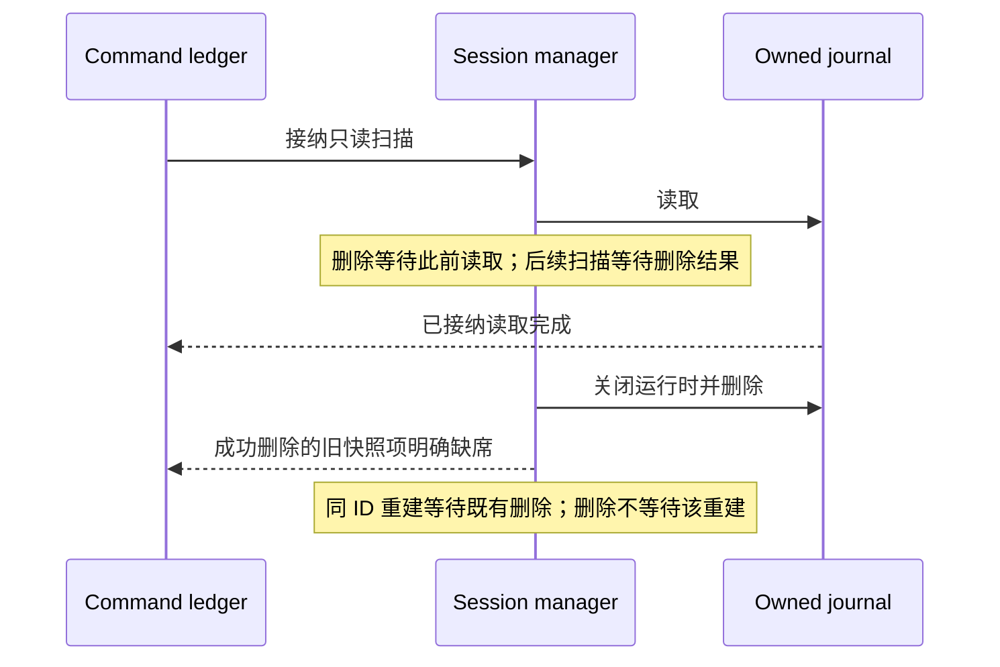
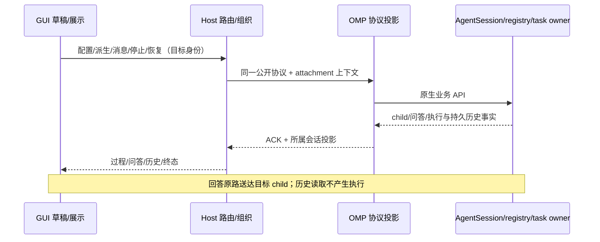

# Spec Delta

## MODIFIED Requirements

### Requirement: 多会话与消息

OMP MUST 两者在同一进程独立推进，结果和停止只归属各自会话。

#### Scenario: 多会话与消息的详细边界

- **WHEN** 本节所述功能在适用条件下运行
- **THEN** 以下具体约束适用：

支持多个会话同时运行。一个会话等待用户回答时，不阻塞其他会话；消息、停止和问答按所属会话处理。

并发主会话由同一 app-server 内的独立 AgentSession 托管，不用反复切换一个“当前会话”冒充并发，也不新建每会话执行宿主。

同一 app-server 对相同 session identity 的并发打开／运行恢复必须共享一次完整 opening，包括异步原生 child 身份解析、持久读取与租约取得；后到请求等待并复用同一个运行 owner，不得重复创建 AgentSession 或将租约冲突当成成功。失败或取消按同一次 opening 结算并清除其在途状态，后续显式打开仍可重试；普通冷历史读取保持只读，不因该并发协调激活模型。

ZCode 对消息、流式回答、工具过程、停止、插话、排队及会话管理操作的路由与投影必须绑定显式目标会话。改名不得破坏无标题槽的旧格式；被任何运行时托管的会话（含同进程其他会话和其他 Host）均不得通过离线文件改写绕过所有权。活跃会话改名走目标会话 API，删除须先关闭目标运行时并释放租约，但不能因此退出整个 app-server 或关闭其他会话；失败以可辨识错误拒绝，不新增审批流程。

命令回执扫描由会话管理器协调读取与删除的生命周期：删除等待此前已接纳的 journal 读取完成；扫描快照中已被本管理器成功删除的会话返回明确缺席，不得使其他会话的创建或查询失败。读取损坏／不可读的 journal 或删除失败仍须报错，不以重试或空历史掩盖。相同显式 ID 的创建与删除只允许单向等待，不能因互相等待而阻塞请求或关闭。

恢复或切换到持久会话前先查本 app-server 的已托管实例，不能对同一 sessionId 重复创建运行时。首次写入前取得并持续持有同一所有权租约；其他进程已持有时明确拒绝接管，切换失败保留原会话及其所有权，关闭目标会话后释放。纯历史读取、导出和渲染不取得运行所有权。app-server 存储操作始终绑定显式目标上下文。

真实 `agent://` 消息的成功投递回执保留总线生成的消息 ID 与发送时间，每个广播收件人使用其实际消息身份；写工具原有结构化结果直接持久化这些字段，使接入方在冷恢复时可将发送与接收记录幂等关联。不新增通信日志或猜测处理回执，失败仍保留真实失败语义。

**子代理核心能力**

子代理是 ZCode→OMP 替换的核心能力；撤销此前对子代理过程、历史查看及控制的排除。以下是交付要求，不表示当前实现或验收已经完成：

- 既有 GUI 的子代理创建配置须落实为 OMP 原生派生参数，包括代理定义、指令、工具范围、模型与思考级别；配置读回与实际 child Provider 请求一致。父、子、兄弟及其他主会话的模型／思考和可变配置隔离，不因查看、刷新或配置子代理改变父会话。
- 真实 child 由 OMP 原生 AgentSession／registry／task owner 创建与持有，稳定关联 parent、child、任务与执行身份。复用原生工具及消息总线，不添加旧 `Agent`／`SendMessage`／`AskUserQuestion` 工具别名，不启动原 `zcode-cli` 或平行 runtime。子代理提问转到所属父会话的既有问答入口，回答只交给该 child；其他会话不被阻塞。
- GUI 可查看真实运行过程、工具与消息、持久历史及成功／失败／取消状态；child 详情保持 readOnly，不新增 child composer。对目标 child 的消息、停止及恢复／继续从既有父会话入口／真实原生工具发起，而非为“控制”另建直接编辑 child 的界面。恢复沿用原生已保存上下文与任务状态，不重启未知工具、不重复派生或重放输入；冷历史读取不启动模型。父会话关闭／停止、child 结束及 owner 消失按实际原生生命周期结算，自有资源释放，迟到事件不得复活终态或串入其他父会话。
- live child 的迟到订阅必须显示原生 owner 当前尚未提交的 assistant partial，并继续消费同一消息的后续事件；仅使用真实 `AgentSession` 的当前流式快照，不重发模型、不重复合并已完成持久消息。冷历史读取不创建或恢复流式执行。
- 原生 `write` 向 `agent://` 目标发送的是通信而非文件写入：保留真实工具名、输入和消息 receipt，复用既有通用详情查看消息正文、回执及错误，不生成文件预览或文件打开动作，不注册旧消息工具别名；普通文件写入展示保持不变。
- 执行与通信事实始终属于 OMP 原生 owner；协议层仅投影，Host 仅路由与组织，UI 仅草稿和展示。desktop-continuous 与 web-remote-replayable 各自遵守订阅恢复语义，不共享游标、ACK 或待执行队列。

ZCode 子代理投影须覆盖配置／模型隔离、真实派生与父问答、过程与冷历史、消息关联、停止恢复、失败和 owner 收尾，事实来自对应原生 child，不由旧 fixture 或历史记录推定成功。

**既有界面的工作流与记忆消费**

- 替换后仍保留 ZCode 已保存工作流界面的文件目录、元数据编辑、移动、删除、实参校验、直接启动、运行历史、产物与从实际 run 保存能力。复用固定兼容提交的独立编译器、引擎与沙箱 runner，保留来源和依赖闭包，不实例化原 Agent runtime；actor 执行由同进程 OMP AgentSession 承担。
- 已保存定义仍由 project/global 定义文件持有；run、actor、node、event 由独立的持久工作流 journal 持有，不把 Host tasks-index 当运行历史，不以内存仓储兜底。会话 journal 只记录真实启动及执行引用；活动 run 句柄仅属于创建它的 app-server，取消／EOF 必须关闭自有执行与沙箱。
- 工作流是同等核心能力，不以 `/workflowz`、`/jch-workflowzbatch`、脚本串行调用、静态流程图或伪造 run 状态替代既有 GUI 工作流。定义创建／编辑／保存／重开、目录与元数据管理、参数错误拒绝及从真实 run 保存均须走既有公开入口；定义与运行身份可追溯。
- 必须从 GUI 启动真实 run，实际 actor 使用 OMP 原生 AgentSession／registry／task owner，支持 GUI actor 过程、工具、问答／消息交互、节点状态与产物查看；结果来自实际执行与真实产物，不以预置输出或 accepted 回执作为完成。
- workflow actor 属于其父 run 的嵌套执行会话，不得混入公开根 `session/list` 或主任务 `sessions-index`。活动创建与冷启动均按持久 workflow journal 的 actor 身份隔离；创建尚未写回 journal 的阶段沿用 SDK 已分配的 scoped interaction UI 所证明的嵌套身份，不建立第二份 actor registry。过滤公开列表不能切断 actor 内部查找、同一 journal 的恢复以及 run 中的只读下钻；actor 原生问答始终由父会话持有 pending interaction 并原路回应。
- run／actor 的持久过程、输入输出、事件次序、终态及失败原因可在历史重开后读取。取消、恢复／继续与 app-server 重启后的处置依赖持久 journal 和实际 owner 事实，不复活已取消 run、不重复已提交 actor／副作用；失去 owner 的运行必须明确结算，不能显示仍在运行。失败与取消须释放本 run 自有 actor／沙箱，不影响其他 run 或会话；恢复不可用的原生状态须明确失败，不假称恢复成功。
- 工作流运行 journal 与原生 actor owner 由 OMP 执行端持有；定义、参数错误、运行交互、输出／产物、历史／恢复、失败／取消及 owner 收尾须投影真实事实。Host 的定时调度不接管工作流执行状态。
- Host 的会话创建期 Memory 偏好须落实到该会话的原生 OMP backend，活动会话不随设置开关热切换。消息 ACK 与执行 telemetry 使用实际采用值；记忆文件与读写跟随 OMP backend，不复制旧 ZCode Memory 数据库或假造 Extraction 结果。不把旧数据库布局当 OMP 状态来源。
- 会话内定时任务复用既有 Host `automation/create` 等反向协议与 Host 持久调度所有者；适配器仅注册真实工具、校验并转交显式会话上下文及实际结果。调度触发轮禁止再创建／修改调度，取消后不提交迟到结果；不在 OMP 再建第二份调度队列。

**原生 dev 接入合同**

本节仅使已有 Dev 后端接入与[协同开发契约](../spec-driven-orchestration/spec.md)一致，复用当前已有工作区及原生阶段会话，不为 Dev 创建工作树。工作区唯一性、六个命令、五种阶段角色、仅 Team 配置、原生聊天与 Goal、批准、停止及必要状态恢复均以该契约为权威。TUI 的唯一新增常驻显示为三行 Dev 固定区，其余显示、详情和配置复用原生 OMP 交互，不另建 Dev 界面体系；本轮不新增桌面 UI、工作流或阶段。既有动态工作流合同保持不变，不能借其恢复机制接管 Dev，后端成功不代表桌面 UI 已验收。

**复用与兼容**

- 翻译、路由及投影仍集中在 `packages/coding-agent/src/modes/zcode/`，消费当前工作区同一原生 Dev 控制者的事实和变化；不让会话核心依赖 ZCode schema，不调用动态工作流引擎或制造 `CreateWorkflow`、虚假 `toolCallId`、脚本节点来模拟阶段，不另建状态机、执行队列或批准 API。
- 查询优先复用既有 `workflows/runs`、`v4/conversation/workflowRuns`、`workflowRunArtifacts`／`workflowRunArtifactRead` 记录和读取形态，沿用语义相符的 Markdown／JSON 展示，不把 Dev 存成可启动的动态工作流定义或模板。
- 既有字段不足时仅增加必要、可选且显式 capability 协商的事实扩展，由现有 schema、生产者与消费者共同落实，不新增另一组执行 API；旧客户端不接收未知字段／枚举，既有动态工作流响应及订阅保持原形。能力协商不是缩减后端必需事实的开关，完整消费者可获取全部真实材料和操作事实，不伪造任务完成数、审查配额、证据引擎或成功。

**身份、查询与订阅**

- 传输路由继续使用既有 `workspaceIdentity?.trim() || workspacePath` 及远端 `remoteSessionId`，请求和消息绑定显式原生会话及流程身份，不成为第二套 Dev 隔离单位。工作区由执行端识别当前已有目录或 Git 工作树，同一工作树的别名、子目录或不同普通会话不得各建流程，分支变化不产生另一流程，不同已有工作树互不影响；Dev 及内部协作不得创建工作树或要求工作树隔离前置。
- 每次成功 `new` 对应独立流程身份；仅进入 Dev、恢复、读取配置或详情不创建新流程。恢复有效工作区状态继续原流程，不以 change 名、显示名、协议请求 ID 或工具调用身份代替流程身份，不覆盖不同流程历史，也不从旧聊天推测批准。
- 列表、详情和订阅投影同一真实截面，角色仅无代理、需求、方案、计划、执行，忙碌、错误及停止依据当前原生运行事实显示，验收、收尾和完成结果保留必要业务约束，不增加代理角色。只呈现已保存 Team 值，配置可修改性和按钮可用性依据阶段及实际运行推导，不另存冻结、采用配置、忙碌或临时错误副本；仅有配置不是损坏或已有流程，Team 开启不表示讨论正在运行，不新增 Dev Goal 开关或状态。
- 保留 revision／seq／snapshot 及 desktop-continuous、web-remote-replayable 各自订阅恢复语义，不发明第三条恢复流；退订、关闭详情或切换查看目标仅释放观察，不因此退出 Dev 或释放其控制权。实际会话管理和工作目录变更须由原生准入确保先成功退出 Dev，不能用查看目标切换绕过这一规则。
- 同工作区已有控制者时其他入口拒绝接管和配置修改，原生进入失败保留原会话及输入；停止、保存、释放或旧工作收尾失败投影真实原因，不把占用判成恢复损坏。不同工作区及无关普通会话仍正常运行，迟到结果不得污染其他流程或会话。

**原生操作与产物读取**

- Dev 操作继续走既有 `sendText` → builtin 或等价原生链路，仅保留协同开发契约的六个入口，先进入后操作。其他旧 Dev 命令及批准参数从注册、路由、补全、帮助、界面动作和相关提示词中彻底删除，不保留别名、兼容处理或专属迁移提示；旧命令与未知子命令同样拒绝，不交给模型。目录、可用性、用法和输出与原生同源，不在适配层重建允许表，不删除普通 OMP 原生命令。
- `/dev config` 仅查看及保存工作区的 Team 开关，复用原生命令交互或如实说明界面限制，不由客户端直接写执行端状态；成员配置继续沿用原生 Team 作用域，不建立平行通用配置。配置及动作可用性由原生 owner 按阶段、运行事实及控制权判断，不持久化冻结或按钮状态，不能因协议可达绕过限制。
- 执行默认正常执行，用户可通过当前执行会话的原生能力手动开启 Goal，仍受获批计划、批准版本及验收收尾限制；这不是新增 Dev 入口或外层阶段。Dev 不按聊天轮次创建、删除、重建或改写 Goal，不在 Dev 状态和投影持久层另存 Goal 状态，恢复 Dev 不自动启动 Goal；原生 Goal 自身状态及生命周期仍由原生所有者管理。
- 每次控制动作绑定提交时的工作区控制者、流程、阶段及真实版本依据；产物结构检查集中于 `next`，正常澄清不因文件未生成报错或自动切阶段。继续依赖批准前仅核对本流程正式材料的已有版本，检查返回结果而不直接改阶段，准入拒绝过期依赖；不自动检测业务代码或整个工作区的变化，不要求用户手抄版本。普通澄清、补充和范围内修复直接交当前原生会话，不经外层模型转发、不广播 Team 成员、不把“同意”当批准；冲突动作不延迟形成额外批准或重复收尾。
- 原生问答可复用既有 pending interaction，不编造工具调用或把阶段决定当工具授权；ACK 只表示真实 admission，不证明保存、配置修改、阶段切换、停止、验收收尾或软件交付已成功。停止请求必须等原生 owner 确认自有调用及后代结清，不因主 Agent 回复结束推断 Team／Goal 已停。
- 消息、输入、附件、队列、草稿、历史、压缩、停止及其回执完全来自所属原生阶段会话，绑定流程、阶段及 Agent；Dev 不另建消息队列、草稿副本、消息处理状态机或持久收据状态。旧阶段输入及迟到结果不转交新阶段；退出与 drop 共用原生停止结清流程，涵盖当前 Agent、Team、Goal 及自有任务，未结清拒绝切换，不在 Host／GUI 另建调度真值。
- 直接投影真实阶段原生消息和工具事件，不复制到父会话后重新输出，不解析聊天摘要推导批准或运行，不将状态和错误摘要反复追加为聊天；流程状态和完整材料单独呈现，不因 TUI 截断状态文本裁剪后端材料。
- 产物身份、媒体类型及字节版本覆盖原 proposal／增量、全部方案候选、推荐 ID 及所选 ID、原格式计划和完成报告；单能力五个正式文件，后三项保留在 `docs/superpowers/plans/`。仅阶段进入完整交接，同阶段追问不重复注入全部未变文件；Team 只在进入方案时启动，失败后结清，再经 `back`、`next` 重入，不增加同阶段 Team 重跑或专用重试机制。不得新建 design／tasks、交接、确认、逐任务状态文件或材料全文副本。
- 只读访问限于流程实际记录的产物及引用，保留路径和归属限制；缺失、不可读或版本未知返回真实缺口，不补建或伪造成功。原生归档已确认的正常路径搬移不属于外部失配或丢失，查询、恢复和重试使用实际归档结果定位同一材料，不重建原 change 目录或重复归档；不因文件可读、报告存在或材料版本一致而声称业务代码未变或测试通过。

**历史观测与显式恢复**

- 历史查询、产物读取及订阅重连只读取真实观测，不创建阶段 AgentSession、取得工作区控制权或写权限、重新武装批准或启动模型，不借动态工作流 journal 恢复入口接管 Dev。
- 失去 live owner 的最后运行观测不等于仍在运行或已成功；已确证终态可保留，其余显示历史、中断或当前事实不可用，不伪装 running 或因留存材料自动恢复。
- 用户显式进入 Dev 时才交原生工作区控制逻辑取得唯一控制权并恢复必要业务事实：阶段、Team 配置、变更与产物身份、方案选择、原生会话关联、批准原文和版本、必要验收及收尾信息；可由既有引用取得的信息不重复保存，不另存忙碌、临时错误、队列、正文或 Goal 状态。有效状态继续同一流程，聊天缺失不直接删除有效流程；配置可修改性和动作按恢复后阶段及实际运行重新推导，版本检查不直接改阶段。恢复不自动发送输入、重放工具、重跑 Team 或启动 Goal，主动继续不构成阶段批准。
- 确实不可恢复、清除、旧任务收尾及部分同步归档等事实由原生 owner 投影，不从历史视图触发清除、猜测批准或伪造可新建。最终验收及 `drop` 遵守同一协同开发契约；收尾自动版本检查仅覆盖本流程正式需求材料、方案、计划及完成报告，不新增业务代码清单、快照或全工作区变化检测。
- 执行阶段最终 `next` 仅由用户提交，原生程序直接同步、校验和归档，不调用模型、不委派执行代理或增加收尾代理。失败时保留同一执行会话、历史及实际进度，真实错误与详情可供用户和当前执行代理读取；用户仍可经已有原生输入通路对话，一般提问只读，明确修复仅允许不改变已验收内容的直接收尾故障。执行代理不得自行验收、提交 `next` 或运行同步归档；修复后用户再次 `next`，程序只完成剩余收尾，不重新验收、重跑业务任务或重启 Goal，不为此新增命令、协议方法、消息系统或持久错误副本。

#### Scenario: 多会话与消息的可观察行为

- **WHEN** 一个会话等待问答，另一个会话继续消息与工具
- **THEN** 两者在同一进程独立推进，结果和停止只归属各自会话

#### Scenario: 不同普通会话不能创建同工作树并行 Dev

- **WHEN** 通过两个普通会话或两个实例操作同一工作树的 Dev
- **THEN** 执行端识别同一工作区并执行唯一流程及控制权门禁；非控制者无法创建、推进、清除或修改配置，路由会话不同不绕过限制，无关工作区和普通会话不受影响

#### Scenario: 查询不恢复而显式进入可恢复

- **WHEN** 无 live Dev owner 时先冷读历史，随后用户明确进入 Dev
- **THEN** 冷读不取得控制权、不创建阶段会话、不恢复批准或执行；明确进入才依据有效必要业务状态恢复同一流程和 Team 配置，核对批准版本并重新推导动作及配置可修改性，不恢复冻结、忙碌、错误或消息队列副本，不自动启动模型、Team 或 Goal

#### Scenario: 命令与配置投影服从原生准入

- **WHEN** 客户端提交 Dev 控制或配置操作
- **THEN** 使用同一新命令语义及原生阶段、配置、版本和工作结清门禁，旧 Dev 命令无可调用或兼容入口，提交时按未知子命令拒绝；ACK 不代替成功事实，冲突操作不延迟排队为下一阶段批准

#### Scenario: 普通追问复用原生阶段会话

- **WHEN** 客户端在同一 Dev 阶段继续澄清、补充或请求批准范围内修复
- **THEN** 原生会话直接接收本次输入及支持的附件，消息和工具事件直接投影，不复制父会话回复、不重复交接未变化的全部材料、不重跑 Team，也不按聊天轮次重建 Goal；仍受批准版本及当前验收收尾约束
