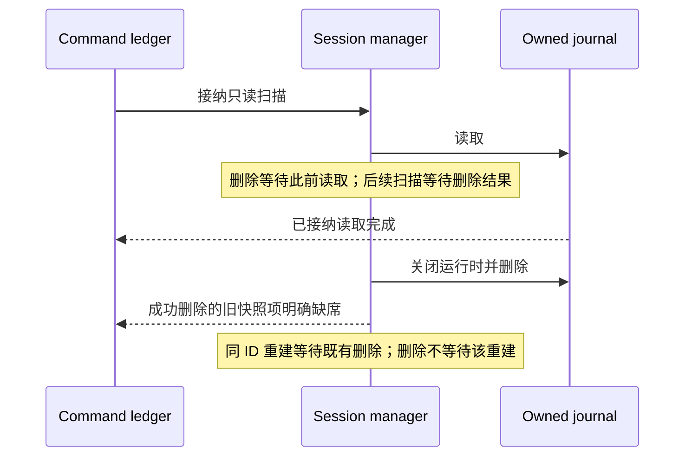
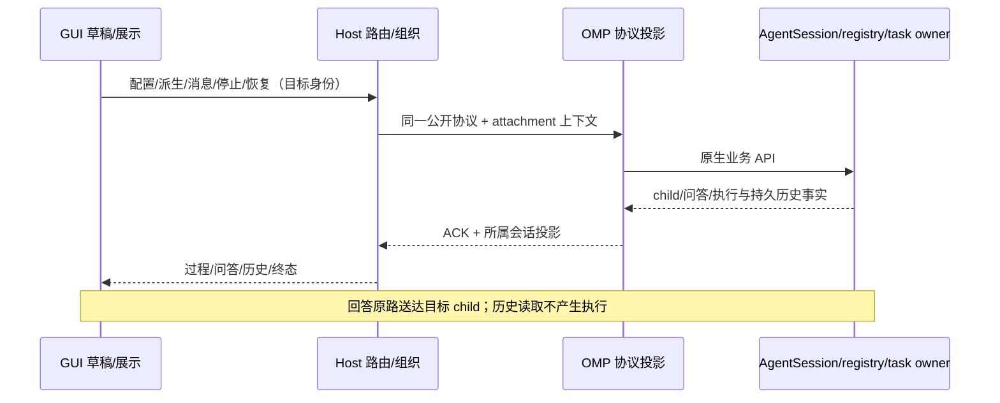

# Spec Delta

## MODIFIED Requirements

### Requirement: 多会话与消息

OMP MUST 两者在同一进程独立推进，结果和停止只归属各自会话。

#### Scenario: 多会话与消息的详细边界

- **WHEN** 本节所述功能在适用条件下运行
- **THEN** 以下具体约束适用：

支持多个会话同时运行。一个会话等待用户回答时，不阻塞其他会话；消息、停止和问答按所属会话处理。

并发主会话由同一 app-server 内的独立 AgentSession 托管，不用反复切换一个“当前会话”冒充并发，也不新建每会话执行宿主。

同一 app-server 对相同 session identity 的并发打开／运行恢复必须共享一次完整 opening，包括异步原生 child 身份解析、持久读取与租约取得；后到请求等待并复用同一个运行 owner，不得重复创建 AgentSession 或将租约冲突当成成功。失败或取消按同一次 opening 结算并清除其在途状态，后续显式打开仍可重试；普通冷历史读取保持只读，不因该并发协调激活模型。

ZCode 对消息、流式回答、工具过程、停止、插话、排队及会话管理操作的路由与投影必须绑定显式目标会话。改名不得破坏无标题槽的旧格式；被任何运行时托管的会话（含同进程其他会话和其他 Host）均不得通过离线文件改写绕过所有权。活跃会话改名走目标会话 API，删除须先关闭目标运行时并释放租约，但不能因此退出整个 app-server 或关闭其他会话；失败以可辨识错误拒绝，不新增审批流程。

命令回执扫描由会话管理器协调读取与删除的生命周期：删除等待此前已接纳的 journal 读取完成；扫描快照中已被本管理器成功删除的会话返回明确缺席，不得使其他会话的创建或查询失败。读取损坏／不可读的 journal 或删除失败仍须报错，不以重试或空历史掩盖。相同显式 ID 的创建与删除只允许单向等待，不能因互相等待而阻塞请求或关闭。

恢复或切换到持久会话前先查本 app-server 的已托管实例，不能对同一 sessionId 重复创建运行时。首次写入前取得并持续持有同一所有权租约；其他进程已持有时明确拒绝接管，切换失败保留原会话及其所有权，关闭目标会话后释放。纯历史读取、导出和渲染不取得运行所有权。app-server 存储操作始终绑定显式目标上下文。

真实 `agent://` 消息的成功投递回执保留总线生成的消息 ID 与发送时间，每个广播收件人使用其实际消息身份；写工具原有结构化结果直接持久化这些字段，使接入方在冷恢复时可将发送与接收记录幂等关联。不新增通信日志或猜测处理回执，失败仍保留真实失败语义。

**子代理核心能力**

子代理是 ZCode→OMP 替换的核心能力；撤销此前对子代理过程、历史查看及控制的排除。以下是交付要求，不表示当前实现或验收已经完成：

- 既有 GUI 的子代理创建配置须落实为 OMP 原生派生参数，包括代理定义、指令、工具范围、模型与思考级别；配置读回与实际 child Provider 请求一致。父、子、兄弟及其他主会话的模型／思考和可变配置隔离，不因查看、刷新或配置子代理改变父会话。
- 真实 child 由 OMP 原生 AgentSession／registry／task owner 创建与持有，稳定关联 parent、child、任务与执行身份。复用原生工具及消息总线，不添加旧 `Agent`／`SendMessage`／`AskUserQuestion` 工具别名，不启动原 `zcode-cli` 或平行 runtime。子代理提问转到所属父会话的既有问答入口，回答只交给该 child；其他会话不被阻塞。
- GUI 可查看真实运行过程、工具与消息、持久历史及成功／失败／取消状态；child 详情保持 readOnly，不新增 child composer。对目标 child 的消息、停止及恢复／继续从既有父会话入口／真实原生工具发起，而非为“控制”另建直接编辑 child 的界面。恢复沿用原生已保存上下文与任务状态，不重启未知工具、不重复派生或重放输入；冷历史读取不启动模型。父会话关闭／停止、child 结束及 owner 消失按实际原生生命周期结算，自有资源释放，迟到事件不得复活终态或串入其他父会话。
- live child 的迟到订阅必须显示原生 owner 当前尚未提交的 assistant partial，并继续消费同一消息的后续事件；仅使用真实 `AgentSession` 的当前流式快照，不重发模型、不重复合并已完成持久消息。冷历史读取不创建或恢复流式执行。
- 原生 `write` 向 `agent://` 目标发送的是通信而非文件写入：保留真实工具名、输入和消息 receipt，复用既有通用详情查看消息正文、回执及错误，不生成文件预览或文件打开动作，不注册旧消息工具别名；普通文件写入展示保持不变。
- 执行与通信事实始终属于 OMP 原生 owner；协议层仅投影，Host 仅路由与组织，UI 仅草稿和展示。desktop-continuous 与 web-remote-replayable 各自遵守订阅恢复语义，不共享游标、ACK 或待执行队列。

ZCode 子代理投影须覆盖配置／模型隔离、真实派生与父问答、过程与冷历史、消息关联、停止恢复、失败和 owner 收尾，事实来自对应原生 child，不由旧 fixture 或历史记录推定成功。

**既有界面的工作流与记忆消费**

- 替换后仍保留 ZCode 已保存工作流界面的文件目录、元数据编辑、移动、删除、实参校验、直接启动、运行历史、产物与从实际 run 保存能力。复用固定兼容提交的独立编译器、引擎与沙箱 runner，保留来源和依赖闭包，不实例化原 Agent runtime；actor 执行由同进程 OMP AgentSession 承担。
- 已保存定义仍由 project/global 定义文件持有；run、actor、node、event 由独立的持久工作流 journal 持有，不把 Host tasks-index 当运行历史，不以内存仓储兜底。会话 journal 只记录真实启动及执行引用；活动 run 句柄仅属于创建它的 app-server，取消／EOF 必须关闭自有执行与沙箱。
- 工作流是同等核心能力，不以 `/workflowz`、`/jch-workflowzbatch`、脚本串行调用、静态流程图或伪造 run 状态替代既有 GUI 工作流。定义创建／编辑／保存／重开、目录与元数据管理、参数错误拒绝及从真实 run 保存均须走既有公开入口；定义与运行身份可追溯。
- 必须从 GUI 启动真实 run，实际 actor 使用 OMP 原生 AgentSession／registry／task owner，支持 GUI actor 过程、工具、问答／消息交互、节点状态与产物查看；结果来自实际执行与真实产物，不以预置输出或 accepted 回执作为完成。
- workflow actor 属于其父 run 的嵌套执行会话，不得混入公开根 `session/list` 或主任务 `sessions-index`。活动创建与冷启动均按持久 workflow journal 的 actor 身份隔离；创建尚未写回 journal 的阶段沿用 SDK 已分配的 scoped interaction UI 所证明的嵌套身份，不建立第二份 actor registry。过滤公开列表不能切断 actor 内部查找、同一 journal 的恢复以及 run 中的只读下钻；actor 原生问答始终由父会话持有 pending interaction 并原路回应。
- run／actor 的持久过程、输入输出、事件次序、终态及失败原因可在历史重开后读取。取消、恢复／继续与 app-server 重启后的处置依赖持久 journal 和实际 owner 事实，不复活已取消 run、不重复已提交 actor／副作用；失去 owner 的运行必须明确结算，不能显示仍在运行。失败与取消须释放本 run 自有 actor／沙箱，不影响其他 run 或会话；恢复不可用的原生状态须明确失败，不假称恢复成功。
- 工作流运行 journal 与原生 actor owner 由 OMP 执行端持有；定义、参数错误、运行交互、输出／产物、历史／恢复、失败／取消及 owner 收尾须投影真实事实。Host 的定时调度不接管工作流执行状态。
- Host 的会话创建期 Memory 偏好须落实到该会话的原生 OMP backend，活动会话不随设置开关热切换。消息 ACK 与执行 telemetry 使用实际采用值；记忆文件与读写跟随 OMP backend，不复制旧 ZCode Memory 数据库或假造 Extraction 结果。不把旧数据库布局当 OMP 状态来源。
- 会话内定时任务复用既有 Host `automation/create` 等反向协议与 Host 持久调度所有者；适配器仅注册真实工具、校验并转交显式会话上下文及实际结果。调度触发轮禁止再创建／修改调度，取消后不提交迟到结果；不在 OMP 再建第二份调度队列。

#### Scenario: 多会话与消息的可观察行为

- **WHEN** 一个会话等待问答，另一个会话继续消息与工具
- **THEN** 两者在同一进程独立推进，结果和停止只归属各自会话
