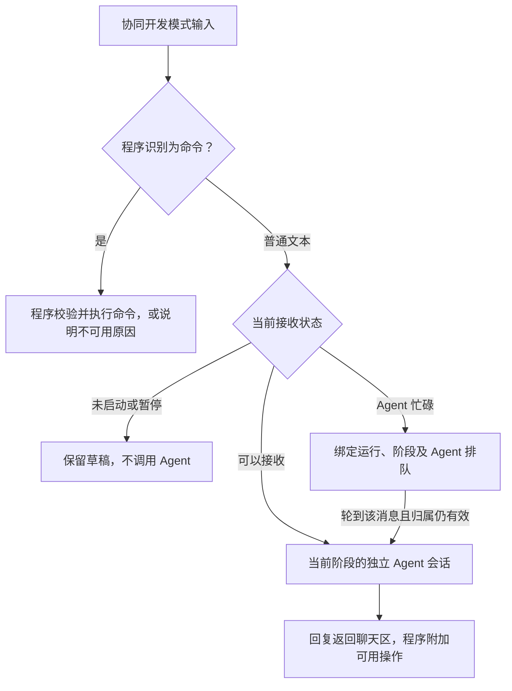
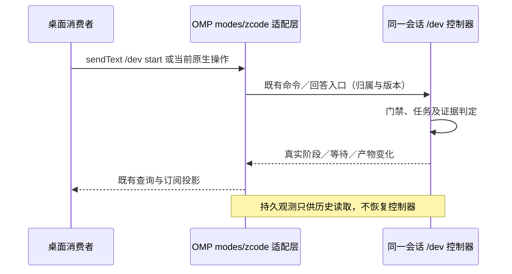

# spec-driven-orchestration

## Purpose

规定面向单个开发者的 /dev 协同开发模式：开发者本人完成需求确认、方案选择、计划批准和最终人工验收；需求、方案、计划、执行四职责、SDD、TDD 和独立 Agent 审查保持不变。独立 OpenSpec 维护需求，不将需求确认等同软件交付。正式需求唯一权威为 `openspec/specs/`，技术博客只作说明，不建立第二套权威。允许增加模型成本，目标是减少开发者纠偏和返工并提升交付质量，须用真实任务测量，不以消耗下降或模型数量作为成功依据。

## Requirements

### Requirement: 独立 OpenSpec 与受控开发模式的边界

OMP MUST OpenSpec 仅生成提案和规格，受控 dev 的状态、批准与执行由 OMP 负责。

#### Scenario: 独立 OpenSpec 与受控开发模式的边界的详细边界

- **WHEN** 本节所述功能在适用条件下运行
- **THEN** 以下具体约束适用：

这套方案复用以下能力：

- **OpenSpec**：用于需求探索、规格编写和增量变更管理；内置六项模型可发现、正文按需读取的 `opsx-*` 技能及必要原生运行资源，其中 `opsx-verify` 保留固定上游核对行为，不分发代码实施工作流。
- **Superpowers**：内置其全部原有技能及配套资源，复用计划编写、TDD、调试、子代理协作、代码审查和收尾等工程能力。
- **内置 JCH 的 `jch-grill-me` 技能**：把 JCH 仓库中的真实技能正文及配套元数据随 OMP 一并交付，由需求节点实际加载；采用其决策树、分轮提问和推荐答案机制，配合 Brainstorming 的受控需求探索，不只是借鉴提问方式或摘录几条规则，也不额外启动另一套设计与实施流程。
- **OMP**：提供统一入口、需求／方案／计划／执行四类职责节点、现有 Team 协作能力，以及程序化的阶段、交接和任务调度。

**OMP 的组合：OpenSpec 管规格，OMP 管执行状态**

这里不是把多个完整开发流程依次跑一遍。Brainstorming 的受控分支帮助探索需求，Grill-me 组织澄清对话；OpenSpec 管理提案、规格增量、结构校验及获批的同步归档；Superpowers 提供计划编写、TDD、调试和审查的方法。OMP 的程序控制器独占阶段、批准、任务状态及可信证据，复用 Team 比较方案；执行主 Agent 决定如何分工、派发和并行，原生调度器落实实际执行。**模型可以自主编排，但 OpenSpec 产物就绪、交接摘要、步骤 checkbox、本地 commit 和模型自报都不能代替完成门禁。**

**OpenSpec 在 OMP 中负责需求文档及独立实现核对，不承担代码实施。** `/skill:opsx-propose` 只能生成需求提案和规格，不能连同 design、tasks 或代码一起产出。`/dev` 第一阶段按需求产物取用原生指令，不因上游默认依赖图存在后续产物而提前生成方案、计划或实施代码。

原版 `brainstorming` 仍然保留，用户可以单独手动调用；主链路仅在需求节点使用其受控需求探索分支，不在后续节点重新启动完整需求、方案和计划流程。OpenSpec 则同时服务严格 `/dev` 与独立的轻量需求维护，但不再作为另一条代码实施路径。

这里的“内置”，不是读完来源仓库，再按自己的理解重写一份替代品。OpenSpec 保留由固定来源适配生成的需求技能和真实 schema、解析、校验、合并及归档实现；Superpowers 保留全部原有技能及必要配套资源；JCH 的 `jch-grill-me` 保留真实技能正文及配套元数据。资源必须随 OMP 包交付，不能只复制说明文字或依赖开发机上另一个源码仓库的绝对路径。保留部分尽量沿用固定来源，记录来源修订及资源校验信息；工具接口、资源路径、平台兼容或既定流程确实需要时，才做必要适配。

**能够由程序确定的流程规则，优先由 OMP 程序执行，不交给模型记忆或自行裁决。** 集成允许对 OpenSpec 原始实现、模板及 Superpowers 技能做少量必要修改；优先修改真实冲突的入口和交接位置，不重写无关能力。适配必须随固定包内资源及生成规则交付，保留来源、版本和默认独立使用路径；不能只在末尾追加一段“忽略前文”，让小模型自行化解相互矛盾的工作流指令。

包内来源清单固定为 OpenSpec **1.14.3** 和 Superpowers **7.0.1**，后者源码修订为 `2ce8aa15d05bd57213e6f746f953aafb7ded7a8b`。完整清单与资源来源保存在 `packages/coding-agent/src/spec-driven/vendor/inventory.json`；版本固定不等于已经通过所有平台及发行入口验收。

`jch-grill-me` 的来源是 JCH 仓库的 `skills/jch-grill-me/`，当前源技能包含 `SKILL.md` 与 `agents/openai.yaml`。这两项均须纳入 OMP 的固定来源清单、包内资源生成及发行打包链，绑定实际纳入的 JCH 修订和资源校验信息；不能只把开发机上已安装的个人技能路径写进提示词，也不要求用户先克隆 JCH 或另行安装该技能。

**OpenSpec：保留需求能力，删除实施及无关入口**

OpenSpec 只提供以下六项内置技能，描述使用中文。仅当会话当前工作目录直接包含 `openspec/` 目录时，名称和描述进入模型默认技能索引，允许模型按任务需要读取正文，无需用户先输入精确命令；不向父目录查找，同名普通文件不满足条件。其他目录保持手动调用，保留 `/skill:opsx-*` 入口，不保留 `/opsx-*` 内置命令、命令模板或旧 `/skill:openspec-*` 别名：

| 内置技能调用 | 职责 |
| --- | --- |
| `/skill:opsx-explore [问题]` | 研究项目、澄清需求，不实施代码 |
| `/skill:opsx-update [变更名及修改要求]` | 修订已有需求并按依赖顺序补齐已确认范围内缺失的 proposal／specs，保留历史实施产物，不生成方案或执行任务 |
| `/skill:opsx-propose [需求]` | 一次形成需求提案和规格，不生成 design／tasks，不自动交接实施 |
| `/skill:opsx-sync [变更名]`、`/skill:opsx-archive [变更名]` | 按当前使用场景的授权同步需求、归档变更，不把文档维护冒充软件实现验收 |
| `/skill:opsx-verify [变更名]` | 沿用固定上游行为，对照 OpenSpec 产物核对实际实现及可用证据；不实施代码 |

技能复用普通内置技能的发现、补全、按需读取及显式调用链路，正文为包内 `SKILL.md`；目录条件由发现层检查，不在技能正文中重复实现。默认只注入符合目录条件的名称和中文描述，不预加载正文；不符合时技能仍在用户管理及手动补全中可用，但普通 `skill://` 读取需有当前分支显式调用记录或宿主授权。目录条件在每次技能发现／重载时重新计算，不依赖进程全局工作目录；创建或移除目录后可重载技能或新建会话生效。符合条件时用户的自然语言请求无需改写为 slash 命令；仍须遵守 `/dev` 阶段允许名单、权限与批准约束。无需先运行 `init`，不向目标项目写入技能或命令模板。参数作为用户输入保留，不作为模板再次执行。技能正文复用固定来源和现有适配生成链，不另写平行工作流。删除范围是 OMP 集成及分发内容，不删除用户独立的 OpenSpec 源码工作区、已有项目需求或变更记录。`apply`、`ff`、`bulk-archive`、`onboard`、`feedback` 不提供内置技能或 slash 工作流入口。

mini 版使用 `omp openspec init [路径] [--language <语言>]` 直接初始化规格目录与配置，默认 schema 为 `omp-spec`；不提供 `--tools`（也不要求 `--tools none`）、工具选择、外部 Agent 命令／Skill 安装、工具目录迁移或 Copilot／profile 设置。重复初始化保留已有配置、需求和变更历史，不清理或改写项目已有外部工具文件。原生 `update` 工具安装更新入口及 `experimental` 安装别名一并移除；它们与保留的 `opsx-update` 需求修订技能不同。六项技能由 OMP 自身提供及更新，不按项目重复安装。原生外部 store 定位及语言配置边界保持不变，不在 pointer 项目内创建竞争性规格根。

新建需求统一通过 `/skill:opsx-propose` 形成提案和规格；修订及继续补齐未完成的需求统一通过 `/skill:opsx-update`。不登记、分发或保留 `opsx-new`、`opsx-continue` 及其别名，提示词和生成链不得继续交接到这两个入口，也不为它们保留隐藏机制。原生 `omp openspec new change`、`status`、`instructions` 等底层能力仍须保留，`/dev` 不受此入口收敛影响。

OMP 收敛技能入口时必须保留这些技能及 `/dev` 所需的包内原生引擎和运行依赖；独立核对只适配 OMP CLI 与当前技能引用，不另建核对引擎或注入需求维护专用限制。

核对不要求 Superpowers 计划或 OMP 运行记录，轻量场景可以独立使用。核对报告不改变 `/dev` 的批准、任务完成或最终验收状态，也不作为严格工作流额外必经节点。技能只加载提示词，实际成功以 CLI 与产物结果为准，不自动宣称完成。

**严格工作流与日常轻量使用的分界**

**OpenSpec 是内置于 OMP 的独立 fork 功能，不是 `/dev` 的子流程。** 六项 `opsx-*` 技能和 `omp openspec ...` 必须自行完成需求探索、提案、修订、同步、独立核对和归档，不依赖 `/dev` 的运行状态、版本批准、方案、计划、Team 或 Markdown 回写 API，不要求用户先启动或完成 `/dev`。`/dev` 可以继续按自身既定契约使用包内 OpenSpec 原生资源，但独立闭环的修复不能改变其阶段、批准、产物、验证与收尾语义。

独立 OpenSpec 的“同步”更新本项目已有的唯一正式需求权威，“归档”结束需求变更记录；需求确认、同步和归档均可以先于代码实现，不表示软件已交付。原生 OpenSpec 项目将 delta 合入 `openspec/specs/`；已有 Markdown 权威目录的项目必须通过本功能自身的文档／标题／原文定位和最小补丁流程同步，不另建竞争性主规格，不调用 `/dev` 的回写状态或批准接口。映射缺失或歧义在写入前澄清；写入后核对需求内容及无关正文的保留。仅文档操作不运行软件测试。

原生 CLI 动态输出、JSON 后续指令及包内产物模板中的命令引用统一指向 `omp openspec`，不能要求独立安装 `openspec`。归档必须通过原生校验及归档引擎；同步已完成、明确跳过同步或使用既有 Markdown 权威时，通过 `--skip-specs` 避免再次写入原生主规格，但不使用 `--no-validate` 绕过校验，不以直接移动目录代替归档，非零结果不得报告成功。

只有用户主动通过 `/dev start` 或操作窗口的等价启动操作，才开始本文的严格四职责工作流；仅切换输入模式或查看帮助不启动 Agent。流程开始后，任务简单也不能跳过其正式文档、批准、三次 handoff、验证和最终用户验收，不提供 `/dev` 内的轻量选项。

未启动 `/dev` 流程时，用户可以单独使用 OpenSpec 维护已有权威需求书，小范围修改不强制创建 change；需要独立追踪时再使用 proposal／delta／同步／归档。仅维护文档时不改业务代码、不运行软件测试，也不宣称功能已实现。用户同时要求新增功能或修改代码时，由普通 OMP 原生实现及编排；用户可以显式调用第二节的手动 Superpowers 技能，在 OpenSpec 更新需求后独立编写计划和实施，不要求先启动 `/dev`，也不创建或更改 `/dev` 的运行与批准状态。

独立轻量入口遇到旧 `spec-driven` schema 或已有非需求产物时，只能在可安全隔离的范围内维护 proposal／specs；不能静默生成 design／tasks、迁移 schema 或删除历史产物。无法安全隔离需求部分时明确报告不兼容并停止该次操作，不借旧 schema 恢复已经删除的实施流程。

预期行为未改变的 bug 修复由普通 OMP 按项目规则调试和验证，不为记录修复而强制改需求或新建 change；需求确实缺失、矛盾或发生变化时，才使用 OpenSpec 澄清与维护。运行中或暂停的 `/dev` 仍由其控制器管理；独立 `opsx-*` 技能不得绕过阶段门禁，须先结束该流程再单独维护需求。

也需要准确看待上游：**OpenSpec 已有 CLI、schema、产物依赖和结构化指令机制，不是纯提示词集合。** 但上游明确把依赖视为帮助而非刚性审批门禁，允许迭代修改产物；OMP 需要在其外层落实已确认的阶段权限、用户批准和变更回退，而不是把上游的 ready 或文件存在当作批准。

严格工作流的主入口为 `/dev`，不改成 OpenSpec 实施入口主导整条流程。执行主 Agent 使用受控的 Superpowers 编排方法和 OMP 原生任务工具，不再另建独立调度器或另一套完成状态。普通独立使用保留上述需求维护能力及第二节限定的普通技能，不默认启用 bootstrap。

增强范围是四类职责节点及其正式产物、三次原生 handoff、专用角色的固定系统规则、执行主代理的自主分工与原生并行、可选无人值守 Goal、完整需求覆盖检查、与实际内容绑定的验证证据、TUI 协同开发交互模式，以及供既有桌面消费的原生 `/dev` 后端协议适配。本轮不新增桌面页面、通用工作流设计器、另一套任务文件、跨进程恢复、多人审批、IAM、OS 沙箱或自动最终分支合并／对外推送，不更换 Team 讨论算法和审查席位；审查修复额度按第七节默认两轮及显式追加规则处理。获批执行工作区内的任务集成另按第三节授权。内部模块拆分、类型和文件布局由实现者沿用既有结构决定，不能改变上述职责和授权边界。

**`/dev` 只是 OMP 的一个可选功能，不得改变核心能力或其他使用场景的既有行为。** 除本文已明确确认的包内资源裁剪、普通技能发现调整和用户主动选择的输入模式外，未启动 `/dev` 流程的对话、原生工具与子代理、独立 Team／Goal、TUI、SDK 及其他宿主路径保持原有语义，不附加阶段门禁、证据采集、系统正文或后台工作。功能状态、权限、回调和资源加载限定到本次运行及所属会话；暂停、取消和释放不得影响无关会话。实现优先收敛在既有 `spec-driven/` 边界；共享链路确需扩展时只使用或补齐默认不启用、调用方显式传入的最小通用接口，不使 OMP 核心依赖本功能的业务状态、资源或专用规则，也不为本功能改写其他场景的默认策略。

**上游方法的受控调用**

受控模式由 OMP 在实际程序节点显式指定，并绑定当前角色、已确认需求与方案、计划版本、交接来源、任务及输出契约；不能从用户正文、技能名称提及或模型自报推断已进入该模式。这是调用级上下文，不新增用户配置开关。模式只说明如何交接，不授予工具、写入、提交或阶段转换权限；这些能力仍由宿主程序限制。

固定来源原件用于来源校验及既定普通独立调用；受控调用通过同一来源和既有资源生成、解析机制取得可追溯的有效分支。实际加载的正文、元数据、引用文件和脚本交接必须一致，不把相反指令留给模型自行裁决；无冲突资源可以共用，不要求所有文件都维护两套物理副本。

适配检查必须覆盖本次实际生效的资源：Brainstorming 的阶段交接、Grill-me 的分轮正文与元数据、SDD 的修复／恢复／最终审查引用，以及 TDD 和 verification 的验证要求。验证范围服从获批计划及目标项目运行授权；证据是否可复用按第三节的内容有效性判断，不能由上游通用的全套测试或每条消息重新执行要求越权覆盖。

需求节点仅运行一次受控需求访谈，Brainstorming 不在这里越权生成实施设计或调用 writing-plans；后续节点接受已经确认的需求，不重复澄清整套业务。计划节点接收上一节点的真实 handoff、已确认需求书和选定方案，完成计划后交回 OMP，不另问一次执行方式或自行开始实施。执行主代理可以使用子代理编排方法；普通实现子代理只接收与任务相符的方法，不把完整阶段控制职责复制给每一个实现者。

执行主 Agent 是执行阶段的编排者，不是禁止委派的单任务 worker。它在已批准约定内自主决定任务细化、自己实现还是委派、串行还是并行，并组织验证、独立审查及修复；程序负责原生派发的权限检查、并发与生命周期、可信状态和完成门禁。普通实现选择不重新索取用户批准；需求、验收标准、核心方案或授权确实需要改变时，不能擅自改写已确认约定或假报完成。

受控分支的结果只作为输入，不是放行凭据。计划、执行或审查调用结束后，OMP 重新检查当前版本、原生工具记录及本节点的必需结果，再决定是否进入下一步；不让上游交接文字、临时 ledger 或执行器的 `complete` 直接改变程序状态。

**专用角色的系统提示词**

四类职责节点的角色边界及本阶段必需的受控技能有效正文，由程序直接装配进该节点的固定系统提示词；不能只写技能名称加 `MUST`，也不能仅在首轮普通消息中自动加载后期待模型一直记得。技能来源、固定版本及适配结果可追溯，普通会话的默认发现规则不因此改变。

| 专用职责 | 固定系统内容 |
| --- | --- |
| 需求 | 受控 Brainstorming、包内 `jch-grill-me` 的必要有效正文，以及只澄清需求、不提前设计或实施的边界 |
| 方案 | 方案比较、既有 Team 协作、候选与采用条件保留，以及交由用户选择的规则 |
| 计划 | 受控 `writing-plans`、完整需求覆盖、唯一计划及不得提前实施的规则 |
| 执行 | 自主编排、委派与安全并行边界，以及当前阶段必需的 TDD、验证和审查方法 |

程序在该节点每轮实际模型请求中提供上述固定内容；同一存活运行内压缩、继续或上下文重建后，从固定版本包内资源重新装配，不依赖已经压缩的技能历史消息。只装入本阶段必要规则，不预加载整套技能；长篇参考、脚本及具体产物指令按需读取，并继续满足受控资源一致性。已在系统层提供的同一正文不再作为首轮普通消息重复注入；必要内容无法容纳时明确受阻，不静默截断或退化为仅有名称。

需求书、方案候选、handoff、代码和任务进度仍是当前业务输入，不因这项机制升级为系统授权。系统规则不授予工具、阶段转换或完成权限；批准、状态和证据仍由程序维护，独立审查者保持只读，不能继承作者的写入权限。规则重建不恢复失效批准，也不新增跨进程恢复。

验收核对实际发往 Provider 的系统内容，不以本地组装成功代替送达；遵守对应 Provider 合同，不支持或未验证的路径如实报告限制。固定注入保证规则持续作为输入提供，不承诺模型绝不违反，真实模型遵循质量与请求构造分别验证。

#### Scenario: 独立 OpenSpec 与受控开发模式的边界的可观察行为

- **WHEN** 普通会话与独立 OpenSpec 维护需求
- **THEN** OpenSpec 仅生成提案和规格，受控 dev 的状态、批准与执行由 OMP 负责

### Requirement: 二、按职责内置，按需加载上下文

OMP MUST 按各自发现与授权范围加载；普通会话保留手动技能入口，受控 `/dev` 方法仍按阶段及准确资源授权隔离。

#### Scenario: 二、按职责内置，按需加载上下文的详细边界

- **WHEN** 本节所述功能在适用条件下运行
- **THEN** 以下具体约束适用：

企业内网模型的上下文往往比较紧张。如果把所保留能力的技能描述、正文和调用说明全部放进普通会话，就会让简单任务也承担不必要的阅读负担。

内置技能按以下固定范围提供发现能力；默认发现只注入名称和描述，不预装正文：

| 范围 | 技能 | 发现与读取规则 |
| --- | --- | --- |
| 普通模型可发现 | `systematic-debugging`、`verification-before-completion`、`writing-skills` | OMP 将这三项包内资源纳入普通模型索引；正文按需读取 |
| 仅手动调用 | `brainstorming` | 设置 `disable-model-invocation: true`；不进入普通模型索引，允许用户显式 `/skill:brainstorming`，随后仅当前调用分支可读；`/dev` 需求节点保留受控加载 |
| 仅手动调用 | 其余十一项包内 Superpowers 技能 | 进入技能管理和 `/skill:` 补全，设置等效的 `disable-model-invocation: true`，不进入普通模型索引；允许用户显式调用，随后仅当前调用分支可通过 `skill://` 读取；`/dev` 仍按现有阶段权限及准确资源授权加载受控方法 |
| 按当前目录发现 | 六项 OpenSpec `opsx-*` | 当前工作目录直接含 `openspec/` 目录时提供名称和中文描述，正文按需读取；否则仅手动调用；保留 `/dev` 阶段约束 |
| 仅手动调用 | JCH 的 `jch-grill-me` | 不进入默认索引，保持显式调用、当前分支读取及 `/dev` 受控加载规则 |

新增手动范围为 `diagnosing-superpowers`、`dispatching-parallel-agents`、`executing-plans`、`finishing-a-development-branch`、`receiving-code-review`、`requesting-code-review`、`subagent-driven-development`、`test-driven-development`、`using-git-worktrees`、`using-superpowers`、`writing-plans`。手动读取限制依据包内来源身份，不按裸名称限制用户、项目或共享来源的同名技能。

此次调整仅涉及技能暴露范围、元数据与现有访问入口，不改写技能正文、相互引用、脚本和受控方法；不修改普通主系统提示词来劝阻模型，不新增替代流程。普通模式的原生 `task` 多代理编排及 reviewer Agent 本身保持可用。Skill 正文中的跨技能引用不自动授予另一项手动技能的读取权。

普通和受控技能中的代理名称按 OMP 原生接口做最小适配：实现及一般任务使用 `task`，代码审查、任务审查及修复后的复审使用 `reviewer`；不得要求派发不存在的 `general-purpose` 代理。固定来源原件保留供校验，适配随资源生成链交付，不新增代理别名，也不改变受控分支的宿主审查席位或派发权限。

`brainstorming` 不恢复普通自动发现；除用户单独手动调用外，只允许在用户主动启动 `/dev` 流程后，由需求节点显式加载受控分支。`jch-grill-me` 必须从 OMP 包内真实技能资源加载，不以 OMP 手写的提问摘要代替；不进入普通会话默认索引，单独调用仍遵守其显式用户调用规则。`/dev` 的需求节点加载属于该流程已授权的受控调用，不需要用户再次手动启用技能，也不把启动 `/dev` 扩大成整套技能自动启用。Brainstorming 与 Grill-me 的受控分支必须统一为本文的分轮规则，不能同时注入相互冲突的逐题等待与整轮提问要求。`using-superpowers` 不删除、不默认发现、不自动启用 bootstrap；其 `SKILL.md` 和整个 `references/` 均保留，`executing-plans`、`writing-skills` 等技能仍可按既有相对路径使用其中的平台说明。

设计目标是：

- 普通模型会话中，包内 Superpowers 默认索引只包含三项普通技能；技能目录及手动补全提供其余十二项技能，正文不预加载。OpenSpec 六项技能按当前目录条件进入默认索引并按需读取，JCH 的手动调用规则不变。
- 手动技能读取须有当前分支对准确资源的显式调用记录，或当前宿主的有效资源授权；其他技能交接、错误路径及其他会话的调用记录均不授予读取。普通原生多代理编排不自动加载整套技能。进入 `/dev` 输入模式本身也不授予整套技能；实际阶段会话仍按现有允许名单及准确资源授权使用受控方法，普通手动调用不能解锁不同路径的受控资源或绕过阶段权限。
- 不新增递归依赖加载、整套技能预加载或平行权限机制；授权随宿主会话和阶段生命周期撤销，不泄漏到其他会话。
- 内部程序仍在固定节点加载所需技能；所有后续动作继续服从 `/dev` 的阶段允许名单、角色权限、用户批准及目标项目规则。

这里的访问约束覆盖 OMP 技能发现、手动调用及 `skill://` 入口，不是文件系统保密沙箱，不承诺阻止 Bash 等通用工具读取可访问的包内文件。已有会话中已注入的旧技能正文不会自动消失；验证应使用新会话，并单独核对手动调用前后的读取边界和 `/dev` 有效授权。允许读取技能不等于允许执行其中提到的命令、提交或下游阶段；本地模拟模型不能证明真实模型的选择或遵循质量。

阶段及执行权限是宿主的工具、资源和批准准入约束，不是 OS 沙箱或 IAM，不承诺阻止通用命令产生所有越界副作用；本轮不新增隔离基础设施或多人审批。

需求文档维护保留终端入口 `omp openspec <原生参数...>`，用户可在满足第一节目录条件时通过自然语言请求由模型发现并读取六项 OpenSpec 技能；任意目录均可通过 `/skill:opsx-*` 手动调用，不提供对应内置命令或命令模板。普通会话可显式调用全部包内 Superpowers 技能及内置 `jch-grill-me`；除三项普通 Superpowers 技能外均不进入默认模型索引。`/dev` 运行期间，单项调用不能绕过阶段、权限和批准门禁。包内 Superpowers 脚本的既有 `omp superpowers <relative-skill-script> [args...]` 终端入口保留；JavaScript 使用 OMP 自带 Bun，Shell 脚本仍需 Bash／POSIX 工具，部分脚本还需 Git 或 Graphviz；缺少条件时报告真实错误，不在线安装或伪造成功。这些终端入口不是需求、方案或计划节点可任意调用的模型工具。

#### Scenario: 二、按职责内置，按需加载上下文的可观察行为

- **WHEN** 普通会话、手动技能入口和 dev 宿主访问内置资源
- **THEN** 普通手动入口可加载准确调用的技能，默认模型索引不扩张，`/dev` 受控方法保持阶段及准确资源授权约束

### Requirement: 三、需求、方案、计划、执行各有独立职责

OMP MUST 需求、方案、计划、执行各有独立会话与门禁，未经版本批准不越阶段。

#### Scenario: 三、需求、方案、计划、执行各有独立职责的详细边界

- **WHEN** 本节所述功能在适用条件下运行
- **THEN** 以下具体约束适用：

主链路由四类专用职责节点承接，不再把方案比较和执行计划合成一个角色。程序决定节点转换，Agent 负责当前节点的具体工作；Team 参与者、独立审查者和按任务派发的实现者是节点内部协作，不额外增加用户必须操作的主阶段。

**阶段一：只澄清需求、编写规格**

需求 Agent 可以读取代码、使用 Wiki／Repo 等只读工具、检索资料和向用户澄清，并生成正式需求书、提案、spec／spec delta 及必要的需求检查材料。提案只解释动机和范围，不写实现设计；本阶段不能生成 design、tasks 或执行计划、修改业务代码，也不能运行任意命令、代码测试或临时实验。

规格应明确目标、范围、约束和可验证的验收标准，并以 OpenSpec 的 Requirement、Scenario 表达行为；已有行为变化用规格增量描述。草稿形成后安排独立审查，检查遗漏、冲突和无法验收的表述。审查意见涉及用户真实意图时，仍需要回到用户，而不是靠多个模型投票决定需求。

**用友好的分轮访谈澄清需求**

需求探索复用 Brainstorming 对目标、动机、范围、约束、反目标和验收场景的检查；需求节点必须实际加载包内 `jch-grill-me` 的受控分支，统一采用其决策树与分轮访谈机制，不仅凭角色提示词模仿其提问方式，也不同时执行两套互相冲突的提问规则：

- 把待决定事项组织成决策树。每轮只问前提已经确定、现在就能回答的问题；同一轮收集全部相互独立的问题，依赖本轮答案的问题留到下一轮。
- 每题编号、给出清楚的推荐答案及取舍，让“是”表示接受推荐。允许用户直接回答“全部是”，也允许逐项纠正；推荐不能冒充已经获得同意。
- 已回答的问题不重复询问。能从项目、代码或工具查明的事实先调查，不能要求用户代查；必要的并行调查仍由 OMP 控制派发，不给需求 Agent 任意扩权。
- 每轮答案更新决策树，直到没有影响结果的未决事项。需求书必须反映用户实际决定；Agent 自行选择的实现层默认值需要明确披露，不能写成用户已经决定。

访谈收敛后，必须将目标、范围及不做什么、约束、稳定需求 ID、可观察验收场景、关键决定和资料引用写入 OpenSpec 的 proposal／specs，不再强制新增 OMP `requirements.md`。独立审查通过后，由用户确认同版本需求材料；这次确认同时表达对共同理解的认可，不再机械增加一轮同义确认。确认后才生成原生 handoff 并进入方案节点。

proposal／specs 是本次变更的需求批准依据；不维护第二份可编辑需求书，也不替代项目原有的长期需求权威。

需求 Agent 的写入范围受程序限制。OpenSpec 必需的项目检查、变更目录和定位元数据准备，可以由外层程序在明确范围内完成；内置技能不需要每个项目重新安装。主流程固定使用包内的**规格专用 schema**，只声明 `proposal`、`specs` 及两者的依赖，不声明 design、tasks 或执行进度跟踪，不要求用户手写 schema。程序通过 `openspec status --change <name> --json` 读取规格产物状态，通过 `openspec instructions proposal --change <name> --json` 和 `openspec instructions specs --change <name> --json` 分别取得原生指令。必要的规格结构校验也由限定接口代办，不向 Agent 开放通用 Bash。这不授权切分支、安装依赖、构建或运行代码测试。

项目已有明确的需求权威时，接入不能制造第二套可编辑主规格。本仓库的正式需求权威为 `openspec/specs/`；其他项目若已有 Markdown 权威目录，则继续按下述精确回写合同维护原文，不自动制造平行主规格。没有既有目录约定的新项目使用原生主规格布局。

**目录兼容不等于格式兼容。** OpenSpec 原生合并依赖能力路径、`### Requirement:` 和 Scenario，不能把现有编号章节直接交给它整块替换。两种布局的读写边界固定如下：

| 主规格布局 | 读取与变更定位 | 验收后的回写 |
| --- | --- | --- |
| 原生 OpenSpec 布局 | 直接使用能力路径、Requirement 与 Scenario 标识 | 使用原生规格同步和校验 |
| 已有 Markdown 需求目录 | 沿用原文件、标题层级及已有需求编号；缺少编号时在本次变更映射中分配引用 ID，不批量改写原文。每项 delta 关联目标文件、完整标题路径、原文定位和基准内容摘要 | 由规格 Agent 按 OpenSpec 增量语义提出针对原文的精确补丁；一名独立审查者检查需求、场景和未涉及内容的保留，程序校验目标、原文匹配及批准版本后应用。不能直接调用原生 `specs-apply` 覆盖非原生文档 |

映射同时覆盖读取、查询、delta、校验和收尾；程序准备的结构化视图只用于调用 OpenSpec，不是第二份可编辑主规格。原文仍是判断依据，不能用模型临时重译的规格替代。新增须明确插入位置，修改或删除须唯一命中原文，重命名须关联原位置与新位置；未涉及的章节和场景保持不变。定位不唯一、来源已变化、场景映射不完整或无法确认无损时，暂停并澄清或重新审查，不能猜测合并。结构检查不能证明语义等价，语义保留仍需独立审查；这不是承诺一个能理解任意 Markdown 的通用合并器。

**阶段二：比较方案，由用户选择**

方案 Agent 接收需求 Agent 的原生 handoff 和最新已确认需求书，不是从一份空白任务重新理解业务。OMP 在本节点复用既有 Team 能力，让参与者独立调查、对齐差异、交叉审查、修订复核；方案 Agent 承接业务上下文并组织候选材料，实际派发和门禁仍由程序控制，不在其内部再启动第二套调度器。讨论算法沿用既有 `/team` 契约。

这里不是要求每次硬凑 A、B、C 三个答案。只有一个合理方向，就明确说明；存在真实取舍，才分别展示候选；没有可采用方案，也不能为了推进流程拼出一个未经审查的新方案。

**Team 到选择门禁：交付候选，不只交付报告**

Team 返回的 `completed` 只表示讨论正常结束，不能证明存在可采用方案。其 Markdown 报告与以下结构化事实必须来自同一组提案、修订和阻断记录，而不是另派模型从报告里提取：

- 本次讨论 ID、输入规格版本，以及每个最终候选的稳定 ID、当前修订版本和报告对应关系。
- 每个候选的审查及必需复核是否成功、是否可采用、未解决阻断 ID 与依据；被排除的方向保留原因，不混入可选集合。
- 影响选择的需求理解差异、必须由用户回答的歧义，以及执行前待验证条件；未证实的运行时前提不能冒称已经验证。

报告和选择界面消费同一份候选结果。程序只接受当前讨论、当前规格版本下可采用候选的明确选择；有影响选择的未决歧义时，先让用户回答，再按 Team 契约重跑受影响讨论。讨论失败、取消、零个可采用候选、必需复核失败、结果缺失或选择了旧版本，都不能进入写计划。选择有条件方案时，条件必须进入计划，实际检查未通过前不解锁依赖该条件的执行任务。OMP 不重写 Team 的审查算法，也不把 `completed` 或综合模型的推荐文字当作放行依据。

**忠实保留选定候选与选择身份**

用户选定候选后，OMP 在本次运行 JSON 中保存候选原文、条件及需求版本、Team run ID、candidate ID 和候选版本，并保留原始 Team 结果，不再强制生成 `solution.md` 或同义 `design.md`。保存必须忠实对应选择，不能让模型重新发挥未经批准的新方案；实质修改回到方案门禁。方案 Agent 根据已选结果生成真实 handoff，成功保存后才交给计划 Agent。

**阶段三：把选定方案转成可执行计划**

**唯一计划与唯一执行状态**

计划 Agent 接收上一节点的真实 handoff、最新已确认 proposal／specs 和选定 Team 候选，调用 Superpowers 的 `writing-plans`，明确任务边界、接口、依赖、验证方法和执行位置。**唯一计划沿用 Superpowers 默认路径 `docs/superpowers/plans/YYYY-MM-DD-<feature-name>.md`**；OMP 只记录其路径、批准版本及对应任务投影，不另造 change 目录内的可编辑计划。计划经过一名独立审查者审查，不能把“方案审查过了”等同于“任务拆分也正确”。

计划中的任务具有稳定 ID，如 `T001`，步骤可引用 `T001.1`；修订保留未改变任务的 ID，不把编号重新分配给其他任务。“一任务一审”的单位是获批计划中的稳定任务 ID，内部委派不减少父任务的必需验证和独立审查义务。OMP 把任务状态与当前规格、所选候选和计划版本绑定，并关联本任务的提交范围、验证记录及独立审查结果；这些结果还必须对应仍有效的实际内容。实现完成、验证通过、审查通过分别记录；**只有当前内容的必需验证与独立审查均通过，任务才算完成并解锁依赖。** 计划的步骤勾选只是阅读进度，不能提升程序状态。

完整需求覆盖的集合是本次变更已批准的需求及明确纳入影响范围的存量行为；全局硬约束始终适用于任务，不要求为整个项目所有历史规格或每条开发规则另造任务。程序在独立计划审查前检查：覆盖集合中的每项需求 ID 至少关联一个计划任务，每个任务的需求引用非空、无重复且属于该集合。遗漏、未知引用或重复任务 ID 都阻塞计划，不能寄希望于审查者从长文中发现。需求与任务允许多对多关系，不为凑一一对应强拆任务；保持既有行为可以由相关验证覆盖，不要求每项需求都产生代码改动。范围调整须先回到需求阶段，不能把未覆盖项静默删掉或标成延期。

结构化任务、需求覆盖关系、批准及运行状态保存在 `.omp/spec-sessions/<run-id>/state.json`。每次运行一份快照，不新增数据库或事件日志系统，不向 Markdown 注释嵌入机器 JSON。计划正文与任务投影绑定同一批准版本；修改任一契约须重新核对，不能利用正文与机器数据不一致绕过批准。任务内部运行时细化不另建计划，也不因普通调度变化自动撤销批准。覆盖齐备不证明语义正确，仍需独立审查和实际验收。

运行目录默认不进 Git，不从快照恢复跨进程批准。必要交付证据明确保留在变更材料中；归档允许保存已批准计划及原始方案、任务数据的只读证据快照，不移动或删除外部唯一计划。OpenSpec `status` 只报告需求产物状态，OMP 独占严格流程状态，不做双向 checkbox 同步，不把独立 `verify-change` 报告当作放行凭据。

计划节点仍然只能生成本阶段文档，不能提前实施。**选择方案只授权编写计划，不等于授权修改代码或提交。** 用户明确批准当前计划并启动后，计划 Agent 才生成原生 handoff；交接成功是放行执行节点的附加条件，不能用批准本身绕过交接。

**只修订计划，不重走未变的上游**

开发者使用 `/dev revise-plan <plan-version> <修改说明...>` 修订当前非终态运行中的计划。程序在停止旧执行或修改状态前，校验所属会话／运行、当前计划版本、非空说明及既有消息归属／结清约束；旧版本、错误归属或终态请求不得中断现有工作或产生修改。接纳后停止旧执行及其自有后代，保留已批准规格、原始方案及选择身份／批准、上一计划和未变且仍有效的任务与证据，撤销计划批准及旧验收资格。计划 Agent 接收修订说明及保留上下文，生成修订计划并完成独立审查后等待开发者重新批准，不自动恢复执行。未变任务保留稳定 ID，变更影响的完成资格与证据须重新取得；需求或核心方案变化仍使用其对应修改入口，不能用计划修订暗改上游。

计划修订复用既有计划及整体审查席位、问题、`revision` 和 `repairLimit`，必须复审且消耗一轮；同 ID 任务即使契约改变也保留原审查计数，不能借修订重置预算。已通过但额度耗尽的计划／整体审查席位，在后续修订或修复受额度限制时也可先明确 `extend-review`；追加本身不改变通过结论、不启动修订／修复或恢复写入。

**阶段四：执行主代理自主编排，完成后交用户验收**

执行 Agent 在本阶段就是主代理：接收计划节点的真实 handoff 和获批文档，持有完整执行目标与当前任务状态，自主推进整个执行阶段，而不是由外层程序固定每次只安排一个任务给无派发权限的 worker。

**模型决定分工，程序落实调度与门禁**

- 主执行代理可以亲自完成工作，也可以按需使用 OMP 原生任务工具派发子代理；允许细化获批任务、调整执行顺序和并行安排，不强制所有任务都必须委派。
- 依赖就绪且修改范围、接口、共享状态确实独立的工作可以并行；复用原生子代理、并发／深度控制、隔离 workspace 和结果回传，不另建一套调度器，也不把“严格流程”解释成一律串行。
- 实现子代理获得本任务原文、接口、必要证据和明确作用域。运行身份、当前批准版本、任务归属、工具／技能限制与可信验证采集必须传递到实际后代，不能假定父代理的限制或自定义工具会自动继承。
- 主执行代理组织验证、独立审查和修复；程序取得对应真实结果后才更新任务状态、解锁依赖和允许整体验收。主代理或子代理自报 complete 都不是完成凭据。

获批父任务的需求归属、对外必需依赖、验收义务和权限保持不变时，执行主代理可自主细化步骤、安排内部依赖及调整实际串并行，不构成新的用户批准点。验证始终按获批计划中的 `validationId` 取得对应命令，模型不得提供替换命令或自行选择所谓等价调用；改变命令、参数或验证范围须先修订计划、审查并重新批准。实际调用和结果由唯一执行状态及证据记录，不另建计划文件；验证和独立审查仍以获批父任务为完成单位。

取消父任务的必需依赖、降低或删除必需验证、新增 TDD 豁免、扩大授权等实质契约变化，不能冒充内部细化，应按第七节回到相应门禁；不影响已批准约定的工作继续由主代理自主推进。

计划批准并启动后，正常执行路径不再设置逐任务、逐次派发、常规实现决策、测试或修复的用户确认点，也不询问“是否继续”。这不取消程序门禁或目标项目规则；真实权限、凭据、必要输入或无法保持已批准约定的阻塞，应先自主调查合法可行路径，仍无法解决时明确报告受阻，不能假装任务已经完成。

**普通执行与可选无人值守 Goal**

普通执行和 Goal 执行使用同一个具备编排能力的主执行代理。未选择 Goal 时也应主动推进获批任务，不能人为要求用户反复输入“继续”；用户可以选择使用既有原生 Goal 的持续目标、续跑和编排能力，无人值守不是默认必开项，也不是可以派发并行子代理的前提。

Goal 必须属于执行主代理自己的会话和当前获批执行目标，不误作用于外层需求会话或其他运行，不向每个实现子代理分别启动整套无人值守流程。复用既有 Goal 状态、预算、暂停、继续、停止及压缩后的目标恢复机制，不新增 Goal 管理器或另一套执行状态。

`/dev` 内选择 Goal 只改变持续执行方式，不扩大原有授权，不自动获得独立 `/goal-autopilot` 提示词中的任意文件、任意命令或 push 授权；不得原样注入与当前批准范围矛盾的全程授权文字。范围内的必要操作直接推进，不另增一轮用户授权确认。`/dev` 外独立 `/goal-autopilot` 的行为仍按其[原有契约](../goal-autopilot/spec.md)处理。

两种方式都在全部验收前实施任务、必需验证和整体审查满足要求后停止新增执行工作，转为待用户验收；此门禁不包含验收后同步归档。Goal 自报完成不触发规格同步或归档。用户后续输入、暂停、停止和取消仍有效，须阻止所属 Goal 与子代理继续派发或提交迟到结果。控制器生命周期结束后，留存 Goal 或交接文档不意味着可以跨进程恢复旧批准。

行为代码按 TDD 组织工作：先有针对目标行为的失败证据，再实现并验证通过。红灯、实现和绿灯分别关联各自实际内容及时间顺序，不要求红绿阶段代码相同；历史红灯仍可保留，但旧绿灯不能证明后续已变内容通过。纯文档、部分生成产物等不适用传统 TDD 的任务，必须在计划中提前列明理由和替代验证方法，执行中不能自行新增豁免。

一个任务的测试通过，不代表整个需求已经满足。验收前实施任务结束后，还需要针对集成后目标内容的整体审查，以及符合已批准验收标准和目标项目规则的实际验证；源任务工作区通过不能直接冒充最终组合通过。缺工具、未运行必需验证或仍有阻断问题，都不能包装成通过。

**执行结果交接与完成判定**

实现者不负责宣布任务验收完成，也不能勾选另一套任务清单。控制器按下表推进当前版本的任务，不能把上游“本轮执行结束”当作需求已经满足：

| 已取得的结果 | OMP 判定 |
| --- | --- |
| 实现已返回，但必需验证尚未全部通过 | `implemented`，仍未完成，不解锁依赖 |
| 必需验证通过，但独立审查尚未通过 | `verified`，仍未完成，不解锁依赖 |
| 当前版本必需验证与独立审查通过，无未解决的阻断或重要问题 | `completed`，才可解锁依赖 |
| 验证失败、缺少必需证据或仍有影响验收的问题 | 保持未完成，由主代理在获批范围及修订上限内自主修复和复验，不索取逐项批准；仍受阻或到上限未解决时如实报告，`complete (..., K parked)` 不能放行 |
| 只剩不影响验收的 minor 建议 | 审查可通过，但建议仍随验证材料保留，不能把阻断问题改名为建议 |

上述状态由程序产生。模型返回的状态词、文件存在、步骤 checkbox 和本地 commit 均不能直接提升状态。暂停后仅在同一仍存活运行中继续，复用仍有效的已完成工作；旧版本或取消节点的迟到结果不能更新新一轮任务。

**验证证据随变更保存**

OMP 从原生工具记录、版本绑定和独立审查结果生成 `<change-dir>/verification.md`，而不是要求执行模型复述命令或填写“已通过”。原始命令结果与必要审查证据保存在同一变更目录的 `checks/` 下，报告使用可随归档保留的相对引用；不能只引用系统临时目录、聊天记录或即将删除的 Superpowers workspace。

验证材料至少包含：

- 本次运行标识、执行主代理及子代理／任务归属、规格和计划版本，实际被测／被审内容与相关输入的身份、必要运行条件，以及已观测的 Git 基准、当前提交和工作区状态；未知信息明确标为未知，不能据此宣称证据仍有效。
- 需求与任务对应关系、任务实现／验证／审查状态，以及与任务关联的真实提交范围。
- 实际命令、cwd、退出码、结果来源及原始输出引用；有效 TDD 红绿证据与普通验证结果分别标明，预期红灯不冒充整体验证失败或成功。
- 必需验证中的未执行项、失败／取消／环境阻塞，以及具有稳定 ID 的未解决问题和非阻断建议。
- 整体验证、整体审查、用户验收和获批收尾的当前事实；没有发生的步骤不能预填为通过。

在任务交接、验证或审查失败、暂停／取消、进入待用户验收及收尾前，程序保存已观测的结果。正在取消的调用没有可靠退出码时记录取消或未知，不能编造结果；不承诺外部强杀进程时尚未完成的最后一次写入。先保存并核对原始证据，再发布对应摘要；持久化失败必须报告并阻塞成功交付，不得继续清理仅存的证据或宣称归档完成。

验证材料是可回查的交付证据，不是新的调度权威，也不是跨进程检查点；手改 `verification.md` 不能让任务完成或恢复旧批准。程序仍根据当前运行的可信状态作出决定，并拒绝旧版本结果覆盖新材料。该文件在实施后按实际结果生成，不放进 OpenSpec 规划依赖图，不以它存在作为验证已经执行的证明。

**证据有效性与最终验收版本**

验证和审查结果必须绑定实际对象及影响结果的代码、测试、配置、必要输入和运行条件；内容标识不能只用规格／计划版本或保存的提交记录代替。相关未跟踪文件的新增、修改和删除同样纳入判断。Git HEAD 改变但相关内容及运行条件未变时可以复用有效结果，同时更新提交来源事实；无关材料变化不导致全量失效，无法确认仍有效的结果不得放行。

验证命令本身可能改写输入。程序在验证／审查结束后发布完成状态、进入待验收、接受最终验收及执行收尾前，核对当前内容与有效证据的一致性。相关变化使受影响的验证、审查和任务完成资格，以及依赖该结论的下游结果、整体结果和最终验收版本失效；原始历史证据保留，未受影响且仍有效的工作继续复用，不另建缓存系统。

这种失效不撤销未变化的需求、方案和计划批准。执行主代理在既有授权及修订上限内自主补齐受影响的实现、验证和审查，不逐项询问是否继续。旧验收命令必须拒绝，不能静默变成对新内容的同意；证据重新齐备后生成新的验收版本，再交用户最终确认。

**本地 commit 与审查材料**

本流程允许本地 commit。用户确认计划、工作区策略并明确启动执行时，一并授权在获批工作区提交本次任务的相关改动，以及按既定方式将指定任务工作区的成果集成回本次执行工作区，包括范围内的冲突修复和本地提交；不逐任务或逐次集成再次询问。需求、方案、计划节点及所有审查者仍无提交权限。该授权不包含把整个执行分支合入其他分支、推送、发布、PR、强制改写历史或提交用户无关改动，目标项目规则仍然适用。

执行前记录 Git 基准，必要时先把已批准且属于本流程的规格和计划单独提交。每个产生改动的任务及后续修复形成真实 commit，程序记录审查用的 `base`、`head` 和任务归属，再复用 Superpowers 原版 `review-package` 生成审查材料；新增文件随提交进入材料。审查未通过的提交仍然存在，但不能因此标记任务完成。

并行实现与内部任务集成必须分离。复用原生隔离 workspace 及其既有集成机制，每个并行任务保有自己的修改与 Git 证据，按获批方式集成到本次执行工作区，冲突边界内的集成操作串行化；共享 checkout 时不能污染同一个 index、提交区间或审查材料，也不能以“文件名不同”代替接口及共享状态分析。程序分别记录来源工作区的内容／真实提交和实际落地提交范围，并关联任务；来源与落地 SHA 不必相同，不存在来源提交时如实记录实际改动来源，不伪造 SHA。目标组合的证据按上一节重新核对，不能只保留源工作区的通过结论。

提交只包含对应任务，不混入用户已有改动。禁止用 `git add .`、空提交或假 SHA 凑材料；无改动且无需提交的任务直接审查文档或验证证据。Git 条件不满足、集成失败或冲突无法在授权范围内安全解决时明确受阻，不覆盖用户改动、不自动初始化仓库或绕过审查。

**各节点实际调用哪些上游命令和技能**

下表列的是本流程的主要调用映射，不是上游全部能力清单，也不是要求一次性把所有正文加载进上下文。OMP 统一入口为 `/dev`；终端原生 CLI 入口为 `omp openspec ...`，手动技能入口为 `/skill:<name> ...`。

| 阶段 | 主要上游命令／技能 | 本阶段使用方式 | OMP 补充的程序节点 |
| --- | --- | --- | --- |
| 需求：写权威规格 | Brainstorming 受控需求探索、包内真实 `jch-grill-me`；OpenSpec schema、instructions 和 validate | 分轮澄清并给出推荐答案，将需求写入 proposal／specs，不增加第二份需求书 | 限定工具和文档范围、独立需求审查、用户确认、原生 handoff |
| 方案：保留选定候选 | OMP Team 的既有调查、交叉审查和修订机制 | 接收交接，比较真实取舍，运行 JSON 忠实保留原始结果及用户选择，不另造方案书 | 可采用性与版本校验、用户选择、原生 handoff；Team completed 不是放行依据 |
| 计划：写唯一 plan | Superpowers：`writing-plans` | 接收获批规格、原始选定候选及交接，在默认目录写唯一计划 | 完整需求覆盖、独立计划审查、用户批准、原生 handoff；任务及批准写入运行 JSON |
| 执行与验收 | 执行主代理使用 `subagent-driven-development` 的受控编排方法；实现者使用 `test-driven-development`，审查使用 `requesting-code-review`，交付使用 `verification-before-completion`；Goal 可选 | 主代理自行实现或原生派发子代理，并行推进独立工作，组织验证、审查和修复；普通执行与 Goal 均无阶段内固定用户确认 | 后代作用域与可信证据、原生调度和隔离、任务依赖、审查及修订门禁、验证材料持久化；完成后等待用户最终验收 |

还有一些按条件调用的能力，而不是每个任务都必须加载：

- `systematic-debugging`：出现失败或异常时，用于定位根因，不靠反复猜改。
- `receiving-code-review`：处理审查反馈，需要核实意见，既不能盲从，也不能忽略真实问题。
- `dispatching-parallel-agents`：确有相互独立的工作时使用，不替代程序对依赖和冲突的判断。
- `using-git-worktrees`：计划已明确采用隔离工作区时使用；不得在需求阶段擅自创建分支。
- `finishing-a-development-branch`：实施验收后的收尾选择；合并、推送、PR 等仍由用户决定和授权。
- 需求或变更需要修订时，严格 `/dev` 必须通过其修改、回退和重新确认机制处理，不能借独立 `/skill:opsx-update` 继续推进。
- 同步与归档：严格 `/dev` 只在最终用户验收后由程序按授权执行；独立 `/skill:opsx-sync`、`/skill:opsx-archive` 按文档修订授权处理，不以文档归档声称业务实现已通过验收。

`executing-plans` 保留普通会话显式 `/skill:executing-plans` 入口，但不能在 `/dev` 内借此取消必需的独立审查。执行主代理使用受控的 Superpowers 编排方法并调用 OMP 原生子代理，不是重复启动另一个流程引擎；实现子任务不能自立阶段批准和完成规则。OpenSpec 保留入口仅承担需求维护及独立核对，不能作为绕过 `/dev` 门禁的手动逃生路径；所有调用继续服从当前阶段和目标项目权限。

OMP 的计划批准必须以独立计划审查为前提，不得以计划作者的自检替代。

**协同开发模式的用户交互**

对外命令统一为 `/dev`，界面名称为“协同开发模式”，覆盖需求、方案、计划、执行及验收，而不是仅维护规格。原 `/spec` 不保留为并行入口或兼容别名；OpenSpec 品牌、规格产物、内部类型及存储名称不因用户入口改名而机械替换。

**模式入口与当前状态**

- 在 TUI 中连续输入无参数 `/dev`，在普通聊天与协同开发模式之间切换，不打开操作窗口。`/dev help` 只打开操作界面，不改变当前输入模式；带其他子命令时只执行该操作，不附带切换模式。
- 每次切换由程序直接在当前聊天区打印状态，不调用模型；包含当前输入模式、真实流程阶段、消息接收 Agent 或未启动／暂停原因、后台是否仍在运行，以及 `/dev help` 操作入口。未启动时明确显示“未启动”和通过 `/dev help` 开始的提示，不冒充需求阶段或已有接收 Agent；完成、取消也保留真实终态。输入区持续标明模式和当前输入去向，不能只在切换瞬间提示。切换状态是当前聊天区中可替换的状态行，不能只存在于 native 终端的瞬时 toast。用户可见去向使用中文阶段／角色，完整 `actorId`／`sessionId` 只在显式详情中提供；打开帮助不自动打印完整命令列表。
- 关闭操作窗口仍留在当前模式，不暂停或取消流程。切回普通聊天也不取消后台开发流程；后台仍保留紧凑状态提示，用户可以再次切回协同开发模式。
- 输入模式限定当前会话，不作为全局设置或自动继承到新会话。切换输入模式与切换／释放原生会话不同，不增加跨进程恢复或恢复旧批准的能力。
- 尚无流程时，操作界面默认选中“开始新流程”，在同一面板先收集需求正文，提供程序自动生成的合法 ASCII、避免已有 change 冲突且可编辑的 change ID 默认值，不要求用户先手工命名。只有用户明确提交启动操作后，才将字段转换为现有 `/dev start <change-id> <需求正文...>` 调用；编辑或查看不启动流程。在明确启动前，普通文本只保留为需求草稿，不启动四个 Agent，也不转交普通聊天模型。

**程序路由与消息生命周期**

协同开发模式是程序控制的中转入口，不是第五个 Agent。它根据当前运行、阶段及实际 Agent 归属路由输入，不依赖外层聊天模型识别用户意图，也不把四阶段会话合并进外层普通 Agent 的循环。Agent 返回的内容通过同一入口显示；TUI 和 GUI 共享原生控制器的阶段、消息及动作事实，界面层不能再建立执行或批准状态机。

- 普通文字不要求携带 `/dev answer`。程序只负责命令解析和路由，不能因自己无法理解自然语言就回退到普通聊天 Agent；自然语言理解属于当前阶段 Agent。
- 正在执行时，新消息排入当前运行、阶段和实际 Agent 的队列，不自动中断当前工作。明确区分“已排队”和“已被 Agent 接收”，不能把排队回执当成已生效。
- 暂停、取消等控制操作可立即执行，不排在普通消息后等待。暂停后可以保留和编辑草稿，但不得调用阶段 Agent；明确恢复后，用户再提交草稿，恢复动作本身不自动发送。
- 存在待处理、正在处理或取消中的用户消息时，不允许转换阶段；用户可以使用 `/dev cancel-message <message-id>` 或等价界面操作取消指定消息。消息身份由程序生成并绑定所属会话、运行、阶段及实际 Agent，不能按文本或当前选中行猜测；错误归属或未知身份明确拒绝，不能转为取消整个流程。
- 尚未交给 Agent 的排队消息可直接标记为已取消，之后不得投递。已接收的消息先进入“取消中”，停止该消息的处理调用及自有后代，不取消整个运行或无关任务；取消请求已接收不等于取消完成。只有程序确认相关处理及工具实际停止、后代不再产生写入，并阻止其迟到结果发布后，才标记为已取消并解除该消息的转换阻塞；无法确认停止时保持取消中／受阻，不假报成功。
- 取消不自动撤销已发生的副作用；保留实际落盘内容及已观测结果，在转换前重新核对正式材料、审查状态和版本。不完整或尚未通过必需审查的材料继续阻塞转换，不能因消息已取消而放行。已完成消息保持实际完成结果，不伪报取消成功；重复取消已取消消息不重复产生副作用。不得静默丢弃其他消息、把旧队列自动交给后继 Agent，或让迟到回复污染其他阶段／运行。
- 本地状态查看、显示设置等不启动普通 Agent 的命令可由程序处理；会启动普通聊天、Skill 或独立执行的入口提示先返回普通聊天。未知命令明确报错，不悄悄当普通聊天或当前 Agent 的文本执行。

**当前阶段对话、修订与转换**

- 需求、方案、计划、执行各使用自己的独立会话和上下文。等待确认／选择／批准时，刚刚产出材料的当前阶段 Agent 仍能接收普通文本、解释和讨论；不能因一次产物生成结束而失去交流入口。方案 Agent 必须能获取当前真实候选及 Team 结论，不能只凭早期会话印象解释方案。
- 需求澄清沿用 Grill-me 的分轮编号、推荐答案及理由，不新增逐题问卷或逐题向导。聊天仍可直接回答；TUI 的当前阶段决策面板必须将本轮全部问题、推荐答案及理由与可编辑回答区放在同一上下文中，长题目可滚动查看，不得选择“回答”后只打开缺少题目的空输入框。允许按题号回答或接受本轮全部推荐，回答绑定当前轮；“全部是”仅接受本轮澄清推荐，不替代正式需求确认、计划批准或最终验收。
- `/dev` 的需求、方案、计划、执行 Agent，以及流程内 Team 成员、独立审查者和执行子代理，MUST 在系统提示中注入统一中文交互约束：面向用户的回复、问题、选项、推荐答案、理由、进度摘要、审查发现和交付说明均使用中文；结构化结果中展示给用户的自然语言文本同样适用。代码、命令、路径、标识符、JSON 字段名、协议枚举值及原始证据保持原样。该约束只作用于 `/dev`，不改变普通 Team 或其他独立会话的语言策略。
- 当前阶段尚待批准的材料可通过自然语言要求修订；程序负责正式保存、必要审查和版本更新，修订后仍停在本阶段，并拒绝旧版本操作。改变已批准上游约定、核心方案或授权边界时，必须使用对应的明确修改操作，不能通过聊天绕过回退与重新批准。
- 主阶段转换和 Agent 切换必须由用户输入明确命令或选择等价界面操作后，由程序完成；Agent 自报完成、建议下一步，或用户普通文字中的“继续”“可以”“同意”，均不能作为转换依据。
- 明确确认需求后完成交接并启动方案；明确选择候选后完成交接并编写计划；明确批准计划后完成交接并开始执行，不再叠加一轮同义的“是否进入下一阶段”。阶段内部既定的审查、修订、验证、任务调度与子代理分工仍按原契约自主进行，不把每个内部 phase 都变成用户操作点。
- 待验收时，执行 Agent 可以分析反馈、解释结果和进行只读调查，但其对目标工作区的修改、提交及可写子代理派发权限必须由程序关闭；工具调用和派发前实际拒绝越权，不仅依赖模型提示词。聊天记录及运行观测的正常保存不受此只读边界限制。
- “返回执行并修复”统一调用 `/dev repair <acceptance-version> <修复说明...>`；界面收集修复说明并携带当前原生验收版本。原生控制器在同一接纳边界核对所属会话／运行、待验收状态、当前不透明验收版本，以及没有待处理、处理中或取消中的用户消息。过期版本、错误归属、错误阶段或消息未结清时拒绝，不能恢复写权限或启动修复。
- 接纳修复操作时，程序先撤销该轮最终验收资格，使旧 `accept` 操作失效，再恢复已批准范围内的执行权限并提交修复说明；不会因一句普通反馈自行恢复代码修改。沿用原计划、权限和验收义务，只使确实受影响的任务完成资格、验证及审查结论失效，保留原始证据和仍有效的结果；未变的需求、方案及计划批准不撤销。修复和必需验证／审查重新齐备后，关闭目标写入权限并生成新的验收版本，旧版本不得复活。新增需求或改变上游约定仍走相应修改门禁，`repair` 不能扩大授权。
- 普通消息只继承当前阶段已有权限，不扩大工具、文件写入、提交或执行授权；需求、方案和计划节点不能因用户随口要求“顺便实现”而直接改业务代码。

**操作窗口、回复和完整材料**

- `/dev help` 在 TUI 打开当前阶段决策面板，首屏说明当前阶段、本轮结果／尚缺条件及下一步后果，而不是自动铺开完整 help 命令菜单。操作按“当前决策”“查看材料”“流程管理”分组，管理动作不混入主要推进选择；初选当前有效且安全的操作，需要需求确认、方案选择、计划批准或最终验收时默认停在查看对应材料，不预选会派发批准的动作。高亮、滚动和查看材料均不提交操作；界面选择与输入对应命令完全等价，提交时由程序重新检查原始动作绑定的所属会话／运行、代次、阶段、身份／版本及待处理消息，不把刷新后的身份偷偷替换到旧选择。
- TUI 中，已启动的流程结束本轮工作、所有用户消息结清并等待用户澄清、确认需求、选择方案、批准计划、最终验收，或处于暂停／受阻等待处理时，自动打开同一个 `/dev help` 操作窗口，包括普通聊天模式中的后台流程；不自动切换输入模式或批准任何操作。已有其他对话框时等待其结束，不覆盖对话框，也不清除输入草稿及附件。同一轮等待关闭窗口或刷新状态不重复弹出；新一轮工作结束、材料版本或可用决策变化后再次提示。尚未启动、已完成、已取消的流程不自动弹窗；手动 `/dev help` 始终可用，关闭后仍可在聊天中讨论。
- 四个 Agent 完成本轮工作后，程序提供紧凑的阶段／工作或等待状态、真实阻塞、任务进度和下一步后果，不依赖 Agent 自行生成或记住命令。TUI 默认隐藏完整命令、长 ID、版本摘要及内部审查计数；自动报告不得同时在原始状态文本、聊天卡片和操作面板中重复铺开相同内容或动作清单。操作面板、聊天提示和 ZCode 适配消费同一动作事实，不分别维护相互冲突的允许表；显式命令详情和 `/dev status` 仍保留带齐当前参数的完整命令及原始诊断材料，非面板 SDK／RPC 宿主保留既有完整命令帮助语义。
- 操作名称说明后果，例如“确认需求并进入方案”“选择此方案并编写计划”“批准计划并开始执行”，不能以含糊的“继续”掩盖批准范围。未满足门禁时显示阻塞原因，不引导用户执行必然失败的推进操作；材料变化后拒绝过期操作并刷新。
- 需求确认、方案选择、计划批准和最终验收分别保留明确的用户决策，不合并成一次笼统同意。确认操作自身只确认一次，不重复叠加同义确认框；用户取消流程前，明确说明停止当前工作、保留已有文件，再确认一次。
- 聊天中的流程输出默认呈现阶段摘要、关键问题、阻塞及操作后果，不反复倾倒完整规格、交接和内部 JSON；澄清题目及推荐理由必须完整可回答，若面板承载本轮问题，则不能因聊天摘要省略而失去问题与回答的同屏上下文。紧凑实时状态说明当前阶段、正在处理什么或在等待谁，不要求反复查询状态。token／成本／耗时等统计及内部审查轮次进入显式详情，不挤占主要决策区域；用户可见的按键提示、焦点／滚动／提交／关闭说明使用中文，代码、路径、命令、原始证据及协议身份保持原样。
- 摘要只是展示投影，TUI 面板必须提供同一上下文内的完整材料查看与滚动阅读，不能以摘要替代批准依据，也不能要求关闭面板后才能读完整材料。底层完整原文、产物、版本和真实消息内容继续供 GUI 经 ZCode 协议适配及既有内容展示能力使用，不裁剪其事实或新增批准权威。材料缺失、未生成、不可读或状态未知须明确展示，不能虚构内容、推荐或成功结论。
- 候选选择区用真实候选正文中的语义标题／摘要区分方向，不能只展示 A／B／C 或机器 ID；同时提供来自同一 Team 结果的真实取舍、采用条件、阻断及审查／复核事实，并可在面板内读取完整候选原文和完整比较报告。材料没有比较、风险或推荐结论时如实说明，不额外调用模型编造；不可采用候选不得混入可选集合，选择仍绑定当前原始 Team run、candidate 及版本。
- 计划批准前，面板展示当前计划的任务标题、归属路径、验证命令、执行工作区／隔离策略及 TDD 要求／例外，并可阅读唯一计划全文；同屏明确本次批准授权开始执行、本地任务 commit 和既定任务工作区集成，不授权 push、发布、PR、改写历史或无关改动。普通执行与可选 Goal 为明确、等价的现有批准动作，普通执行仍为默认执行方式，不因安全初选查看计划而改变此语义。待验收面板提供实际交付、任务和验证状态及完整证据入口；返回执行修复须在当前材料旁收集非空修复范围说明，再走原生 `repair` 校验。
- 面板在 ANSI 与 native TUI 均可使用，复用既有主题、按键绑定及 native 描述能力，不改变普通会话全局 UI。120×36 和 100×28 终端下高度受可用空间约束，长正文可滚动、动作与字段可达，不能裁掉提交入口；Tab 可切换动作／正文／字段焦点，按现有绑定导航与翻页。只有显式提交才派发，查看材料时回车不批准；Esc 关闭不派发、不改变模式／流程状态，保留主输入草稿和附件。重新打开或调整尺寸不自动批准，也不恢复历史批准。

**与其他模式的边界**

协同开发输入模式与外层 Plan、Goal、Vibe 模式互斥；已有冲突模式时提示先退出，不自动关闭或覆盖。协同开发模式内也不能直接启用这些外层模式。此边界不限制执行主 Agent 自己选择 `--goal`，也不把返回普通聊天等同于取消后台开发流程。

外层 Loop 已启用（包括暂停等待下一条输入）时，也须先显式退出 Loop 才能进入协同开发输入模式，避免自动续跑绕过阶段消息路由；拒绝切换时保留原有 Loop 状态。

**用户命令与版本绑定**

以下为协同开发模式及 TUI／ZCode 共用的原生操作入口；TUI 增加上述模式与操作窗口，GUI 通过 ZCode 适配，不新增桌面页面或工作流设计器。流程状态、批准、消息路由与权限由同一原生控制器管理，不能另立界面专属的执行或批准规则。

| 命令 | 输入及作用 |
| --- | --- |
| `/dev` | TUI 中切换普通聊天／协同开发输入模式，并在聊天区打印当前状态；不打开操作窗口，不启动流程 |
| `/dev help` | TUI 打开当前阶段决策面板，提供当前可用操作、同屏材料及显式完整命令详情；非面板宿主保留完整命令帮助；不切换输入模式 |
| `/dev start <change-id> <需求正文...>` | 主动启动；面板先收集需求并提供可编辑的自动 change ID，明确提交后调用，原生命令参数不变，普通文本不自动启动 |
| `/dev status` | 显示阶段摘要、交接／任务状态、问题、阻塞原因及下一步完整命令；完整材料仍可获取 |
| `/dev answer <回答...>` | 保留显式回答入口；协同开发模式下可直接回答当前轮问题，不能把未回答项视为同意 |
| `/dev cancel-message <message-id>` | 取消当前运行中的指定消息，不取消整个流程；处理中消息须实际停止并完成结果隔离后才记为已取消 |
| `/dev confirm-spec <spec-version>` | 明确确认当前需求及同版本规格材料，完成需求原生 handoff 后才进入方案节点 |
| `/dev choose <run-id> <candidate-id> <candidate-version>` | 选择当前已审查候选，仅授权编写计划，完成方案原生 handoff 后进入计划节点 |
| `/dev confirm-plan <plan-version> [--goal]` | 批准当前计划及工作区策略并启动，默认普通执行，显式添加 `--goal` 才选择可选原生 Goal；完成计划原生 handoff 后才放行执行；同时授权本任务的本地 commit，以及按既定方式集成指定任务工作区成果和范围内冲突修复，不扩大授权或免除最终用户验收 |
| `/dev revise-plan <plan-version> <修改说明...>` | 仅修订当前计划，停止旧执行，保留已批准上游及有效工作，撤销计划批准和旧验收；新计划审查后等待重新批准，不自动执行 |
| `/dev extend-review <review-id> <revision> <repair-limit>` | 对当前已耗尽且仍有阻断或修复受限的审查席位明确追加一轮；绑定席位及当前已用轮次／额度，不重置计数、问题或审查，不放行或扩权 |
| `/dev accept <acceptance-version>` | 最终验收当前有效交付版本，随后仅执行已授权收尾 |
| `/dev repair <acceptance-version> <修复说明...>` | 从当前待验收版本明确返回执行并修复；先使旧验收资格失效，再恢复获批范围内的写入和验证，完成后重新生成验收版本 |
| `/dev amend <修改后的需求...>` | 回到受影响的需求节点，撤销相关下游批准，保留代码和材料 |
| `/dev change-solution <原因...>` | 需求未变但核心方案需要改变时重新讨论，撤销相关下游批准 |
| `/dev pause`、`/dev resume`、`/dev cancel` | 当前运行期间暂停／继续／取消；恢复不自动发送草稿，不授权重置工作区，不提供跨进程重启恢复 |

用户可以直接选择程序提供的操作，也可以输入显式详情中程序提供的实际完整命令；不要求手抄参数，上表尖括号仅为用法说明。TUI 默认收起机器身份与完整命令不改变原生命令参数或注册表；桌面交互由后端提供同一原生命令路径所需的结构化材料和操作身份，不能绕过命令的版本校验。版本参数必须由程序校验，不沿用旧批准，也不以默认选项代替用户决定。`confirm-plan` 的本地任务集成授权不扩展为整个执行分支合入其他分支、push、发布、PR、改写历史或提交用户无关改动；`accept` 不能豁免失效证据、缺失证据或未通过的必需验证。显式模型／Provider 无效、必需证据缺失或运行条件受阻时暂停并报告，不静默回退或假报通过。

计划批准前明确提供普通执行与可选 Goal 执行的选择，默认普通执行；选择 Goal 不是再次批准任务，也不能把它设为启动执行的必选项。运行期间的 Goal 管理作用于当前执行主代理，复用既有 Goal 控制能力；无论是否开启 Goal，普通执行推进都不新增用户确认点，最终验收仍使用当前有效的 `acceptance-version`。

流程控制状态保存在当前原生会话的内存中，同一会话的宿主共享控制器。`pause`／`resume` 只作用于这个仍存活的运行；切换或释放原生会话、变更其工作目录或退出 OMP 进程后，不承诺续接原运行。需求书、方案书、计划、handoff、提交和聊天记录需要保留，但不是可恢复的控制器检查点；重新打开历史不能恢复原批准和调度进度。

**原生 `/dev` 的桌面后端合同**

本轮实现 OMP 后端，桌面 UI 留待后续实现；后端必须提供完整可消费的观测和操作材料，不能以“界面尚未实现”跳过后端验收。产品规则以本节及前述交互与阶段门禁为权威；wire 复用、兼容协商、身份、查询订阅、操作映射、产物读取及历史只读边界由 [RPC／UI 协议需求的原生 `/dev` 接入合同](../zcode-app-server/spec.md) 定义，桌面消费职责见 OmpCode 的 FORK-003。

- `/dev` 是 builtin，从既有 ZCode `sendText` 命令链进入原生 slash 分发；同一会话控制器独占阶段、消息路由、任务、批准及证据。桌面适配只翻译与投影，不把运行转换为动态工作流，不另建执行器、消息队列、审批 API 或状态机。普通阶段对话与明确转换操作使用前述同一归属及版本规则，不触发外层普通 Agent 循环。
- 运行列表每次实际 `/dev start` 或等价启动运行一行，包含 change、名称、时间与真实状态；同一 change 再次运行必须是另一运行身份，不能覆盖旧行。仅切换模式、查看帮助、普通聊天、独立 `/skill:opsx-*` 维护和未启动流程的技能调用不进入该列表。
- 详情忠实区分需求、方案、计划、执行、验收及收尾，展示真实等待、暂停、失败、取消、完成和受阻原因；“待用户验收”不是已完成，验收通过也不掩盖必需收尾失败。任务完成数来自 `SpecTaskState.completed`，不是脚本节点结束数、工具调用数或模型自报；任务、阶段与整体状态不能互相冒充。
- 提供原生澄清问题及回答、需求确认、候选选择、计划普通／Goal 批准、最终验收、返回执行修复、消息级取消及流程暂停／继续／取消所需的当前材料、可用性和身份／版本依据。修复绑定当前不透明验收版本，消息取消绑定原生消息身份及运行／阶段／Agent；取消中与实际已取消分别投影。最终桌面操作无需复制命令，但仍走同一原生命令及回答入口；不增加阶段内审批点，不预选 Goal，不把界面展示当作批准。
- 产物覆盖 proposal／specs、选定候选 JSON、唯一 Superpowers 计划、三份真实 handoff、verification 及原始检查证据；不为桌面新增 design／tasks 权威。材料缺失、未生成、不可读或状态未知须明确显示，不能用空文件、推测成功或旧版本代替。
- 允许保留运行观测与产物引用供进程丢失后只读查看，但这些记录不是控制器检查点；不能恢复旧批准、调度或继续能力，也不能把最后观测的 running／paused 当作仍存活或可恢复。已有确证终态与产物保留原意，无法确定的结果明确不可用／未知。

#### Scenario: 三、需求、方案、计划、执行各有独立职责的可观察行为

- **WHEN** 用户明确启动 dev 后推进四职责
- **THEN** 需求、方案、计划、执行各有独立会话与门禁，未经版本批准不越阶段

### Requirement: 四、多模型用在需要独立视角的节点

OMP MUST 复用 Team 模型名单，审查维持独立只读席位并明确降级。

#### Scenario: 四、多模型用在需要独立视角的节点的详细边界

- **WHEN** 本节所述功能在适用条件下运行
- **THEN** 以下具体约束适用：

多模型的价值在于给关键判断提供不同视角，而不是让每次工具调用都变成讨论会。同一个模型可能把自己早期的假设一路带到计划和实现；另一个独立调查者有机会发现不同解释、遗漏或反例，但这种机会不等于正确性保证。

| 引入位置 | 为什么值得引入独立模型视角 | 必须守住的边界 |
| --- | --- | --- |
| 需求提交确认前 | 从不同角度检查遗漏场景、相互矛盾的约束，以及无法实际验收的标准 | 模型不能代替用户决定业务意图，也不能自行扩需求 |
| 候选方案讨论 | 不同模型独立探索实现方向，暴露架构、兼容性、修改范围和验证成本上的真实取舍 | 先独立调查再交叉审查，避免其他参与者只是附和第一份答案 |
| 计划提交确认前 | 检查 spec 是否落实到任务，接口是否一致，依赖、并行边界和验证方式是否可执行 | 不是把计划写得越长越好，也不是重复生成另一份计划 |
| 任务完成及整体交付时 | 发现实现者的局部盲点，以及跨任务拼接后才出现的不一致 | 审查必须结合真实代码和证据，不能代替测试与实际入口验证 |

模型名单统一复用 OMP 的 `team.members`，不再为新流程建立另一套配置。主持、需求起草、方案组织和计划编写默认使用发起流程时的当前模型。Team 内部的提案槽位、交叉审查和修订复核仍按既有 Team 规则运行，**不缩减成一名成员的方案讨论**。

Team 讨论以外，需求审查、计划审查、每个任务审查和整体审查，**每个审查节点每次只派一名独立审查者**。任务审查由这一个人同时检查规格符合性和代码质量；调用多个审查技能只提供方法，不能重复创建审查者。

审查模型按节点创建顺序遍历本次启动时解析的有序名单，优先选取与被审查材料作者不同的模型；没有不同模型时，使用同模型的新独立上下文并明确标注。未配置名单时沿用 Team 的当前模型回退，显式配置不可用则报错，不静默换人。节点的初审与后续复核固定同一审查席位和模型，复核保留问题 ID、修订与验证证据；席位失败或模型不可用时暂停，不自动追加第二名审查者或重跑完整 Team。

内网模型选择有限时，允许同一模型启动多个独立 Agent，但必须明确标注为“同模型独立分析”，不能冒称多模型。独立上下文可以减少直接相互影响，却不能提供不同模型本身的视角。

审查不采用多数票代替证据。多个模型也可能共享错误前提，因此要回查事实、保留不同意见，只对有依据的问题要求修订。一个有证据的反例，比多数模型的“看起来没问题”更重要。

**允许增加模型成本，目标是减少开发者纠偏、返工并提升质量。** 更多调用、必要材料的重复阅读和独立审查都是允许的投入；按需加载与一席审查限制无关上下文和重复派发，不承诺减少总 token、费用或耗时。应在真实配对任务中测量开发者纠偏、返工、交付缺陷和实际模型成本；质量提升不能仅凭“模型更多”或模拟编排通过宣称已经实现。

#### Scenario: 四、多模型用在需要独立视角的节点的可观察行为

- **WHEN** 节点选择讨论者或独立审查者
- **THEN** 复用 Team 模型名单，审查维持独立只读席位并明确降级

### Requirement: 五、小上下文：业务理解连续，阶段权限隔离

OMP MUST 后继收到真实 handoff 和已确认材料，旧权限及未批准草稿不继承。

#### Scenario: 五、小上下文：业务理解连续，阶段权限隔离的详细边界

- **WHEN** 本节所述功能在适用条件下运行
- **THEN** 以下具体约束适用：

四类职责节点不是四个必须从头聊到尾的长会话。下一节点有独立的运行身份和权限，但通过上一节点的真实 handoff 和已确认文档延续业务理解，不能只给一个新 Agent 一句任务名称就视为完成交接。

每次主阶段转换都显式传入交接文档、最新已确认的相关正式文档及必要原文引用；“最新”是当前有效批准版本，不是最后修改的未批准草稿。执行主代理持续持有目标和编排上下文，按需给实现子代理提供全局硬约束、本任务需求、选定方案、接口及证据；子任务不默认继承全部聊天、废弃方案或其他代理转录，也不重复运行主阶段 handoff。

交接材料需要保留决定及其依据。摘要可以帮助导航，但不能替代已确认需求、关键决策和验收条件的原文。文档可以通过需求 ID 和章节按需读取；必要材料仍无法容纳时，应暂停并重新划定任务范围，而不是静默截断。

**三次交接必须真实调用原生 handoff**

强制交接固定为需求→方案、方案→计划、计划→执行，不扩展为每个实现子任务、审查者或修复轮次都调用一次。上一节点的正式产物获得用户确认后，由 OMP 在该节点自己的真实会话上调用 `/handoff` 对应的原生 `AgentSession.handoff()`；不能让模型自行决定是否调用，也不能另起一个没有原会话内容的摘要 Agent 冒充原生交接。

原生 handoff 只生成交接说明并在同一会话中提交压缩记录，不负责启动下一 Agent、撤销旧权限或核验文档版本。OMP 必须把这些职责分别落实，不能把原生命令的成功当作整个阶段转换成功：

- 生成前固定当前批准版本，将对应正式文档和用户决定明确提供给原生调用。只在提示词里写一个文件路径，不代表原生 handoff 会自动读取文件。
- 在等待用户确认和运行 handoff 期间，由程序持有上一节点的生命周期所有权；实际生成结束前不能被正常释放、空闲回收或并发改写。只保存一个 JavaScript 引用不等于持有有效会话。
- 将原生返回的交接正文原样保存到 `handoffs/requirements-to-solution.md`、`handoffs/solution-to-plan.md` 或 `handoffs/plan-to-execution.md`，路径均相对当前变更目录。关联记录包含来源节点／会话、运行代次、原生调用结果及所依赖文档的版本／摘要，不能由模型自报来源。
- 正文为空、调用失败或取消、文档保存失败、批准或输入版本失效时暂停，不启动下一节点，不降级为“只传文件继续”。同一存活运行继续时复用仍有效的成功交接；迟到结果不能覆盖新版本。
- 下一技能的输入同时包含这份真实交接和正式文档，不能只有摘要。OMP 为下一节点重新授予必要工具和写入范围，不继承上一节点的技能授权、工具权限或自行声称的批准。

交接摘要只负责延续目标、决定、依据和必要进展，不是新的需求或授权权威。程序可以核验原生调用、文件来源和版本，不能仅凭交接文本非空证明其语义完整；与正式文档矛盾或缺少必要上下文时必须显式处理，不能让摘要覆盖需求原文。归档保留三份交接及其必要关联材料，保存这些文件不意味着获得跨进程恢复能力。

任务拆分同样要克制：

- 强耦合改动不能只为缩短上下文而强拆。
- 边界和交接明确、存在依赖的任务，可以顺序执行。
- 只有确认修改范围、接口和共享状态不会相互影响的任务，才能并行；不能只凭“修改不同文件”判断。

#### Scenario: 五、小上下文：业务理解连续，阶段权限隔离的可观察行为

- **WHEN** 阶段转换与上下文压缩发生
- **THEN** 后继收到真实 handoff 和已确认材料，旧权限及未批准草稿不继承

### Requirement: 七、变化要回到上游，失败要有停止条件

OMP MUST 回退受影响阶段、撤销下游批准并保留真实文件与未变证据。

#### Scenario: 七、变化要回到上游，失败要有停止条件的详细边界

- **WHEN** 本节所述功能在适用条件下运行
- **THEN** 以下具体约束适用：

流程不能只会向前走，还必须处理已经批准的约定发生变化。

- 需求目标或验收标准发生实质变化，退回需求阶段。
- 需求未变，但已选核心方案需要改变，退回方案节点，并重新生成受影响的计划和交接。
- 需求和核心方案未变，但父任务的必需依赖、验收义务、验证命令、TDD 例外或授权范围等实质契约需要改变时，使用 `/dev revise-plan <plan-version> <修改说明...>` 退回计划节点修订、独立审查并重新批准；仅任务内部细化或调度安排不构成这种变化。
- 只撤销受影响的下游确认，保留已有材料和代码；回退不等于自动删除或重置工作区。
- 不改变已批准约定的实现细节，由执行 Agent 自行处理。

自动修复不是无限循环。需求、计划、任务和整体审查均为一次初审，默认修复额度 `repairLimit` 为 2，`revision` 记录已使用轮次；Team 保持已有轮次契约。同一审查节点的计数不因暂停／继续、切换 Goal 或内部重新委派而重置。额度耗尽且仍有阻断或修复受限时停止自动修复，开发者可明确调用 `/dev extend-review <review-id> <revision> <repair-limit>`，每次只追加一轮。程序在中断或修改前校验当前席位身份、已用轮次和额度、运行归属及既有消息约束，拒绝重复、过期、错误归属或未耗尽请求；保留累计计数、原问题 ID／依据、证据、固定审查席位和模型，不自动通过、不清问题、不扩大写入或测试权限。追加后允许已停止的审查／执行继续原工作；待验收仍保持只读，须后续明确 `repair` 才能修改。任何追加均不能豁免 TDD、必需测试、独立审查或最终人工验收；不能把“没有轮次了”解释成“问题已经解决”。问题及依据必须进入验证材料，不得随临时记录丢失。

计划批准并启动后，实现、子代理分工、常规测试、审查和修复由执行主代理自主推进，不新增阶段内固定用户确认；是否启用无人值守 Goal 不改变这个边界。验收前实施任务、必需验证和整体审查须对应当前目标内容，通过后才进入“待用户验收”；证据失效时按第三节自主补齐并生成新验收版本。用户确认才算业务验收完成，不能豁免缺失验证。执行阶段的本地提交及既定任务集成已随启动授权，最终用户确认仍不自动授权整个执行分支合入其他分支、推送、发布或创建 PR。

OpenSpec 的规格同步和归档属于验收后收尾，不放进“待用户验收”所需完成的实施任务集合；需要在获批计划中明确，或另行获得用户授权，只在最终验收确认后执行。既有 Markdown 目录按已审查的原文补丁回写，原生布局按原生同步处理；写入前均重新核对来源和批准版本。归档保留 proposal／specs、原始 Team 及选定候选、获批计划只读快照、三份原生交接、验证摘要与必要证据；外部唯一计划和项目长期主需求仍留在原处。OMP 完成证据交接及需求验收前不执行临时 workspace 清理或分支收尾。必需同步或归档失败时不得标为完成；未授权时保留变更并明确待收尾项，不自动合并、移动或删除文件。

收尾失败后的回滚只能撤销仍能确认属于本轮发布的写入。目标已被用户或其他进程修改、或无法确认写入归属时，不得用旧快照覆盖或删除当前内容；保留当前文件和可恢复材料，明确报告冲突、部分写入及收尾未完成，不能为恢复表面上的整批原状而丢失外部修改。

#### Scenario: 七、变化要回到上游，失败要有停止条件的可观察行为

- **WHEN** 已批准约定变化或审查失败
- **THEN** 回退受影响阶段、撤销下游批准并保留真实文件与未变证据

### Requirement: 八、当前设计刻意保留的边界

OMP MUST 普通功能语义不受阶段门禁影响，冷历史不恢复旧批准或执行。

#### Scenario: 八、当前设计刻意保留的边界的详细边界

- **WHEN** 本节所述功能在适用条件下运行
- **THEN** 以下具体约束适用：

| 取舍 | 当前边界与代价 |
| --- | --- |
| 重要任务才启用 | 普通任务保持轻量；用户需要主动选择进入重流程 |
| 最小适配上游 | OpenSpec 只保留需求维护能力，Superpowers 保留工程方法；可以修改冲突交接，保留来源和固定版本，不为维持“完整原件”而重新引入已删除入口 |
| 允许模型成本增加以减少人工返工 | 接受调查、审查与修复的额外投入，以真实任务测量开发者纠偏、返工和交付质量，同时记录请求、token、费用和等待，不以消耗下降作为成功标准 |
| 执行位置随计划确定 | 沿用项目偏好；无偏好时选择原地执行或 worktree，获批后才准备环境 |
| 只支持运行期间暂停与继续 | 不做跨进程重启恢复；文档可以保留，但进程退出后不能承诺续接原流程进度 |
| 原生流程、TUI 交互与桌面适配 | TUI 采用协同开发模式和命令操作窗口；GUI 通过 ZCode 消费同一控制器的完整状态、消息、产物及操作身份，不解析聊天摘要另造状态机，不新增通用工作流设计器。TUI 实际操作、后端协议及桌面真实 UI 分别验收，不以已有命令／协议通过记录代替新增交互验收 |

实现必须复用既有包内资源解析、规格专用 schema、原文回写及 Team 结构化候选交接，不把本次增强当作重新实现这些能力的理由。OpenSpec 采用 JavaScript／TypeScript 生态不等于与所有平台兼容；各入口、平台及仓库门禁分别报告实际证据，不将一个入口的通过扩大为其他入口、小模型遵循质量或跨平台验收。

这套方法适合跨模块改造、重要功能开发、需要比较多种实现方向的工程任务。增量价值要与既有能力区分：OpenSpec 已有规格管理，Superpowers 已有 TDD 和独立审查，Team 已有多方调查与交叉审查；OMP 新增的是跨阶段的权限、有效批准、证据关联和强制停止。后续应在相同任务、代码起点、模型配置和验收标准下，与直接使用这些能力的方式比较，检查是否减少越权、遗漏、无证据放行和额外人工纠偏，同时如实记录请求、token、费用和等待。刻意设置的用户决策门不计为被迫纠偏；更多投入是代价，不自动等于更高质量，也不是需要包装成下降的指标。

#### Scenario: 八、当前设计刻意保留的边界的可观察行为

- **WHEN** 用户未启动 dev 或查看旧历史
- **THEN** 普通功能语义不受阶段门禁影响，冷历史不恢复旧批准或执行

### Requirement: 协同开发模式的实现验收条件

OMP MUST 满足原有 AC-01 至 AC-36 的全部验收边界；任一场景未执行或未通过时不得宣称相应范围已验收。

#### Scenario: AC-01 — 第一节：按清单内置

- **WHEN** 第一节：按清单内置 的条件或操作从适用公开入口发生
- **THEN** 脱离来源源码工作区及个人已安装技能后，从打包 OMP 的真实入口按第二节范围调用六项 `/skill:opsx-*`、全部包内 Superpowers 技能及 JCH 的 `jch-grill-me`；`/dev` 宿主仍按阶段加载受控方法。能定位并使用包内真实正文、元数据、schema、模板、脚本及必要传递依赖；缺少运行条件时明确报错。不得只有源码可用而发行包缺失资源，也不得恢复 OpenSpec 内置命令或命令模板。

#### Scenario: AC-02 — 第二节：普通发现、手动入口与受控方法隔离

- **WHEN** 第二节：普通发现、手动入口与受控方法隔离 的条件或操作从适用公开入口发生
- **THEN** 新普通会话实际发往模型的包内 Superpowers 索引仅包含 `systematic-debugging`、`verification-before-completion`、`writing-skills`。其余十二项进入技能目录和 `/skill:` 补全，但不进入默认模型索引；`writing-plans`、`executing-plans` 等可在独立 OpenSpec 更新需求后显式调用，调用前拒绝 `skill://` resolve／locate，调用后仅当前分支对准确资源开放读取，其他技能的调用记录不授予读取。用户自建同名技能及 JCH／OpenSpec 既有规则不变。`/dev` 按阶段绑定和准确资源授权正常读取受控正文及依赖，普通原件不能替代受控方法，授权替换／撤销不泄漏到普通或其他会话。不改技能正文，不预加载整套技能，不把技能入口隔离表述为文件系统沙箱；已有历史正文不作为新会话验收证据。

#### Scenario: AC-03 — 第三节：四类职责与权限

- **WHEN** 第三节：四类职责与权限 的条件或操作从适用公开入口发生
- **THEN** 前三个节点不能改业务代码、提交或执行任意命令；越权须在副作用前拒绝。执行节点是可自行实现或原生派发子代理的主编排者，不被限制成无 task 权限的 worker；后代实际继承当前批准版本、任务及工具／技能作用域和可信验证采集，不能凭选择另一种子代理逃逸。阶段后继接收正式文档与真实 handoff，独立审查仍保持上下文隔离。

#### Scenario: AC-04 — 第三节：用户门禁

- **WHEN** 第三节：用户门禁 的条件或操作从适用公开入口发生
- **THEN** 需求书未确认不进入方案，选择方案不授权实施，计划未批准不启动执行，前三次转换均先完成真实 handoff。启动后不为每个任务、派发、常规实现、验证、修复或既定内部集成索取用户确认，普通模式和可选 Goal 相同。验收前实施任务及整体结果须有当前有效证据，旧验收版本被拒绝；补齐后生成新版本再由用户确认。验收后才执行获批同步归档，不能沿用失效批准或豁免缺失验证。

#### Scenario: AC-05 — 第三节：候选与正式方案

- **WHEN** 第三节：候选与正式方案 的条件或操作从适用公开入口发生
- **THEN** 复用现有 Team，交付与报告一致的候选 ID、版本、可采用性、审查／复核状态、阻断、歧义和采用条件；零可用候选即使 completed 也不能进入计划，旧版本、被排除候选或影响选择的未决歧义不能放行。选定原文、条件及选择身份忠实保存在运行 JSON 并保留原始 Team 结果，不强制新增 solution.md，不重新发挥未经批准的新方案；采用条件进入计划并约束依赖任务。

#### Scenario: AC-06 — 第四、七节：独立审查与停止

- **WHEN** 第四、七节：独立审查与停止 的条件或操作从适用公开入口发生
- **THEN** 每个需求、计划、获批父任务及整体审查节点只派一名只读独立审查者，初审与复核固定席位和模型。默认 `repairLimit=2`，`revision` 累计已用轮次，暂停／继续、Goal 或重新委派不重置。额度耗尽且仍阻断或修复受限时，只有绑定当前 `review-id`、`revision`、`repair-limit` 的显式 `extend-review` 才能每次加一；重复、旧身份、错误归属、未耗尽或非受限请求零中断、零修改。追加保留问题、计数、证据和席位，不自动通过、解锁依赖、扩大权限或豁免测试／审查；停止的原工作可继续，待验收仍只读直到明确 `repair`。席位失败或必需复核未成功不得放行，Team 内部规则不变。

#### Scenario: AC-07 — 第四节：模型配置和降级

- **WHEN** 第四节：模型配置和降级 的条件或操作从适用公开入口发生
- **THEN** 讨论与审查复用 `team.members`；非 Team 节点按节点顺序和有序名单选一名审查者，优先不同于作者的模型，无不同模型时明确标注同模型独立上下文。未配置时回退当前模型；显式项不可用报错，不静默删除或追加配置外模型。

#### Scenario: AC-08 — 第五节：业务连续与上下文边界

- **WHEN** 第五节：业务连续与上下文边界 的条件或操作从适用公开入口发生
- **THEN** 主阶段的后继节点实际收到上一节点真实 handoff、最新已确认正式文档、全局硬约束及必要引用；执行任务不默认继承完整历史、废弃方案及全部技能。交接可回查相关原文、接口和证据，不能用摘要遗漏、静默截断或未批准草稿代替覆盖。原生 handoff 不授予下一节点旧权限；必需材料无法容纳或相互矛盾时明确暂停并处理，不能仍宣称已满足全部要求。

#### Scenario: AC-09 — 第三、五节：自主分工与并行

- **WHEN** 第三、五节：自主分工与并行 的条件或操作从适用公开入口发生
- **THEN** 执行主代理可自行实现或按需委派，并能通过原生任务工具让独立工作实际并行，不仅返回并行文字或由程序一律串行派发。获批父任务契约不变时可自主细化步骤、安排内部依赖及调整串并行，不重复索取批准；必需依赖、接口和共享状态不允许的工作不得并行。并行修改与既定内部集成正确隔离，保留任务、来源与落地范围、原始证据及不受污染的审查区间，不混入用户无关改动。

#### Scenario: AC-10 — 第三、六节：TDD 和证据

- **WHEN** 第三、六节：TDD 和证据 的条件或操作从适用公开入口发生
- **THEN** 行为代码任务的红灯、实现和绿灯分别绑定实际内容与顺序，红灯须针对目标行为；不要求红绿内容相同，不能用任意非零退出或模型口述代替真实证据，也不能用旧绿灯证明已变内容。TDD 例外及替代验证随计划预先批准，执行中不能自行新增豁免。验证只按获批 `validationId` 执行对应命令，不能接受模型提供的命令或等价理由替换；更改命令、参数或范围必须先修订计划、独立审查并重新批准，且仍受目标项目测试授权约束。

#### Scenario: AC-11 — 第三、六、七节：整体交付

- **WHEN** 第三、六、七节：整体交付 的条件或操作从适用公开入口发生
- **THEN** 任务局部通过后仍对集成后的目标内容执行整体审查和真实入口验收，覆盖需求与实现、场景与测试的一致性，以及受影响的删除／重命名语义；源工作区通过不等于目标组合通过。未运行、失败、证据失效或环境受阻时准确报告，不进入成功验收路径；不以独立 verify 报告或原生结构校验替代严格流程审查，不用模拟编排冒称真实模型质量。

#### Scenario: AC-12 — 第七节：上游变化

- **WHEN** 第七节：上游变化 的条件或操作从适用公开入口发生
- **THEN** 实质修改已确认需求或核心方案时回到对应节点；仅改计划使用当前版本绑定的 `revise-plan`。旧版本、错误归属、空说明、终态及消息未结清请求在停止或修改前拒绝。接纳后停止旧执行及自有后代，保留规格／方案／选择批准、上一计划、未变稳定任务及有效证据，撤销计划批准和旧验收；计划 Agent 收到修改说明，经独立审查后等待重新批准，不自动执行。受影响任务与证据重新取得，不删除代码或重置工作区；内部细化与调度不制造回退，验证命令变更不能冒充等价调用绕过修订。

#### Scenario: AC-13 — 第八节：运行生命周期

- **WHEN** 第八节：运行生命周期 的条件或操作从适用公开入口发生
- **THEN** 暂停／取消后停止后续派发和 Goal 续跑，处理本运行自有后代及迟到结果，不影响无关会话；同一存活运行继续时不重复已完成且仍有效的工作。进程退出后不宣称恢复原审批和调度，留存 Goal、文档或聊天记录都不是 `/dev` 跨重启检查点。

#### Scenario: AC-14 — 第三、八节：提交和操作授权

- **WHEN** 第三、八节：提交和操作授权 的条件或操作从适用公开入口发生
- **THEN** 批准计划及工作区策略启动后，允许本任务本地提交，以及指定任务工作区到本次执行工作区的既定集成、范围内冲突修复和提交，不逐次询问。需求、方案、计划节点及审查者不能提交。来源内容／真实提交与实际落地提交范围分别记录并关联任务，可生成包含新增文件、不混入无关改动的真实 review-package；修复关联原问题。不制造空提交或假 SHA；失败受阻。该授权不包含整个执行分支合入其他分支、推送、发布、PR 或改写历史。

#### Scenario: AC-15 — 第三、八节：当前交付范围

- **WHEN** 第三、八节：当前交付范围 的条件或操作从适用公开入口发生
- **THEN** 范围包含原生流程、TUI 协同开发交互模式及桌面后端协议适配，不包含桌面 UI 实现或跨重启恢复。TUI 按 AC-32–36 从真实源码入口验收；后端查询、订阅、原生操作与历史边界须经过真实 app-server 入口验收，不能以未来 GUI 验收替代或跳过。后续 GUI 消费同一控制器，实际界面行为与联调单独验收，不复制独立工作流引擎。

#### Scenario: AC-16 — 第一、三节：唯一产物与完整覆盖

- **WHEN** 第一、三节：唯一产物与完整覆盖 的条件或操作从适用公开入口发生
- **THEN** OpenSpec schema 仅生成 proposal、specs，不强制新增 requirements.md 或 solution.md；Superpowers 默认路径下只有一份可编辑计划。OMP 将任务投影、需求覆盖和批准版本写入本次运行 state.json，Markdown 不嵌入机器 JSON，不维护竞争性的计划或状态。覆盖集合为本次获批需求及明确纳入影响范围的存量行为，阻塞遗漏、未知／重复引用和重复任务 ID；内部细化仍归属稳定父任务。归档可保留只读证据快照，不能移动唯一计划；checkbox、规格就绪、自报 complete 或已有提交均不构成完成。

#### Scenario: AC-17 — 第三、七节：主规格与收尾

- **WHEN** 第三、七节：主规格与收尾 的条件或操作从适用公开入口发生
- **THEN** 原生布局与既有 Markdown 目录分别走明确回写路径，已有目录仍是唯一可编辑主规格；验证新增、修改、删除、重命名及场景保留，非原生文档不交给原生整块合并。定位歧义、来源变化或映射不完整即暂停。获批同步归档属于验收后收尾，不阻塞进入待验收，但其必需步骤失败时整个流程不能完成。覆盖“写入 A、外部修改 A、后续写 B 失败”的回滚边界：不得覆盖或删除外部修改，应保留当前内容和恢复材料，报告冲突及部分写入，不误报完成。

#### Scenario: AC-18 — 第四、八节：质量目标与投入

- **WHEN** 第四、八节：质量目标与投入 的条件或操作从适用公开入口发生
- **THEN** 在约定的配对任务和验收标准下报告交付缺陷、遗漏、越权或无证据放行、额外人工纠偏，以及实际请求、token、费用和等待；区分上游已有能力与新门禁作用。未知费用如实标未知，不用调用次数冒充账单，不以消耗下降作为验收目标，也不只凭模拟编排通过宣称质量提高。

#### Scenario: AC-19 — 第一、三节：受控方法与主代理

- **WHEN** 第一、三节：受控方法与主代理 的条件或操作从适用公开入口发生
- **THEN** 受控调用实际生效的正文、元数据、引用文件和脚本交接一致且来源可追溯，不仅在原件后追加冲突覆盖语句；SDD 修复／恢复／最终审查及 TDD／verification 要求不能重新引入相反的状态、轮次、收尾、测试范围或证据时效规则。需求不重复启动完整 brainstorming，计划结束后等待既有批准。执行主代理可使用受控编排和原生子代理，子任务不自立批准或完成规则。普通独立路径与默认发现规则保持其既定边界，不强制 `/dev`，不默认启用 bootstrap。

#### Scenario: AC-20 — 第三、七节：验证材料与证据有效性

- **WHEN** 第三、七节：验证材料与证据有效性 的条件或操作从适用公开入口发生
- **THEN** 从真实入口观察成功、必需验证失败及暂停／继续：verification.md 根据原生记录生成，状态、命令、退出码及变更目录内原始输出可回查；先保存证据再发布摘要，保存失败不能成功交付或清理唯一证据。相关代码、测试、配置、必要输入或运行条件变化后，撤销受影响及依赖该结论的完成资格和最终验收版本，拒绝旧验收命令；不因需求和计划未变而复用失效结果。覆盖相关未跟踪文件及验证命令改写输入的情况；无关材料或同内容新提交不触发机械全量重跑，仍有效结果可复用。补齐后产生新验收版本，原始历史保留，手改报告不能放行。验收前不归档或分支收尾，获批归档后正式文档、三份交接和必要证据仍可读；这些材料不是跨重启检查点或真实模型质量证明。

#### Scenario: AC-21 — 第三节：友好访谈与权威需求

- **WHEN** 第三节：友好访谈与权威需求 的条件或操作从适用公开入口发生
- **THEN** 需求节点使用获准只读工具；按已确定依赖分轮给出编号问题、推荐答案及理由，支持逐项及整轮接受，不重复已确认事项，不追问工具可查事实，不提前询问依赖未决答案的问题。收敛后在 proposal／specs 保存目标、范围、约束、稳定需求 ID、验收场景及决定；用户确认同版本材料后才交接，不强制新增第二份需求书。

#### Scenario: AC-22 — 第五节：真实 handoff 与节点生命周期

- **WHEN** 第五节：真实 handoff 与节点生命周期 的条件或操作从适用公开入口发生
- **THEN** 三个主交接点均在用户确认当前产物后，对上一节点真实会话调用原生 handoff，保存实际返回正文并绑定来源和正式文档版本；真实原生调用与下一技能输入可以关联核对，不能以人工拼接摘要或只传文件替代。等待确认和生成期间会话有有效生命周期所有权，不被释放／空闲回收打断。空结果、失败、取消、保存失败或版本失效时不启动下一节点；暂停继续复用仍有效的成功交接，迟到结果不能污染新代次，不要求每个任务／审查重复 handoff，也不声称具备跨进程恢复。

#### Scenario: AC-23 — 第一节：轻量维护与严格工作流

- **WHEN** 第一节：轻量维护与严格工作流 的条件或操作从适用公开入口发生
- **THEN** 未启动 `/dev` 流程时可直接维护已有权威需求书，不强制建 change、生成方案／计划或启动四代理，需要追踪时保留需求 change／delta／同步／归档。遇旧 schema 仅在可安全隔离时维护需求部分，不静默生成 design／tasks、迁移 schema 或删除历史产物，不能隔离则明确不兼容。仅文档维护不改代码、不运行软件测试、不声称实现完成；日常功能由普通 OMP 原生实现，Superpowers 仅提供第二节允许的普通技能。`/dev` 内不存在轻量旁路。

#### Scenario: AC-24 — 第三节：可选无人值守 Goal

- **WHEN** 第三节：可选无人值守 Goal 的条件或操作从适用公开入口发生
- **THEN** 默认普通执行，用户可选择原生 Goal；两种方式均由执行主代理自主推进，无逐任务用户确认，均可原生委派和并行。Goal 绑定当前执行会话及获批目标，不污染其他节点／运行、不扩权、不恢复旧批准、不另建管理器；验收前任务、必需验证和整体审查具备当前有效证据后停止新增执行并待用户验收，不把验收后收尾算作此门禁，也不能由 Goal complete 自动归档。

#### Scenario: AC-25 — 第一、二节：OpenSpec 按需技能与独立核对

- **WHEN** 第一、二节：OpenSpec 按需技能与独立核对 的条件或操作从适用公开入口发生
- **THEN** 六项内置 `/skill:opsx-*` 技能在用户技能补全中可用；仅当前工作目录直接含 `openspec/` 目录时进入模型默认索引并允许无调用记录的 `skill://` 读取，默认索引仅含名称和中文描述，不预加载正文。目录缺失、只有父目录含有该目录或同名普通文件时不自动发现，普通读取须有当前分支显式调用记录；创建及移除目录后重新发现应反映当前条件，隔离会话互不影响。不能绕过 `/dev` 阶段允许名单、权限与批准约束。完整保留用户参数，不执行参数中的模板标记；不提供 `/opsx-*` 内置命令、命令模板、旧技能别名及已移除的 new／continue 工作流。新建由 propose 完成，已有不完整 change 由 update 按原生依赖顺序补齐需求产物。`opsx-verify` 正文沿用固定上游，仅适配 OMP CLI 及技能调用引用，不依赖 Superpowers 计划或 OMP 状态，不实施代码或改变严格流程批准。其余技能只维护需求，运行中或暂停的严格流程拒绝独立调用；保留共用引擎及既有 Markdown 权威适配，不删除用户上游工作区或项目资料。按第一节独立 fork 契约分别验收原生主规格与已有 Markdown 的同步归档、动态命令引用及坏 delta 拒绝归档，不调用 `/dev` 回写 API，并复验 `/dev` 对应的公开流程。

#### Scenario: AC-26 — 第一、二、三节：JCH Grill-me 实际内置

- **WHEN** 第一、二、三节：JCH Grill-me 实际内置 的条件或操作从适用公开入口发生
- **THEN** 未安装个人 Grill-me、未克隆 JCH 的隔离环境中，打包 OMP 仍可显式调用 `jch-grill-me`，`/dev` 需求节点实际加载同一包内来源的受控技能，不额外要求用户手动启用；普通会话默认索引不新增该技能。来源清单可追溯 JCH 修订及 `SKILL.md`／配套元数据，发行资源与生成链一致，不能只保存改写后的提问摘要或外部绝对路径。访谈行为仍须满足 AC-21，资源可读取与真实模型遵循质量分别报告。

#### Scenario: AC-27 — 第一、二节：专用角色的系统规则

- **WHEN** 第一、二节：专用角色的系统规则 的条件或操作从适用公开入口发生
- **THEN** 从四类职责节点的实际模型请求核对本阶段角色边界及必要受控技能有效正文，不得仅有技能名加 MUST 或首轮历史 autoload。多轮澄清、继续、压缩或同一存活运行内上下文重建后，规则仍由固定版本包内资源提供；正文、元数据和实际加载引用保持一致，不重复注入同一首轮正文、不预加载整套技能，不能静默截断必需内容。业务输入不升级为系统授权，独立审查仍只读，权限与批准仍由程序控制，不从提示词恢复失效批准；普通会话发现规则不变。Provider 送达限制和真实模型遵循质量分别报告，不能以本地组装成功冒称实际生效或绝对遵循。

#### Scenario: AC-28 — 第一、三节：可选功能隔离

- **WHEN** 第一、三节：可选功能隔离 的条件或操作从适用公开入口发生
- **THEN** 未启动 `/dev` 流程且未主动进入协同开发输入模式时，普通对话、原生工具及子代理、独立 Team／Goal、TUI、SDK 和其他宿主不执行本功能的门禁、系统正文注入、证据采集或后台工作，保持本文既定资源／发现调整以外的原有行为。仅切换模式或查看帮助不启动阶段 Agent；返回普通聊天不取消已启动的后台流程。显式启用后的状态、权限和回调仅作用于所属运行及实际后代，取消或释放不影响并行普通会话；共享扩展未提供时沿用原路径，核心不依赖本功能业务模块，不引入全局开关、配置或策略改写。通过相关既有公开入口及并发隔离场景验证，不以 `/dev` 单独通过推断其他场景未受影响。

#### Scenario: AC-29 — 第三节：桌面后端观测

- **WHEN** 第三节：桌面后端观测 的条件或操作从适用公开入口发生
- **THEN** 从真实 app-server 的既有命令入口启动 `/dev` 流程，列表及详情按真实运行持续更新；同一 change 重跑得到两行不同身份，模式切换／帮助、普通聊天及独立需求维护不混入。覆盖需求／方案／计划／执行／验收／收尾及等待、暂停、取消、失败和收尾受阻，完成数与原生 `SpecTaskState.completed` 一致；不得靠动态脚本节点或聊天文本推导。查询与订阅读取同一控制器事实，跨会话与跨 workspace 不串扰。

#### Scenario: AC-30 — 第三节：桌面后端操作与材料

- **WHEN** 第三节：桌面后端操作与材料 的条件或操作从适用公开入口发生
- **THEN** 从公开协议往返原生澄清回答、需求确认、候选选择、普通及 Goal 计划批准、最终验收、版本绑定的返回执行修复、指定消息取消和流程暂停／继续／取消；拒绝错误归属、旧版本、失效批准及迟到操作，无额外审批或平行控制 API。修复前的待验收交流不能写入目标内容，修复接纳后旧验收失效且仅恢复获批范围内执行；消息取消的接纳／取消中／实际已取消与整轮取消分别可观察，未实际停止仍阻塞转换。proposal／specs、选定候选 JSON、唯一计划、handoff 和 verification／检查证据可通过产物入口读取并关联版本；材料未生成、缺失或读取失败如实区分，不新建 design／tasks 或以 UI 数字版本充当批准凭据。

#### Scenario: AC-31 — 第三、八节：兼容与历史边界

- **WHEN** 第三、八节：兼容与历史边界 的条件或操作从适用公开入口发生
- **THEN** 按 RPC／UI 协议合同验证旧严格 schema 客户端不收到未协商字段，扩展消费者可得到完整事实；既有动态工作流、普通会话和两种 delivery profile 保持原语义。进程丢失后可只读查询持久观测和真实产物，但不创建运行 owner、模型请求或恢复旧批准／调度，历史不显示虚假 running／resumable，未知结果及资源缺口明确报告。后端验收与未实现的桌面 UI 验收分别记录，不隐藏未运行项。

#### Scenario: AC-32 — 第三节：模式切换和操作入口

- **WHEN** 第三节：模式切换和操作入口 的条件或操作从适用公开入口发生
- **THEN** 从真实 TUI 连续输入 `/dev` 观察普通聊天／协同开发模式交替，切换不启动模型且聊天打印准确状态，无参切换不打开操作窗口；`/dev help` 打开当前阶段决策面板但不切换模式，关闭界面不暂停／取消。核对输入区持续显示模式和实际接收 Agent／未启动／暂停原因，并在面板关闭、主阶段转换、暂停及恢复后更新，不能只打印切换瞬间的聊天提示。无流程时先填写需求，自动提供合法、无现有 change 冲突且可编辑的 ID，只有明确提交后启动；启动前文本只保留草稿，未启动／已完成／已取消不冒充需求阶段或活跃 Agent。返回普通聊天保留后台运行及紧凑提示，新会话不继承模式。

#### Scenario: AC-33 — 第三节：阶段对话和队列归属

- **WHEN** 第三节：阶段对话和队列归属 的条件或操作从适用公开入口发生
- **THEN** 真实 TUI 的普通输入只送当前阶段独立 Agent，澄清无需命令前缀；需求、方案、计划等待批准时仍可交流，待验收反馈先分析而不直接改代码。忙时显示排队／接收区别，有待处理、处理中或取消中消息时拒绝转换。分别取消未投递消息和已经执行工具的消息：前者不得再投递，后者在实际停止和迟到结果隔离前不得解除阻塞；保留已发生副作用并重核材料／审查／版本，消息取消不取消整个运行或其他消息。拒绝错误消息归属，取消失败或无法确认停止时不伪报成功；旧消息／回复不跨阶段、跨运行或跨会话。暂停文本保留草稿且零 Agent 调用，恢复不自动发送；未知／受限命令不触发普通 Agent 或独立执行。

#### Scenario: AC-34 — 第三节：明确转换与有效操作

- **WHEN** 第三节：明确转换与有效操作 的条件或操作从适用公开入口发生
- **THEN** 验证自然语言“继续”“可以”“全部是”和 Agent 自报完成均不触发批准或角色切换；澄清推荐可按本轮回答接受。程序在聊天提供紧凑后果提示，决策面板提供同源的当前动作和材料，显式详情可获取带齐真实参数的完整命令；选择操作与输入命令经过相同门禁，未满足条件说明阻塞，旧运行／代次／阶段／版本操作拒绝并刷新。打开、初选、切换材料及回车阅读不批准；一次明确批准完成对应 handoff 和后继启动，不叠加同义确认，取消流程明确保留文件并确认。

#### Scenario: AC-35 — 第三节：修订、待验收反馈与权限

- **WHEN** 第三节：修订、待验收反馈与权限 的条件或操作从适用公开入口发生
- **THEN** 自然语言可修订当前尚待批准材料，经过保存／必要审查后更新版本，旧操作失效且不越阶段；改变已批准上游约定必须使用明确修改操作。待验收时由程序在工具及子代理边界拒绝目标工作区修改／提交／可写派发，普通反馈仅允许解释和只读调查；`repair` 校验当前运行、待验收状态、验收版本和消息已结清，错误或过期操作零恢复写权限、零修复派发。接纳后先使旧验收失效，再恢复获批范围内修复及验证；保留未变的需求／方案／计划批准和有效证据，完成必需验证及审查后重新关闭写权限并生成新验收版本，旧 `accept` 不得成功。普通消息不扩大阶段权限。外层 Plan／Goal／Vibe 与协同开发模式互斥且不自动替用户关闭，执行 Agent 自己的可选 Goal 仍可使用。

#### Scenario: AC-36 — 第三节：摘要、完整材料及双端一致

- **WHEN** 第三节：摘要、完整材料及双端一致 的条件或操作从适用公开入口发生
- **THEN** 真实 TUI 聊天以阶段、真实工作／等待、阻塞及下一步后果为主，不重复输出原始摘要、卡片和完整 help 菜单；完整可回答的本轮澄清问题及推荐理由始终可在回答的同一上下文读取。完整原文、产物、版本、消息及完整命令可在面板材料／显式详情中访问，不能被摘要替代。TUI 使用中文阶段／角色与按键提示，统计和内部计数收进详情，`/dev status` 保留原始 phase、完整身份、命令及诊断事实；非面板 SDK／RPC 保留原有完整帮助语义。真实 app-server 消费同源状态、动作和完整材料，保留版本／归属及消息队列语义，不因 TUI 投影裁剪底层事实；两种 delivery profile 及旧客户端兼容按协议合同验收，GUI 实际 UI 单独验收。

#### Scenario: AC-37 — 当前阶段决策面板与自动输出去重

- **WHEN** 流程完成一轮工作并等待用户决策，或用户手动打开 `/dev help`
- **THEN** 两者进入同一阶段决策面板，显示真实阶段、本轮结果、缺失条件及动作后果，默认不倾倒完整命令／ID／摘要哈希。原始状态、聊天卡片和面板不重复铺开动作清单；保留既有每轮等待自动提示、其他对话框延后、同轮关闭不重弹的生命周期，打开帮助不启动 Agent、不切换模式、不自动批准。

#### Scenario: AC-38 — 澄清材料与回答同屏

- **WHEN** 当前轮有多道独立澄清问题，用户选择回答并编辑答案
- **THEN** 同一面板内可阅读全部题号、问题、推荐答案及理由并编辑回答，长文可滚动，输入不成为脱离问题的空对话框；本轮一次提交，允许按题号纠正或接受本轮全部推荐，不变成逐题向导，不替代正式需求确认。

#### Scenario: AC-39 — 真实候选比较及完整材料

- **WHEN** 用户在方案选择阶段切换候选或查看报告
- **THEN** 候选用真实语义内容区分，完整提案、比较报告、采用条件、阻断和审查事实均可在面板读取；没有真实风险／推荐／比较事实时明确缺失，不生成虚假结论。不可采用候选不获准选择，旧 Team run／candidate／版本提交被拒绝，查看全文不触发方案选择。

#### Scenario: AC-40 — 计划与验收批准依据及授权

- **WHEN** 用户准备批准计划、验收交付或返回执行修复
- **THEN** 默认先查看当前材料；计划任务标题、归属路径、验证命令、工作区隔离、TDD 要求／例外、全文与本地 commit／任务集成但不 push 的授权均在批准前可读，普通／Goal 执行选择明确。验收显示真实交付、任务、验证及证据；修复在同屏收集非空范围说明并绑定当前验收版本。读取或关闭材料不批准、不恢复写入，待处理消息及旧版本继续阻塞转换。

#### Scenario: AC-41 — 分组操作和安全初选

- **WHEN** 用户进入需求确认、候选选择、计划批准或最终验收面板
- **THEN** 当前决策、材料查看、流程管理分组明确，管理不混入主推进动作，初选查看相关材料而非批准；高亮、焦点切换、滚动和查看材料时回车均不派发批准，只有明确提交的当前动作经过原生归属／版本／消息门禁后才执行，不增加自动批准或重复确认。

#### Scenario: AC-42 — 先填需求与真实空闲状态

- **WHEN** 无流程时切换 `/dev` 或打开 `/dev help` 开始新流程
- **THEN** 切换只说明未启动及帮助启动入口，不伪造需求阶段／接收 Agent；面板默认开始操作、先填需求、自动提供合法 ASCII 且避免已有 change 冲突的可编辑 ID，不要求手工先命名。修改字段、关闭或查看不启动，明确提交才调用参数不变的原生 start；完成和取消也显示真实终态。

#### Scenario: AC-43 — 统计详情、中文提示与双终端可达性

- **WHEN** 在 ANSI 和 native TUI 的 120×36、100×28 尺寸打开含长材料、多动作和输入字段的决策面板
- **THEN** 统计及内部计数只在显式详情占用空间，完整命令／原始版本仍可访问；焦点、导航、翻页、提交和关闭的用户提示为中文。面板不超出可用高度，正文可滚动，全部动作、输入和提交入口可达；取消保留主输入草稿／附件，调整尺寸或重开不派发、不恢复历史批准。普通会话 UI、原生命令注册表、ZCode 完整事实和历史只读边界保持不变。
