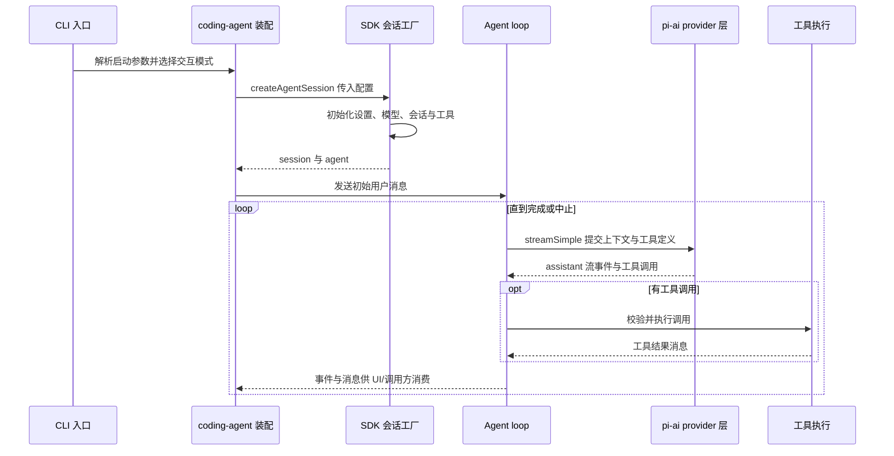

# 运行架构与请求生命周期

## 总体结构

运行时可分为入口适配、coding-agent 会话装配、通用 agent loop、模型协议、工具执行与平台原生能力几层。CLI 负责启动约束、参数/配置和交互选择；`createAgentSession()` 将模型、持久化会话、扩展及工具组装成可用会话；`Agent`/agent loop 负责每轮控制；`pi-ai` 在模型边界处理 provider 请求与流式响应。TUI 是交互承载层，不拥有另一套推理循环。

*图：CLI 将启动意图交给会话装配层，agent loop 在模型与工具之间循环，并向入口发布事件。*

## 两个入口：fork 与上游基线

本仓库 fork 的 CLI 主入口是 `packages/coding-agent/src/cli.ts`，它承担 Bun 环境检查、worker/进程引导、代理网络默认值等进程级职责，再进入命令执行；`packages/coding-agent/src/main.ts` 将 CLI 参数解释为会话启动选项，并承载 TUI 交互与启动流程。SDK 使用 `packages/coding-agent/src/sdk.ts` 的 `createAgentSession()`，调用者可以直接装配会话，而无需运行 CLI/TUI。

桌面集成或外部宿主通常消费 SDK/事件接口，而非重新实现模型循环。这里的 fork 双入口是进程入口（CLI）与编程式入口（SDK）的区别；CLI 内部再由 main 组织交互。不要将上游 pi-mono 的 coding-agent 单入口/模块布局直接套用到本仓库：本 fork 在 CLI bootstrap、配置、工具扩展和原生桥接处有自身职责与机制。核对行为应以本仓库路径为准。

## 会话装配与请求循环

SDK 的会话工厂连接配置与运行态：解析模型和 provider 可用性，初始化项目/用户设置、凭据与会话状态，发现扩展并构建工具，再创建 agent。会话及消息的持久化语义见[会话概念](../concepts/sessions.md)；工具和扩展的注册边界见[工具与扩展](../concepts/tools-extensions.md)。入口负责提供会话选项，agent loop 不应承担 CLI 参数解析或 UI 生命周期。

`packages/agent/src/agent-loop.ts` 的核心抽象以 `AgentMessage` 维护运行中的上下文，仅在 LLM 调用边界转换为 `Message[]`。它请求模型流，将 assistant 内容和工具调用变成事件；结构化工具调用经过参数校验及执行后，工具结果进入上下文并触发下一轮请求。无工具的终止响应结束当前回合。取消、暂停、provider 中断和异常由循环控制与事件/结果语义处理；对非终止 pause-turn 连续续采样有上限，避免后端持续暂停造成无限循环。

## 模块边界与原生能力

- `packages/ai/src`（包名 `pi-ai`）提供模型/provider 抽象、流式调用、消息转换、认证与协议适配；它不负责 coding-agent 的项目会话或具体工具策略。
- `packages/agent` 提供通用 agent 与 loop，接收模型流函数、上下文和工具定义；工具执行由提供给 agent 的工具实现完成。
- `packages/coding-agent` 负责产品级配置、会话装配、CLI/TUI、工具及扩展生态。
- `packages/natives` 与 `crates/pi-natives` 提供跨 JavaScript/Rust 的原生能力实现及其绑定边界；仅在需要平台/性能能力时由上层调用，不取代会话或 loop。具体 native 能力按其适配接口使用，不应把原生模块误认为 agent 状态所有者。

桌面入口属于宿主集成边界：它可复用 SDK 会话工厂及事件流，负责宿主窗口、输入输出和生命周期；实际部署集成细节参见[Zcode 集成](../integrations/zcode.md)。

## 配置、失败与验证

模型选择、凭据、provider 请求及代理网络属于配置/AI 边界；CLI 会在发请求前安装 fork 的网络默认设置。工具 schema 和调用参数由 agent loop/工具边界校验，扩展加载失败应由 coding-agent 装配层处理，而不是静默改变模型协议。请求可因取消、认证/provider 错误、工具校验/执行错误或会话初始化失败而结束；调用方应消费 agent 事件并处理终止状态，不应假设每次模型流都产生完整 assistant 回答。

修改运行时流程时，重点测试 CLI 与 SDK 是否汇入同一套会话装配、模型流与工具调用循环是否按序产生事件、取消/失败是否终止而不遗留运行态，以及 provider 消息转换是否保留工具调用历史。`packages/agent` 中围绕 loop 的测试和 coding-agent 的 SDK/CLI 集成测试分别验证控制循环与产品装配；原生模块则应在对应平台绑定测试中单独验证。
