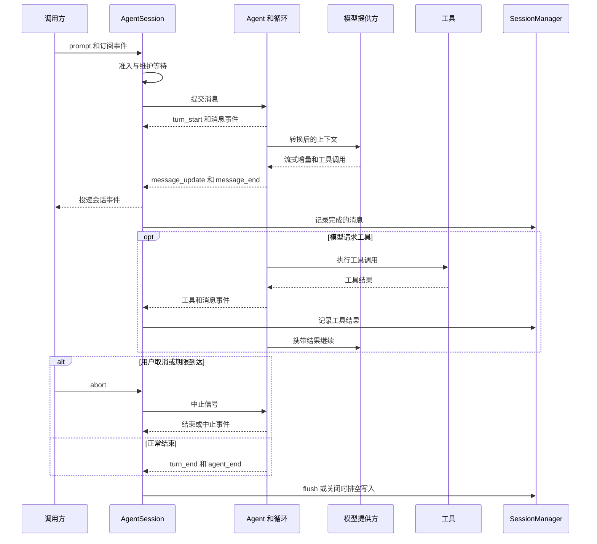

# 会话、Agent 循环与持久化恢复

会话运行时连接交互入口和模型执行：`createAgentSession` 组装 `Agent`、工具、设置及 `SessionManager`；`AgentSession` 管理提交、队列、事件和维护；核心 `Agent` 与 `agent-loop` 负责模型回合和工具循环；`SessionManager` 管理可恢复的历史树及其存储。工具本身的执行和权限边界另见 [工具与执行](tools-and-execution.md)，全局关系见[系统地图](system-map.md)。

## 一次提交的路径

普通 `AgentSession.prompt(text, options)` 为输入分配 `inputId` 并经过提交准入。它先预留客户端提交的所有权，再等待正在进行的维护清理，然后派发命令或构造模型输入；显式 `queueOnly` 则先成为队列事实，其投递仍可等待维护。扩展命令可以在流式运行期间立即处理，所以并非每次 `prompt` 都产生模型调用。`prompt` 返回的布尔值也不能当作磁盘持久化确认。

图：常见 prompt 的事件与记录路径；取消可能发生在不同阶段，图不表示每个事件都同步落盘。

核心循环以当前上下文准备 provider 调用，输出 `turn_start`、`message_start`、增量 `message_update`、`message_end` 等事件；工具调用产生工具执行事件和 `toolResult` 消息，结果进入上下文后再请求模型。内层循环处理工具和 steering，外层在本来要停止时还可消费 follow-up。`AgentSession` 对核心事件做状态更新、扩展和订阅者投递及消息持久化；核心监听处理并非全部被循环同步等待，因此必须在首次 `await` 前完成影响下一回合的关键状态更新。流式显示不等于已提交完整消息，更不等于已刷盘。

## 队列、取消与重试

steering 可以在运行中改变下一步，follow-up 则在当前工作将结束时续接。循环开始时若已被外部中止，不取走 steering，避免将消息困在即将结束的运行中；工具调用与对应结果必须保持配对，恢复未配对工具尾部时 steering 暂停到该批次之后。进程暂停在回合边界等待，但外部 abort 可解除等待；deadline 也通过中止信号限制运行。取消是协作式传播，不意味着已经执行的外部操作被回滚。

不要把恢复理解为全局 exactly-once。核心明确支持在手动 retry 时重放未配对的工具调用：若 harness 移除了失败或中止的结果，循环会先重新执行尾部调用，再请求模型。对有副作用的工具，调用方和工具实现必须考虑幂等或先核实外部状态；不能假设重试、压缩或历史重建会撤销操作，也不能无条件重放已经完成的副作用。压缩和分支重建使用历史消息构建上下文，不是执行历史工具的机制。

## 历史、压缩和恢复

需要区分四种状态：

| 状态 | 所有权及边界 |
| --- | --- |
| 运行中内存 | `Agent` 当前消息、流状态及 `AgentSession` 的队列和维护状态；进程退出不自动保留。 |
| 原生历史 | `SessionManager` 的条目包含 id 和 parentId，形成可分支的历史；文件模式使用逐行 JSON（JSONL/NDJSON），并非把所有状态都存入同一个数据库。存储接口也有内存及其他实现。 |
| 侧状态 | 例如认证、工具或 provider 会话状态有独立所有者和生命周期；不能仅凭会话消息断言它们已恢复。 |
| 可重建视图 | 从历史路径构建的模型上下文和索引属于派生视图，不应与原始历史或外部副作用混为一谈。 |

`buildSessionContext` 从选定 leaf 沿 parentId 向根回溯，再正序恢复消息及模型、思考等级等设置；遇到损坏的父节点环会停止遍历。显式空 leaf 代表没有活动分支。压缩记录保存摘要和保留消息的边界；重建时把摘要、保留段和压缩后的消息组合为模型上下文，而不是删除一切旧历史。上下文压缩和分支摘要的实现位于 `packages/agent/src/compaction`，会话维护负责协调运行时切换。提交与手动压缩、handoff 等维护之间有等待和所有权协调，避免正在改写历史时同时启动普通 prompt。

编辑历史用户输入会在目标父节点执行预检并切换分支；若输入未获准，代码恢复原 leaf。若预检已提交真实压缩记录，该记录保留在旁支，而不是假装从未发生。恢复后还要重建 Agent 消息及相关分支状态；这只是恢复会话视图，并非回滚文件系统或远端工具的效果。

## 写入、关闭与故障边界

文件持久化有缓冲、串行写入与 `flush`/`close` 边界，调用方需要等待这些操作才能观察其完成或错误；内存中追加不等于已持久化。首次 assistant 条目触发的落盘路径也意味着不能假设刚输入的每条用户消息立即有独立磁盘文件。关闭与并发追加存在特别处理：正在关闭的 writer 不能再走同步热写路径，追加转入重写路径，避免把 `Writer closed` 留作后续持久化错误。关闭不是禁止同一 manager 后续追加的永久封印。

终止错误也属于恢复信息：测试覆盖了工具失败后的空 provider 错误回合被记录，禁用重试时不产生虚假重试事件，以及已有实质文本的错误回合不重复记录。不要把这一测试扩大解释为所有崩溃、断电或外部工具副作用都具有事务性保障。

## 验证与修改入口

- [`agent-session-message-pipeline.test.ts`](../../packages/coding-agent/test/agent-session-message-pipeline.test.ts) 使用 mock provider、扩展及内存会话测试消息流水线；具体断言应按所修改路径选择。
- [`agent-session-terminal-error-persistence.test.ts`](../../packages/coding-agent/test/agent-session-terminal-error-persistence.test.ts) 验证上述终止错误记录，测试中关闭了自动压缩和重试。
- [`session-manager-close-race.test.ts`](../../packages/coding-agent/test/session-manager-close-race.test.ts) 通过受控内存存储暂停 writer close，验证竞争窗口追加及随后 flush，而不是模拟操作系统断电。
- 扩展模型流、上下文转换或工具时，分别检查 [`agent-loop.ts`](../../packages/agent/src/agent-loop.ts)、[`agent.ts`](../../packages/agent/src/agent.ts) 和 [`sdk.ts`](../../packages/coding-agent/src/sdk.ts) 的注入点；改恢复逻辑时同时检查 [`session-context.ts`](../../packages/coding-agent/src/session/session-context.ts) 与 [`session-manager.ts`](../../packages/coding-agent/src/session/session-manager.ts)。
