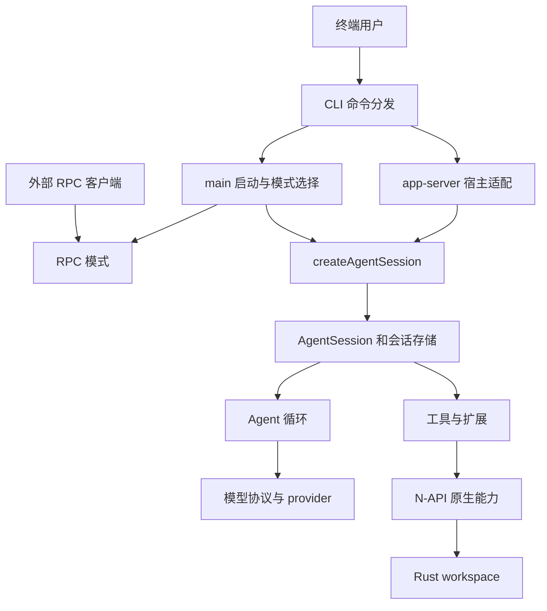

# 系统分层与运行入口

系统的中心不是某一种 UI，而是 `packages/coding-agent` 中可供不同宿主创建的会话。终端入口负责启动和交互，ZCode app-server 负责宿主协议与会话管理，两者在 `createAgentSession` 汇合；实际的模型调用和工具循环再交给较低层。不要把 app-server、RPC、协作协议或模型 provider 协议当成同一种线路。

图：不同入口汇合到会话和共享运行能力；外部 RPC 客户端通过进程协议接入，而非直接调用 TypeScript SDK。

## 分层与所有权

| 边界 | 主要职责 | 修改时的定位 |
| --- | --- | --- |
| CLI 和模式 | `cli.ts` 注册命令并处理启动环境；`main.ts` 组装会话选项并选择运行模式。终端显示属于宿主，不是 Agent 循环。 | 入口参数、进程启动、交互呈现看 coding-agent 的 CLI 和 modes。 |
| 会话 SDK | `createAgentSession` 组装配置、模型、工具和扩展，返回供宿主使用的会话；`AgentSession` 与 session manager 负责会话运行和持久化等上层语义。公共入口还导出配置、工具及扩展 API。 | 嵌入应用可从 [`index.ts`](../../packages/coding-agent/src/index.ts) 使用 SDK，不必模拟终端。详见[会话运行时](session-runtime.md)。 |
| Agent 核心 | `packages/agent` 导出 Agent、循环、压缩和工具参数验证等。循环在内部使用 `AgentMessage`，在模型调用边界才转换为模型消息，并执行模型与工具之间的迭代。 | 修改 turn、事件、工具调用的通用语义时从这里入手，而不是先改某个 UI。 |
| 模型协议 | `packages/ai` 提供模型、消息、流、provider 注册和认证等抽象；provider 特有运行 API 通过相应子路径访问。 | provider 的协议差异和流转换属于这一层；模型选择和会话配置仍由上层持有。 |
| 原生能力 | `packages/natives` 是 JavaScript 加载与 N-API 边界，Rust 实现在 `crates/pi-natives` 及其他 Cargo 成员中，提供搜索、文件发现、终端图像等能力。 | 改工具行为同时检查 TS 调用方、绑定与 Rust 实现，不能只改其中一侧。详见[工具与执行](tools-and-execution.md)。 |

根 `package.json` 将 `packages/*` 和 `python/robomp/web` 纳入 JS workspace；根 `Cargo.toml` 则显式列出 Rust 成员和 vendored patch。两套 workspace 有各自的构建与测试边界，不等同于两个独立产品。根脚本的 `bun run dev` 启动 CLI，`bun run build:native` 构建原生包，`bun run test:ts`、`bun run test:rs` 分别进入相应测试流程。

## 入口如何汇合

CLI 在执行命令前检查最低 Bun 版本，并在命令使用 provider 网络之前安装网络初始化。profile 必须先于会急切加载环境的模块设置；worker 也可通过隐藏 selector 重入同一入口。这些启动约束属于进程层，而非单个会话。`main.ts` 将解析后的选择和配置交给 `createAgentSession`，之后由所选模式消费会话。

`app-server` 是独立命令边界，不经过 TUI、普通 RPC 或 ACP 的运行路径。它要求 `--stdio`，指定 `--cwd` 时必须是已有目录的绝对路径；无效参数直接报错。它将诊断日志导向 stderr，避免污染 stdout 协议流。宿主的 `ZCodeSessionManager` 在创建会话前准备持久化 journal 和适用的 MCP 工具，再调用同一个 SDK；受限制会话不能启用指定 MCP servers。宿主维护协议投影、交互及会话记录，而不是复制 Agent 引擎。具体协议和生命周期见 [ZCode app-server](../integrations/zcode-app-server.md)。

SDK 是组装边界，不意味着所有状态都是进程全局的：app-server 创建会话时显式传入 session manager、registry、工具限制和认证，并设置 `bindProcessState: false`。因此修改共享状态或资源所有权时，要同时检查终端和多会话宿主；不能假定每个进程只有一个终端会话。

## 消费者与协议边界

- `sdk/go/omp-rpc` 等外部 SDK 面向 `omp --mode rpc` 的 stdio JSON lines，而不是 ZCode app-server 协议。Go 绑定中的 wire 类型从 coding-agent 的 RPC schema 生成；改 schema 后用 `bun run gen:rpc` 更新绑定。客户端需要消费事件流并关闭连接，协议断开后调用会失败。更多宿主工具和无界面接入见[无界面与扩展接口](../integrations/headless-and-extension-surfaces.md)。
- `python/robomp` 是外部编排消费者：它在 issue worktree 中启动 RPC 子进程，恢复持久化会话，并通过独立的 GitHub 代理执行写操作；它不是会话引擎的另一份实现。
- `packages/wire` 定义协作会话的 JSON 安全形状和常量，供 CLI 宿主与 `collab-web` 使用；它本身不序列化、加密、验证或路由帧。不要将其与上述 RPC schema 或 provider wire 格式混淆。
- TUI、catalog、utils 等工作区分别为宿主呈现、模型目录及共享基础设施提供支撑；它们的存在不改变会话 SDK 对运行组装的所有权。辅助产品通过各自入口使用核心能力，而不是自动成为 Agent 内核。

## 变更与验证

跨层变更应沿调用方向核对：入口参数或协议 → SDK 选项与资源所有权 → 会话事件和存储 → Agent 循环 → provider 或工具实现。原生发行还涉及平台专用可选依赖和加载器，x64 在运行时选择 baseline 或 modern 构建；只通过 TypeScript 类型检查不能证明 addon 可加载。发布构建使用 Rust unwind，让受保护的原生异步任务 panic 能作为 JS Promise 拒绝返回，而不是越过 FFI 边界强制终止进程。

针对入口和宿主，可先检查 `packages/coding-agent/test/modes/zcode-process.test.ts`、`zcode-sessions.test.ts` 和 `zcode-core-protocol.e2e.ts`；涉及 RPC schema 时还应运行根脚本 `bun run sdk:test:go` 或 `bun run sdk:test:rust`。这些是定位建议，不替代跨平台原生构建及端到端验证。有关上游同步与维护边界见 [fork 维护](../operations/fork-maintenance.md)。
