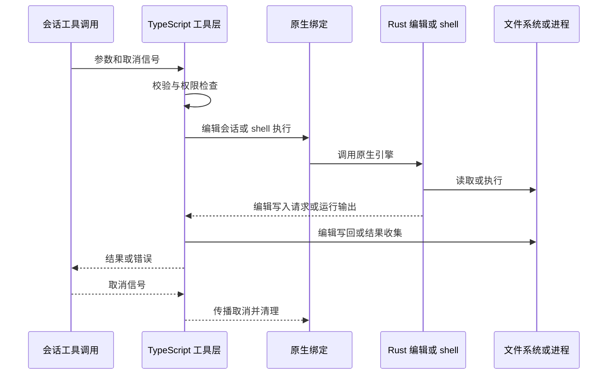
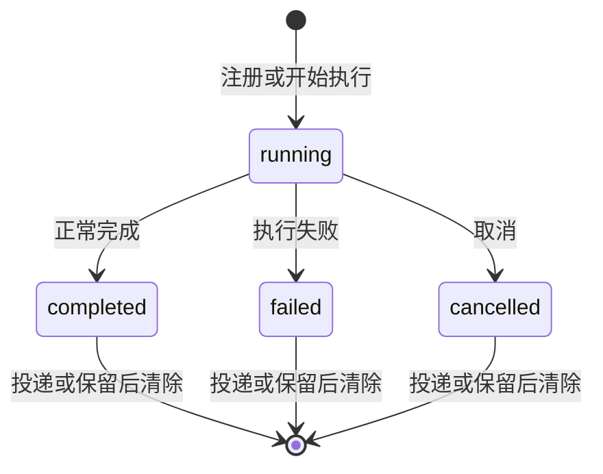

# 工具权限、任务与原生执行

工具调用不是一次简单的函数调用：会话先组装可用工具及限制，调用再经过参数校验、权限判断和具体执行器；后台化以后，任务管理器还负责状态、结果投递和资源回收。TypeScript 层拥有会话、策略和协调，原生绑定则承担编辑和 shell 等具体工作。会话生命周期的外围关系见[会话运行时](session-runtime.md)。

## 注册、发现与设备入口

[`createTools`](../../packages/coding-agent/src/tools/index.ts) 根据会话和请求的名称实例化内建工具，包装 Team 读取隔离及工具限制，并将实例放入会话工具注册表。扩展、自定义工具和 MCP 的装配发生在会话 SDK 层；受限子会话不会自动获得完整扩展和 MCP 目录。新增工具时，要同时考虑其能力级别、限制包装、取消、结果和呈现，而不仅仅是注册名称。

启用 `tools.xdev` 时，可发现工具可以从顶层 schema 移到 `xd://`：`read xd://` 列目录，`read xd://<tool>` 查看文档和 schema，`write xd://<tool>` 以 JSON 对象作为参数执行。设备和直接调用使用同一工具映射；设备参数按内层工具 schema 校验，非法 JSON、非对象或不匹配的参数会报错。`read`、`write` 是传输工具，部分依赖顶层调用的工具也保留顶层。显式受限的子会话不建立可被后续扩充的设备目录。

**设备路径是呈现和传输方式，不是新的授权或调度类别。** 不应因为外层是 `write` 就把只读设备当成文件写入，也不能假定挂载会绕过内层工具批准、限制或执行调度。某些只显式授予 `read` 的普通会话会得到 device-only `write` 传输，但它不等于授予普通文件系统写入；具体限制仍由实现执行。参见 [`xdev.ts`](../../packages/coding-agent/src/tools/xdev.ts) 与 [设备派发测试](../../packages/coding-agent/test/write-xdev-dispatch.test.ts)。

## 批准不等于工具可见性

[批准策略规范](../../openspec/specs/approval-policy/spec.md) 按 read、write、exec 能力级别定义五种模式：

| 模式 | 自动放行边界 |
| --- | --- |
| `always-ask` | read 自动放行，write 和 exec 询问 |
| `always-ask-cached` | 有目标的读取先询问，可记住文件或目录读写授权；无目标只读调用自动放行，exec 仍询问 |
| `write` | read、write 自动放行，exec 询问 |
| `yolo` | 三个级别自动放行，且是默认值 |
| `guarded` | 普通调用自动放行，但声明的 critical override 每次确认 |

`--approval-mode` 覆盖 `tools.approvalMode` 而不持久改写设置。逐工具 `tools.approval` 的 `deny` 不能被模式放行覆盖；`prompt` 要求确认。`tools.restrictedFolders` 另有逐次确认约束，不能使用记住的授权绕过。配置中的未知模式回落默认 `yolo`，非法 CLI 值则报错；因此不要把损坏配置视为保守拒绝。

## 一次编辑与 shell 调用

图：代表性编辑与 shell 路径跨越 TypeScript、原生绑定和 Rust；编辑写回与 shell 运行是不同分支，并非每次都同时发生。

编辑工具的流式参数可提前打开原生 `EditSession` 产生预览；若最终参数被钩子修改，旧会话关闭并按最终参数重建。执行时原生引擎计算变更，通过回调交回 TypeScript 写入，最后关闭会话。多文件编辑失败不保证事务回滚：结果会报告已提交和可能已变更的路径，重试前应重新读取，而非盲目重放。实现见 [编辑工具](../../packages/coding-agent/src/edit/index.ts) 与 [pi-edit 引擎](../../crates/pi-edit/src/engine.rs)。

`bash` 经 [`executeBash`](../../packages/coding-agent/src/exec/bash-executor.ts) 调用原生 `Shell`，也可按配置走用户 shell 或 PTY。嵌入式 shell 支持注入内部 URL 文件系统；外部进程和用户 shell 不自动看到该文件系统。输出可流式预览、截断并保留完整输出工件；结果区分退出码、取消和超时。持久 shell 忙时可用一次性 shell，后者不会共享或保留前者的状态。

[Shell 语义规范](../../openspec/specs/shell-semantics/spec.md) 要求原生非 UTF-8 参数保真；进程树信号先快照目标并避免重复投递，保护宿主及无关进程。取消已启动的管道时仍须等待 TERM 清理宽限，不能立即丢弃句柄并硬杀。修改该边界时同时检查 [pi-shell](../../crates/pi-shell/src/process.rs) 的平台实现和超时退出码约定。

## task、异步状态与释放

普通 `task` 使用子代理执行器运行子会话，不应仅凭其名称推断只读。执行器跟踪进度、输出、用量及预算，传播调用方的 `AbortSignal`；取消、超时、预算、终止和关闭是不同原因。中止会请求子会话停止并等待相关清理，关闭可覆盖可恢复的中止路径；结果与错误再交回调用方。子代理是进程内工作，不能因历史命名 `runSubprocess` 就假定必然启动 OS 子进程。

图：异步作业的终态由管理器记录；排队和前台待后台化是附加标记，而非新的终态。

[`AsyncJobManager`](../../packages/coding-agent/src/async/job-manager.ts) 统一管理 `bash`、`task`、`eval` 作业，记录状态、结果、错误和进度。排队作业在真正运行前不占运行配额；前台调用可以先隐藏作业，慢时再提升为后台作业。带 owner 的结果只投递给该 owner 的接收端，接收端缺失时保留结果供检查而不泄露给其他会话。已消费和未消费结果有不同保留期；延迟投递需要的临时工件可随作业保留，最终在清除或管理器释放时清理。后台化不是取消，取消也不意味着可以省略等待和资源释放。

## 三种子代理权限不要混淆

* **普通 task**：权限取决于 agent 定义、会话工具及继承限制。提示词中的“只读”本身不是守卫。
* **Team 讨论**：[`team/runner.ts`](../../packages/coding-agent/src/team/runner.ts) 直接调用同一执行器，但明确列出只读工具并使用 `restrictToolNames`，不提供 bash、edit、write、task 等。Team 读取隔离还在真实路径解析后限制其他成员材料及其祖先搜索范围，而非仅隐藏 `agent://` 链接。详见 [Team 讨论](../workflows/team-discussion.md)。
* **Dev 阶段**：执行确认前的 scout 使用显式只读工具名单、禁用 MCP 等，并由 spawn 钩子拒绝额外工具和 worktree；执行者阶段有不同授权，继承克隆的限制，协作仍拒绝创建 worktree。阶段约束来自程序钩子和会话配置，而非角色提示词。详见 [Dev 生命周期](../workflows/dev-lifecycle.md)。

## 修改与验证

涉及设备派发时检查直接调用与设备调用的 schema、内层权限、错误及渲染是否一致；涉及编辑时覆盖参数流取消、部分写入和原生会话关闭；涉及任务时覆盖取消与结果投递竞争、超时和延迟清理。聚焦测试包括 [设备派发](../../packages/coding-agent/test/write-xdev-dispatch.test.ts)、[异步静默](../../packages/coding-agent/test/task/executor-async-quiescence.test.ts)、[延迟清理](../../packages/coding-agent/test/task/executor-deferred-cleanup.test.ts) 和 [任务超时](../../packages/coding-agent/test/task/executor-wall-clock.test.ts)。这些测试是回归入口，不替代对具体权限配置和平台行为的检查。扩展及外部接口另见[无头与扩展接口](../integrations/headless-and-extension-surfaces.md)。
