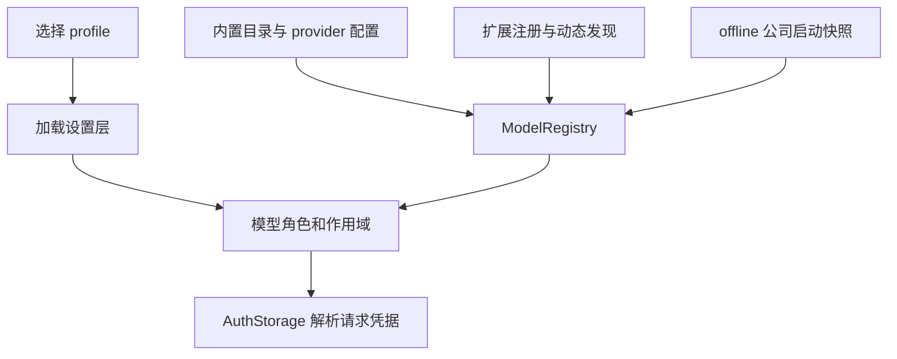

# 配置、认证与模型选择

终端、SDK 和桌面宿主不应各自猜测一个“默认模型”或把所有配置文件视作同一个覆盖链。`Settings` 管理有效设置和来源；`ModelRegistry` 构造可用模型目录；角色解析把选择器映射到候选模型；`AuthStorage` 负责实际凭据。公司 provider 则有独立的启动快照，不等同于普通认证存储。

图：模型目录、角色选择和请求认证是相互连接但独立的责任。

## 档案与设置来源

CLI 在加载依赖档案环境的模块之前提取 `--profile`（或 `-P`）；未显式指定时使用继承的 `OMP_PROFILE` / `PI_PROFILE`。档案隔离认证、会话、设置和缓存；SDK 宿主也可以显式传入自己的 `agentDir` 和设置实例，不能假定它使用 CLI 单例。参见 [CLI 启动](../../packages/coding-agent/src/cli.ts) 和 [启动帮助](../../packages/coding-agent/src/commands/launch-help.ts)。

普通设置的合并来源从高到低是运行时 override、额外 config overlay、项目、用户全局、父 overlay 和 schema 默认值。`PI_CONFIG_FILES` 与显式 `configFiles` 提供额外文件；缺失或格式错误的显式 overlay 会使加载失败。`null` 在普通设置读取中视为未设置，但角色的 null tombstone 可以阻止较低层角色重新出现，不能把两者混为一谈。具体 setting 还可能有自己的环境变量解析，不能将此层级当作所有认证和环境变量的统一顺序。[设置实现](../../packages/coding-agent/src/config/settings.ts) 和 [cwd 重载测试](../../packages/coding-agent/test/settings-reload-cwd.test.ts)给出了例子。

`Settings.init` 是进程单例；`loadIsolated` 为宿主创建独立持久化实例，`loadReadOnly` 不打开数据库或执行迁移写入，`isolated` 是内存视图。子 `overlay` 实时继承父设置，自己的覆盖不写回父对象。模型授权使用不含项目层的 `grantAuthority`，避免由仓库可写配置授予模型权限；派生子代理继承父级授权边界。

项目目录切换时，`reloadForCwd` 重新计算项目层及路径作用域，例如 `enabledModels`，但保留普通运行时覆盖。设置可监听文件及有效值变化，但是否真正影响现有会话取决于消费者是否订阅或重新读取，不能据此推断所有 provider、模型或进程快照都热更新。持久化用户设置的 `UserSettingsStore` 对目标进行所有权和符号链接检查，以锁、revision/CAS、临时文件原子替换及回读避免覆盖并发修改；格式无效或冲突时报告失败，而不是静默覆盖。

## 具体默认值与保存位置

| 设置 | 未配置时 | 边界 |
| --- | --- | --- |
| `modelRoleStorage` | `global` | 选择器角色分配默认保存到当前档案；设为 `project` 时保存到 `.omp/config.yml`，缺失的项目角色可使用全局值。 |
| `modelRoles` | 空记录 | 角色选择不等于 provider 声明；运行时或项目角色仍可覆盖全局角色。 |
| `enabledModels`、`enabledProviders`、`disabledProviders` | 空数组 | 支持按路径作用域解析；空默认值不应被解释成一份固定的模型清单。 |
| `cycleOrder` | `smol`, `default`, `slow` | 决定角色轮换顺序，不定义模型本身。 |
| `auth.broker.url`、`auth.broker.token` | 未设置 | 分别支持 `OMP_AUTH_BROKER_URL`、`OMP_AUTH_BROKER_TOKEN`；broker 连接只从环境和全局配置发现，不允许项目重定向凭据。 |

这些定义见 [model-settings.ts](../../packages/coding-agent/src/config/model-settings.ts)。其他个人默认值及其适用条件见 [终端与个人默认值](tui-and-personal-defaults.md)；例如批准规格要求 `lsp.enabled=false`、`eval.js=false`、`composer.predictions=true`，而 `terminal.programStatus` 在 offline 默认关闭、普通模式默认开启，显式设置优先。默认值本身不应改写用户已有配置。技能来源和刷新另见 [技能与规格资源](../integrations/skills-and-spec-resources.md)。

## 模型发现与角色解析

[ModelRegistry](../../packages/coding-agent/src/config/model-registry.ts) 汇集内置目录、缓存及发现结果，并应用 `models.yml` 的自定义模型、provider 和覆盖；扩展也可通过 `registerProvider` 注册模型或动态发现。运行时扩展覆盖跨 registry 刷新保留。隐式本地 provider 排在显式配置之后，以免同名模型遮蔽用户配置。配置模型与拥有可用凭据是不同的条件；注册表通过 `AuthStorage` 解析请求所需的认证。

模型角色用 `@default`、`@smol` 等选择，兼容旧的 `pi/` 前缀，`*` 是默认角色简写。角色有模型类型约束：例如普通聊天角色接受 chat，`image` 接受 image，`judge` 可接受 judge、tiny 或 chat；还可通过设置定义自定义角色和显示元数据。`completion()` 的 `smol`、`slow` 对应各自角色，`default` 优先当前会话模型，否则使用 `@default`；只有 `slow` 发送思考档位。judge 的候选及 fallback 受当前会话或项目 `enabledModels` 限制，但既有的会话模型 fallback 仍可追加。详见 [角色定义](../../packages/coding-agent/src/config/model-roles.ts) 和 [模型发现规格](../../openspec/specs/model-and-skill-discovery/spec.md)。

显式模型选择可能需要等扩展完成 provider 注册之后才能解析。测试还区分 offline 下显式选择与自动子代理启动或恢复：后者不会为了冷发现主动请求未缓存模型，可使用已缓存 fallback 或报告未找到；不要把这一边界推广成“offline 永不发起任何发现请求”。参见 [SDK 模型选择测试](../../packages/coding-agent/test/sdk-model-selection.test.ts)。

## 凭据所有者与更新边界

coding-agent 的 `session/auth-storage.ts` 只是重导出；实现属于 [pi-ai AuthStorage](../../packages/ai/src/auth-storage.ts)。它组合凭据存储、OAuth 刷新、多账户选择、会话绑定和限流状态。普通 key 查找使用自身的级联：运行时、配置、OAuth、登录 key、环境、已存 key；这不是 `Settings` 合并顺序。`auth.accountPolicies` 可运行时更新，非法或有歧义的策略不会替换当前策略。切换 broker 的 store 时先加载新 store，失败保留旧 store；成功后重建依赖旧行 ID 的状态并保留运行时覆盖等订阅。

公司 lane 只在启用 offline 时存在。它从 Claude 活动配置目录的 `settings.json` 读取 `env.ANTHROPIC_BASE_URL` 和 `env.ANTHROPIC_AUTH_TOKEN`，校验后在主线程缓存成功或失败的启动快照，worker 复用快照而不重新读文件。修改文件或修复错误后需要重启；普通启动不读取该公司快照。不要把这里的 token 当作普通登录凭据或从常规设置热重载推断其生命周期。配置要求与离线操作见 [内网与离线运行](../operations/intranet-offline.md)。

## 验证与排查

先检查当前 profile、cwd、设置来源和显式 overlay，再检查模型角色、模型目录与认证来源；不要把“模型未发现”“角色不匹配”和“没有凭据”视为同一种故障。[settings-reload-cwd.test.ts](../../packages/coding-agent/test/settings-reload-cwd.test.ts) 覆盖路径作用域、层级及 overlay 错误；[sdk-model-selection.test.ts](../../packages/coding-agent/test/sdk-model-selection.test.ts) 覆盖扩展注册后的延迟解析和 offline 子代理发现边界。批准规格用于理解目标，实际行为仍应以当前实现和测试为准。
