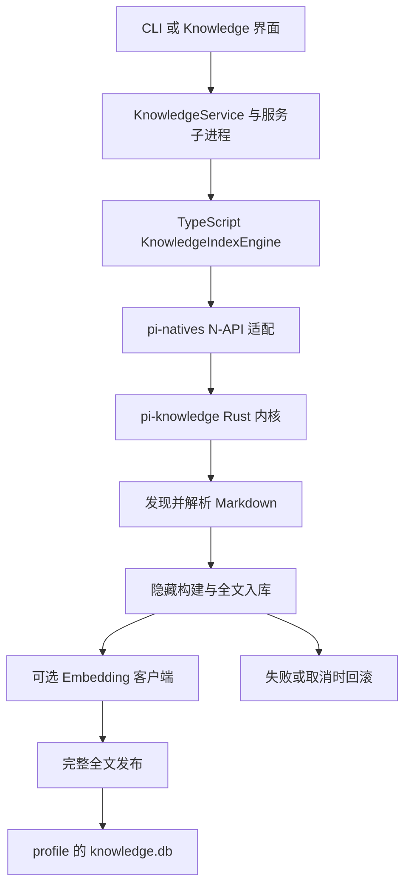
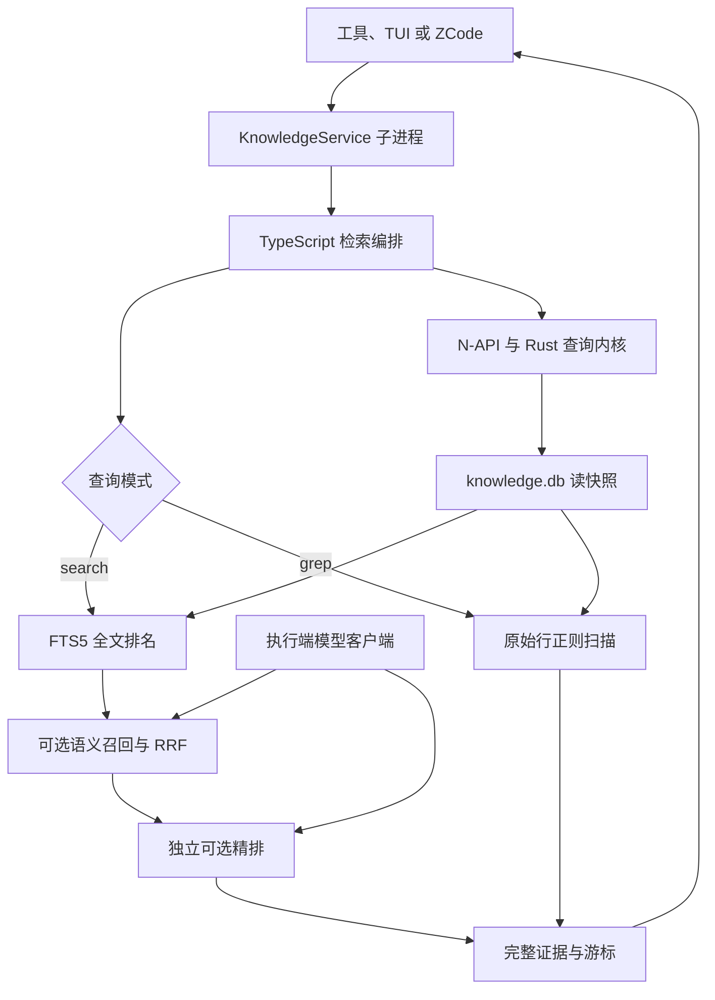

# Knowledge 文档证据索引

Knowledge 索引将一次导入的 Markdown 固化为可检索的证据，而不是对源目录的实时视图。Knowledge 管理契约只有新建和删除，没有 update、rebuild 或自动同步。重新导出文档后，先删除旧索引，再显式导入：

```sh
omp knowledge init "<dir>" --name "<name>"
omp knowledge remove <name> --force
```

同名导入报错，不覆盖；删除只影响数据库中的索引及派生向量，不删除源文件。索引名去除首尾 Unicode 空白后须非空、最多 64 个 Unicode 标量，不能含控制字符或使用 `__building__` 保留前缀。面板可以列出索引，但这不是额外的 CLI 管理命令。

## 导入、发布与责任分界



图：导入由宿主协调，Rust 内核持有存储生命周期；可选模型准备不是全文发布的前提。

Rust `pi-knowledge` 负责文件发现、Markdown 切分、哈希、SQLite schema、导入与回滚、全文和 grep、排名及快照；`pi-natives` 是 N-API 桥，还负责 JS 对象相关的页预算、渲染与可取消等待。TypeScript engine 处理宿主路径、可选模型编排和融合；`KnowledgeService` 通过按 owner 惰性创建的子进程承接 IPC、排队、取消和资源释放，避免交互线程执行数据库工作。UI 和工具消费同一服务，不自行实现检索或调用模型。

发现只收普通 `.md` 文件，扩展名 ASCII 大小写不敏感；包含隐藏项、不读取忽略规则、不跟随符号链接，真实目录去重且导入顺序稳定。解析保留原始 Markdown、代码语境和行号，围栏中的伪标题不拆章节；超长行分片有重叠，每节上限 18000 字符。图片、附件和链接目标本身不随文字入库。

全文先进入隐藏构建；成功完成后才发布。Embedding 可在本次授权导入中批量准备，只有完整一致的向量代际可用；模型缺席或向量准备失败不阻止完整全文发布，而全文失败或用户取消会回滚，不将取消伪装成纯全文成功。下次非空导入会回收中断遗留的隐藏构建。租约、构建和发布绑定实际数据库身份，数据库被替换时不能凭复用的行 ID 修改另一库。查询不会自动补算向量。

打开不存在的数据库会创建空 WAL 库，但空库不是已建立索引，查询仍报无索引；Unix 文件权限为 0600，过高 schema 版本被拒绝。旧库可从数据库保存的正文迁移查询投影，不要求源目录存在或重建全文；首次准备有空间和时间成本。

每个 profile 使用 `knowledge.db`；不读取或迁移旧名称的数据库，也不迁移旧位置的数据。知识库数据可能随缓存清理或路径变更而丢失，需要时重新导入材料。

## DB-only 查询与检索策略



图：导入后查询、正文与来源均来自数据库；grep 不经过模型分支。

默认 `search` 接受关键词或自然语言，不把布尔词、引号或通配符当查询语言。全文分支使用 SQLite FTS5/BM25 和技术相关性排序，覆盖完整匹配集。若已配置兼容 Embedding 且当前语料存在有效向量，则按名次用 RRF 融合全文与有限语义候选，而非直接相加 BM25 与余弦分数；当前实现的语义候选上限为 64。全文证据不会因候选预算被截掉。结果集合是全部全文命中与本次语义候选的去重并集，并非全部可能的语义相关内容。

向量身份包含模型、端点、维度、编码和语料代际，不能仅凭相同维度混用。查询向量无效时整体退回全文；部分存储代际不兼容时只排除这些代际的语义部分，其全文仍可达。模型不可用或请求失败也回退全文，不掩盖基础数据库错误。独立配置的 Reranker 可对全文或融合基础排名的有限窗口精排；当前窗口最多 40 节，只在同一命中类别内调整顺序，不删除证据。无配置、失败或无效响应保留基础排名。工具结果报告实际采用的检索和精排状态，而不是仅报告配置。

技术名称如 `std::vector`、`C++` 或 `mbist_check.rpt` 以保留内部标点的完整边界判定：`C++17` 不是 `C++` 的完整名称命中。`match=exact-name` 始终先于 `match=related`；部分名称或纯语义相似不能升级为完整命中。没有完整名称时明确提示，即使仍有相关章节。切片边界需结合存储的相邻上下文判断。

显式 `mode="grep"` 则逐原始行扫描数据库 Markdown，返回 `match=regex` 并按来源顺序分页。`case` 默认 `true`；Rust 正则不支持的合法表达式交给 PCRE2，均拒绝则报错，不作字面量回退。表达式保留首尾空格，空白表达式和超过 500 UTF-16 单元的表达式报错；跨切片的同一原始行要恢复，不能把人为边界当行首或行尾。grep 不解析模型凭据、不调用 Embedding 或 Reranker，也不做融合。

工具接受 `query` 及可选 `mode`、`case`、`cursor`、`path`。相对 `path` 不以 `/` 结尾时限定精确文件，以 `/` 结尾时限定目录后代；它是字面数据库路径，不访问源文件系统，并在各分支候选计算前生效。默认搜索的超长 query 会截断至 500 字符并附省略号，grep 不做这种改写。

## 来源、快照与完整分页

每条证据携带索引名、相对路径、行号、原文档 SHA-256 和 `sectionId`。引用应保留索引名、路径、行号及版本身份：不同索引可有相同路径，remove 后重新 init 也可能复用 `sectionId`，所以它不是永久引用。源文件后来被修改或删除，不改变已入库证据；有冲突时分别呈现来源，不回读源文件补证。

每页的版本、计数、正文和来源来自同一读快照；页间不长期持有事务。服务有界缓存完整排名，容量淘汰整个查询而不是截断尾部。游标绑定有效 query、模式、大小写、索引及路径范围和数据库逻辑版本；融合或精排还绑定实际模型、向量代际和排名策略。续页复用既定顺序，不逐页重新请求模型。库变化、参数不匹配或无法恢复原融合上下文时明确报游标错误，不把另一排名接到旧结果后面；有效旧全文游标不因新增模型能力而自动转为混合搜索。

工具页目标约 4000 字符、最多 10 节，但首节即使超预算也完整返回；放不下的后续章节留给下一页，正文不截断。同页超过 200 字符的逐字重复正文可以引用已展示正文，但各来源仍保留，跨页须重新给出正文。未展开线索最多 10 条，只是定位预览，不是完整证据，也不推进游标。TUI 详情支持折行和滚动到长正文尾部。

已有索引的合法零命中是成功结果，只说明**本次已导入语料和范围内**没有匹配，不证明知识或规定不存在。无索引、非法正则、损坏或过期游标及基础数据库错误不是零命中。

## 交互、取消与验收

`/knowledge` 面板检索所选索引，默认搜索与显式 grep 共用后端；只读 `knowledge_search` 工具可覆盖多个索引。非受限默认会话可通过 `xd://knowledge_search` 按需暴露工具，审批和调度仍遵守 Knowledge 自身规则，参见 [工具与执行](../architecture/tools-and-execution.md)。ZCode 的 Knowledge 页面通过执行端的 bridge 复用当前 profile 的 `knowledge.db` 和服务；远端导入目录必须是执行端路径，不是桌面本机路径。切换上下文、关闭页面或取消时释放自有操作并丢弃迟到结果；失败或取消续页保留已展示证据。

可选模型故障可以降级，**用户取消不能降级成成功结果**：取消应停止该调用，不继续交付全文或基础排名。成功搜索包括正常零命中和续页，对外总时长至少 **500ms**，这是下限而不是性能上限；实际工作完成后不足部分以可取消异步等待补足，错误和取消不等待。诊断应区分真实工作、等待和总时长，不能把下限当缓存 TTL 或性能提升。

[索引测试](../../packages/coding-agent/test/knowledge-index.test.ts)、[语义测试](../../packages/coding-agent/test/knowledge-semantic.test.ts) 和 [工具测试](../../packages/coding-agent/test/knowledge-search-tool.test.ts) 是检查导入、分页、回退和调用边界的切入点。确定性模型 stub 能验证融合、故障及取消合同，却不能证明真实模型的语义或精排质量；真实验收应以代表性语料比较全文基线与实际模型的 Recall@k／MRR，并单独测量构建、查询、续页和 500ms 等待。离线部署的模型与凭据边界另见 [内网与离线](../operations/intranet-offline.md)；文档生成与索引消费的关系见 [OpenWiki 生成](../integrations/openwiki-generation.md)。
