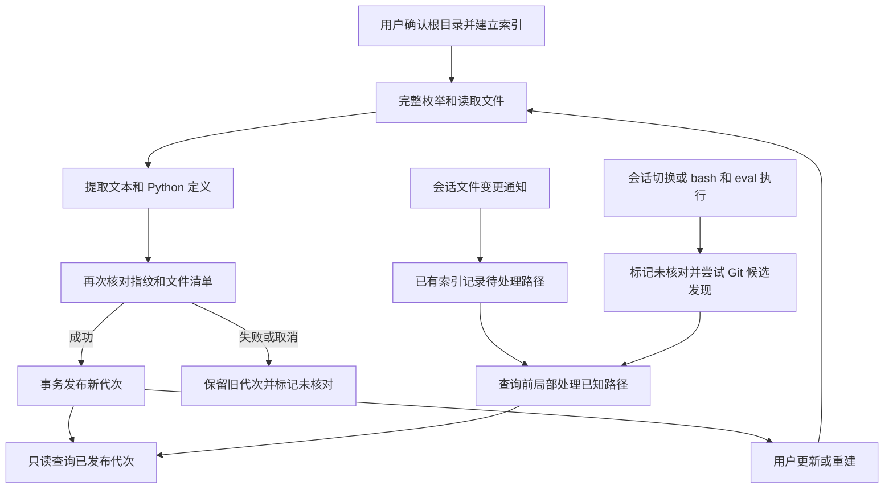

# Repo 代码索引与增量提示

Repo 是本地、离线的代码定位索引：它保存纳入范围的文本和 Python 定义候选，减少反复扫描源码的成本。它不是当前文件系统的实时镜像，也不推断调用图、依赖或影响范围。索引命中的行号和片段属于发布该代次时的文本；编辑前应使用 `read` 核对当前文件，需要当前或穷尽的检索时使用 `grep` 等文件工具。

它与手动维护的 [Wiki 文档索引](wiki-document-index.md) 是不同的数据库和查询链路，也不等同于 [OpenWiki 页面生成](../integrations/openwiki-generation.md)。工具的调度和执行背景见[工具与执行](../architecture/tools-and-execution.md)。

## 入口与身份

用户在交互会话中通过 `/repo` 面板确认目标根目录后建立、更新、重建或删除索引；普通只读查询不会代替用户建库。ZCode 的 `omp/repo` 桥接将状态、文本、符号、维护、进度和取消请求转给同一个 `RepoService`，而不是另建索引所有者。桥接对维护请求验证执行端的真实根目录，按工作区身份和 operationId 隔离取消，同根维护互斥；关闭桥接会中止在途操作。规格中的 Repo 专页包含尚需真实 GUI 验收的目标，不能仅凭服务接口断言全部页面体验已验收。

`resolveRepoRoot` 先解析 cwd 的真实路径：Git 项目使用真实 worktree 根，非 Git 项目使用真实 cwd。数据库路径为 `agentDir/repo/<根路径的 SHA-256>.db`，因此 profile 的 `agentDir` 和真实根共同决定身份，不同 worktree 或 profile 不混用。根的符号链接别名归一到同一真实根，但根内符号链接不被纳入索引。ZCode 确认路径也比较真实目录，Windows 上忽略大小写。

## 构建、发布与恢复

图：显式完整维护与会话提示在已发布索引处汇合；提示不是自动建库或全树核对。

完整建立和更新使用遵循忽略规则的严格枚举，包含可纳入的隐藏文件；不可读目录会使核对失败，而不是当作空目录。文件读取排除符号链接、二进制或无效 UTF-8、超过 2 MiB 的文件，并检查读取期间替换或变化。路径、类别、内容指纹和原始文本存入 SQLite，FTS5 trigram 支持文本候选；Python 文件另提取模块、类、函数和方法的位置及可用签名。Python 解析失败时保留文本、报告失败且不保留过期符号；其他语言主要提供文本定位。类别只是标签，不代表测试覆盖或配置依赖。

更新会完整读取文件并按内容指纹发现变化，未变内容复用旧记录；重建则重新解析，包括修复旧解析器造成的缺失定义。发布前再次验证文件内容和清单，将文件、符号及覆盖状态作为一个代次提交；扫描中较新的已知通知保留为待处理。未通知的竞争变化、严格枚举错误、失败或取消不会发布半成品：操作返回错误或取消，旧的可用代次保留，并尽力记录未核对原因。维护锁下清理强杀遗留的未发布代次。删除只移除索引，不改源码，并通过锁及 epoch 防止等待中的维护在删除后重新发布。

数据库损坏或 schema 不兼容不是零命中。应从 `/repo` 选择重建恢复：服务先在独立临时位置完整建库，成功后在锁下替换数据库；替换失败会尝试还原原文件，取消不会推广未完成的临时库。其他持有损坏句柄的会话提示服务会重新打开，以便恢复后的通知到达新数据库。

## 查询与覆盖状态

AI 侧 `repo` 是只读工具，`action` 默认 `search`，也可选择 `symbol` 或 `status`；输入为查询词、相对 `path` 和续页 `cursor`。缺库返回明确的 missing 和 `/repo` 建立提示，而不是空命中，也不阻止直接读文件。正常零命中、非法路径、查询错误和损坏库应分别处理。默认启用 `tools.xdev` 的非受限会话可通过 `read xd://repo` 发现说明、`write xd://repo` 提交 JSON；这是只读工具的设备派发入口，不授予建库权限。

文本查询不区分大小写，以字面量和词元召回候选，优先完整边界匹配；符号查询按 Python 名称或限定名匹配。每页最多 20 条，查询词超过 500 个 UTF-16 单元或候选超过 100,000 条会明确报错，不能把部分结果当作完整结果。cursor 绑定查询条件与代次，代次变化须从第一页重查。路径必须留在索引根内；POSIX 上存在字面反斜杠路径时优先匹配该身份，否则可按 Windows 分隔符归一化。

查询在独立 SQLite 读快照中读取已发布代次，只有当前页加载正文片段；缓存的是有界定位信息而非完整源码。并发维护持锁时，查询不等待整次构建，读取旧的已发布代次并携带覆盖提示。`status` 展示代次、数量、失败、待处理路径、未核对原因和最近完整核对时间；这些是证据边界，不是此后没有外部变更的保证。查询取消或数据库错误向调用方传播，不把部分查询伪装成正常结果。

## 会话提示与失效边界

`RepoLifecycle` 在会话启动时订阅文件变更，只有数据库存在且已有发布代次才记录提示。成功的工具写入、编辑、删除或重命名将已知路径排队；重命名包括旧路径和新路径。下一次 `search` 或 `symbol` 前局部处理待处理路径，删除会清除旧文本和符号；维护锁忙时可先返回旧代次及 pending 提示。`status` 本身不扫描源码。拒绝、预览或未执行的操作不应冒充成功写入。

会话启动或切换，以及实际执行的 `bash` / `eval`，会标记可能遗漏变更并异步尝试 Git HEAD 和工作区候选发现；命令文本不会被解析为文件变更清单。即使命令执行后失败、超时或中断，也可能已经写入文件。外部编辑、新文件和忽略规则变化不保证即时发现；规则变化需要完整更新才能重新确认覆盖。提示发现失败也会尽力记录未核对，而不是中断原开发操作。

每次提示会重新检查 cwd 和根：cwd 变化关闭旧服务，Git 初始化或移除也可能在 cwd 不变时改变根。会话根的别名只用于映射通知前缀，不解析已删除的末端路径，也不将子树符号链接变成目标文件通知；删除路径保留索引身份，避免 Windows 大小写别名残留，同时不混同 POSIX 大小写不同的文件。会话结束取消订阅并关闭服务。

## 验证关注点

[`repo-index.test.ts`](../../packages/coding-agent/test/repo-index.test.ts) 和 [`repo-review-regressions.test.ts`](../../packages/coding-agent/test/repo-review-regressions.test.ts) 覆盖索引、查询及竞争和回归边界；[`repo-lifecycle.test.ts`](../../packages/coding-agent/test/repo-lifecycle.test.ts) 通过真实 SDK 会话和文件工具验证成功写入、拒绝编辑、shell / eval 及释放订阅。修改维护逻辑时，应同时检查缺库不创建、取消保留旧代次、路径身份及恢复后提示，而不只测试命中结果。
