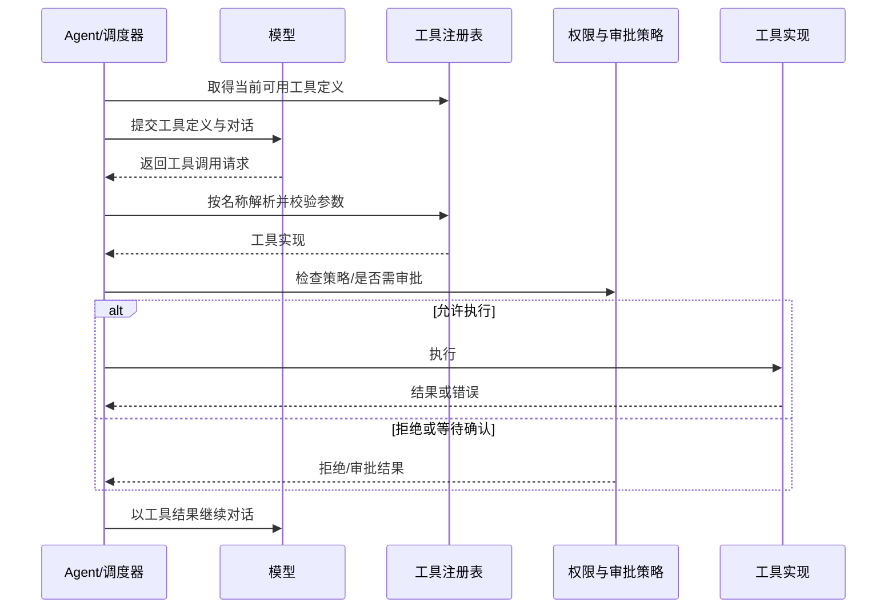

# 工具、权限与扩展机制

工具是 agent 与工作区及外部系统交互的受控边界：模型只能请求已注册且以 schema 描述的操作，执行端再负责校验参数、应用安全策略并将结果回传。工具注册与 agent 调度的总体位置见[运行时架构](../architecture/runtime.md)。工具是否可调用、是否需要用户确认、以及调用失败如何反馈，是不同层次的问题；不能把“工具已注册”理解为“操作已获授权”。

## 注册与一次调用

coding-agent 的工具实现集中在 `packages/coding-agent/src/tools`，权限相关逻辑位于 `packages/coding-agent/src/security`；MCP 集成和 extensibility 则分别由 `src/mcp`、`src/extensibility` 承担。运行时把可用工具描述提供给模型，模型返回工具调用后，调度层按名称找到实现并执行，结果作为工具消息进入后续对话。工具实现的参数 schema 是模型调用接口，同时也是运行时校验边界；扩展工具应遵循同样的注册和结果约定，而不是绕过调度器直接执行。

## 文件与 shell：能力和风险边界

文件工具承载读取、搜索、编辑等工作区操作；shell 工具把命令交给操作系统进程执行，风险模型明显不同。shell 命令可能产生任意副作用，不能仅依赖模型生成内容或工具 schema 保证安全，因此审批策略与 shell 语义共同决定执行行为。操作失败、取消或被拒绝都应作为明确结果处理，不能伪装成成功。

审批策略的规范入口是 `openspec/specs/approval-policy/spec.md`，shell 行为规范入口是 `openspec/specs/shell-semantics/spec.md`。执行模式、自动批准选项和安全检查应以这两份规范及对应实现为准；涉及 fork 时尤其应区分规范基线与当前分支：不要假设基线规则、默认审批或命令处理在 fork 中完全一致。排查时从工具注册/调用入口追踪到 security 检查和 shell 执行点，并核对该分支配置、调用者与测试，而非只看规范名称。

审批不是一般意义上的参数验证：它是执行前的授权关口。配置过于宽松会令高风险操作失去交互确认；配置过严则可能使自动化停滞。变更策略时应同时检查默认值、显式配置覆盖、调用入口传入的上下文以及拒绝/取消路径。可从 `packages/coding-agent/test/tools.test.ts` 的工具测试定位代表性行为，再追查对应 security 与 shell 专项测试；测试名称和分支条件能帮助确认实际覆盖的是基线还是 fork 特有行为。

## MCP 与可扩展工具

MCP 将外部服务器提供的工具接入 agent 的工具调用模型。它扩展的是能力来源，不会自动赋予外部工具更高信任级别：连接配置、服务器生命周期、工具发现以及调用失败均属于集成边界；外部工具仍须经过 agent 的调用与权限流程。运维时应审视服务器来源和配置，并把模型可见的工具集合视为实际暴露面。

技能（skills）通常是供 agent 使用的指令/能力补充，不等同于可直接执行的工具。技能发现入口和加载规则决定哪些指令进入 agent 上下文，因此目录位置、发现顺序、配置覆盖以及 fork 的改动都会影响行为和安全。技能内容可能影响模型决策，但不能代替工具端的授权检查。核实技能发现差异时，应沿发现入口追到配置读取、目录扫描/加载和调用者，再核对测试；不要从目录存在推断其一定会被加载。

## 配置、扩展与验证

新增内置工具应同时实现参数校验、执行、错误/结果表达，并将其接入注册路径；新增外部能力优先使用 MCP 或既定 extensibility 接口，避免绕开安全与审批层。权限策略、shell 执行语义和技能发现属于高影响变更，需在目标 fork 上核对默认配置与覆盖顺序，并为允许、拒绝、需审批、错误/取消等分支补测试。

建议阅读顺序：先看 `src/tools` 的注册和调用者，再看 `src/security` 的授权决策，最后分别跟踪 `src/mcp` 与 `src/extensibility` 的发现/生命周期。使用 `packages/coding-agent/test/tools.test.ts` 验证端到端工具行为，并结合审批与 shell 规范及其实现测试核实 fork 差异。离线模型的配置和模型供应商边界另见[模型与离线运行](../integrations/models-offline.md)。
