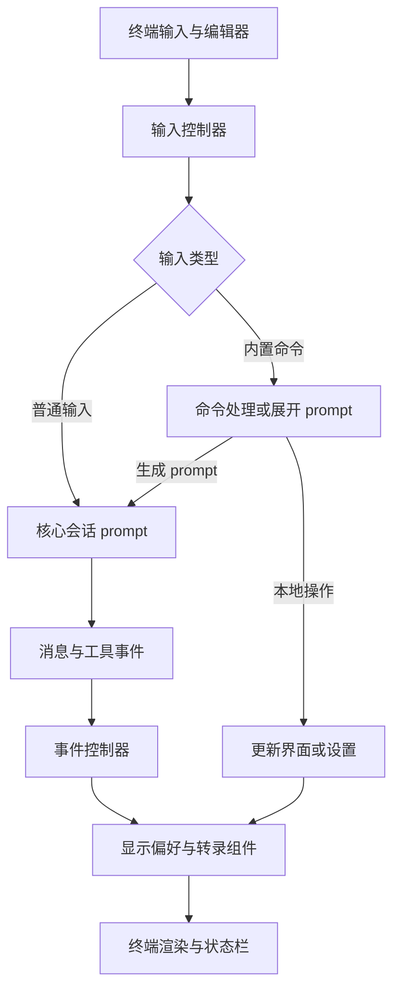

# TUI 交互与个人默认行为

TUI 是核心会话的交互宿主，而不是另一套 Agent 执行器。编辑器接收输入，控制器决定它是本地命令、展开后的 prompt 还是普通消息；会话产生消息和工具事件，界面再按当前设置投影。**看不到某个工具或思考块，不意味着它没有执行或没有进入上下文。**会话生命周期见[会话运行时](../architecture/session-runtime.md)，模型与设置优先级见[配置与模型](configuration-and-models.md)。

图：代表性的输入分流和会话事件渲染路径；具体焦点、扩展和队列分支仍由各自宿主处理。

[输入控制器](../../packages/coding-agent/src/modes/controllers/input-controller.ts)处理命令、技能、`!` Bash、`$ ` Python 和普通输入；流式中可将输入作为 steer，压缩中则排队。扩展命令在普通用户消息的乐观渲染之前处理，避免本地消费的命令冒充已发给模型的消息。[事件控制器](../../packages/coding-agent/src/modes/controllers/event-controller.ts)处理消息、工具开始／更新／结束、重试与压缩等事件；流式工具预览在组件尚未出现时按调用 ID 暂存。它请求重绘，但执行状态仍来自会话和工具。UI 的 `viewSession` 也可能指向正在查看的子代理，不应把当前视图误认为整个系统的运行状态。

## 显示模式：同一会话的不同投影

fork 的[显示规格](../../openspec/specs/tui-presentation/spec.md)和[设置实现](../../packages/coding-agent/src/modes/settings.ts)共同确立 `display.mode` 默认 `compact`。`/display [clean|compact|detailed]` 可指定模式，无参数按 clean → compact → detailed → clean 循环；原工具可见性快捷键也循环模式，而不是建立独立的工具隐藏开关。命令设置偏好后会检查实际生效值，如果被更高优先级来源遮蔽则提示来源。图片的 `terminal.showImages` 和 `images.*` 仍是独立设置，切换档位不会改写它们。

| 模式 | 终端投影 |
| --- | --- |
| `clean` | 隐藏工具活动、工具结果图片和真实思考，包括实时思考占位；不保留 compact 固定思考区。 |
| `compact` | 连续普通工具段默认预览最后两次调用，超过两次时显示该段总数；连续实际文件写入段保留最后三个原组件。边界和关键反馈按实际操作判断，不是全轮只有三行。 |
| `detailed` | 使用上游完整工具和思考组件及其展开、截断、图片和滚动行为；完整可查看不等于强制展开。 |

compact 的普通工具调用层 `isError` 可在默认折叠态静默，但实际命令非零退出／超时、部分修改、独立诊断和需要用户确认或输入的反馈不受普通预览数量限制。切换 detailed 或显式展开可查看原始内容。普通工具段不跨可见正文或实际文件写入合并；已归档历史不因新段回头改写。Bash 实时输出、后台计时与展开沿用既有执行事实，而非显示层重启任务或创建另一个日志调度器。

compact 将消息流中的思考隐藏，在输入区上方保留固定单行及下方空行：优先显示当前活跃思考的最新非空行；没有可显示思考时，可显示当前工具实时输出的最新非空行。结束、取消或切换会话不能把旧内容当成当前活动。发送后的用户消息若排版超过六屏幕行，compact 显示前五行与折叠提示；原文仍用于保存、复制和模型输入。上述是显示筛选，不改变消息、工具结果、执行顺序、审批或持久化。

## 四种容易混淆的状态

- **思考显隐**：`Alt+P` 改变 thinking blocks 的显示偏好，不改变模型请求的 thinking level。thinking 为 off 且没有观察到可显示内容时，控制器拒绝无意义的切换；已观察到真实思考则可解锁显示。
- **模型 thinking level**：`Shift+F1` 请求当前查看会话循环级别；模型不支持时显示提示。这与隐藏已产生的内容不同。
- **会话模式**：`Shift+Tab` 进入或切换计划模式，它影响会话工作方式，不是 `/display` 的三档之一。
- **真实运行状态**：compact 工作状态行依据当前查看代理已有事实区分等待、思考、回复、参数生成、工具执行和审批等；参数生成不等于工具已执行，未知阶段不应推断为成功或服务器排队。

默认快捷键还包括 `Ctrl+T` 临时模型选择、`Ctrl+O` 展开工具输出和 `Ctrl+Q` 排队后续消息。clean 中先用 `/display` 或工具可见性快捷键显示工具才能展开。键位可配置，焦点、弹窗和终端实际发出的按键序列也会影响处理；空输入框的固定提示是帮助文字，不是自定义键位的实时回显，`Esc Esc` 的“回退”也不是撤销文件修改。默认键映射见[键位定义](../../packages/tui/src/app-keybindings.ts)。

## 输入区、状态栏与终端能力

fork 默认状态栏 `default` 左组在 `git` 后依次包含 `subagents`、`token_rate`、`cache_hit`、`context_pct`、`time_spent`，右组为空；其他 preset 或用户配置可不同。Git 的改动数按启用类别的文件并集统计，同一文件不因同时暂存和未暂存而重复计数。窄屏时状态栏可换行，空输入帮助按显示宽度换行而不是整段消失；这些都是呈现规则，不代表额外的会话状态。状态栏顺序见[预设](../../packages/tui/src/status-line/presets.ts)。

fork 规格还规定输入区默认 `composer.shape=box`、`composer.predictions=true`、`display.showTurnTime=true`。预测沿用既有模型建议机制，Tab／右方向键插入但不发送，可能产生额外用量；显式关闭仍优先。默认深色主题为上游 `titanium`，而可选 `dark-terminal` 才有局部颜色柔化。offline 下 `terminal.programStatus` 默认关闭以避免旧终端显示 OSC 状态序列，显式配置仍优先；这些默认值及范围见[运行默认值规格](../../openspec/specs/fork-runtime-defaults/spec.md)。主要 TUI 导航和说明使用简体中文，命令、路径、模型标识及机器字段保持原样，不应把显示翻译当作协议变更。

`/jobs` 打开当前查看会话的交互任务树；可以浏览详情并按既有权限取消，`/jobs full` 输出完整命令折行报告。面板中的状态来自真实任务，不因显示折叠而改变任务生命周期。具体终端能力和键序列各异，参考终端测试通过不等于所有真实终端、字体、输入法或远程连接都已验收。

## 个人命令与宿主边界

个人命令复用共享 slash-command 链路，有的执行本地 UI 操作，有的展开为用户 prompt；不要把 prompt 中对模型的指令误认为程序强制执行的权限或调度限制。

- `/jchime [故障现象]` 展开 IBus 恢复提示词，由模型结合现场核实执行，不是无模型本地修复。提示词限定当前用户和 DISPLAY，并要求最终由用户在故障窗口确认中文输入；不能把模拟测试当作公司实际环境验收。
- `/jch-workflowzbatch <任务块软目标> <并发上限> <任务正文>` 校验两个正的安全整数和非空正文，再展开为 `workflowz` 用户消息；非法输入只显示用法。任务块数是软目标，并发上限是提示词指令而非新增程序级限制；模板明确限制测试和全仓检查，不能据命令成功展开就断言模型遵守了约束。
- `/team <问题或需求>` 启动只读规划讨论；空问题只给用法，`/team configure` 打开配置而不启动讨论。失败派发时 TUI 尝试恢复草稿与附件。详细工作流见[团队讨论](../workflows/team-discussion.md)。
- `/loop [次数或总时长] [间隔] [任务内容]` 首轮立即执行，之后在轮次间等待；暂停或切换会话后旧定时器不得继续提交。间隔超出 `2147483647` 毫秒时报错且不启动；未知单位的 token 保留为任务正文。相关工作流见[开发生命周期](../workflows/dev-lifecycle.md)。

命令目录按宿主能力暴露，TUI、ACP 和 RPC 并非完全相同：规格规定 ACP 不接受参数的内置命令退回普通 prompt，而 RPC 对仅 TUI 命令或不允许的参数明确报错。共享进程中的目录迁移应绑定当前会话而不是修改进程级目录；`/wt` 目标与当前工作树相同时不清理源目录。不要把 TUI 中看到的选择器或快捷键视为所有宿主都有的能力。参见[个人命令规格](../../openspec/specs/personal-commands/spec.md)及[命令实现](../../packages/coding-agent/src/jch-commands/workflow.ts)。

## 修改与验证时的关注点

显示变更应同时检查实时流、历史重建、切换代理和模式，以及错误／审批入口是否仍可达；不能只检查最终截图。可从 [thinking 预览测试](../../packages/coding-agent/test/event-controller-thinking-preview.test.ts)、[输入控制器键位测试](../../packages/coding-agent/test/input-controller-keybindings.test.ts)和[交互终端测试](../../packages/coding-agent/test/interactive-terminal-e2e.test.ts)入手。前两者使用测试会话或模拟输入，终端测试覆盖参考环境；涉及窄屏、IME、字体或 native 终端时仍需针对目标环境验证。上文明确标为 fork 的差异以规格和对应实现为边界，其他沿用机制不据此推断其历史归属。
