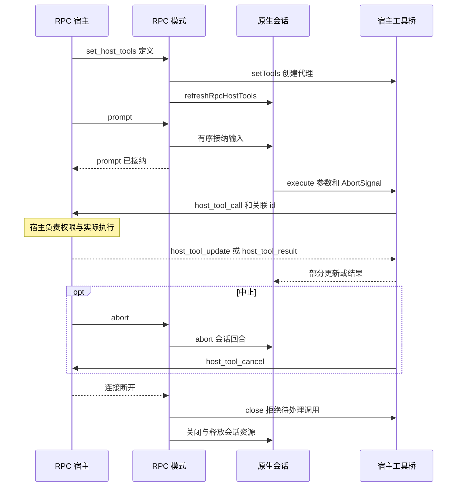

# SDK、RPC、ACP 与扩展边界

这些表面复用的是原生 `AgentSession` 和工具执行能力，而不是同一种协议。会话内部的状态、持久化和 agent 循环见[会话运行时](../architecture/session-runtime.md)，工具执行的共同边界见[工具与执行](../architecture/tools-and-execution.md)。宿主必须同时设计输入、事件、权限、取消和资源释放，不能只把 prompt 转发给模型。

## 选择接入契约

| 表面 | 接入与输出 | 状态和生命周期 | 边界 |
| --- | --- | --- | --- |
| TypeScript SDK | `createAgentSession` 在进程内创建原生会话；调用者直接调用、订阅会话 | 调用者持有并释放 session，可注入配置、存储和工具 | 不是线路协议；同进程共享资源不等于会话状态应共享 |
| print | 单次无头执行，输出文本或 JSON 事件 | 运行完成后释放 session 并返回退出码 | JSON 输出是事件流，不是可交互 RPC；无 UI |
| RPC | stdin 逐行 JSON 命令，stdout 响应和事件；支持协议版本协商 | 一个运行中的 session 接受 prompt、队列操作、abort 及宿主工具 | prompt 成功响应表示输入已接纳，不意味着 agent 已完成 |
| ACP | ACP JSON-RPC over stdio，客户端请求会话并接收更新 | `AcpAgent` 管理多个 workspace session 和连接关闭时的清理 | 客户端能力控制文件和终端桥；权限请求由会话策略决定 |

实现入口分别见 [SDK](../../packages/coding-agent/src/sdk.ts)、[print](../../packages/coding-agent/src/modes/print-mode.ts)、[RPC](../../packages/coding-agent/src/modes/rpc/rpc-mode.ts)和 [ACP](../../packages/coding-agent/src/modes/acp/acp-mode.ts)。`sdk/python/omp-rpc`、`sdk/go/omp-rpc`、`sdk/rust/omp-rpc` 是 RPC 消费者边界，不应假设它们是进程内 TypeScript SDK 或自动具有其他协议的能力。

## 无头请求与宿主工具

下面以 RPC 为例。注册定义只建立会话可调用的代理；实际执行在宿主中，不能把接到工具调用视为对其副作用的授权。宿主应在自己的信任边界校验参数和权限；原生会话仍拥有其自身的工具策略。

图：RPC 请求和宿主工具的状态、权限、取消及关闭所有者。

`set_host_tools` 规范化定义并刷新会话工具集；桥以独立 id 跟踪待处理调用，接收部分更新和结果。错误结果转为拒绝；abort 发出带 `targetId` 的取消帧并拒绝本地 promise，宿主仍须自行停止实际工作。断连时桥拒绝所有待处理及后续请求，迟到结果不能重新完成调用。`abort_and_restore_queue` 还先撤回队列，再中止，以免排队输入在中断后继续运行。实现及回归用例见 [host-tools.ts](../../packages/coding-agent/src/modes/rpc/host-tools.ts) 和 [rpc-host-tools.test.ts](../../packages/coding-agent/test/rpc-host-tools.test.ts)。

RPC 启动在扩展发现前占用 Bun stdin reader，避免进程内模块抢走输入；坏 JSON 行报告解析错误后继续读取后续行。协议版本协商当前接受版本 2。输出端必须保留给协议帧，诊断和扩展日志不能混入 stdout；不要把人类可读日志拼进事件流。参见 [rpc-input.ts](../../packages/coding-agent/src/modes/rpc/rpc-input.ts) 和 [rpc-output.ts](../../packages/coding-agent/src/modes/rpc/rpc-output.ts)。

## ACP：延迟会话与权限

CLI 只在 ACP 分支动态加载协议运行器，并把工厂交给它；扩展按客户端会话绑定，而不是为了启动服务器提前执行所有会话工厂。新建会话按客户端 cwd 创建、确保落盘后注册；加载或恢复已有会话时检查 cwd，失败的临时会话被释放。客户端声明的 MCP 服务由该 ACP 会话记录的 manager 管理，而非假定属于全局会话。连接中止触发 agent 清理，stdio runner 等待连接关闭和退出清理。详见 [main.ts](../../packages/coding-agent/src/main.ts) 和 [acp-agent.ts](../../packages/coding-agent/src/modes/acp/acp-agent.ts)。

ACP 保留原始 stdout 给 NDJSON transport，将其他 `process.stdout` 写入和 `console.log` 转向 stderr；直接写 fd 1 的第三方代码仍可能破坏协议，扩展作者应避免这样做。客户端声明 `fs.readTextFile`、`fs.writeTextFile` 或 `terminal` 时，`ClientBridge` 才暴露对应转发；权限请求本身可用，但是否请求由 agent 策略决定。等待权限时若 steering 取代工具调用，桥取消线路上的请求，返回 cancelled，避免遗留对话框。见 [acp-client-bridge.ts](../../packages/coding-agent/src/modes/acp/acp-client-bridge.ts) 和 [ACP 会话效果测试](../../packages/coding-agent/test/acp-session-effects.test.ts)。

## 扩展、MCP 和释放

SDK 会话组装时可发现并绑定扩展、自定义工具及 MCP 工具。扩展可注册工具和会话事件处理器，但宿主不应假设交互 UI 可用：print 明确以无 UI 模式初始化扩展。技能与资源发现的不同职责见[技能和规范资源](skills-and-spec-resources.md)。

MCP loader 从 `.mcp.json` 发现配置，创建 `MCPManager`，将发现的工具转换成自定义工具形式供会话使用；连接状态、工具缓存、认证存储和项目配置均有独立选项。整体发现失败时返回空工具及错误，而不是把错误伪装为成功连接。manager 是连接生命周期的所有者；启动发现可有非阻塞窗口，因此调用方不能把启动时的工具快照当作永不变化。取消和进程退出必须贯穿 transport 并清理服务，参考 [MCP loader](../../packages/coding-agent/src/mcp/loader.ts) 和 [stdio 取消测试](../../packages/coding-agent/test/mcp-stdio-cancellation.test.ts)。

print 的 JSON 模式先输出可用的 session header，再输出经过 `printableEvent` 裁剪的事件；它串行等待 stdout 写入完成，避免大记录在退出时截断。信号路径通过 postmortem 释放会话；普通完成也要释放。由于没有人工审核界面，print 忽略新会话的 `plan.defaultOnStartup`，无头自动规划应显式使用 `--plan-yolo`。

隔离不是“每个对象都绝不共享”：SDK 测试刻意共享认证存储和模型 registry，同时验证会话存储等状态隔离；测试也显式关闭进程级 SQLite 存储。新增多会话宿主时应按会话管理 cwd、会话存储、工具和权限上下文，并明确共享 registry、缓存及其最终关闭者，不要让一个会话 dispose 误伤另一个。参见 [sdk-session-isolation.test.ts](../../packages/coding-agent/test/sdk-session-isolation.test.ts)。
