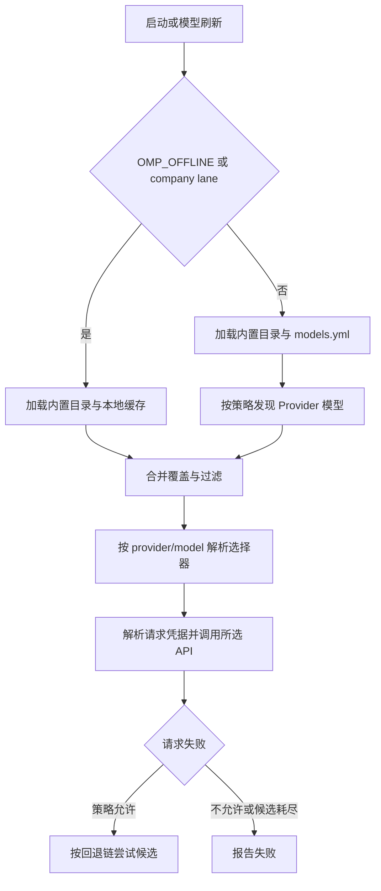

# 模型供应商、发现与内网模式

模型目录不是网络可达性的保证：目录可能来自内置定义、配置覆盖、持久缓存或在线发现；真正发请求时仍由选中的 Provider、API 协议、地址和认证共同决定。OMP 的 `ModelRegistry` 负责汇总并投影模型，再供 selector、角色和请求侧解析使用。这里的“offline”主要约束模型目录发现，并不等同于封锁所有网络请求。

## 选择与目录刷新

*该图概括目录组装、selector 解析与请求失败后的候选回退；目录发现和模型请求是不同阶段。*

内置模型、`models.yml` 的自定义模型及 Provider 覆盖、运行时扩展注册和动态发现结果共同构成可用目录。刷新策略可为 `offline`、`online-if-uncached` 或显式在线；默认刷新会考虑公司 lane。在线目录获取与命令式凭据刷新彼此独立：普通发现不应为了目录刷新重跑 `!command` 凭据命令。缓存命中与否、Provider 的权威目录语义会影响合并结果；自定义覆盖不是自动替换所有内置信息的同义词。

模型选择器通常采用 `provider/model`，模型角色、显式 CLI 选择及已有角色配置参与优先级解析。Company 角色默认仅在 offline lane 可用且公司配置有效时填补未配置角色；现存角色设置和显式 `--model` 优先。无效或未知模型不应被悄悄视作另一个 Provider 的模型。模型回退链是请求失败后的独立策略：跨 Provider 复制模型 ID 时剥离来源的 `@upstream` 路由；同 Provider 才保留路由。特定 Provider（如 CodeAgent）的认证轮换限制也可能禁止重放已产生流式输出的请求，不能把通用回退理解为任何失败都可重发。

## 配置与认证来源

普通自定义 Provider 通过 `models.yml` 提供 API 类型、地址、模型定义及凭据配置；认证解析还可结合环境变量、AuthStorage 中的登录凭据或配置的命令值。请求边界解析实际 API key/headers，而目录发现可使用不同的凭据与网络策略。模型 ID 可解析成功，并不意味着认证或远端服务可用。

Fork 保留 `company`、`codeagent` Provider ID，不允许扩展或运行时注册覆盖它们；`models.yml` 中同名保留段忽略并提示，避免单段错误破坏其他自定义 Provider。

### Company 内网 Provider

`company` 是 OMP fork 的 offline 专用 Provider，并非上游通用 offline 模式的必然组成部分。仅 `OMP_OFFLINE=1` 时启用 company lane；普通进程不注册它、不读取 Claude 设置、不提供公司模型或嵌入回退。普通进程显式选择 `company/...` 或 `--provider company` 会因 lane 未启用而失败，而不是回落公网。

lane 启用后，OMP 从 Claude Code 活动配置目录（默认 `~/.claude`，可由 `CLAUDE_CONFIG_DIR` 指定）的 `settings.json` 读取 `env.ANTHROPIC_BASE_URL` 与 `env.ANTHROPIC_AUTH_TOKEN`。URL 必须是无 userinfo、query、fragment 的 HTTP(S) 基础地址；配置缺失、JSON 损坏或字段无效会形成不可用状态。配置错误应可诊断，但错误与日志不暴露 Token。凭据不写入 OMP 配置；内部对象的 Token 不可枚举，避免意外序列化泄露。

读取结果（包括失败）按进程缓存；修改配置文件不会热更新，须重启 OMP。主线程在设置 offline lane 时建立快照，再通过 worker environment data 交给后续 Worker；Worker 不自行读设置文件。普通启动不会持有此 Token。Company 聊天目录使用固定模型定义、Anthropic Messages 协议和 Bearer 认证，仅请求配置的公司网关，不做公司目录发现，也不因失败自动改投对应厂商公网 API。公司配置无效时显式选择公司模型应明确失败；不可用不能伪装成成功的回退。

OMP offline 还可为未配置角色提供公司默认值：主角色、PLAN、SLOW 使用 `company/GLM-5.3-public`；轻量、提交等角色及视觉、任务角色按 `company-models.ts` 的映射设置。公司聊天模型运行时上下文窗口限制为 200,000 token，不改变 maxTokens。已配置角色和显式选择仍优先，普通模式不受这些默认值影响。

公司嵌入是独立的内网路径：记忆功能启用且未明确指定向量模型时，才使用内置 `Qwen3-VL-Embedding-2B` 与同一启动快照的地址和 Token。显式向量配置优先；指定其他地址时不得带上公司 Token。自定义通用 API 路由或显式要求 embedding 走 API 时，按通用 API 设置解析，不混用 company 凭据。公司 embedding 使用 OpenAI 兼容 `/v1/embeddings`，规范化 `/v1` 路径，不探测其它端点或回退公网；内网网关兼容性须实际验证。检索目录中的 Reranker 目前不等于已接入现有检索流程。

## `OMP_OFFLINE` 的边界

OMP 上游基线的 offline 行为是目录发现与缓存策略，不能泛化成“没有任何网络”。fork 增加的 company lane、公司模型/角色默认值及内网认证是 `OMP_OFFLINE=1` 的 fork 特性。offline 下 `omp models`、`omp bench` 等目录消费者先设置 lane，再构建 registry；目录刷新和 selector miss 的发现回退使用 cache-only，避免对公网模型目录发请求。Company 本身是固定目录，不在线发现。

Cache-only 不禁止用户实际选中的模型请求、OAuth/API 请求、usage 请求或其他远端能力；这些仍按原 Provider 流程执行。因此设置 offline 不代表网络隔离或请求必然成功。需要真正无网络环境时，必须由操作系统/网络策略另行限制出口。离线缓存缺失时，目录不会靠联网补齐；公司配置缺失则不可用，而非自动寻找公网替代品。

### 诊断与操作

1. 要使用公司模型，先在 Claude Code 配置目录的 `settings.json` 配置 `env.ANTHROPIC_BASE_URL` 和 `env.ANTHROPIC_AUTH_TOKEN`，保护该文件权限。
2. 启动进程时设置 `OMP_OFFLINE=1`，再查看 `omp models` 是否列出 `company/...`；配置在启动快照中固定，改动后重启。
3. 可显式选择 `company/<模型>`；不要仅凭模型目录存在推断网关可达，调用失败应检查内网 DNS、路由、网关协议及 Token，而不要预期公网回退。
4. 自定义 provider 使用 `models.yml`，本地模型服务则须配置其地址并按对应发现机制使用；offline 时缺少缓存不会触发联网发现。

交互式启动通过既有 TUI 呈现公司配置警告，独立模型命令向 stderr 报告。共享 SDK 初始化和认证/会话代码不直接写终端；同一命令重复初始化不重复输出启动告警。CLI 的诊断不应包含凭据。

## 验证重点

- `company-provider.test.ts` 用独立子进程验证 lane 门控、配置快照、文件替换/删除后不热更新、Worker 继承，以及 JSON 错误不泄露凭据。
- `models-offline-company.test.ts` 以受控子进程测试 offline 列出公司目录、上下文限制、缺失/损坏配置诊断、普通模式不注册 company，并用 network guard 确认模型目录操作不发网络发现请求。
- 修改发现策略时同时检查 registry 的刷新入口和真实 CLI 消费者，确保 offline 在 registry 构建前生效；不要只测 provider 函数而忽略命令路径。

## 相关页面

- [运行时架构](../architecture/runtime.md)
- [ZCode 集成](./zcode.md)
- [配置与优先级](../operations/configuration.md)

## 主要实现依据

- [Provider 与 offline 规范](../../openspec/specs/model-providers/spec.md)
- [Company 配置快照](../../packages/coding-agent/src/config/company-provider.ts)
- [Company 模型目录与角色默认值](../../packages/coding-agent/src/config/company-models.ts)
- [模型注册表](../../packages/coding-agent/src/config/model-registry.ts)
- [Company 快照测试](../../packages/coding-agent/test/company-provider.test.ts)
- [Offline CLI 测试](../../packages/coding-agent/test/models-offline-company.test.ts)
