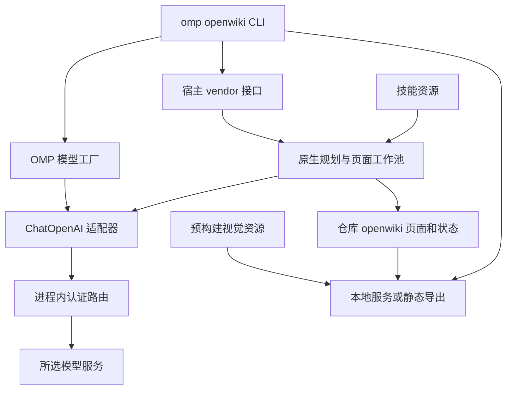

# OpenWiki 生成与内置资源集成

`omp openwiki` 是 OMP 对 `vendor/openwiki` fork 的**进程内仓库 Wiki 适配层**，不是独立 OpenWiki 安装器。本仓库的 `openwiki/` 是针对本仓库生成的知识页及其状态；`vendor/openwiki` 是生成和查询引擎源码；OMP 原有 `wiki` 文档索引及 `repo` 代码索引则是另一套能力和数据。不要把这些页面或 fork 当成 `docs.db`，也不要假设生成 Wiki 会更新既有索引。

## 入口与执行边界

在目标仓库运行：

```sh
omp openwiki code --init --dry-run
omp openwiki code --init
omp openwiki code --update
omp openwiki visualize openwiki --no-open
omp openwiki visualize openwiki --export ./wiki-export
```

`code` 可省略；默认语言为 `zh-CN`，可通过 `--language` 覆盖。init 是重新生成，保留 `openwiki/INSTRUCTIONS.md`，并非无损更新。实际运行会刷新根目录 `AGENTS.md` 的 OpenWiki 管理区块，保留其他内容；标记损坏或重复时报错。缺失的 `INSTRUCTIONS.md` 以空文件创建，已有内容不覆盖。



图：宿主负责模型、凭据与资源注入，fork 负责仓库生成和视觉展示。

宿主通过 `openwiki-vendor-runtime` 动态加载 [vendor 契约](../../packages/coding-agent/src/openwiki/vendor-contract.ts)，调用 `runNativeRepositoryGeneration`，传入根目录、模式、语言、模型、页面并发、技能目录、取消信号和事件回调。原生规划、页面任务、Claims、checkpoint 和最终化仍属于 fork，而不是 OMP 通用 Task 的重写。`OPENWIKI_PAGE_CONCURRENCY` 默认 1，范围 1–8；这不是跨进程仓库互斥保证。

`--dry-run` 只预览模型选择器、源码快照候选、可比较的变更和已有页面，不调用模型、不写 Wiki 或遥测；候选既不是完整读取清单，也不是最终页面列表。模型实际规划页面。真正运行时，部分页面失败返回 1 并提示 update 重试；中断返回 130；全部页面成功但期间源码变化时警告再次更新。恢复和增量判断使用已有页面、Claims 与进度，不能仅凭 Git clean 或 Agent 的文字宣称认定完成。

OMP 只暴露仓库生成、link、workspace 和 visualize 等入口；个人模式、连接器、MCP 安装及 CLI `search`/`read` 不在内置范围。普通对话通过 `openwiki_search`、`openwiki_read`、`openwiki_list_workspaces`、`openwiki_list_wikis` 按需只读查询已有 Wiki，不调用生成器。链接和活动工作区状态位于有效 OMP profile 的 `openwiki` 配置目录，不自动接管旧独立 OpenWiki home。

## 模型与认证转接

页面模型使用 `--modelId` / `--model-id`，否则使用 OMP 的 `default` role 或运行时可用模型。规划模型优先级为 `--planner-model`、公共显式模型、已配置的 `plan` role，最后复用页面模型；已配置的规划模型不可用时不静默回退。相同选择器复用实例，不同选择器分别创建并在结束或失败时释放。`--debug` 显示实际模型 ID；预览中的选择器未经运行时发现和认证验证。

[模型工厂](../../packages/coding-agent/src/openwiki/model.ts) 加载当前设置、凭据存储、模型注册表及扩展 provider，按照离线策略刷新注册表；拒绝不支持工具调用或没有可用凭据的选择。它以 LangChain `ChatOpenAI` 适配原生生成器，但 `http://openwiki.internal/v1` 是经自定义 fetch 转发到**进程内** OMP auth gateway 的虚拟地址，不是要求部署的新服务。路由器按所选 provider 解析凭据并保留 assistant 工具调用轮次；推理档位按模型能力转换后传递。取消或 dispose 会中止请求并关闭路由器和存储。

## 资源的构建、定位与交付

资源分两条路径，不能仅因源码可读就断定交付物完整：

- 根目录 `postinstall` 执行 `openwiki-resources.ts --if-present`；它读取当前 checkout 的 fork 技能和视觉源码，构建浏览器脚本，收集 CSS、图形、Markdown、净化和 Mermaid 依赖及许可声明，并以临时文件加 rename 发布 `dist/openwiki-resources/visual-assets.json`。输入生成前后指纹不同则失败。子模块缺失时删除旧视觉 map 并警告；初始化子模块后运行 `bun run gen:openwiki-resources`。
- 技能在源码 checkout 直接使用 `vendor/openwiki/skills`；交付路径从 `PI_OPENWIKI_SKILLS` 或 `dist/openwiki-resources/skills.json` 读取映射，按 SHA-256 内容摘要原子发布到 profile 的 `openwiki/resources/<digest>/skills`，并拒绝路径穿越。bundle 和编译二进制的构建脚本将技能映射内嵌；不要误以为上述 postinstall 单独写出了 `skills.json`。
- 可视化从 `PI_OPENWIKI_VISUAL_ASSETS` 或预构建 JSON 加载，检查必要资源；源码 checkout 下还核对输入指纹，缺失、无效或过期时明确报错并要求重新生成。编译或 bundle 交付可内嵌同一资源映射。

`visualize` 把资源和 Wiki 根目录交给 fork 的嵌入式服务，停止时关闭服务；`--export` 则生成可由静态 HTTP 服务托管的页面和图，不承诺 `file://` 直接打开。离线可视化所需浏览器库随资源提供，但**离线不等于离线生成自动可用**：仍需已交付资源、可用的工具调用模型和对应凭据及可达端点。内置路径的遥测禁用；显式 `--telemetry-file` 只写本地禁用状态。参见[内网与离线](../operations/intranet-offline.md)和 [fork 维护](../operations/fork-maintenance.md)。

## 检索与验证

已有的 [代码索引](../concepts/repo-code-index.md) 和 [文档索引](../concepts/wiki-document-index.md) 保留各自命令和存储语义；OpenWiki 查询不替代它们，也不在普通任务开始时预加载全部页面。知识页是可过时的派生材料，排障时应回到源码和测试。

修改集成时，可重点检查 `packages/coding-agent/test/cli/openwiki-generation.test.ts` 的生成与模型路径、`openwiki-dry-run.test.ts` 的只读预览、`openwiki-recovery.test.ts` 的恢复，以及 `test/openwiki/query.test.ts` 和 `agents-instructions.test.ts` 的查询与指令边界；fork 自身的生成测试覆盖原生页面编排。资源或子模块变化后应重新生成并检查指纹，而不是沿用旧视觉产物。
