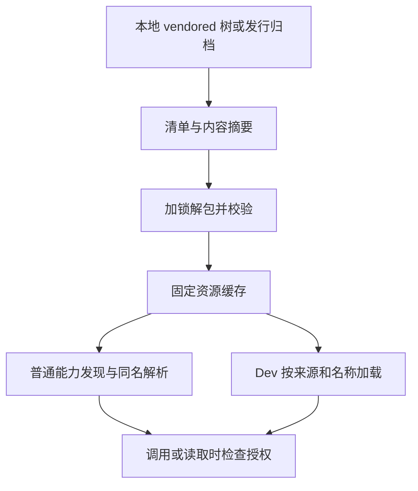

# 技能发现、OpenSpec 与 Superpowers 资源

OMP 同时提供普通会话可调用的技能和命令、独立的 `omp openspec` CLI，以及 [Dev 四阶段工作流](../workflows/dev-lifecycle.md)使用的固定方法。三者共享打包资源，但不共享同一种控制权：独立 OpenSpec 用于需求材料维护，不负责实施或软件验收，也不依赖 Dev 状态；Dev 的阶段推进与批准由自己的控制器管理。

## 固定来源和资源解析

包内清单记录 OpenSpec `1.15.0` 的完整性信息、Superpowers `7.0.1` 的 revision 和 JCH revision；这是随发行物固定的来源，不是会话启动时下载的插件。源码模式从 vendored 资源树快照实际文件，编译包使用嵌入归档，缺少完整本地树的 SDK 包使用发行归档。清单按文件记录 SHA-256 和可执行属性，技能条目来自三个来源的 `skills/<name>/SKILL.md`。

解包以清单摘要命名缓存，在文件锁下写临时目录、核验每个文件的 SHA-256、恢复可执行位，完成后才发布并写完成标记。失败会清除进程内的提取 promise，允许重试。资源路径拒绝绝对路径、反斜杠、空段和 `.`、`..`，并检查 realpath 仍在根内；加载固定技能时还检查来源根和内容摘要。vendored 树快照也拒绝逃逸和目录循环。



图：普通目录发现和 Dev 精确加载共用缓存，但授权仍在使用时检查。

## 普通发现、同名覆盖与授权

`spec-driven` 是低优先级能力提供者。它从清单逐项发现 Superpowers 和 JCH 技能，但 OpenSpec 普通技能只开放五项：`openspec-propose`、`openspec-explore`、`openspec-update-change`、`openspec-sync-specs`、`openspec-archive-change`。同一提供者从包内 OpenSpec `commands` 目录只发现 `/opsx-propose`、`/opsx-explore`、`/opsx-update`、`/opsx-sync`、`/opsx-archive`。这些是普通技能和 Markdown 命令的发现链，不是 `/dev` 的阶段命令；其他包内资源仍可供 CLI 使用。

技能 catalog 先按来源发现、解析名称，再应用启用、包含和排除过滤。自定义目录同名技能取得裸名，不同内容的原版本保留为命名空间名称，必要时带 `~N`；正文和 frontmatter 均相同的副本可合并。`OMP_SKILLS_DIR` 是优先于其他自定义目录的共享单层技能根，不负责下载或同步；默认也启用 Codex 用户技能发现。配置及其他模型发现边界见[配置与模型](../concepts/configuration-and-models.md)。普通会话可通过 `/skill:<name>` 显式调用；隐藏技能不出现在系统提示的技能列表中，但仍可被显式调用。

**可见性不是授权。** 对隐藏的固定资源，`skill://` 读取要求当前会话分支存在匹配名称和路径的显式调用记录，或持有对应的精确授权；普通隐藏用户技能保留原有 URI 语义。Dev 的阶段策略还先检查允许的 catalog 名称，阶段内大多数固定 Superpowers 技能需要名称和绝对路径均匹配的原生授权；`systematic-debugging`、`verification-before-completion`、`writing-skills` 保留原有阶段访问例外。授权绑定会话作用域，替换策略会使旧授权失效，释放时不会清除较新的绑定。

## 独立 OpenSpec 与 schema

`omp openspec` 直接运行包内 OpenSpec CLI，透传输出和退出码。`init` 强制 `--tools=none`，避免在项目安装重复的技能和命令；首次生成配置时把默认 schema 设为 `mini`，既有配置不改写。无配置的 `new change` 也默认 `mini`，但显式 `--schema` 和已有配置优先。`mini` 的材料是 `proposal` 和 `specs`；显式选择原生 `spec-driven` 则保留 `proposal`、`specs`、`design`、`tasks`，不会把旧 change 自动迁移。

Dev 使用另一套包内 `omp-spec`。进入需求方法前通过 `openspec schema which omp-spec --json` 核验来源必须是 `package`，且 realpath 必须等于包内 `schemas/omp-spec`；项目或用户同名 schema 遮蔽时直接报错，而不是悄悄改变 Dev 流程或修改已有 change。需求阶段再请求该 schema 的 `proposal` 和 `specs` 指令。

## Dev 的特殊注入

Dev 不依赖普通 catalog 的裸名解析：需求角色精确加载 JCH 的 `jch-grill-me`，规划角色加载 Superpowers `writing-plans`，但截去 `Execution Handoff` 及其后内容；缺少该节即失败。执行角色注入 `using-superpowers` 和 `subagent-driven-development`。执行会话另外从清单递归暴露所有固定 Superpowers 技能并以名称和路径授权；若普通技能已占裸名，固定版本使用 `superpowers/<name>` 及必要的数字后缀，不抢占用户版本。阶段自动加载寻址固定资源，即使用户自定义了同名技能也不改变阶段方法。执行可见性和授权均限于执行会话，并不改变普通会话权限或名称优先级。

## Superpowers 脚本入口

使用 `omp superpowers <relative-skill-script> [args...]`，路径相对于固定的 Superpowers 根。例如：

```sh
omp superpowers skills/writing-skills/render-graphs.js <skill-directory>
omp superpowers skills/subagent-driven-development/scripts/review-package <plan-file> <base> <head> [output-file]
```

脚本必须在清单中且位于 `skills/` 下，并经过规范路径与 realpath 包含检查。当前资源中的主要脚本包括 `skills/brainstorming/scripts/` 下的 `helper.js`、`server.cjs`、`start-server.sh`、`stop-server.sh`，`skills/executing-plans/scripts/` 下的 `task-start`、`task-done`，`skills/subagent-driven-development/scripts/` 下的 `review-package`、`sdd-workspace`、`task-brief`，以及 `skills/systematic-debugging/find-polluter.sh` 和 `skills/writing-skills/render-graphs.js`。清单包含并不意味着任意文件都可执行：JavaScript 扩展名使用 OMP 的 Bun，其他脚本必须有 bash 或 sh shebang，并由 Bash 执行。Windows 需要 Git Bash，而不是 WSL 的 `bash.exe`；图渲染还需要 Graphviz `dot`。

子进程继承环境并关闭 OpenSpec 遥测，工作目录为调用目录，brainstorm 数据目录设为该目录下 `.superpowers/brainstorm`。CLI 将 `SIGINT`、`SIGTERM` 转为 abort signal，转发子进程 stdout、stderr 和真实退出码；缺少脚本参数返回 2，帮助返回 0，路径、解释器等入口错误返回 1。外部工具的失败不被伪装成成功。

## 验证与维护

`resources.test.ts` 和 `skill-policy.test.ts` 覆盖资源边界与阶段授权；`process-resources.e2e.test.ts` 经公开进程入口验证打包命令、带引号参数、初始化不覆盖用户文件、`mini` 与显式原生 schema，以及验证和归档。更新 vendored 资源时应同时检查清单、打包、脚本运行环境和这些实际入口，而不是只验证源码树；参见 [fork 维护](../operations/fork-maintenance.md)和[无头与扩展接口](headless-and-extension-surfaces.md)。
