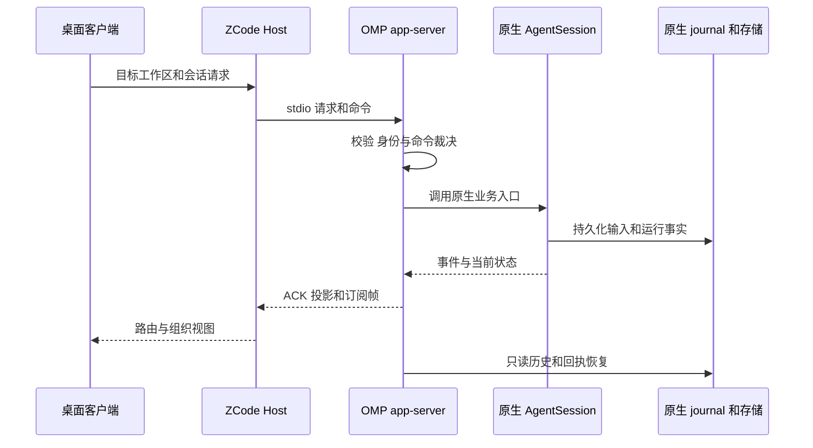

# ZCode 桌面与 app-server 边界

ZCode app-server 是 OMP 的独立协议入口，不是 TUI、独立 RPC 或 ACP 的别名。Host 可用 `ZCODE_AGENT_SERVER_COMMAND=omp` 启动 `omp app-server --stdio --surface desktop`；协议适配器与多个原生 `AgentSession` 同进程，通过业务 API 调用，而不是为每个主会话启动执行宿主。桌面 Host、GUI 和远端部署属于外部 ZCode 仓的集成边界：本仓的协议实现和进程测试不能证明真实 GUI 或完整跨仓交付已验收。兼容规格固定参考 OmpCode 提交 `c7c190724f3a00a2de998a0a5511201d5a2ba1a0`；外层协议版本、V4 wire 版本与 OMP 独立 RPC 的版本不能混同。

图：请求进入原生 owner，投影和回执是对事实的表达，不是第二个执行器。

## 启动、传输与执行端

`--stdio` 必填，`--cwd` 必须为已有绝对目录；`--surface desktop` 选择结构化桌面交互，而非终端选择器。stdout 保留协议帧，诊断重定向到 stderr。外层为逐行 NDJSON 的 ZCode 信封，使用 `method`、`result` 或数字 `error.code`，不是 JSON-RPC 2.0，也不是独立 RPC 信封。attachment 的 hello/clientHello 由 Host 负责，不是 app-server 的 stdio 初始化方法。

存储准备使用独立的 `omp app-server --stdio --prepare-storage --cwd <绝对路径>` 进程：先声明实际存储路径并等待 Host 确认，再准备资源，成功关闭资源后才发 `startup/storagePrepared`。正常进程另行打开存储并报告自身 ready；准备成功不等于模型或认证已就绪。请求受启动门禁保护。stdin EOF 是进程 owner 消失，需收尾该进程托管的会话和资源；关闭详情或退订只释放观察，不等于停止运行。

网络配置属于进程而非会话。启动时读取 `ZCODE_HTTP_PROXY`、`ZCODE_NO_PROXY` 和 `ZCODE_AGENT_CA_CERT`，在创建会话之前接入原生代理及额外 CA；显式空代理表示默认直连，不回落继承代理，原生请求级或 provider 级代理仍有优先权。CA 必须是已有文件，并强制 TLS 验证。SSH、WSL、Docker 等远端须在实际执行端部署和配置兼容 OMP，本地环境变量不能代替远端配置。

## 会话、投影与命令事实

原生会话拥有消息 journal、上下文、队列、工具和模型执行；适配层拥有协议映射、命令裁决、投影和订阅。请求必须携带明确会话／工作区身份，同一进程可并发托管多个会话；同一持久会话的写租约跨进程约束。stop 面向目标运行，不等于关闭会话；显式关闭才释放其监听和租约。只读历史不应取得写租约或启动模型。

Host 的 `tasks-index.sqlite` 是项目和任务归属、pin、归档等组织状态的 owner；OMP journal 是会话正文与历史的 owner；`sessions-index/<workspaceId>` 则是可重建的活性摘要。组织行缺少摘要不意味着应删除，历史 running 也不能冒充当前运行。订阅使用各自的 snapshot、`logEpoch`、seq 和 revision；旧 epoch 或不可重放游标须通过快照恢复，而非把新进程序列接到旧序列上。冷投影缓存可淘汰，重新访问从持久事实只读重建，不取消原生任务。

外层请求 ID 仅关联一次响应；业务 `commandId` 与 session 身份才用于命令裁决。ledger 对命令内容、base revision 和 epoch 相关信息计算 fingerprint，在副作用前保留在途决策，并查 journal 中的持久回执；同身份不同内容不能当作重试。索引是 journal 的可重建加速结构，不是待执行队列。`accepted` 表示原生准入而非任务完成；执行失败、取消、后台工作结算须看后续真实事实。停止后原生队列可处于 held 状态，继续或显式提升交给原生队列 owner，不能由投影擅自释放其他输入。

命令目录和补全来自目标工作区的原生注册表；`sendText` 等通用入口保留原文及参数，非 TUI 专属命令走同一原生处理链。仅终端支持的操作明确拒绝，而不是把命令当普通提示词交给模型。目录 revision 反映目录内容变化，不是会话执行水位。

## 审批与会话配置

原生工具需要授权时，适配器发布 `permission` pending interaction，携带真实工具调用和原生允许的选项；客户端通过 `resolveInteraction` 回答，不能自带更宽授权规则。拒绝、取消、过期或迟到回答不得触发工具；stop、会话关闭和 owner EOF 取消等待，单纯退订不取消原生运行。协作模式在会话内映射原生权限：`build` 对应 `always-ask`，`edit` 对应 `write`；`auto` 明确不支持，桌面 surface 本身不会自动批准。

会话级 MCP 供给在创建前连接并发现工具，失败不产生半就绪会话；journal 保存引用身份，真实配置及凭据留在原生 auth 存储。冷恢复缺凭据或身份不符应明确失败，不能静默改为空配置；显式删除会话才移除相应凭据。工具 allowlist／denylist 属于会话配置，不能绕过原生审批。

模型目录、role 和常规认证由执行端当前 profile 的原生 Settings、registry 和 auth 链拥有；Host provider 配置同步和 registry 注入接口明确不支持。`workspace-config` 投影原生模型选项，临时选择绑定目标会话；单次执行的模型及请求级认证不应泄漏到后续回合。role 经 `session/configure` 读取或以 revision CAS 保存到用户层，不顺带更改其他 role 或 Team。工作区提问自动结束和模型 IO 保留偏好则是按 cwd 的进程内状态，不跨进程持久化。

Profile 是启动时身份，不在运行进程热切换。`omp/profiles/list` 返回实际 `configRoot`、`activeProfile` 和标识有效数据域及 profile 的稳定 `storageScope`；`prepareSwitch` 检查原生 blocker，成功后建立业务准入屏障，匹配 token 的 `cancelSwitch` 可撤销。真正切换需要完整退出和重启，不能把待选 profile 当成当前运行身份。

## 能力发现与桌面工作负载

客户端通过 `runtime/capabilities` 检查附加能力，而不是直接操作执行端文件：

| 能力 | 接入与所有权 |
| --- | --- |
| `ompConfiguration` | `omp/team/configure` 路由全局 Team 配置，不依赖聊天会话；用户层保存使用 revision 和原生配置服务，冲突或提交未知须重新读取，不盲目重放。 |
| `ompTeam`、`ompTan` | Team 讨论仍由 `/team` 发起，观测接口只读或停止所属 live run；Tan 交给父会话原生任务 owner。历史失去 owner 时不能把派发回执当作完成。 |
| `ompIndexes` | `omp/wiki/*` 和 `omp/repo/*` 调用原生索引服务；操作用 workspace 与 `operationId` 关联进度和取消，进度不是成功终态，取消受理也不证明回滚。维护操作核对执行端确认路径。 |
| `ompSkillManagement` | `skills/manage` 消费原生 inventory；启停写当前 profile 用户层，工作区写 scope 不支持。 |
| `ompSpecDriven` | Dev 观测需客户端显式 `includeSpecDriven:true`；可选 `sendText.specRun` 绑定流程、阶段和材料版本，过期时拒绝。旧客户端不携带时仍受原生 Dev 准入约束。 |

桌面已保存 workflow 与 [Dev 生命周期](../workflows/dev-lifecycle.md) 不是同一个状态机：前者有定义文件、独立持久 run journal、原生 actor 和沙箱；后者复用工作区原生 Dev 控制者与阶段会话，通过既有 workflow 查询形态投影，不把 Dev 存成动态 workflow 模板。冷读 Dev 不取得控制权或启动模型，显式进入才由原生 owner 恢复必要事实。Goal 命令和暂停／恢复也路由到目标会话的原生控制器，不由桌面维护第二份目标；参见 [Goal 自动驾驶](../workflows/goal-autopilot.md) 和 [Team 讨论](../workflows/team-discussion.md)。

## 验证与进一步阅读

进程级测试 `packages/coding-agent/test/modes/zcode-process-session.test.ts` 使用实际 app-server peer，覆盖 fork 冷重开、会话模式和真实权限交互等；`zcode-spec-driven.e2e.ts` 聚焦 Dev 协议链路。这些测试验证被测协议及进程行为，不替代外部 Host、远端环境和真实 GUI 的端到端验收。修改时还应分别验证启动存储、网络、profile、并发会话、审批取消、重连与命令幂等的失败路径。

进一步了解 [会话运行时](../architecture/session-runtime.md)、[配置与模型](../concepts/configuration-and-models.md) 和 [无界面及扩展入口](headless-and-extension-surfaces.md)。实现入口见 [app-server 入口](../../packages/coding-agent/src/modes/zcode/index.ts)、[协议分发](../../packages/coding-agent/src/modes/zcode/server.ts) 与 [命令账本](../../packages/coding-agent/src/modes/zcode/command-ledger.ts)；完整兼容要求见 [app-server 规格](../../openspec/specs/zcode-app-server/spec.md) 和 [模型配置规格](../../openspec/specs/zcode-model-configuration/spec.md)。
