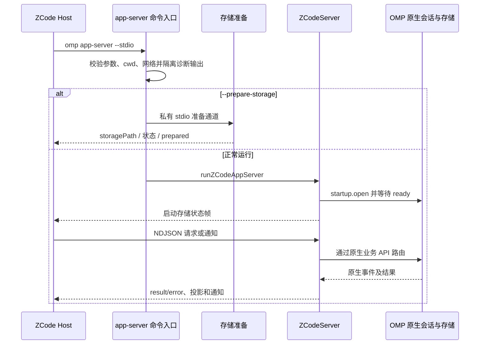

# ZCode app-server 协议与运行所有权

ZCode 适配器位于 `packages/coding-agent/src/modes/zcode/`，是协议边界而不是另一套 Agent runtime。它把 ZCode 请求映射到 OMP 原生 `AgentSession`、journal、队列和命令服务；协议层拥有会话映射、命令裁决及投影，不拥有模型执行或第二条待执行队列。会话概念可参阅[会话模型](../concepts/sessions.md)。

## 三种基线不能混淆

- **固定 ZCode 兼容基线**是协议兼容合同：外层 ZCode Protocol 为 `1`，V4 wire 为 `3`，projection snapshot schema 为 `1`。这些数字各属 ZCode 协议版本，V4 的 `3` 不是 OMP 上游独立 RPC v3。固定兼容提交是 `c7c190724f3a00a2de998a0a5511201d5a2ba1a0`，不是浮动分支；字段、信封、方法和恢复语义以固定基线的 schema/规格及真实消费者为准。
- **OMP 上游基线**是 OMP 自身 Agent、session、存储和业务 API。ZCode 目录直接调用这些所有者，不通过内部 RPC，也不应把私有协议桥接逻辑散入核心。
- **独立 RPC**指 OMP 自有的 `type: "response"` 等协议形态；不能拿它替代 ZCode NDJSON `method` 请求和 `result`/`error` 响应。也不增加 MCP 式 `initialize`、`initialized`、`shutdown`、`exit` wire 方法。V4 hello/clientHello 是 Host attachment 握手，不是 stdio 初始化。

规格中列出的固定仓库参考路径是开发基线说明，不是运行时依赖。OMP 实现代码及测试用于判断当前实际行为；规格中的 MUST 是合同要求，不应被写成“已经验收”的证据。

## 入口与启动顺序

`runAppServerCommand` 是专用命令入口，只接受 `--stdio`，可指定 `--cwd`（绝对且已存在目录）、`--surface desktop` 和 `--prepare-storage`。入口校验 cwd、消费 Host 网络代理/CA 配置，并把 `console.log/info/debug` 转到 stderr，避免诊断污染 stdout。普通启动进入 `runZCodeAppServer`；准备存储则由独立短生命周期通道运行 `prepareZCodeStorage`，不创建会话或启动模型。

*启动图展示准备进程与正常服务进程的分离，以及正常运行时协议与原生会话之间的控制流。*

准备通道先声明实际存储路径并等待 Host 确认，再检查/初始化实际资源；完成并关闭准备资源后才报告 `storagePrepared`。失败、EOF、取消或存储错误不能报告 ready。正常进程重新打开自己的运行存储并产生新运行代次的 ready，不重放准备进程 ready。该顺序避免把空成功或无用途的数据库文件冒充准备完成。

正常入口以 LF 分帧解析 NDJSON，单帧与输入缓冲上限为 1 MiB，在途请求上限为 256；输出队列有 16 MiB pending 容量，按序写帧，但业务 dispatch 不因写队列而串行化。输入块超限、帧超限、非法 UTF-8/JSON、未终结 EOF 帧及传输错误属于传输失败；可解析的有 ID 请求则以协议 `error` 返回。非法 envelope 为 `-32600`，未知数字码外的校验/业务异常默认 `-32602`；字符串业务码置于数字 `-32000` 的 `error.data.code`，保留业务 data。通知没有响应 ID，执行错误记 stderr，不伪造响应。反向 Host 请求设有容量 256 和 30 秒超时，取消返回 `-32800`。

## 多会话与生命周期

一个 app-server 进程可管理多个显式 sessionId，每会话有独立原生运行实例和上下文；请求、cwd、模型、权限、交互、子代理与事件必须按目标会话路由，不可用进程级“当前会话”或 `process.chdir()`。并发打开同一会话共享 `#attaching` 中的 opening，避免重复创建运行时/争抢租约。跨进程写入同一 journal 由原生所有权租约约束。

停止某会话调用该会话的原生停止能力，不等于关闭实例或进程。关闭会话才清除所属监听、投影、交互和租约；订阅/attachment 断开只是释放观察资源。stdin EOF、信号或 owner 消失会 abort 本进程工作并 dispose 所有自有运行时。协议等待取消本身不自动取消业务，业务取消必须调用原生目标会话 API。

## 命令幂等与事实持久化

`ZCodeCommandLedger` 将 `(sessionId, commandId)` 作为键，对命令类型、payload、`baseRevision`、`baseLogEpoch` 的规范序列化计算 fingerprint。执行开始先同步安装在途 reservation，使并发重复请求共享裁决；同 key 不同 fingerprint 拒绝。结果回执及创建/派生 session 的 produced fact 写入原生 session journal，而非独立待执行队列或第二个真值库。创建/派生结果写在新目标 journal，并记录来源 key 与 journal 身份，避免 fork 复制的父回执被误认作 child 自己的事实。

已接受副作用若在持久回执写入时出错，不能把错误转成允许重放副作用；同进程失败 reservation 保留以防重复执行。冷查询从已有 journal 只读回源，不 `resume()`、不构造运行时、不取得写租约。可重建索引只加速 journal 事实查找；范围未被完整证明、读取失败或损坏时不能宣称 `unknown`，更不能放行重复副作用。历史回填在 ready 后后台启动，不阻塞服务 ready；普通查询需按当前可靠覆盖范围回源。

## 投影、冷历史与恢复

`ZCodeProjection` 是会话 journal/事件的派生视图，不是正文事实所有者。活动会话由原生事件增量更新；历史读取可从持久条目只读重建。投影过滤 reset boundary 前的可见内容，依据稳定实体维持 rowId，映射消息、工具、队列、状态和附件等 ZCode 结构。snapshot、seq、logEpoch 与 revision 属于协议同步语义，不能拿 journal entry cursor 或进程输入序号冒充。

server 为冷投影设置容量上限 16；活动订阅投影不按空闲缓存淘汰，最后订阅消失后重新纳入容量约束。淘汰投影只释放观察资源，不关闭或取消原生会话。重新打开冷历史应只读重建，不启动模型、恢复工具或抢写租约；缺失/损坏历史必须如实报错，不能伪造空历史。新的投影序列不能接在旧 logEpoch 上，客户端应按快照恢复不可回放游标。

## 权限与扩展边界

权限交互由目标会话的原生交互宿主处理；app-server 将请求/回答关联到会话，并跟踪连接对 root session 的审批所有权。仅取消视图订阅不释放权限所有权，真实断连或会话关闭才清理。`--surface desktop` 选择桌面交互上下文，不意味着自动批准，也不进入 TUI、ANSI/PTY 或终端 stdin 提问。

固定基线之外的 OMP 能力通过明确 capability 宣告和既有 ZCode 信封扩展，例如 profiles、Tan、Team、indexes、skill management、spec-driven；客户端仅在 capability 为真时开放相应入口。新增能力应复用既有查询、选择、interaction、分页及错误样式，不随意另造平行协议。桌面/远端投递和恢复边界仍由原协议合同限定；更多关联见[离线模型与数据边界](./models-offline.md)、[索引工作流](../workflows/indexing.md)及[编排工作流](../workflows/orchestration.md)。

## 重点验证

`packages/coding-agent/test/modes` 中针对性测试覆盖 `zcode-core-protocol.e2e.ts` 的端到端协议、`zcode-command-ledger.test.ts` 的重复/持久回执、`zcode-projection.test.ts` 的投影与恢复、`zcode-sessions.test.ts` 的会话生命周期、`zcode-storage.test.ts` 的存储启动，以及 `zcode-permissions.e2e.ts` 的权限交互。规格是更广的合同清单；这些测试能证明其覆盖的实现路径，不等同于规格中所有要求均已验收。
