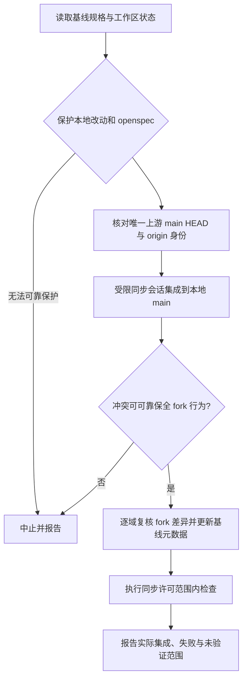

# 上游同步与 fork 维护

本页面向维护者和执行维护任务的 Agent，说明 fork 如何承接上游而不丢失本地需求，以及同步、验证与发布之间的边界。关键原则是：**以唯一完整的上游提交作为比较基线；ZCode 兼容提交属于本地 fork 变更，不是上游基线。** 规格描述期望状态和验收目标，只有源码、Git 状态或本轮验证报告才能证明实际行为。

## 需求与变更归属

本仓库是 `jchanghong023/oh-my-pi` 个人 fork。已批准的 `openspec/specs/` 是需求权威；`openspec/changes/` 只承载尚未批准的提案和增量。`docs-zh-CN/` 是 fork 指南、工程背景和历史记录，不是第二份需求目录，也不应重新变成上游文档翻译。实现发生变化但需求未变时，不要为了描述实现而制造需求变更；已批准目标尚未实现，也不能据代码现状删掉。

维护差异时优先将 fork 代码接入上游现有文件和执行链路，保持差异小、集中、内聚；不要为规避冲突另建平行实现，或添加推测性抽象、兼容层及无关重构。需求实现和入口变化需要同步维护根及适用子级 `AGENTS.md`；根文件登记有效子级规则文件。

ZCode 兼容提交是一个明确的本地差异类别。验证或审查时，不得把它混入“相对上游新增多少提交”所采用的完整上游基线，也不能据提交数量推断功能归属。按差异的需求/规格、提交内容及调用路径逐项判断其是否为 fork 自有行为；对指定行为恢复上游语义时，只处理明确点名范围，不整体回滚文件或包，也不破坏其他已批准 fork 功能。

## 唯一上游基线

基线规格 `openspec/specs/fork-upstream-baseline/spec.md` 记录最近一次成功集成的上游 `main`：完整 SHA、UTC 同步日期，以及该目标提交中 `packages/coding-agent/package.json` 的版本。当前记录为：

- 上游：`can1357/oh-my-pi@main`
- 版本：`v18.14.2`
- 完整提交：`62f4f7cccfd38adde9a2ae203d69b27bc187a84f`
- 同步日期：`2026-10-31`（UTC）

这些是仓库规格中记录的基线元数据，不代表当前工作区已通过功能验收。执行维护时应重新检查该规格与 Git 历史：有效的唯一 `Upstream commit` 必须是本地 `main` 的祖先；不能用 tag、Release、其他分支、远端跟踪引用或 ZCode 提交替代。同步成功后在同一提交更新版本、SHA、日期，并只保留一条版本记录，不追加历史基线或并行清单。

## 同步流程与安全边界

同步来源固定为 `https://github.com/can1357/oh-my-pi.git` 的 `refs/heads/main` HEAD；集成分支是本地 `main`，`origin` 的有效 fetch/push 身份均为 `jchanghong023/oh-my-pi`。不接受上游历史改写。同步前保护本地改动和整个 `openspec/`，确认基线提交有效且为 `main` 祖先。

若同步需要本地提交或冲突重建，必须通过已部署的受限同步脚本会话执行 Git 写操作；不能在外部 Agent 命令绕过检查。授权只覆盖必要本地集成，不含 push。同步提交格式为 `sync(upstream): merge main@<目标前12位>`，命令级禁用 hooks 和签名，不改全局 Git 配置。整个过程只集成本地 `main`，不推送分支或标签。无法可靠保留 fork 功能时中止，不重置仓库或丢弃无关改动。

集成后按功能域检查哪些 fork 差异仍必要；上游已有等价能力时，按批准需求删除相应本地需求及差异说明。仍须保留根 `AGENTS.md` 的 fork 引用、整个 `openspec/`、`docs-zh-CN/quick-start-intranet.md` 和根 `README.md` 中的 fork 约定；根 README 的上游正文则随基线更新。README 更新时以 `docs-zh-CN/README.upstream.md` 英文快照对照上游正文：上游正文未变不动；Install/下载段保留 fork release、安装器、`+fork.N` 与平台声明，其余正文不混入 fork 内容。

## 同步检查与功能验收不是一回事

同步检查的授权非常有限：做 staged Git 检查和必要语义审查，必要时最多一次 `bun run check:tools`。缺依赖时唯一允许安装命令为 `bun install --frozen-lockfile --ignore-scripts`。首轮失败只修复本次相关问题，并对失败项复验一次；仍失败就停止，不提交。同步流程不得借机运行编译、类型检查、测试、UI/browser/heavy、Docker、benchmark、打包、发布、Rust/native 检查构建，或 `fastcheck`、`fulltest`、`slowtest`。

若冲突重建需要 UT 和真实入口 E2E 才能确认行为，而没有额外验证授权，应中止并报告未验证，不得把未经验证的重建称为同步完成。同步成功的含义是上游提交已安全集成并更新基线元数据，不等于全部 fork 功能验收通过。

独立验证按风险选择最小充分集合：局部逻辑用 UT，跨模块或公开入口行为用集成/E2E，并覆盖关键成功与失败路径。纯文档变更只核对内容、差异和链接。静态检查、编译、模拟或历史缓存不能证明未实际运行的边界。报告应分别注明已实现、已验证通过、失败、排除和未验证；平台跳过、缺工具、未运行或缓存命中都不能写成新执行通过。

`fastcheck`、`fulltest`、`slowtest` 是不同授权和范围的门禁：fastcheck 不跑测试；fulltest/slowtest 需本任务明确授权。门禁默认围绕 fork 自有功能，按变更选测并可能回退到完整 fork 范围，受时间预算、源码快照和失败汇总规则约束；affected 选测不是全量回归证明。详见[验证与门禁](../testing/verification.md)及 `openspec/specs/fork-verification-gates/spec.md`。测试报告仅对其实际源码快照、平台和范围有效。

## Git 钩子与协作责任

OMP fork 禁用所有 Git hooks，不让提交或推送自动运行检查。既有 checkout 删除钩子文件，并仅在本仓库设置 `git config --local core.hooksPath /dev/null`；不得改用户全局配置，也不得恢复安装钩子步骤。检查由任务明确授权后显式运行。

协作贡献仍应保持单一逻辑范围。上游 `CONTRIBUTING.md` 对公开 PR 还要求贡献者理解并审查所有变更、运行相关检查并实际操作验证改动行为；PR 正文至少包含一条本人撰写的变更说明。该上游贡献流程不替代 fork 内部的 OpenSpec 需求权威或本仓库验证授权规则。

## 发布核验

发布前应分别核对版本元数据、二进制与浏览器扩展构建是否成功，以及本次发布声明所依据的基线 SHA。基线只是状态记录，不是验收凭证；发布工作流不因同步或本页要求而自动触发测试，门禁也不授权 push、CI/远端发布、部署或发布操作。实际发布需独立授权。发布说明不能把未执行测试、仅 affected 覆盖、平台跳过或历史测试结果表述为本轮通过。

fork 自有指南和文档变化归 `docs-zh-CN/`；维护或 review 不恢复上游文档翻译。根 README 保持上游中文版职责及必要的 fork 安装约定。这样可使 fork 文档、需求规格和上游正文各有清晰归属。

## 维护时快速核对

1. 阅读相关规格和适用提案，不把文档当作第二份需求源。
2. 以完整 `Upstream commit` 比较上游；将 ZCode 兼容提交单独识别为 fork 差异。
3. 同步前保护工作区与 `openspec/`，只从规定上游 `main` 集成到本地 `main`。
4. 逐项复核差异、更新唯一基线元数据，并保留规定的 fork 文件和规则。
5. 把同步允许的检查与功能验证分开，按授权运行并报告真实范围。
6. 发布时分别核对构建/版本状态与测试证据；不将规格目标或基线存在误写为验收通过。

参阅：[配置维护](configuration.md)、[快速开始](../quickstart.md)、[验证与门禁](../testing/verification.md)。
