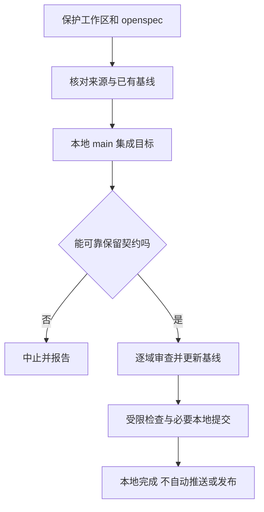

# Fork 上游同步与资源交付

## 先区分状态、需求和证据

[已批准规格](../../openspec/specs/fork-maintenance/spec.md)是需求权威；`openspec/changes/` 是待批准提案，不能当成已批准或已实现行为。`docs-zh-CN/` 是使用说明和工程线索，不是第二份需求基线。修改前按功能域读取规格及适用提案：需求改变才同步规格，不因实现尚缺就删掉批准目标。正确性依靠可复现自动化，而非要求用户人工回归。

[当前集成基线](../../openspec/specs/fork-upstream-baseline/spec.md)记录 `can1357/oh-my-pi@main` 的 `v18.14.2`、完整提交 `62f4f7cccfd38adde9a2ae203d69b27bc187a84f` 和 UTC 日期 `2026-10-31`。它是最近成功集成目标的状态元数据，不是全部 fork 工作或个人贡献清单，也不是功能验收结果。规格要求该提交是本地 `main` 祖先；此处没有读取 Git 历史，不能独立证明祖先关系。

### 差异归类：不要把线索当成上游对照结果

- **已证实的 fork 差异**：仓库规则明确采用 fork 专属发布和更新渠道、offline 与统一数据根，以及删除源码安装入口；工作流和构建脚本也直接体现 fork 版本和发行选择。这是相对产品契约而言已明确保留的差异，不是本页自行计算的完整上游 diff。
- **重点沿用**：尽量接入上游现有文件和执行链，保持差异小而内聚，不为避免冲突建立平行实现。指定的 HTML 导出、扩展参数校验等行为有恢复上游语义的批准范围，但不能因此回滚整个文件或删除其他已批准能力。
- **已贡献上游**：本次仓库内资料不足以确认具体贡献及其作者，不列举或推断。上游等价实现被确认后，维护规则要求删除重复本地需求和差异说明；这不等于证明由本 fork 贡献。
- **归属未确认**：[工程现状线索](../../docs-zh-CN/fork-engineering-notes.md)列出进程管道、Windows native 等散点修复，明确要求核对使用场景；例如 `ptree` 的超时回归测试可供定位，但不能仅凭线索判定上游现状或永久保留义务。

## 同步是受限的本地集成

图：批准的同步流程将功能保全和有限检查放在本地集成边界内。

1. 唯一来源是 `https://github.com/can1357/oh-my-pi.git` 的 `refs/heads/main` HEAD，而非 tag、Release 或其他跟踪引用；不得接受上游历史改写。集成分支为本地 `main`，`origin` 的 fetch/push 身份均应是 `jchanghong023/oh-my-pi`。保护本地改动和整个 `openspec/`，核对既有基线完整且为祖先。
2. 合并后逐域核对 fork 契约，保留根 `AGENTS.md` 的 fork 引用、`openspec/`、内网快速指南和 README 的 fork 约定；不能可靠保留时中止，不得整仓重置或丢弃无关修改。成功集成时同一提交更新上游 SHA、UTC 日期和目标包版本，基线节只留唯一版本行。
3. Git 写操作经已部署的受限同步脚本会话；必要提交格式为 `sync(upstream): merge main@<目标前12位>`，仅命令级禁用 hooks 和签名，不改全局配置。同步授权不含 push 或发布。项目规则要求钩子持续禁用，现有 checkout 使用本地 `core.hooksPath /dev/null`，验证须显式执行。
4. 同步检查仅做 staged Git 检查和必要语义审查，必要时最多一次 `bun run check:tools`；缺依赖只允许 `bun install --frozen-lockfile --ignore-scripts`。首轮失败只修本次问题并复验失败项一次，仍失败即中止。不在该授权下运行构建、类型检查、测试、打包或 Rust/native 检查。冲突重建若需要 UT 和真实入口 E2E，未获额外验证授权就中止并报告未验证。

## 保护运行契约，而非保留所有历史补丁

主要使用入口为原生终端 TUI，以本 fork OMP 为 Agent 核心；零配置是目标，不消除模型服务和认证前提。验收须从真实入口完成消息、模型和工具链；公司 offline 场景还需无公网。详见[系统概览](../architecture/system-map.md)和[内网与离线运行](intranet-offline.md)。

同步审查尤其要保护：`OMP_OFFLINE` 的进程级临时覆盖与本地资源、`OMP_CONFIG_ROOT` 和 profile 数据隔离、Windows 安装及更新、工具取消和持久化等已批准契约。offline 不是无需模型服务，配置覆盖也不应写回用户文件。规格同时限定指定行为恢复上游语义；若恢复与其他批准契约冲突，应报告并取得用户决定，而不是静默扩大回滚。

## 资源所有权与构建链

`vendor/openwiki` 是指向 OpenWiki fork 的子模块，正式发行由父仓库 gitlink 固定，而不是 URL、浮动分支或独立包版本。OpenWiki 的知识核心、Agent 和编排在该 fork 维护；OMP 保留宿主接线及构建规则，不复制第二套实现。CI 递归 checkout 后比对 gitlink 并检查必要入口；本地资源构建则有意使用当前子模块工作区，包括未提交修改，不能把它冒充固定提交的正式发行物。更多接入边界见 [OpenWiki 生成](../integrations/openwiki-generation.md)。

本地 `packages/coding-agent/scripts/build-binary.ts` 与发布脚本 `scripts/ci-release-build-binaries.ts` 共用 `compileCodingAgent`：生成或检查 stats 与导出 viewer，编译 CLI 并在 `finally` 恢复 stats 生成占位文件。编译器嵌入目标 native、文档索引、OpenWiki skills 和可视化资源，并用插件装入 spec-driven 归档。发布脚本目标表比实际 CI 矩阵宽；表中存在某平台不代表该平台有 fork Release。

OpenWiki 资源生成从当前 vendor 读取 skills、构建浏览器脚本，并纳入图、Markdown、净化器、Mermaid 及许可证；生成前后指纹不一致则失败，JSON 通过临时文件与 rename 发布。子模块缺失时 `--if-present` 删除旧视觉资源并警告，避免旧缓存冒充当前输入。spec-driven 归档则直接打包已检入的 vendor 树及其依赖，不在打包时联网安装；排序和归一化归档元数据用于稳定缓存键。生成物不是第二份可维护源码。相关资源机制见 [Skills 与规格资源](../integrations/skills-and-spec-resources.md)。

## 发布与安装边界

[CI 工作流](../../.github/workflows/ci.yml)只接受手动派发，默认 `publish_release=false`，同 ref 排队且不取消正在运行的任务，默认权限 `contents: read`。它从基线节的唯一版本行和工作流 `run_number` 生成 `vX.Y.Z+fork.N`；版本行缺失、重复或格式不符会失败。因此不要重命名或重建工作流文件而重置计数。只有显式选择发布且在 `main`，元数据、所有二进制和浏览器扩展成功后，发布 job 才取得 `contents: write`。构建不运行测试，也不构成功能验收。

CI 的发行矩阵仅为 Linux glibc x64 和 Windows x64，上传两个二进制及浏览器扩展；不发布 npm或 Homebrew 产物。安装器只安装 fork Release 二进制，不恢复上游源码安装。Windows 支持系统自带 PowerShell 5.1；替换前验证下载，失败保护旧安装或保留已验证产物。Linux 原子替换不终止旧会话；Windows 优先重命名旧映像，只有失败时才按精确映像路径强杀回退。安装器默认放宽 TLS 验证，版本检查不等同端点身份认证，应在受控环境评估风险。开发 setup 不等同发行安装：`scripts/setup.ts` 顺序安装依赖、构建 native、链接 coding-agent 和 `omp`，Windows 链接失败可回退复制。

## 验证入口与证据边界

资源变更可从 `packages/coding-agent/test/spec-driven/resources.test.ts` 的完整资源树和隔离消费者检查，以及 `packages/coding-agent/test/cli/openwiki-generation.test.ts` 等真实 CLI 用例定位；进程管道线索可查 `packages/utils/test/ptree-timeout.test.ts`。涉及二进制还需在授权后检查目标平台、内嵌资源和干净环境的真实入口，不能用开发机缓存证明发行物完整。门禁范围、授权和报告解释见[验证门禁](../testing/verification-gates.md)。上述测试是入口，不表示本次运行或通过；同步限制与另行授权的功能验收不可混为一谈。
