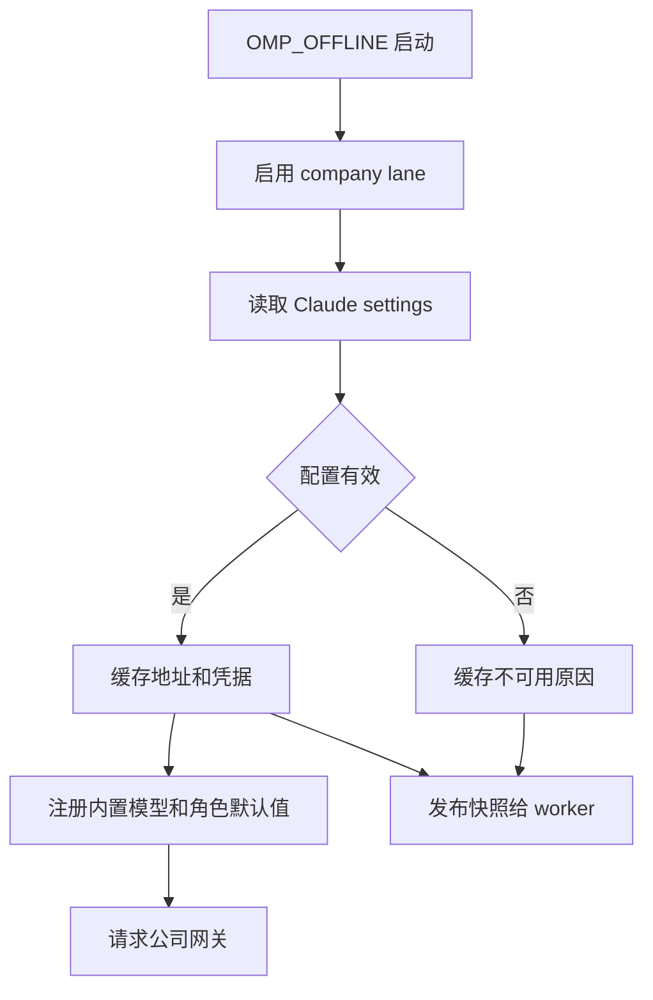

# 公司内网与离线运行

`OMP_OFFLINE` 是面向无公网环境的**进程运行策略，不是网络沙箱，也不是本地推理开关**。公司模型、显式选择的其他模型、OAuth、MCP 或其他远端服务仍可能需要网络和认证；shell 等通用能力也不受网络隔离。应由部署环境另行执行公网访问控制，不要把设置环境变量当成防火墙。

## 启动与策略边界

在启动 OMP 及其子进程前设置 `OMP_OFFLINE=1`。也接受忽略大小写和首尾空白的 `true`、`yes`、`on`；其他值不启用。没有 `--offline` 参数。内网使用者可先按公司流程执行 `ma dmas_ide` 和 `ide agent`，使 IDE 与模型代理就绪，再启动 OMP。

- 启动时临时关闭 `web_search.enabled`、`browser.enabled`、`astEdit.enabled`、`fetch.enabled`，并告知模型不要访问公网；这些覆盖不写入持久配置。bash、Eval、本地文件、Git 和按配置启用的 LSP 等仍可用。
- 自动版本检查、插件市场自动检查与更新、启动更新日志和在线模型目录发现被跳过。手动刷新、selector 未命中、会话恢复及 task 子代理的目录发现也只用内置数据和缓存；缓存缺失可能使模型不可解析，而不是去公网补齐。显式更新命令、实际模型和 OAuth 请求不因此被禁止。
- `omp models` 用缓存目录列出模型，`omp bench` 则会真正请求所选模型；前者成功不证明网关可达。`omp read` 的本地文件读取和 `omp render` 不要求公司认证，但图片问答需要所选 vision 模型。显式选择的非 company 模型仍按其配置请求。
- 离线统一 logger 只保留 ERROR，优先于 `OMP_LOG_LEVEL`；界面提示和命令错误仍可出现。缺少 INFO/WARN 不代表没有发生初始化或降级。

`OMP_CONFIG_ROOT` 可用绝对路径（支持 `~`）统一改变 OMP 用户数据根及 profile 布局；相对值被忽略，项目 `.omp/` 不受影响。它不改变 Claude 配置目录，也不由 offline 自动设置。参见[配置与模型](../concepts/configuration-and-models.md)。

## 公司模型和认证快照

图：公司配置在启动时形成成功或失败快照，worker 继承快照而非重新读取文件。

公司 lane 仅在 offline 进程启用。它从 `CLAUDE_CONFIG_DIR` 指定目录（未设置时为 `~/.claude`）的 `settings.json` 读取 `env.ANTHROPIC_BASE_URL` 和 `env.ANTHROPIC_AUTH_TOKEN`，不是从 OMP 的配置根读取。URL 必须是无用户名、密码、查询串和片段的 HTTP(S) 地址；token 不能为空或包含换行。尾部斜杠和末尾 `/v1` 会规范化。无效 JSON、不可读文件或字段错误都会使 provider 不可用，并显示不含凭据的原因。

主线程在启用 lane 时读取一次，成功与失败均缓存；快照通过 worker 线程环境数据传递，worker 不独立读文件。修复配置、换 token 或更改 `CLAUDE_CONFIG_DIR` 后，应重启 OMP 及相关 worker，已有进程不会热重载。token 在配置对象中不可枚举以降低意外序列化风险，但仍存在内存中；不要粘贴 settings、token、认证头或带敏感参数的 URL 到工单和日志。普通启动不读取此快照，也不注册 company；`company` 是保留 provider ID，不能通过 `models.yml` 或扩展替换。

公司聊天模型使用 Anthropic Messages 和 Bearer 认证，只访问配置的网关，不发现或自动回退到厂商公网 API。内置目录包括 `GLM-5.3-public`、`GLM-5.2-public`、`DeepSeek-V4-Flash-public`、`MiniMax-M2.7`、`Qwen3.6-27B-public`、`Qwen3.6-35B-A3B` 和 `Qwen3.8-27B`。offline 进程中聊天模型的 `contextWindow` 覆盖为 200000，`maxTokens` 不变。

配置有效时，仅未配置角色获得进程内默认值：`default`、`plan`、`slow` 为 `company/GLM-5.3-public`；`task`、`vision`、`advisor` 为 `company/Qwen3.8-27B`；`smol`、`tiny`、`commit` 为 `company/Qwen3.6-35B-A3B`。`memory` 仍按原规则解析。已有角色配置（包括显式 `null`）和 CLI 选择优先，也可切换其他模型。

启用 Mnemopi 且未显式配置向量时，公司 lane 可默认使用 `Qwen3-VL-Embedding-2B`，复用快照并请求 OpenAI 兼容的 `/v1/embeddings`；不会自动启用 Mnemopi。显式向量配置和指定通用 API 路由优先，公司 token 不发给显式配置的其他地址。内置检索目录还有 `Qwen3-VL-Reranker-2B`，但当前记忆流程只接文本向量，不接远端 reranker 或图片向量；网关是否支持该接口需在内网验证。

可选的 `ascend` 在普通和 offline 模式都可显式选择，需要 `ASCEND_API_KEY`，不改变默认角色；其固定地址 `http://models.ascend.huawei.com` 是明文 HTTP，凭据和内容在传输中不加密。选择它之前应评估网络信任边界。

## 资源交付与可选能力

无公网部署须预先交付适合平台的 OMP 二进制、所需 native 组件、配置和本地资源，不能假定首次运行能下载缺失文件。OMP 内置 OpenWiki 的图、Markdown 和 Mermaid 浏览资源及静态导出资源旨在随发行提供，不依赖公网 CDN；已有 Wiki 的只读查询和浏览不需要模型凭据，而生成仍需要可达的模型服务。参见 [Wiki 文档索引](../concepts/wiki-document-index.md) 和 [代码索引](../concepts/repo-code-index.md)。

本地 tiny 模型是可选能力，不等同于 company 网关。其 MLX 下载实现会访问配置的 Hugging Face endpoint 列出仓库文件并下载权重，甚至检查完整标记之前也先列目录；不要假定 `OMP_OFFLINE` 会阻断此路径或已有缓存一定消除网络访问。缺资源时应按组织允许的方式提前准备或禁用该能力，而不是在内网临时尝试公网下载。

Linux offline 的 Python Eval 要求 Python 3.11 以上：显式 `python.interpreter` 优先且无效时直接失败；否则先尝试 `/software/public/python/3.11.4/bin/python3.11`，再检查自动候选和 PATH。缺少合适解释器时明确失败，不安装依赖，也不把旧 Python 降级为可用版本。

## 代理、TLS 与排查

主进程在未显式设置时默认 `NODE_TLS_REJECT_UNAUTHORIZED=0` 和 `GIT_SSL_NO_VERIFY=true`，分别放宽 fetch 与继承环境的 Git 子进程证书验证。显式设置 `NODE_TLS_REJECT_UNAUTHORIZED=1`、`GIT_SSL_NO_VERIFY=false` 可恢复对应严格验证；agent 目录 `.env` 先于默认值生效，worker 子进程入口不经过此默认。**宽松默认不验证端点身份，可能使凭据和内容被中间人截获，不是通用安全建议**；应使用可信 CA、严格校验及受控网络。安装器的 Web 请求也默认放宽 TLS，运行时环境设置不应被误认为自动约束安装器。

Windows 主进程全局 fetch 的代理顺序为请求显式代理、标准代理环境变量、当前用户静态系统代理、直连；`NO_PROXY` 和内网绕行适用于系统代理层，其内置绕行清单不约束显式或环境变量代理。系统代理不支持 PAC/WPAD；worker 子进程入口不经过该系统代理链。排障时分别检查目标地址、代理和绕行规则，不要输出包含认证信息的代理 URL。

1. **没有 company 模型**：确认当前进程实际设置了真值 `OMP_OFFLINE`，检查 Claude 配置目录和 JSON 字段，再重启；`omp models` 的 stderr 或交互界面警告可提供安全原因。
2. **能列模型但请求失败**：区分目录缓存与真实请求；检查内网代理服务、网关可达性、token 有效性和 TLS 信任。不要把公司服务故障当成应回退公网的理由。
3. **显式模型找不到**：确认内置目录或当前 profile 的缓存存在；offline 不会为 selector miss 在线发现。检查显式角色及 `--model`，不要假定公司默认覆盖用户配置。
4. **可视化或本地功能缺资源**：核对发行包和导出目录完整性、本机权限与目标平台；OpenWiki 查看成功不证明生成模型可用，tiny 模型缺权重也不等于公司聊天故障。
5. **日志信息不足**：offline 只留 ERROR，查看终端的安全错误摘要并核对配置和服务状态；不要通过提高 `OMP_LOG_LEVEL` 期待恢复 INFO，也不要为排障复制凭据。

行为边界和回归入口可参考 [公司 provider 测试](../../packages/coding-agent/test/company-provider.test.ts)、[离线模型测试](../../packages/coding-agent/test/models-offline-company.test.ts) 与 [离线子命令测试](../../packages/coding-agent/test/offline-subcommands.test.ts)。
