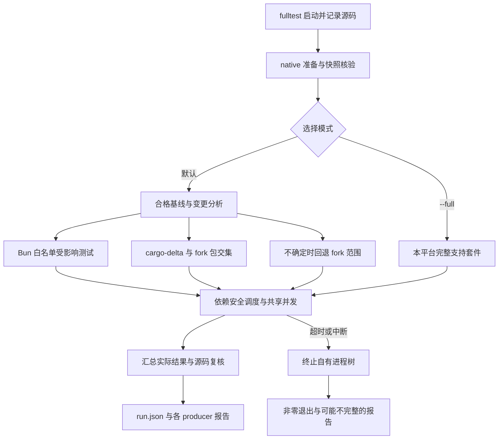

# 验证门禁与行为证据

验证应从改动风险和具体验收场景出发，而不是从命令名称推断覆盖率。本页描述当前实现与[验证规格](../../openspec/specs/fork-verification-gates/spec.md)的合同；**不表示本次运行或通过了任何测试**。纯文档改动通常只需检查内容、差异和链接；不要为了验证文档而运行产品构建或测试。日常操作和授权边界另见[开发生命周期](../workflows/dev-lifecycle.md)与 [fork 维护](../operations/fork-maintenance.md)。

## 选择入口

| 入口 | 实际职责和边界 |
| --- | --- |
| `bun run fastcheck` | TS lint、格式与类型检查，以及 Rust 格式、clippy 等静态检查和必要编译。**不执行任何测试**，包括冒烟或门禁自测。 |
| `bun run fulltest` | 本平台的静态检查、native 准备、fork 功能测试与隔离 dev-TUI PTY 冒烟；默认 Bun 和 Rust 可根据合格基线选受影响范围，不能称为全仓新回归。 |
| `bun run fulltest --full` | 当前平台支持的完整 Bun、Rust workspace、Python 普通套件、Go/Rust SDK 和脚本测试；不采用 fork 白名单或增量选测，但仍排除 `vendor/openwiki` 自身测试、独立授权的桌面输入和其他不适用项。 |
| `bun run slowtest` | 本机默认 fulltest 一次，另在需要且可用时执行 Linux WSL fulltest；不是 `--full` 的别名。无适用 WSL 时仍保留本机验证。 |

`fastcheck` 应在相关改动批次完成且确有需要时运行；`fulltest`、`slowtest` 必须获得本次用户明确运行授权，不能通过内部阶段绕过。三个入口均接受有限正数 `--limit-seconds=<秒>`，只能下调各自上限；后两者还支持仅改变诊断的 `--debug`。非法参数以用法及退出码 2 结束。入口位于根 [package.json](../../package.json)，执行方式及范围由 [fastcheck](../../scripts/fastcheck.ts)、[fulltest](../../scripts/fulltest.ts) 和 [slowtest](../../scripts/slowtest.ts) 定义。

底层 `bun run test` 和 `bun run test:ts` 分别调用 `ci-test-ts.ts local`、`local-ts`；`bun run test:rs` 是完整 fork Rust 范围而非 delta；`bun run test:scripts` 是独立脚本自测。显式底层选测不等于完整门禁。独立 Robomp integration 需要 Python 依赖及 PATH 中的 `omp`，也不因入口存在而自动进入默认门禁。

## 从选测到报告

图：选测、调度、完整性核验与异常退出的关系；普通测试失败不等同于立即取消。

### 选择不是结果缓存

默认 fulltest 只在 fork 白名单内用 Bun 原生 `--changed` 和依赖图选测；没有合格的 clean、完整成功基线，或输入无法安全追踪时，回退完整白名单，而不是整个上游测试集。当前 [source 选择规则](../../scripts/test-gate-source.ts)尤其保守：仅特定 `coding-agent/src/tools` 和 `repo` 下的普通 TS 源码可走受影响选择；构建、配置、fixture 等不确定输入触发完整选择。根 `docs/`、`docs-zh-CN/` 和 `AGENTS.md` 不作为选测变更输入，但仍参与源码完整性核验；包内资源不享有这个排除。间接启动 CLI 的测试应在共享 harness 静态声明真实运行依赖，而不是执行 CLI 主入口来建立依赖图。

Rust 使用预先安装的 `cargo-delta 0.5.0` 与 Git 基线、Cargo metadata 分析受影响包及逆向依赖，再与 `pi-knowledge`、`pi-natives` fork 范围取交集。工具缺失、版本不符、分析失败或无有效基线时回退完整 fork 范围；空交集记录未选，不启动 Cargo。只有选中 `pi-knowledge` 才执行其 doctest；`pi-natives` 为 `cdylib`，没有 doctest。独立 `test:rs` 不使用 delta，`--full` 使用 workspace。见 [delta 实现](../../scripts/test-gate-delta.ts)和 [Rust 运行器](../../scripts/run-rs-task.ts)。

保留 Cargo、Bun 等正常编译和工具缓存；没有整条门禁或测试命令的结果缓存。历史完整计时报告只能提示调度顺序和容量，不能充当本轮执行。动态依赖、环境和外部输入可能漏检，所以 affected 不是完整新回归的证明；重大或跨域变更应适时请求完整回归。

### 快照、并发和失败

fulltest 将脚本、静态检查和测试绑定到同一 post-native source identity：HEAD、受跟踪及非忽略新增文件的内容、类型和模式，以及子模块 gitlink、实际 HEAD 和递归指纹。native 准备阶段仅允许两个已跟踪 bindings 文件 `packages/natives/native/index.js`、`index.d.ts` 的内容变化；准备后重取快照并在结束时核对。源码或工作区完整性破坏是阻断，而不是可忽略的选测变化。缺失子模块 Git 元数据也不能退回父仓冒充子模块。

生成共享文件的 native 阶段先于读取者；Rust 测试等待 Rust 静态检查，TS 检查与普通测试可并行，启动敏感的 TUI/RPC 测试随后运行。测试并发受可用核心、任务数和最多 28 个 worker 的共同限制，Bun chunk 与文件 worker 共享预算，高成本 integration/E2E chunk 最多同时 4 个。调度不改变断言和覆盖。实现见 [fulltest](../../scripts/fulltest.ts)、[调度器](../../scripts/test-gate-scheduler.ts)和 [TS 运行器](../../scripts/ci-test-ts.ts)。

单项检查或测试失败后，独立的必需工作继续；Nextest 和 rustdoc 使用 `--no-fail-fast`。最终汇总失败并保留首个实际失败的原退出码，未启动、阻塞或取消不计通过。超时、中断、参数错误及完整性破坏则可立即终止自有进程树。门禁采用累计单调时钟，实际纯编译区间的并集从非编译预算扣除，混合工作及准备、等待、清理和报告仍计费；重叠不重复扣除。fastcheck 非编译上限 360 秒，fulltest 为 1800 秒，slowtest 为 3000 秒；后两者还有同数值的总墙钟硬上限，包含编译和收尾。嵌套门禁共享外层剩余额度。到限报告 `TIMEOUT` 并非零退出，监督器负责回收本次拥有的后代，不能杀其他工作的进程。

### 如何读报告

公开测试入口在 Git 忽略的 `runs/test-timing/<run-id>/` 写入 `run.json` 和各 producer 可提供的 JUnit XML；记录源码、平台、命令、范围、选择原因、原退出码和完成状态。默认 scope 为 `fulltest: fork feature suites`，`--full` 为 `fulltest: all test suites`。区分实际执行、deselected、not-selected、跳过和未运行；零选择没有虚构 XML 或通过用例。Cargo doctest 没有标准 JUnit，报告 `not-supported`，不要把阶段耗时冒充用例耗时。并行情况下 JUnit 时间之和也不是墙钟时间。控制台主要显示失败及诊断，成功细节保留在结构化报告中；超时或强退可能留下不完整报告，应结合最终状态和进程退出码判断。见 [报告实现](../../scripts/test-reporting.ts)及[运行时](../../scripts/test-gate-runtime.ts)。

## 平台与隔离

当前支持 Windows/Linux x64。Windows 的 slowtest 目标是 **Ubuntu-24.04 WSL2**；不可用或不适用分别报告 `SKIPPED_WSL_UNAVAILABLE`、`SKIPPED_NOT_APPLICABLE`，不能说 Linux 已通过。可用时，Linux 工作区必须是 root 的原生 `/root` 仓库，通过 Git 网络远端获取同一固定 SHA；未提交或未推送的源码、同步/工具/执行失败不能降级为跳过。门禁不替用户 commit、push、安装工具或发行版。两端可并行，单端失败不取消另一端独立工作；Linux XML 留在 WSL 仓库，宿主报告不代表两端 XML 已完整合并。详见 [WSL 阶段](../../scripts/slowtest-wsl-stage.ts)。

测试子进程使用隔离 HOME、应用配置、工作区和本地 provider fixture，不读取个人真实凭据；Cargo/Rustup 正常缓存仍保留。Windows 子进程 PATH 排除 WindowsApps 占位程序，Python fixture 使用 UTF-8。缺少 `tui-test` 或其他必要工具时如实报告，不自动安装或绕过。

## 行为证据与焦点测试地图

| 改动域 | 先找的焦点证据 | 需要扩大时 |
| --- | --- | --- |
| 门禁选择、超时、进程回收、报告 | `scripts/test-gate-delta.test.ts`、`test-gate-runtime.test.ts`、`test-reporting.test.ts` | 对应 `fulltest.test.ts`、`slowtest.test.ts` 和获授权的真实入口；短任务自测不替代真实门禁。 |
| Dev/OpenSpec 编排与资源 | `test/spec-driven/controller.test.ts`、`resources.test.ts` | `process.e2e.test.ts`、资源进程测试及相关 `tui-*.e2e.test.ts`，覆盖真实入口、失败和生命周期。 |
| ZCode 协议、权限、模型配置 | `test/modes/zcode-commands.test.ts`、`zcode-provider-config.test.ts` | 对应 `zcode-process-*.test.ts`、`zcode-permissions.e2e.ts`、`zcode-spec-driven.e2e.ts`；见 [ZCode app-server](../integrations/zcode-app-server.md)。 |
| Knowledge/Repo 索引与 Python symbols | 相关消费者测试及 `pi-knowledge`、`pi-natives` fork Rust 测试 | 跨语言或配置变更还需相应进程和索引回归；见 [Knowledge 文档索引](../concepts/knowledge-document-index.md)。 |
| TUI 输入、状态和焦点 | 相应组件/控制器测试 | 相关 spec-driven TUI PTY 场景和隔离 dev-TUI 冒烟，保留取消、恢复、焦点等不同边界。 |

路径中的 `test/` 指 `packages/coding-agent/test/`。局部 UT 可证明其断言的逻辑；真实子进程覆盖启动和协议，但本地 fixture 不证明真实提供者认证。参考终端或虚拟终端可验证渲染模型，PTY 上实际源码 TUI 可验证终端交互，但都不是共享桌面真实 GUI 输入。真实桌面输入需要另行明确授权，门禁记作 `NOT_RUN_SEPARATE_USER_INSTRUCTION_REQUIRED`；真实模型质量、公司内网与真实认证也需单独授权和证据。

临时真实 TUI 验收使用源码入口 `bun run dev` 和 `tui-test`：首次先执行 `tui-test skill` 并读完整指南，唯一 session 显式指定 cwd、cols、rows，用业务断言而非仅 `wait idle` 判断完成，检查命令和进程退出，最后只关闭自己的 session。需要模型响应时先确认隔离配置、实际模型和请求目标，使用本地模拟模型；失败不回退真实模型。只有明确要求打包产物时才使用已确认的当前产物绝对路径，源码运行不能代替产物验证。
