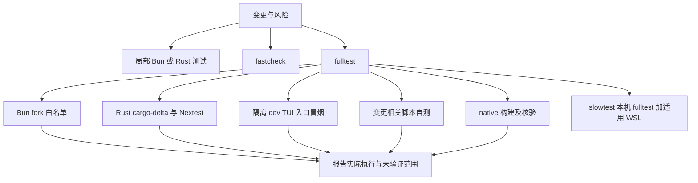

# 测试策略与变更验证

验证的目标不是“跑过一个命令”，而是以与风险相称的证据覆盖修改行为：局部逻辑优先单元测试，跨模块和公开入口问题需要集成或 E2E。模拟、静态检查和编译只能证明其实际覆盖的部分，不能代替真实入口、真实平台或外部服务验收。规格定义的是门禁契约，不是某一轮已经通过的结果；每次报告都应注明实际运行范围、平台、失败和未运行项。

## 从变更选择测试

| 变更风险 | 建议入口 | 能证明什么／不能证明什么 |
| --- | --- | --- |
| 单个函数、状态转换或格式化逻辑 | 对应 Bun 测试文件，例如 `bun test packages/coding-agent/test/modes/...test.ts` | 局部行为及断言覆盖；不证明 CLI 装配或外部服务可用 |
| Bun 包内多个模块或公开 API | 包测试或 `bun run test:ts` | TS 套件所实际运行的行为；`local-ts` 等本地选择可能不是全套 |
| Rust 逻辑、跨 crate 依赖 | `bun run test:rs` | fork Rust 包测试及适用的文档测试；不等于 Rust workspace 全量 |
| fork 核心功能、提交前门禁 | `bun run fulltest`，慢速环境可用 `bun run slowtest` | 按门禁实现执行的本机 fork 范围；默认可能是原生受影响选测，需读报告 |
| 要确认选测外的覆盖 | `bun run fulltest --full` | 规格定义的更广套件选择，但仍受平台、独立授权及工具可用性约束 |
| 用户可见 TUI/CLI 集成 | 隔离配置下使用源码入口 `bun run dev` 与 `tui-test` | 真实公开入口行为；模型需求用本地模拟，不能据此宣称真实 provider 验收 |
| 外部 provider、真实模型、公司内网或真实桌面 | 单独获授权的外部验收 | 仅该实际服务、凭据、网络和场景；本地模拟不构成证明 |

根脚本命令定义见 [`package.json`](../../package.json)，TS 门禁分组和选测机制见 [`scripts/ci-test-ts.ts`](../../scripts/ci-test-ts.ts)。只改文档时按规格只检查内容、差异和链接，不运行产品构建或测试。保留有效 Cargo 增量缓存；不要无理由 `cargo clean` 或删除 `target/`。

### 门禁层次及边界

图示为规格描述的门禁职责关系，不是某次执行记录。`fastcheck` 仅静态检查、类型/格式检查和编译，不运行测试；非编译上限为 360 秒。`fulltest` 包含 fastcheck 工作及规定的 fork Bun、Rust/Nextest、适用 doctest、相关脚本自测、native 与隔离 dev-TUI 入口，墙钟硬上限 1800 秒。`slowtest` 在本机 fulltest 上增加项目需要且现有兼容 WSL 可用时的 Linux fulltest，总墙钟上限 3000 秒；无适用 WSL 时仍保留本机验证。具体规定见 [fork 验证规格](../../openspec/specs/fork-verification-gates/spec.md)。

默认 fulltest 的测试选择可能是增量的：Bun 在 fork 白名单内使用原生 `--changed`；Rust 使用预装的 `cargo-delta` 分析受影响 crate，再与 fork 范围取交集，Nextest 按标准包选择运行，只有 `pi-wiki` 被选中才运行 doctest。缺少合格完整基线、分析工具不可用或结果无法确定时应回退完整 fork 范围；空交集可能意味着本轮没有启动 Cargo。Bun 动态依赖、环境和外部输入可能不在依赖图内，Rust 构建脚本等也可能影响范围，因此受影响选测不等于全量新回归。`bun run fulltest --full` 用于扩大测试范围；仍须如实记录平台跳过、单独授权边界和实际执行项。

`bun run test` 对应本地 TS 门禁模式，`bun run test:ts` 是本地 TS 选择，`bun run test:rs` 是 fork Rust 范围；这些命令不应被误写为 fulltest。Rust workspace 全量测试不是默认 fork 门禁。高成本测试并发、预算和源码快照完整性由门禁管理，不能为求通过而跳过失败、缩短断言或删掉真实边界。

## 离线、持久化、协议与并发回归

离线测试适合隔离确定性逻辑：使用 fixture、临时目录、内存/本地服务替身或本地模拟模型，断言成功结果和关键错误路径。它能检验本地实现，不证明认证、真实网络、provider 行为或线上配置。涉及模型的 TUI 验证应使用隔离配置和本地模拟模型，发消息前确认目标配置；失败时报告阻塞，不回退真实模型。

| 回归面 | 定位入口 | 重点断言 |
| --- | --- | --- |
| 公司/provider 配置和离线逻辑 | [`company-provider.test.ts`](../../packages/coding-agent/test/company-provider.test.ts) | 配置解析与 provider 选择的边界；真实凭据/服务另行验收 |
| Repo 生命周期 | [`repo-lifecycle.test.ts`](../../packages/coding-agent/test/repo-lifecycle.test.ts) | 创建、切换、关闭等生命周期，以及失败后的清理/状态 |
| 本地持久化与失败 | `packages/coding-agent/test/modes/` 下 `*persistence*`、`*storage*`、`*session*` 测试 | 写入、恢复、取消/关闭与错误处理，必要时核对重启后的状态 |
| Spec-driven 工作流 | [`test/spec-driven/`](../../packages/coding-agent/test/spec-driven/) | actor、orchestrator、stage、workspace 等状态推进及资源生命周期 |
| 协议及真实子进程边界 | `packages/coding-agent/test/modes/` 中 `*.e2e.ts` 与 `zcode-*process*` | 请求/响应契约、进程退出、权限和错误状态；不要仅断言“未崩溃” |
| TUI 交互生命周期 | `packages/coding-agent/test/spec-driven/tui-*.e2e.test.ts` | 输入、业务完成断言、关闭/取消和资源回收；不是共享桌面验收 |

查找测试时优先从对应失败断言回到实现和状态所有者，再追踪调用方、持久化介质或进程边界。并发回归应覆盖竞争顺序、取消与清理，避免测试共享临时 HOME、端口、工作区或 provider fixture；规格要求启动敏感的 spec-driven TUI/RPC 场景隔离运行。并发门禁调度受 CPU 和高成本 chunk 限制，测试仍应保持独立可重复。

## 真实入口与外部服务验收

要验证公开 CLI/TUI 的装配，用源码入口 `bun run dev`，不要用内部函数测试冒充入口验收。临时 TUI 交互按规格先调用 CLI 子命令 `tui-test skill` 并阅读指南，以唯一 session 显式指定 cwd、cols、rows；用业务断言判断完成，`wait idle` 不是业务完成证明。确认命令失败与进程退出码，最后仅关闭本次创建的 session。缺少 `tui-test` 时如实报告，不自动安装或另写 PTY/ANSI 驱动。

源码入口结果不能代表 exe 或打包产物；只有用户明确要求时才用核实过的当前构建产物绝对路径。真实 provider/模型认证、公司内网、桌面输入和独立集成入口各自需要适用环境与明确授权。`bun run robomp:test:integration` 需要 Python 依赖及 PATH 中的 `omp`，它不是默认 fork 门禁范围。不得把模拟、未运行、平台跳过或缓存历史记录表述为通过。

## 失败与证据的判读

门禁报告应区分已实现、通过、失败、排除和未运行；失败时比较上游基线，先判断业务缺陷还是测试适配问题。缺工具不自动安装，缺工具导致的阻塞不是通过。单个用例失败时独立测试原则上继续执行并汇总；预算超时、中断、参数错误或源码/工作区完整性破坏等阻断可以终止。

检查 `runs/test-timing/<run-id>/run.json` 及相应 JUnit/Nextest 报告时，核对 scope、源码 revision、平台与架构、实际 producer、选择模式（full/affected）、退出码和报告完成状态。历史耗时不是本轮执行，JUnit 用例时长之和也不是并行墙钟时间。WSL 报告留在 Linux 原生仓库时，宿主 XML 不代表两端完整报告。最终结论应清楚写出“哪些范围在何种环境实际运行”，不能笼统声称全仓全量通过。
