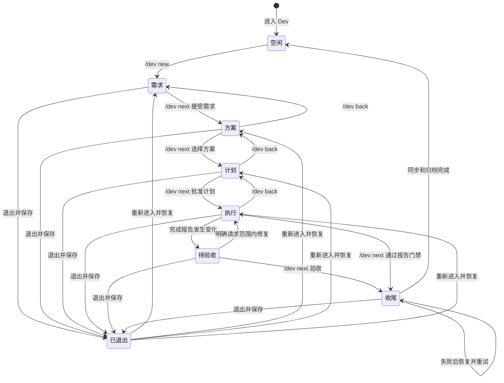

# Dev 四阶段、批准与恢复

Dev 是由工作区控制器协调的规格驱动开发流程，而不是把聊天文本解释成自动审批的任务引擎。四个阶段分别由 `requirements`、`solution`、`planner`、`executor` 原生 Agent 会话承担；阶段切换由用户显式操作，正式材料以工作区真实文件为准。普通回复、模型宣称完成、进入模式都不自动推进。

图：四个实际阶段和用户决策边界；待验收、收尾和退出是生命周期条件，不是额外角色。

## 入口与授权边界

先用 `/dev` 显式进入，再用 `/dev new <需求内容>` 启动；控制器生成 change ID，初始化产物路径并准备需求会话。`/dev next` 在当前阶段读取和验证材料、记录用户原始决定、准备下一角色，持久化后才发起下一阶段模型工作。方案阶段可用 `/dev next <方案ID>`；只有一个候选时可省略 ID，多候选必须明确选择。`/dev back` 只退一阶段，撤销目标阶段及其之后的批准，不自动运行模型。`/dev config` 的 Team 设置只可在空闲或需求阶段修改。

进入 Dev、接受需求、批准计划、验收软件及 Git 或发布授权是不同决定。批准计划才进入业务执行；执行报告后的 `/dev next` 是用户验收并触发规格收尾，不等于授权提交、推送或发布。报告允许披露失败、未验证和未完成项，结构通过也不证明软件正确。

Team 仅在**进入方案阶段**且配置启用时实际运行；讨论须完成并产生可采用候选。方案文件中的 Team 候选必须保留本轮可采用候选 ID 和完整 proposal，来源无法从原生阶段历史确证时阻止采用，不能静默降级成单人方案。后续聊天不会重复启动 Team。执行角色可使用 Goal 能力，但 Dev 本身不会自动启动 Goal。参见 [Team 讨论](team-discussion.md) 和 [Goal 自动驾驶](goal-autopilot.md)。

## 正式材料与门禁

| 阶段所有者 | 正式输出与进入下一阶段的检查 |
| --- | --- |
| 需求 Agent | `openspec/changes/<changeId>/proposal.md` 和 `specs/**/spec.md`，至少一个原生规格；执行 OpenSpec 严格 change 校验。若发现唯一的外部 Markdown 需求权威目录，其文件也纳入材料；多个候选目录视为歧义而失败。 |
| 方案 Agent | 默认计划路径派生的 `-solutions.json`；必须为有效 JSON，有非空且 ID 唯一的候选、标题和内容，以及指向候选的 `recommendedCandidateId`。推荐不代替用户选择。 |
| 计划 Agent | `docs/superpowers/plans/<日期>-<changeId>.md`，必须存在且非空；计划批准才交给执行者。 |
| 执行 Agent | 同目录 `-completion.md`；验收时要求 `# 完成报告` 及非空的 `## 完成情况`、`## 验证结果`、`## 未完成项`。 |

路径可由已保存运行覆盖。交接包括真实文件完整内容、版本、原始请求和已有用户决定的原文，以及选择的候选；这些材料是任务数据，不是新授权。控制器保存的是文件路径和 SHA-256 版本，不是文件正文。每次推进和验收检查既有批准字节；需求集中新文件、缺失或变化也会使批准失效。读取时再次比对批准版本以覆盖检查与读取之间的竞争。失效时允许只读诊断，但写入和推进受阻，应回退到相应阶段重新确认。

初始化新 change 前，`assertDevSpecSchema` 要求 `omp-spec` 解析到随包提供的实际 schema 目录且来源为 `package`；项目或用户同名覆盖会被拒绝，而不是悄悄换工作流。需求阶段使用该 schema 的原生 OpenSpec instructions。资源提取按清单校验摘要；这保护来源而不证明产物语义正确。写入路径还检查工作区包含关系并拒绝阶段输出路径上的符号链接和硬链接别名。详见 [技能与规格资源](../integrations/skills-and-spec-resources.md)。

## 原生会话、工具和并发

每个角色是独立的 SDK `AgentSession` 和原生历史，继承项目硬约束；阶段进入用隐藏的 `dev-stage-context` 传完整交接，平时用户文本进入当前会话。忙时输入使用原生 follow-up 队列及随输入携带的只读限制，不另建 Dev 队列。阶段控制操作必须等待会话、已接收输入和异步任务结清；准备下一会话或持久化失败时不应发布未提交的切换，模型调用在提交后失败则保留已保存的目标阶段以便恢复。

执行前的角色工具白名单是 `read`、`grep`、`glob`、`write`、`edit`、`task`，需求和方案额外有 `knowledge_search`。写入仅限各自指定正式输出；`task` 只能派无额外工具、无 worktree 的只读 `scout`。前置角色禁用环境扩展发现、MCP、LSP 和 IRC。执行者可继承宿主允许的执行能力与技能，但 Dev 协作仍禁止创建 worktree，且宿主工具限制仍生效。参见 [会话运行时](../architecture/session-runtime.md) 和 [工具与执行](../architecture/tools-and-execution.md)。

完成报告实际发生变化后进入待验收并暂停运行中的 Goal；一般讨论保持只读。只有可识别的明确修复或继续实施已批准计划的请求才打开范围内修复；提问、解释请求、普通同意或禁止修改不构成授权。修复开始使旧报告失效，执行者必须实际更新报告才能再次验收。已验收后的收尾修复不能改动已验收材料或派发业务任务；工具执行后仍复查版本。

## 持久化、停止与恢复

`DevWorkspace` 对 Git 根目录（否则当前目录）持有独占租约，原子写入 `.omp/dev/state.json`。其中保存 Team 配置、run ID、阶段、路径、各阶段批准及原文、会话引用、待验收标记和收尾进度；原生会话正文由 `.omp/dev/sessions/<runId>` 下的会话文件拥有，正式材料正文仍属于工作区文件。损坏或不符合结构的状态会被清除并提示，I/O 错误则不当作坏状态静默清除。

退出会中止运行、递增 generation、清空队列并等待角色及后代异步工作实际结清，保存状态后释放租约；取消未结清时拒绝后续控制，须重试退出或丢弃。重新进入恢复保存的阶段和会话，不自动重跑模型或把恢复当作新批准；批准版本不匹配会保留决定并显示阻塞。原生历史缺失或损坏时，恢复上下文明确说明不记得缺失对话，只提供当前真实文件和保存的批准，仍须在 `next` 经过结构门禁。`/dev drop` 丢弃跟踪和配置，不删除正式产物或原生会话，也不撤销已经发生的同步或归档。

验收先持久化全部正式材料的版本和原始决定，再调用原生 `openspec archive`，由其负责规格同步、验证及归档。进度和实际副作用被记录；失败后重试只继续剩余收尾，且再次检查已验收字节。可根据版本寻找唯一已完成归档，无法唯一识别则阻塞；清理遗留路径须先明确处理。同步、归档或未恢复的实际副作用发生后禁止回退，持久化失败也不能假装外部副作用已回滚。

ZCode 的桥接层观察控制器并在 `.omp/spec-sessions/<runId>/zcode.json` 保存查询索引和版本身份，不拥有材料正文。冷查询不创建或恢复控制器；历史视图只读，文件版本不再匹配时不能从索引恢复旧正文。实时操作绑定 run、generation、phase 和材料摘要，过期绑定被拒绝。参见 [ZCode App Server](../integrations/zcode-app-server.md)。

## 验证范围

[编排测试](../../packages/coding-agent/test/spec-driven/orchestrator.test.ts) 覆盖显式四次推进、原文交接、竞争版本、回退、修复与收尾恢复；[runtime 测试](../../packages/coding-agent/test/spec-driven/runtime.test.ts) 和 [原生界面测试](../../packages/coding-agent/test/spec-driven/native-surface.test.ts) 覆盖相应运行时及界面行为。这些测试和规格描述的是可观察边界，不应仅凭文件存在或校验成功推断实现、模型输出或业务验收正确；实际模型、宿主工具、并发取消及外部 OpenSpec 副作用仍需在目标宿主中验证。
