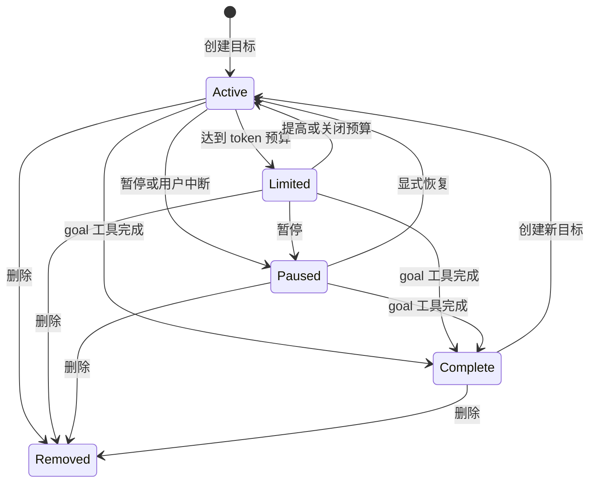

# Goal 自动推进与预算

Goal 是当前会话中的持续目标和续跑控制，不是另一个工作流阶段。`AgentSession` 持有目标状态并将事件交给 `GoalRuntime`；交互界面和 RPC 宿主负责命令、工具集合与各自的续跑调度。跨会话机制见[会话运行时](../architecture/session-runtime.md)，配置体系见[配置与模型](../concepts/configuration-and-models.md)。

## 入口与配置

`/goal <目标>` 或 `/goal set <目标>` 创建目标；`show`、`pause`、`resume`、`drop` 和 `budget <N|off>` 管理当前目标。`/goal-autopilot` 提供同样的命令形式，但创建或替换时设置 `autoOrchestrate` 标记。管理命令保留已有目标的标记：例如，用 `/goal-autopilot resume` 不会把普通目标转换成无人值守目标。目标正文不能为空，token 预算若指定必须是正整数。创建不能覆盖尚未结束的已有目标；替换需要当前目标处于启用的计量状态。宿主的删除确认等交互仍然有效。

`goal.enabled` 默认开启会话级 Goal 功能及隐藏 `goal` 工具，不意味着已经创建目标；`goal.statusInFooter` 默认显示预算。`goal.continuationModes` 默认仅含 `interactive`，如需 headless 宿主自动续跑须加入 `rpc`。开启功能、保存配置或加载目标状态都不等于启动执行。模型可通过 `goal` 工具执行 `create`、`get`、`complete`、`resume`、`drop`；`get` 是读操作，其余是写操作，仍受工具审批策略约束。

## 状态与生命周期

图：目标状态的主要转换；替换活动目标会创建新的目标 ID 和零用量，不是原目标的继续。

`GoalModeState` 包含 `enabled`、`mode`、可选 `autoOrchestrate` 和目标本身；目标包含正文、状态、预算、累计用量和时间戳。完成由 `goal` 工具显式标记，状态变为 `complete`、模式进入 `exiting`，并可向模型返回最终预算报告；不能仅凭模型输出文本推断目标完成。删除先发出 dropped 更新，再清除会话状态。用户中断会先结算并将活动目标暂停；内部中断不等同于用户暂停。

状态以会话 `mode_change` 数据持久化并按当前分支恢复，异常记录不能构造有效目标。一般重新打开活动目标时会将其恢复为暂停，需显式恢复；特定内部恢复可选择保留活动状态并重新建立计量基线。`resume` 设置活动状态，但不自动调整已耗尽的预算；应先检查并提高或关闭预算。暂停、恢复、更新预算不会改变 `autoOrchestrate` 标记。切换会话时宿主重协调当前会话的目标，不能沿用另一会话的调度。

## 隐藏消息和续跑门禁

普通 Goal 的活动上下文包含目标和可用的 todo 上下文。交互宿主在一轮结束后，只有 Goal 启用且状态为 `active`、对应运行模式允许续跑、没有互斥的 plan/loop、未提交输入或编辑器内容，且待办不全被阻塞时，才安排约 800 ms 的空闲等待。等待结束再次检查会话、目标 ID、忙闲和输入，然后以不显示的 `goal-continuation` 提交；因此目标存在不保证持续调用模型。

续跑保护器比较整轮工具调用及结果的摘要：重复活动停止自动续跑。成功返回非空文本但没有工具活动时，每段连续续跑最多一次 `goal-tool-recovery`，对该次请求的首次模型调用强制工具选择；纠偏后仍无工具活动则停止并通知目标未完成，真实工具活动也不会补充纠偏次数。错误、取消、截断、空输出及所有工作受阻不能靠纠偏无限重试。用户 follow-up 在活动 Goal 的工具批次结束后可按队列提升，不必等整个目标完成，也不会中断当前工具批次。

`/goal-autopilot` 另在首次提交及真正成功提交压缩后的历史重写边界，附加持久的 `goal-auto-orchestrate-context`：使用保存的完整目标、固定无人值守指令及共享 Orchestrate 规则。构造时读取当前启用能力，包括间接工具；`task` 不可用时只省略编排规则。消息具有用户而非系统授权层级，并按目标及压缩事件去重。普通工具往返、续跑、状态恢复和失败或未提交的压缩不重建它；已经写入的旧通知也不会因暂停或模式退出而被追溯删除。成功压缩后重新读取当前有效目标与能力，而不是依赖摘要保存完整指令。历史通知本身不构成再次启动或绕过审批的授权。

## 预算与计量

Goal 限制的是 token，不是费用上限或时间截止。每次结算按累计使用量相对于本轮基线的非负增量计算：`input + cacheWrite + output`，排除 `cacheRead`；不同字段分别取非负差，剩余量最低为零。运行时在工具完成、轮次结束、状态变化和中断等边界串行结算，避免重复计入；达到或超过预算进入 `budget-limited`，停止普通自动续跑。在允许 steering 的边界可发送隐藏 `goal-budget-limit` 提示；某些结算边界会抑制该提示，不能假定每次超限都有一条新消息。提高预算至高于已用量或关闭预算可令受限目标重新活动；下调至已用量以下会使活动目标受限。预算是边界检查，不保证请求中途精确截断，因此实际用量可以超过上限。

时间是启用且处于 `active` 或 `budget-limited` 的目标所累计的墙钟秒数，按结算间隔向下取整，并保留不足一秒的余量；暂停不继续累计。`tokensUsed` 和 `timeUsedSeconds` 是持久目标数据，而当前轮次的 usage 基线、墙钟锚点及已报告预算标记是运行时暂态快照。一般纯时间增量先更新内存和界面，token 增量、达到预算或内部切换前的必要时间结算才持久化，避免每个工具事件写入完整目标。恢复时重新建立锚点，不把会话关闭期间计作运行时间；压缩和内部切换前的结算与重新建立基线防止重复计量或漏掉已结算用量。

## 与 Dev 的关系和验证

[Dev 生命周期](aireq-lifecycle.md)有自己的批准、执行和最终用户验收边界。用户可以在 **当前 Dev 执行会话中手动启用**原生 Goal 作为持续执行方式；这既不是 Dev 自动启动 Goal，也不把普通实现子代理变成无人值守代理。保存的 Goal 配置、旧会话中的恢复状态或历史通知不能恢复已经失效的 Dev 批准。Goal 不新增阶段，也不赋予系统权限、替代强制审批或允许绕过用户停止；受阻时应报告证据和缺失前提，而非虚报完成。

维护时可重点检查 `test/goals/goal-runtime.test.ts` 的计量和内部中断、`goal-continuation-guard.test.ts` 的无进展与一次性纠偏、`test/agent-session-goal-midrun-compaction.test.ts` 的运行中压缩及通知持久化。规格中的真实 TUI 和 Provider 协议验收要求不等同于这些局部测试已经证明真实模型质量或费用节省。
