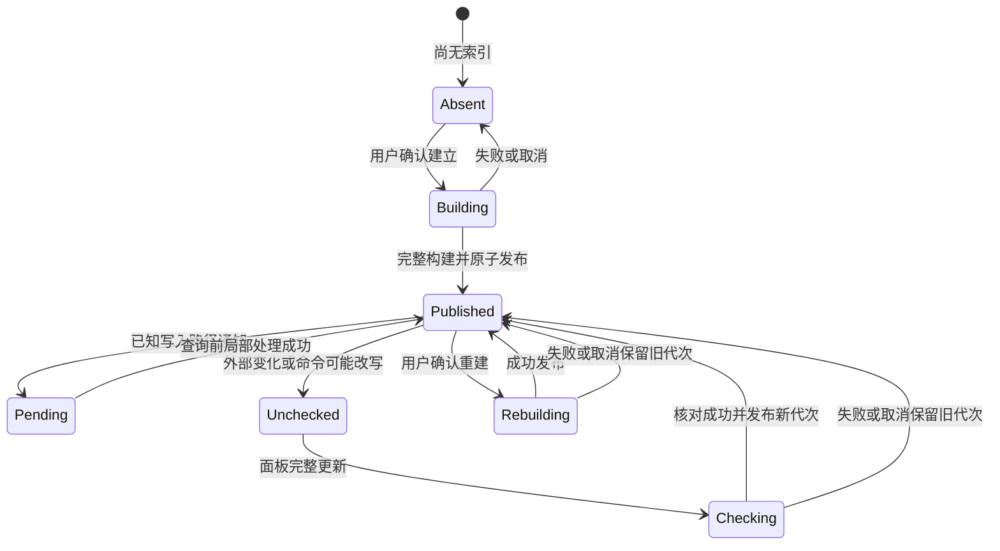
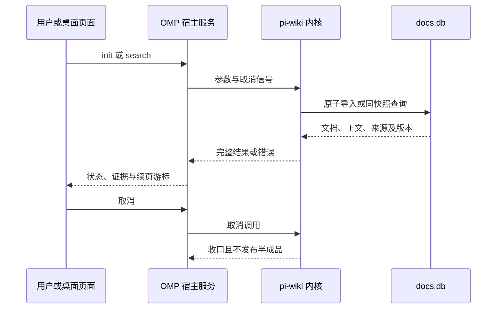

# 仓库索引与 OpenWiki 工作流

本 fork 中“索引”并非单一服务：Repo 为当前 worktree 建立可更新的代码定位数据库；Wiki 将用户显式导入的 Markdown 快照持久化为文档库；OpenWiki 则负责知识页资源、依赖和生成工作流，不是 Repo 数据库的另一种视图。三者入口和更新语义不可互换。运行时入口与工具边界另见[运行时架构](../architecture/runtime.md)、[工具与扩展](../concepts/tools-extensions.md)及[ZCode 集成](../integrations/zcode.md)。

## 三类状态与所有权

| 子系统 | 目的与主要入口 | 持久化和数据新鲜度 | 更新/删除 |
| --- | --- | --- | --- |
| Repo | `/repo` 面板、只读 `repo` 工具、ZCode Repo 专页；文本搜索、Python 定义定位、状态 | 用户 profile 下按规范化根目录隔离的 SQLite；Git 项目以当前 worktree 为范围。保存文件类别、指纹、原文及 Python 符号 | 首次建立需用户确认；已知变更可增量处理，面板更新完整枚举核对；失败/取消不发布新代次。删除只删索引 |
| Wiki | `/wiki`、只读 `wiki` 工具、ZCode Wiki 专页；查询 Markdown 证据 | profile 的 `docs.db`；保存导入时的 Markdown、路径、行号和版本身份，查询从库读取而非回读源文件 | 仅 `omp docs init` 新建与 `omp docs remove <name> --force` 删除；刷新是 remove 后 init，无 update/rebuild 命令。全文原子发布，取消/失败不留可见半成品 |
| OpenWiki | OpenWiki 工作流及桌面桥接；生成、维护知识页及其资源依赖 | 由 `crates/pi-wiki` 与 `packages/coding-agent/src/openwiki` 所代表的 Wiki 内核/宿主资源层承载；与 Repo 源码索引分离 | 资源指纹/依赖用于识别变更；生成/更新不能等同于 Repo 完整核对，页面证据通过工作流提交 |

Repo 和 Wiki 的 SQLite 数据、命令及查询语义彼此独立。Repo 不产出 Markdown 知识页、调用图或影响分析；Wiki 不监视源目录，也不会在搜索时自动同步或补算向量。OpenWiki 面向页面资源和证据维护，不应被称作“自动更新 Repo 索引”。

## Repo 生命周期：通知增量与完整核对

Repo 首次建库由人确认目标根目录；AI 的只读查询不触发建库。成功的 OMP 文件编辑、新建、删除、重命名（含实际落盘的 LSP 修改）通知变更路径，在下一次 search/symbol 前合并处理；预览、拒绝和未执行操作不是成功写入。任意实际执行的 bash/eval 则只能标记可能影响范围未核对，不从命令文本猜路径；异常、超时、中断及后台任务结束也需保留该提示。外部编辑不保证立即发现。完整“更新”读取当前纳入范围文件并以内容指纹核对，因此可发现同大小同时间戳修改及未跟踪新增；未改变文件不重复解析。

此图概括 Repo 的公开代次和覆盖状态转换；失败回到旧的可用索引而非半成品。特别是未核对状态不会被一次查询悄悄解释为完整覆盖。

目录枚举采用严格错误模式：不可读目录令整次构建/核对失败，报告路径与原因，不得跳过后声称覆盖完整。读取竞争、文件清单变动、取消、损坏库或 schema 不兼容也不能公开半成品；损坏恢复通过面板重建。强杀留下的未发布构建在后续取得维护锁时回收。查询期间若维护锁存在，仍读取当前已发布代次并提示 pending/unchecked，而非等待整次维护或读构建中数据。游标绑定动作、查询、路径及代次，代次改变需重新查询。

文本索引覆盖适用的源码、测试、配置等文本；Tree-sitter 提取 Python 模块/类/函数/方法定义和签名，语法失败仍保留文本候选但清除过期符号。索引只提供候选定位，不等于访问控制、完整 grep 或语义关系分析。路径过滤限定索引根内相对路径。

## Wiki 导入、查询与取消

Wiki 的源 Markdown 由 `omp docs init "<dir>" --name "<name>"` 显式导入，`crates/pi-wiki` 承担 Rust 索引内核职责，宿主服务把查询和取消交给该内核。导入只收录符合约定的 Markdown 普通文件，结果保存至 `docs.db`；导入后即使源目录消失，搜索正文和引用仍从数据库快照提供。重新导出文档需先 remove 再 init；删除数据库索引不删除源文件。

全文是基本能力；普通 search 在 Embedding 与有效向量代际可用时融合全文/语义候选，并可在独立 Reranker 可用时有限调整排序。缺少或失败的可选模型路径回退到完整全文结果；取消不是模型故障，不可伪装成全文成功。显式 grep 则扫描库内原始 Markdown，保持正则语义且不调用模型。查询分页游标绑定查询条件、语料版本及实际排名上下文；正文与来源来自同一读快照。无索引、零命中、非法查询、数据库错误和取消是不同结果，不可混为“没有知识”。

此序列展示宿主路由、Rust 内核和数据库的边界；页面关闭或上下文切换时，桌面调用必须取消自有工作并丢弃迟到结果。

## OpenWiki 与桌面桥接

`packages/coding-agent/src/openwiki` 中的资源模型、资源指纹、资源依赖与 vendor contract/loader 属于 OpenWiki 页面资源和宿主桥接；它们不是 Repo SQLite 的表或 Wiki `docs.db` 的别名。`crates/pi-wiki` 提供 Markdown 文档索引核心，ZCode 页面复用 OMP 已有服务与执行端 profile，而不是由 GUI 自行另建数据库或实现第二套检索。Repo 专页与 Wiki 专页相邻但操作各归其主：Repo 提供建立、更新、重建、删除及代码查询；Wiki 提供导入、删除、全文/融合查询及正文证据。远端执行端必须使用远端路径与数据库身份，切换 workspace/profile 后迟到响应不得污染新页。

桥接应维持既有 ZCode 协议兼容：新增能力通过可选能力发现，不重定义既有方法、字段或信封；Host 负责路由，页面持有输入与展示状态。维护和查询非阻塞，取消、页面关闭、profile/workspace 切换均须终止自身请求。确认建立、重建、删除时呈现真实完整目标；状态页区分缺索引、零命中、覆盖缺口、失败和数据库故障。

## 更新选择与故障判断

- 代码编辑成功且路径已知：Repo 增量维护即可；任意 shell 命令、外部编辑或忽略规则变更：将索引视为可能未核对，必要时做完整更新。
- Repo 更新需发现所有外部变化：选择面板完整核对，而非普通查询；需要修复旧解析器遗留符号缺失时用重建。
- Wiki 文档变更：显式 remove → init；不要寻找不存在的 update 命令。模型不可用只影响可选语义/精排能力，不应阻断已成功全文导入。
- OpenWiki 页面资源变化：按资源依赖/指纹进行页面工作流更新，不把它当成源码数据库 refresh。
- 失败或取消：检查旧代次/旧证据是否仍可读，并查看未核对提示；不要将“操作失败”报告为已成功更新，也不要将正常零结果报告为查询故障。

## 聚焦验证

Repo 的 `packages/coding-agent/test/repo-lifecycle.test.ts` 适合核验成功编辑通知、索引代次、更新与失败保留行为；`packages/coding-agent/test/openwiki` 覆盖 OpenWiki 工作流边界。Wiki 内核的生命周期、数据库快照、导入回滚和分页取消应针对 `crates/pi-wiki` 测试；桌面验收则必须真实经过 ZCode 页面验证切换目标、取消、完整证据和错误状态，而不能以单测或 TUI 证据替代 GUI 验收。
