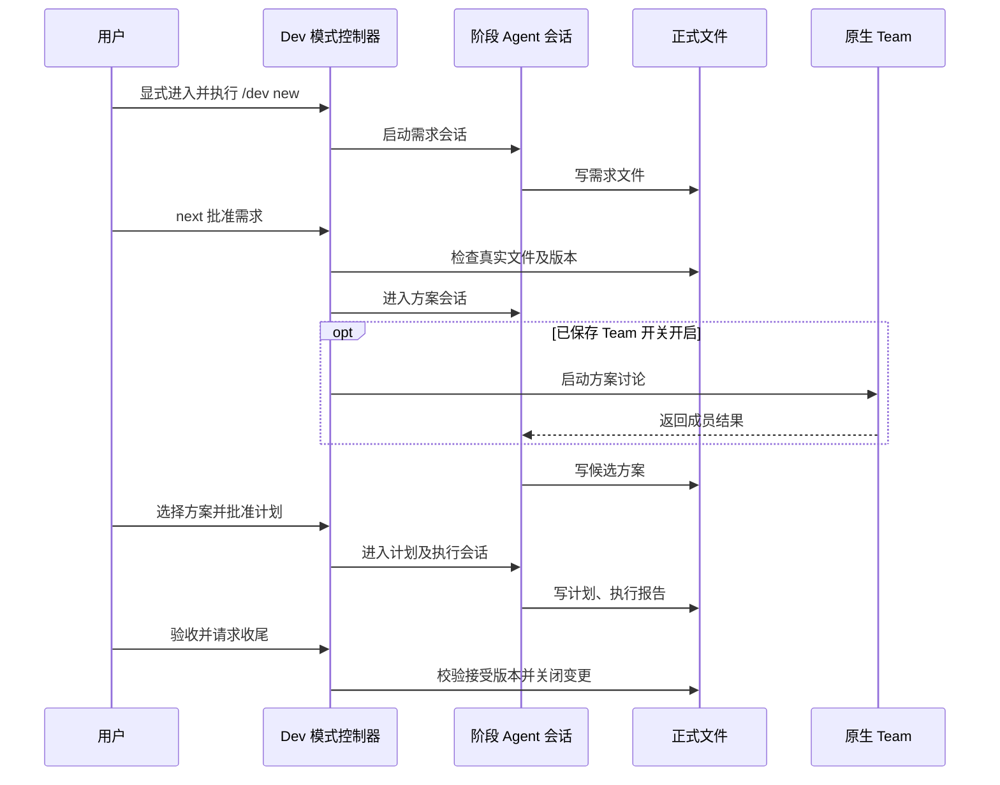

# 目标、Team 与规格驱动编排

这些能力不是互相替代的“另一套 Agent”：Goal 是当前会话的目标运行模式；Team 是原生任务协作；Dev 是在明确进入后运行的四阶段工作流。共同原则是沿用原生会话与任务生命周期，让各自控制器只拥有编排所需状态，不能把“正在跑”“文件已生成”误当作用户批准或软件验收。会话基础见[会话](../concepts/sessions.md)，工具与扩展边界见[工具与扩展](../concepts/tools-extensions.md)，Zcode 入口见[集成：Zcode](../integrations/zcode.md)。

## Goal：当前会话中的持续目标

Goal Runtime (`packages/coding-agent/src/goals/runtime.ts`) 通过宿主适配器读取和设置当前 `GoalModeState`，发出 `GoalRuntimeEvent`，持久化 `goal`、`goal_paused` 或 `none`，并向会话发送隐藏控制消息。它不另建会话：活动目标由当前会话的原生状态承载，提示词把目标、使用量及剩余预算送入当前 Agent 的后续轮次。目标结束、暂停、继续与预算限制仍属于 Goal 原语语义。

运行时在 turn 边界保存 token 使用基线并按目标归属核算；token 预算包含新增 input、cacheWrite 和 output，排除复用的 cacheRead。墙钟时间与 turn 用量均纳入状态。预算耗尽会进入预算限制路径而非伪报完成；提示模板区分 active、continuation、budget-limit，并可在工具恢复场景要求处理恢复。无预算时视为不限制 token。预算必须为正整数。

fork 的 Dev 不会替用户创建或管理 Goal：进入执行阶段、批准计划或恢复流程都不启动 Goal。用户只能在执行会话中显式启用原生 Goal，且它不解除已批准范围、验收或收尾限制。

## Team：任务协作而非外层阶段

Team 复用原生 `task` 派生的成员会话及既有并发配置。`team/orchestrator.ts` 与 `controller.ts` 编排成员和讨论，`runner.ts` 连接任务运行，`report.ts` 汇总结果；配置与成员类型由 `config.ts`、`members.ts` 等模块承担。主会话仍是调用 Team 的 Agent；成员结果是调查输入，不能代替主 Agent 决定方案或代用户批准。

Dev 对 Team 的使用范围刻意收窄：只有用户通过 `next` 批准需求并成功进入方案阶段，且已保存 Team 开关开启时，方案 Agent 才启动一次讨论。它以已批准需求、原始用户决定和本轮反馈为上下文，随后由方案 Agent 根据结果写正式候选。主聊天不切换成员，普通输入不广播。关闭配置则方案 Agent 独立工作。

Team 不可用、配置不完整、成员失败或取消、没有可用候选等情形必须如实阻塞并显示原因，不得静默降级后声称协作成功。失败/取消后若要重新讨论，先结清本次任务，再经 `back` 回需求并重新 `next` 进入方案；没有同阶段 Team 重试按钮或自动重派。方案阶段普通追问、查看配置、恢复会话、回退本身均不重跑讨论。配置改动须显式保存，未保存的勾选不触发工作。

## Dev：四阶段、原生会话和正式产物

Dev 是 fork 的规格驱动差异，不等同于独立 OpenSpec。用户先显式进入 Dev，再通过 `/dev new <需求内容>` 建立流程；进入模式、恢复状态或保存配置均不得启动模型、Team 或 Goal。它固定四个 Agent 角色及阶段：需求、方案、计划、执行。同一时刻只有一个活动阶段 Agent；每个角色对应可持续、可恢复的原生 SDK 会话，保存的运行记录只存阶段、路径、审批及会话引用等必要信息，对话文本仍由原生 session 文件拥有。

| 阶段 | 正式产物 | 推进门槛 |
|---|---|---|
| 需求 | `proposal.md` 与每个受影响能力的增量 `spec.md` | OpenSpec 真实文件及原生结构有效，用户明确批准 |
| 方案 | 候选方案 JSON（含候选及推荐） | 文件结构有效，用户明确选择 |
| 计划 | Superpowers 格式的 Markdown 计划 | 文件有效，用户明确批准计划 |
| 执行 | 完成报告 Markdown | 真实执行及验证结果如实报告，随后仍由用户验收 |

正式文件集中在变更目录或方案/计划目录；运行状态不是额外交付文件。正式需求权威仍是 `openspec/specs/`，Dev 使用包内 `omp-spec`，避免与其他 Markdown 权威并存。独立 OpenSpec、Superpowers、普通会话和原生 task/reviewer 保留各自语义；Dev 不增加第五阶段或逐任务状态机，不强制提交。

该图展示 Dev 的用户批准驱动阶段转换；Team 只在方案阶段内部调用，并不取代方案 Agent。

## 状态、批准与失败语义

`spec-driven/stages.ts` 区分阶段（`idle`、`requirements`、`solution`、`planning`、`executing`）与产物阶段；接受和收尾是执行事实，不是额外阶段。控制器/编排器负责转换，runtime 提供当前状态与保存运行记录，actors 通过 Agent 端口连接原生会话，artifacts 负责文件初始化、读取、版本检查及关闭。批准记录包含文件版本，而不是仅记“曾点过批准”。

用户执行 `next` 才触发阶段检查：读取真实路径和完整内容、非空性、格式/最低字段、所依赖的批准版本以及调用是否结清。文件存在、Agent 口头称完成、自然语言材料或本地提交都不构成批准。任一检查失败，阶段、会话、输入、附件及文件保留，给出具体阻塞原因，不越级推进。文件在批准后变更时，版本检查使其失效并要求重审；接受需求与选定方案也不会授权实施。

执行阶段的计划与项目规则仍约束 Agent。用户可在执行会话自行使用 Goal，但 Goal 不能绕开审批版本；执行完成不等于用户验收。验收后的关闭/归档是独立收尾动作，并按接受版本执行；不能把报告存在、测试通过或 OpenSpec 归档解释成软件正确性证明。停止执行、退出或丢弃时须沿原生生命周期结清自有任务和 Goal，不得在停止后自动续轮。

## 观测与排障

桌面侧通过 Zcode 的模式交互、阶段状态和 Team 运行视图呈现控制器结果；这里的状态是对底层会话/任务/产物的观察投影，不是另一个状态所有者。诊断时分别检查：当前会话是否活动/暂停、任务是否仍运行或已结清、Dev 阶段和阻塞理由、批准版本与磁盘文件是否一致。不要通过重启 Team、手工改运行记录或跳过 `next` 修复状态。

## 测试关注点

针对机制变更，应优先运行 `packages/coding-agent/test/spec-driven` 与 `packages/coding-agent/test/team` 中对应测试。Spec-driven 测试应覆盖显式启动、四阶段转换、真实文件与版本门禁、批准/回退、恢复引用、取消与收尾；Team 测试应覆盖配置保存、成员并发/结果汇总、错误取消与任务结清。Goal 变更另核对 `packages/coding-agent/src/goals` 的预算、暂停继续和事件持久化测试。测试证明编排规则，不证明业务软件正确。
