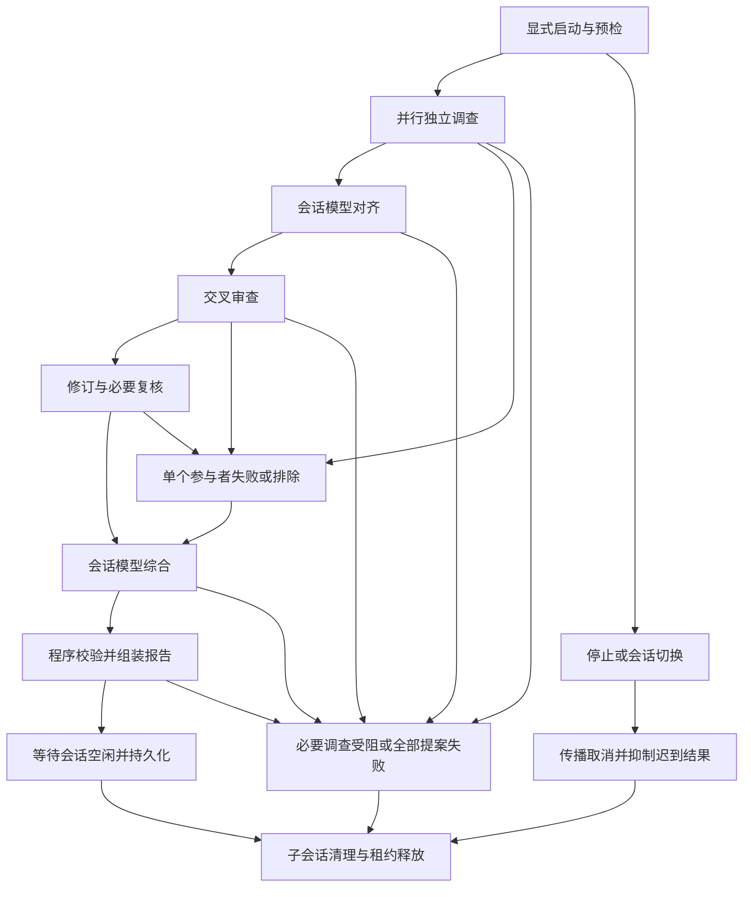

# Team 配置与只读协作

Team 是以多次独立子代理调用调查、比较和审查问题的只读讨论，而不是自动实施方案的工作流。独立入口是聊天命令 `/team …`；成员设置只决定将来运行的模型和顺序，保存或预览配置都不会启动讨论。选择最终方案也只确认方案及其验收标准和执行前检查；要修改代码必须另行明确要求。涉及影响选择的需求理解差异时，应先回答差异并带答案重跑。

## 配置与启动门槛

`team.members` 是有序的 `provider/modelId` 字符串数组，允许重复。显式成员逐项严格解析为当前可用且符合 `enabledModels` 的模型，不可用项不会被悄悄丢弃；空字符串、非字符串也会报出具体配置问题。模型须支持聊天工具和结构化 yield。当前会话模型即使不在显式名单中，也必须可用且具备能力：它负责对齐与综合，不会被自动追加到显式名单。空或未设置名单使用会话模型。对长度为 M 的有效名单，按顺序循环扩展到 `max(3, M)` 个独立提案槽位，重复模型仍是不同子会话。可用模型可通过 `omp models` 检查。

配置服务区分用户值、按设置优先级投影的有效值、来源、问题和参与者预览。模型目录查询显示不可选择原因，包括未认证、禁用或能力不足；查询不刷新 provider。预览可保留原始选择器用于诊断，而保存只接受目录中真实的 `{provider, modelId}` 身份，不能使用通配符、`auto` 或搜索别名。保存仅允许 `user` scope，要求 `expectedRevision` 以检测并发修改；`members: null` 表示移除用户覆盖。保存后重新读取并报告写入结果与有效值是否匹配：高优先级配置仍可能覆盖它，存储无效或不可读也不应误认为可运行。配置上下文已切换时服务拒绝过期操作。详见[配置与模型](../concepts/configuration-and-models.md)。

独立 `/team` 还要求会话 async job manager 可用且能注册任务；达到后台任务上限时先等待或通过 Agent Hub / `hub cancel` 取消已有任务。控制器在注册前捕获模型、目录、工件与事件总线，使用 job 的取消信号贯穿各调用。状态进度和子代理详情分别进入 job/status 与 Agent Hub。

## 讨论与报告生命周期

图：主要阶段、部分失败与终止路径；清理也发生在各子调用结束时，而非仅在整次讨论结束时。

1. **独立调查**：各提案者得到相同问题与工作目录，互不共享摘要，并在 `task.maxConcurrency` 信号量下并发运行。必要调查受阻或所有提案失败会使整体失败；自报没有可行方案的记录仍供比较，但不作为最终选项。
2. **对齐与交叉审查**：对齐由会话模型的新子调用执行。审查者按提案顺序轮换到下一个不同模型；没有不同模型时使用同模型的新子代理，绝不是由主会话 Agent 自己审查。审查失败的方案不能作为最终选项；所有必要审查都失败则整体失败。
3. **修订与复核**：每个方案最多两轮，互不依赖地并发处理。仅结构化标志表明核心设计变化、声称解决阻断、新证据改变假设或争议阻断问题时触发复核。阻断问题有稳定 ID，只有完整且有依据的审查者决议能关闭；作者声称已解决不够。必需复核失败时当前修订版本不可采用，后续成功复核可恢复资格并保留历史失败记录。
4. **综合和报告**：会话模型的子调用综合可用记录，代码依据结构化跟踪生成采用状态；未解决阻断、轮次上限或未完成复核不能被模型推荐覆盖。无效推荐被丢弃；正文与机械状态冲突或输出合同不合规则整体失败，不发布半成品结论。综合还可将确认的硬约束违例加入阻断。报告包含参与不完整的说明，并以固定选择合同收尾。

提案、审查、修订的局部失败可被记录并允许其他参与者继续；对齐、综合或报告组装失败则终止。每次调用需通过严格结构化输出与阶段解析；候选携带 run 身份、内容版本、证据和采用资格，不能把自然语言推荐当成授权。

## 执行隔离与清理

真实 runner 直接调用 `runSubprocess`，**不是**主 Agent 调用原生 `task` 工具。它以 `modelOverride` 绑定每个调用的确切模型，并核对实际解析身份；模型不匹配、子进程错误或无效结构化输出都作为调用失败。每个子调用使用新会话和严格 schema；Team 不设置通用子代理墙钟时限，但仍可能遇到执行器请求预算或其他内部终止。

只读是程序边界，不只是提示词：工具白名单为 `read`、`grep`、`glob`、`knowledge_search`、`ast_grep`，执行器另提供必需的 `yield`；`restrictToolNames` 禁止自动扩展，且关闭 LSP、IRC、MCP 和跨 Agent 读取。没有 `bash`、`edit`、`write`、`task` 或 `hub`。工作区额外授权目录仍传递给子代理；隔离根阻止读取其他子调用工件。普通 Team 不向子代理传入 `AGENTS.md` 上下文文件，受限工作流可显式保留既有上下文。

每次调用取得工件租约：有 `.jsonl` 会话文件时使用其同名兄弟工件目录并保留以供审计；否则使用临时目录，结束后删除。执行器若将超时的子会话 disposal 延后，临时目录也延后到清理完成才删除，避免与打开的句柄竞争。会话切换会取消旧 job，并过滤旧会话迟到的进度、事件与交付，避免污染新会话。

独立运行完成后，控制器等待会话不再 streaming，再用 `appendCustomMessage` 将 `team-result` 作为可见持久消息写入，而非作为模型下一轮输入。失败可持久化失败说明；取消不发布成功报告。完整聚合结果也保存在 job 中，可通过 `proc://` 读取以恢复交付失败的结果；持久化后的 UI 回调失败不撤销已写入的报告。

## Dev 与原生 task 的边界

Dev 的方案阶段可显式启用 Team：Dev runtime 在 solution 入口检查已批准版本，复用成员解析、runner 和 orchestrator，再把成功且至少有一个可采用候选的结果交给方案角色。它由 Dev 的阶段上下文和取消信号拥有，而非独立 `/team` 的后台 job 或配置保存触发；批准版本变化或讨论无可采用候选会阻断该阶段。后续需求、方案、计划和实施的门槛见 [Dev 生命周期](dev-lifecycle.md)。原生 task 与 Team 共享底层子进程执行设施和并发设置，但 Team 自己拥有五阶段编排、只读工具集和审查门槛；一般工具执行边界见[工具与执行](../architecture/tools-and-execution.md)。

## 验证与维护线索

<!-- openwiki: broken internal link [../../packages/coding-agent/test/team] file "../../packages/coding-agent/test/team" does not exist. Fix the href or restore the target, then delete this comment. -->
重点回归位于 [`test/team`](../../packages/coding-agent/test/team)：`members.test.ts` 覆盖名单展开与模型预检，`config.test.ts` 覆盖配置读写与预览，`orchestrator.test.ts` 覆盖轮换、阻断和失败，`runner.test.ts` 与 `read-isolation.test.ts` 覆盖绑定、清理及隔离，`controller.test.ts` 覆盖取消和报告交付。并行审查回归另见 [`parallel-review-TeamDiscussion-regression.test.ts`](../../packages/coding-agent/test/parallel-review-TeamDiscussion-regression.test.ts)。变更报告合同、工具集合或生命周期时，应同时检查这些测试与 [Team 讨论规范](../../openspec/specs/team-discussion/spec.md)。
