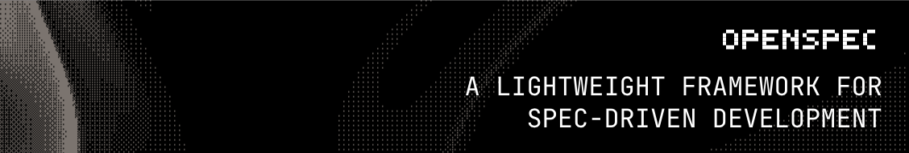
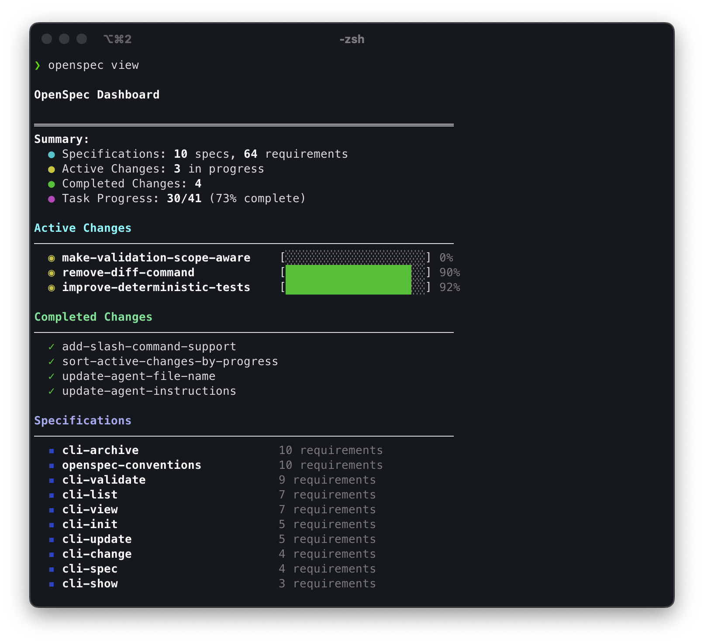

<p align="center">
  <a href="https://github.com/Fission-AI/OpenSpec">
    <picture>
      <source srcset="assets/openspec_bg.png">
      
    </picture>
  </a>
</p>

<p align="center">
  <a href="https://github.com/Fission-AI/OpenSpec/actions/workflows/ci.yml"></a>
  <a href="https://www.npmjs.com/package/@fission-ai/openspec"></a>
  <a href="./LICENSE"></a>
  <a href="https://discord.gg/YctCnvvshC"></a>
</p>

<details>
<summary><strong>The most loved spec framework.</strong></summary>

[](https://github.com/Fission-AI/OpenSpec/stargazers)
[](https://www.npmjs.com/package/@fission-ai/openspec)
[](https://github.com/Fission-AI/OpenSpec/graphs/contributors)

</details>
<p></p>
Our philosophy:

```text
→ fluid not rigid
→ iterative not waterfall
→ easy not complex
→ built for brownfield not just greenfield
→ scalable from personal projects to enterprises
```

<p align="center">
  Follow <a href="https://x.com/0xTab">@0xTab on X</a> for updates · Join the <a href="https://discord.gg/YctCnvvshC">OpenSpec Discord</a> for help and questions.
</p>


## See it in action

```text
You: /skill:openspec-explore
AI:  What would you like to explore?
You: I want dark mode but I'm not sure how to do it cleanly.
AI:  Let me look at your styling setup...
     Cleanest path here: CSS variables + a small theme context,
     with system-preference detection. No new dependencies. Scope it?
You: Yes, let's do it.

You: /skill:openspec-propose add-dark-mode
AI:  Created openspec/changes/add-dark-mode/
     ✓ proposal.md — why we're doing this, what's changing
     ✓ specs/       — requirements and scenarios
     ✓ design.md    — technical approach
     ✓ tasks.md     — implementation checklist
     Ready for implementation!

You: /skill:openspec-apply-change
AI:  Implementing tasks...
     ✓ 1.1 Add theme context provider
     ✓ 1.2 Create toggle component
     ✓ 2.1 Add CSS variables
     ✓ 2.2 Wire up localStorage
     All tasks complete!

You: /skill:openspec-archive-change
AI:  Archived to openspec/changes/archive/2025-01-23-add-dark-mode/
     Specs updated. Ready for the next feature.
```

<details>
<summary><strong>What do the specs actually look like?</strong></summary>

Plain Markdown — requirements with concrete scenarios, no special syntax to learn. Here's what goes in the `specs/` folder created above:

```markdown
## ADDED Requirements

### Requirement: Theme selection
The app SHALL let users switch between light and dark themes,
defaulting to the system preference.

#### Scenario: User toggles dark mode
- **WHEN** the user clicks the theme toggle
- **THEN** the app switches to dark mode and persists the choice
```

Your AI writes these; you review the plan before any code is written.

OpenSpec is built with OpenSpec — browse the upstream [specs](https://github.com/Fission-AI/OpenSpec/tree/ea635dd255f8686dcf48626bbcbe0e3fd59b6067/openspec/specs) and in-flight [changes](https://github.com/Fission-AI/OpenSpec/tree/ea635dd255f8686dcf48626bbcbe0e3fd59b6067/openspec/changes) for real examples at scale.

</details>

<details>
<summary><strong>OpenSpec Dashboard</strong></summary>

<p align="center">
  
</p>

</details>

## Why teams adopt OpenSpec

Solo, OpenSpec keeps you and your AI honest on a single repo. On a team, the hard part moves: a feature spans the API server, the web app, and a shared library; requirements are owned by one team and consumed by others; planning starts before any code exists.

**[Stores](https://openspec.dev/docs/stores)** are the answer — planning in a repo of its own. The same `openspec/` shape you already know (specs and changes), shared by `git push` like anything else. One source of truth your whole team and every coding agent can read, across every repo.

- **Cross-repo features** — one change, one plan, even when the code lands in three repos.
- **Shared requirements** — a platform team owns the specs; product teams reference them read-only, right where their coding agent can read them. No drifting wiki.
- **Plan before code** — capture the plan in the store now; the code repos catch up later.

> Stores are in **beta**. Start with the [Stores guide](https://openspec.dev/docs/stores).

## Quick Start

OMP bundles OpenSpec 2.0.0; no standalone OpenSpec or Node installation is required. After explicitly choosing to initialize your project:

```bash
cd your-project
omp openspec init
```

Initialization creates project structure and configuration only, defaulting to `spec-driven`. It does not install, update, or clean user Skills, Agent settings, or legacy commands.

All 12 OpenSpec Skills are bundled with OMP and use native discovery, completion, on-demand `skill://<name>` reads, and path authorization in any directory. Project/user same-name overrides keep their existing precedence. No profile selection or duplicate Skill installation is needed. Skill discovery does not authorize project initialization.

In OMP chat, start with `/skill:openspec-explore` or `/skill:openspec-propose <goal>`. All terminal operations use `omp openspec ...`. See the local [Skill reference](docs/commands.md) and [setup guide](docs/installation.md), not upstream per-Agent installation instructions.

## Docs

This bundled guide documents the OMP interface. Upstream documentation describes additional standalone integrations that are not shipped here.

→ **[Quickstart](https://openspec.dev/docs/quickstart)**: your first change, start to finish<br>
→ **[Set up your project](docs/installation.md)**: what `omp openspec init` creates<br>
→ **[CLI](docs/cli.md)**: terminal reference<br>
→ **[Supported interface](docs/supported-tools.md)**: native OMP Skill invocation<br>
→ **[Customize](https://openspec.dev/docs/customize)**: profiles, project config, and schemas<br>
→ **[Stores](https://openspec.dev/docs/stores)**: plan in a separate repo, shared across your team (beta)<br>
→ **[Community Showcase](docs/community.md)**: projects and resources built with and for OpenSpec

## Community schemas

Third-party schema bundles distributed via standalone repositories — these provide opinionated workflows that integrate OpenSpec with other tools, similar to how [github/spec-kit's community extension catalog](https://github.com/github/spec-kit/tree/main/extensions) handles tool integrations.

→ **[Browse the catalog](docs/customization.md#community-schemas)** in the customization docs.


## Why OpenSpec?

AI coding assistants are powerful but unpredictable when requirements live only in chat history. OpenSpec adds a lightweight spec layer so you agree on what to build before any code is written.

- **Agree before you build** — human and AI align on specs before code gets written
- **Stay organized** — each change gets its own folder with proposal, specs, design, and tasks
- **Work fluidly** — update any artifact anytime, no rigid phase gates
- **Use your tools** — uses OMP native Skills

### How we compare

**vs. [Spec Kit](https://github.com/github/spec-kit)** (GitHub) — Thorough but heavyweight. Rigid phase gates, lots of Markdown, Python setup. OpenSpec is lighter and lets you iterate freely.

**vs. [Kiro](https://kiro.dev)** (AWS) — Powerful but you're locked into their IDE and limited to Claude models. OpenSpec works with the tools you already use.

**vs. nothing** — AI coding without specs means vague prompts and unpredictable results. OpenSpec brings predictability without the ceremony.

## Updating OpenSpec

Upgrade OMP to update the bundled CLI, schema, and Skills. There is no standalone CLI update or per-project Skill refresh; CLI `update` and legacy `opsx` file commands are removed. `openspec-update-change` remains a Skill for editing planning artifacts. Existing custom schemas such as `mini` and `omp-spec` need an explicit [migration](docs/migration-guide.md); missing design/tasks remain incomplete, and historical archives are preserved.

## Usage Notes

**Model selection**: OpenSpec works best with high-reasoning models. We recommend Codex 5.5 and Opus 4.7 for both planning and implementation.

**Context hygiene**: OpenSpec benefits from a clean context window. Clear your context before starting implementation and maintain good context hygiene throughout your session.

## Contributing

Every change starts as an issue. We discuss it there, and if we agree to pursue it, a maintainer implements the change or invites you to build it with us.

→ **[CONTRIBUTING.md](https://github.com/Fission-AI/OpenSpec/blob/ea635dd255f8686dcf48626bbcbe0e3fd59b6067/CONTRIBUTING.md)**: the full process, from first issue to merged PR

## Other

<details>
<summary><strong>Telemetry</strong></summary>

OpenSpec collects anonymous usage stats.

We collect only command names and version to understand usage patterns. No arguments, paths, content, or PII. Automatically disabled in CI.

**Opt-out (any one is enough):**
- `omp openspec config set telemetry.enabled false` (global config; unset means on)
- `export OPENSPEC_TELEMETRY=0` or `export DO_NOT_TRACK=1` (env overrides config)

</details>

<details>
<summary><strong>Maintainers & Advisors</strong></summary>

See [MAINTAINERS.md](https://github.com/Fission-AI/OpenSpec/blob/ea635dd255f8686dcf48626bbcbe0e3fd59b6067/MAINTAINERS.md) for the list of core maintainers and advisors who help guide the project.

</details>


## License

MIT
